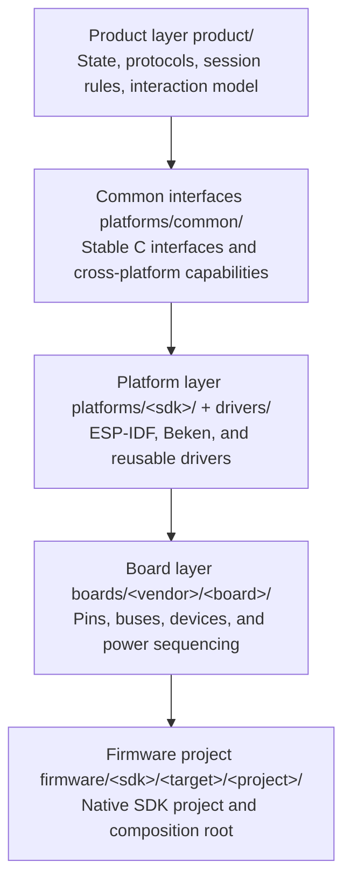
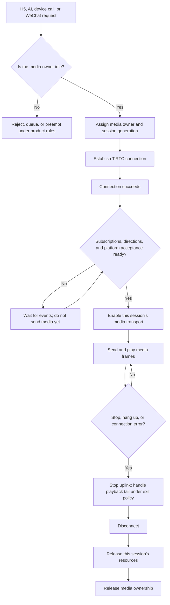
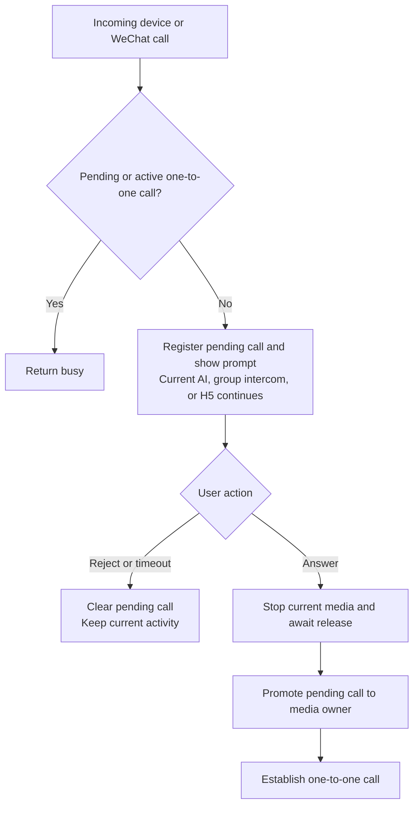

# XiaoTai Architecture and Development

[Quick start](README.en.md) · [Architecture and development](ARCHITECTURE.en.md) · [Contributing](CONTRIBUTING.en.md) · [All documentation](docs/README.en.md)

[中文](ARCHITECTURE.md) · [English](ARCHITECTURE.en.md)

This document explains how XiaoTai deploys shared product capabilities across chips and boards. It introduces the codebase for engineers and provides context for AI development tools before making changes.

The ESP32-S3 and ESP32-P4 projects use **ESP-IDF v5.5.5**, commit `b774170ff46c393eeb5e495ea37936038d3f4f4f`. Before building, run `. tools/activate_esp_idf.sh` from the repository root and verify with `idf.py --version`. The `>=5.5,<5.6` component requirement is a compatibility range, not the selected build version.

Historical compiler versions for third-party SDKs are recorded in their manifests.

## Product capabilities

XiaoTai supports browser-based live view and two-way audio (H5), AI voice conversations, device-to-device calls, and WeChat VoIP calls.

The product layer also manages Wi-Fi setup, binding, contacts, rooms, buttons, touch UI, and session state. Each board variant explicitly selects its display, camera, and interaction capabilities; code must not infer them from the chip name.

## Layers

The arrows show how shared product logic is composed into a specific firmware project.

`product/` determines the current product state and allowed transitions. It does not directly control GPIO, direct memory access (DMA), or specific audio devices.

`platforms/` maps stable C interfaces to each chip's software development kit (SDK). It defines the boundaries for networking, threads, memory, and media transport. Board-specific pins remain in board code.

`boards/` describes specific hardware. Two boards using the same chip still need separate registrations because their displays, touch controllers, audio, power sequencing, and flash layouts may differ.

`firmware/` contains the composition roots. ESP-IDF and Beken remain separate SDK projects. The root `tools/build.py` selects one board and one variant, then dispatches to the native build command.

Shared Beken sessions, platform protocols, and media implementations live in `platforms/beken/runtime`; shared build tooling and SDK patches live in `platforms/beken/tools`.

The LCKFB and MGKFB BK7258 boards retain independent native projects, application-core (AP) and communication-core (CP) configurations, entry points, partitions, and build counters. Their respective `boards/` adapters manage GPIO and power. The MGKFB project does not take source files from the LCKFB native project.

New boards and platforms must follow these directory and manifest boundaries and provide the materials, tests, and hardware evidence required by [Contributing](CONTRIBUTING.en.md).

## Directory guide

The root contains cross-platform entry points and public documentation. Native SDK projects remain independent; shared product logic uses stable C interfaces instead of merging vendor projects solely for reuse.

| Directory or file | Purpose |
|---|---|
| `README.md` | Firmware downloads, board selection, flashing, and quick start |
| `ARCHITECTURE.md` | Product architecture, directory boundaries, and development entry points |
| `product/` | Shared session arbitration, contacts, rooms, and interaction state |
| `platforms/` | ESP-IDF, Beken, and other platform adapters and common C interfaces |
| `drivers/` | Reusable device drivers that do not own product state |
| `boards/` | Board manifests, hardware configuration, and build selection |
| `firmware/` | Independent native firmware projects and composition roots |
| `tools/` | Build, packaging, validation, and automated test entry points |
| `tests/` | Host tests, contract tests, and test utilities |
| `docs/` | User and developer guides, internal product specifications, and technical records |

Three directories are local only: `.tools/` for compilers, vendor SDKs, and Python environments; `.references/` for schematics, datasheets, vendor examples, and reference SDKs; and `output/` for explicitly exported artifact copies.

Native builds and default packages remain in each project's `build/` and established configuration directories. See [Firmware versions and releases](CONTRIBUTING.en.md#firmware-versions-and-releases). These local directories are ignored by `.gitignore` and must not become implicit source dependencies.

Repository documentation records public download locations, versions, and SHA-256 checksums. Hardware links must use official board-provider or component-vendor sources. If no URL is known, leave the link empty and mark the material as unavailable; do not guess URLs or use local paths.

Downloaded schematics, manuals, and vendor examples belong in `.references/`, not in `evidence/` or other tracked directories. Project hardware findings and on-board validation records remain in board documentation and Hardware IR, with references to third-party sources.

## Session and media lifecycle

Only one media owner may exist at a time. H5, AI, device calls, and WeChat calls must use the product runtime rather than independently taking over the microphone, speaker, or TiRTC connection.

The diagram covers a session from request to release. Media readiness is a separate step and must not be skipped after a successful connection callback.

This describes session media admission. Hardware capture for wake detection or pre-recording may already be running. On normal AI completion or remote closure, drain received audio according to the exit policy; user cancellation and timeout exits have separate handling.

A successful connection does not mean uplink may start. Code must distinguish transport connection, platform acceptance, subscriptions, and the actual first frame. Every callback must check the session generation so that an old connection cannot release a new session's resources.

Incorrect stream IDs, unreported capabilities, or premature transmission can cause one-way silence. Incorrect release order can cause abnormal task termination or access to freed buffers.

## Service entry and session priority

Priority is not a single ordered list: receiving a call and taking media ownership after the user answers are separate phases. The product runtime enforces the following rules; UI and platform adapters must not bypass them.

| Scenario | When requested | After confirmation or admission |
|---|---|---|
| H5 live view | Accept only when media is idle and group intercom is inactive | Acquire ownership; reject during AI, group intercom, or a one-to-one call |
| AI conversation | Start from an explicit button, touch, or wake intent | End replaceable lower-priority activity, then acquire ownership |
| Group intercom | Enter on user action or restore under product rules | Reject H5 while owning media; restore the desired room state after higher-priority activity |
| Device or WeChat call | Register one pending call and show a prompt; do not stop current activity | On answer, stop current media, release resources, then enter the one-to-one call |

Device and WeChat calls share one first-come, first-served pending slot. Later calls receive busy while a call is pending or a one-to-one call is active. An incoming-call prompt does not own the microphone, speaker, or TiRTC connection. Only answering triggers media handover.

The full contract is in [Product requirements: state priority (Chinese)](docs/product/PRODUCT_REQUIREMENTS.md#5-状态优先级). The shared runtime represents the two phases with a pending slot and a media owner. Product tests cover these rules.

## Audio and video contract

The product uses fixed logical stream IDs, which platform adapters map to TiRTC:

| Feature | Device uplink | Device downlink |
|---|---|---|
| H5 live view and two-way audio | Audio 10, video 11 | Audio 14, video 15 |
| Device call | Audio 10, video 11 | Audio 10, video 11 |
| WeChat VoIP | Audio 0, video 1 | Audio 0, video 1 |
| AI conversation | Audio 1 | Audio 1 |

Media parameters depend on both board capabilities and session type. For example, BK7258 H5 audio uses mono A-law at 8 kHz, with 20 ms and 160 bytes per packet. AI hardware processing stays at 16 kHz; uplink uses A-law at 16 kHz and downlink uses Opus at 16 kHz, both mono with 20 ms frames.

Video settings also vary. BK7258 H5 uses H.264 at 640×480 with a target of 20 fps; Waveshare ESP32-P4 H5 uses H.264 at 1280×960, targeting 20 fps and 3 Mbit/s. Encoded dimensions differ from display dimensions after receiver-side rotation. Other boards may use MJPEG, a stream of independently encoded JPEG frames.

Exact codecs, packet sizes, resolutions, frame rates, and bitrates are maintained in the [Media contract (Chinese)](docs/product/MEDIA_CONTRACT.md). Media changes must update implementation, capability reporting, and that contract together.

After coming online and completing service discovery, the device reports capabilities per scenario: `stream` for H5 live view and two-way audio, `call` for device calls, and `voip` for WeChat calls. Each reports uplink and downlink formats, sample rates, channels, orientation, and video support separately.

One scenario's settings cannot substitute for another's.

Successful capability reporting does not mean media is ready. The runtime still waits for connection, platform acceptance, and subscriptions. Every frame must match the reported and negotiated format.

Integration follows the [Thing Connect API](https://github.com/tangeai/tirtc-server-example/blob/main/thing-connect/api-reference.md), [TiRTC documentation](https://docs.tange.ai/products/tirtc/), and [WeChat VoIP device integration guide](https://docs.tange.ai/products/wxvoip/guides/device-integration.html).

## Acoustic echo cancellation

Acoustic echo cancellation (AEC) operates on decoded pulse-code modulation (PCM) samples, independently of whether network audio uses A-law or Opus. Actual speaker PCM supplies the reference signal; microphone PCM supplies the near-end signal. The result then enters the encoder.

Reference and microphone frames must have matching sample rates, channel counts, and lengths, with compensation for speaker, DMA, and queue delays. Keep statistics for missing reference data, reference backlog, and processed frames to distinguish algorithm issues from media timing issues.

AEC capabilities are documented for ESP32-P4, LCKFB ESP32-S3, M5Stack CoreS3-Lite, and BK7258 paths. Board manifests are build metadata; hardware materials and on-board reports remain the evidence for hardware conclusions.

## Boards, variants, and evidence

Register each board in `boards/<vendor>/<board>/board.json`. A build selects exactly one board ID and one explicit variant. Variants describe interaction layouts or feature combinations; they must not mix pin assignments from different hardware.

The project distinguishes three kinds of facts:

- Manifest facts: build entry points, SDK names, variants, and capability tags.
- Hardware facts: GPIO, devices, buses, power, and schematic sources.
- Validation facts: tests completed on hardware with a specific source revision and firmware.

`board.json` establishes build selection, not correct wiring. Hardware findings must reference Hardware IR or probe reports. On-board conclusions must identify the source commit, firmware SHA-256, and tested scope.

## Development paths

### Change product behavior

Start with states and interfaces in `product/` and determine whether behavior is shared across platforms. Platforms implement capabilities; they do not duplicate contact ordering, session arbitration, or page business rules.

Before changing UI, buttons, voice controls, or user flows, read [Interaction profiles (Chinese)](docs/product/PRODUCT_INTERACTION_PROFILES.md). Interaction adapters emit intents and render a view model; the product runtime owns business state.

### Add a board for an existing chip

Follow [Adding a board](CONTRIBUTING.en.md#adding-a-board). Prepare the model, PCB revision, schematics, component list, pins, power sequencing, and physical board. Reuse existing platform adapters and add only board facts and required drivers.

### Add a chip platform

Follow [Adding a chip platform](CONTRIBUTING.en.md#adding-a-chip-platform). Create an independent SDK project first, then implement the stable platform interfaces. Do not embed the new SDK inside an existing ESP-IDF or Beken project.

Manual and AI-assisted development follow the same evidence, testing, and board boundaries in [Contributing](CONTRIBUTING.en.md).

## Validation

Validation has three layers:

1. Static checks and host unit tests for manifests, interfaces, documentation, and pure business logic.
2. Full native SDK builds for dependencies, linking, and firmware artifacts.
3. Hardware-in-the-loop (HIL) tests for display, touch, audio, camera, networking, and complete product flows.

A successful build does not replace hardware validation, and a valid manifest does not replace schematic evidence. See [Testing](tests/README.en.md) for entry points and reporting conventions.

## Further reading

- [Contributing](CONTRIBUTING.en.md)
- [Board directory](docs/boards/README.en.md)
- [Testing and hardware validation](tests/README.en.md)
- [Glossary](docs/glossary.en.md)
