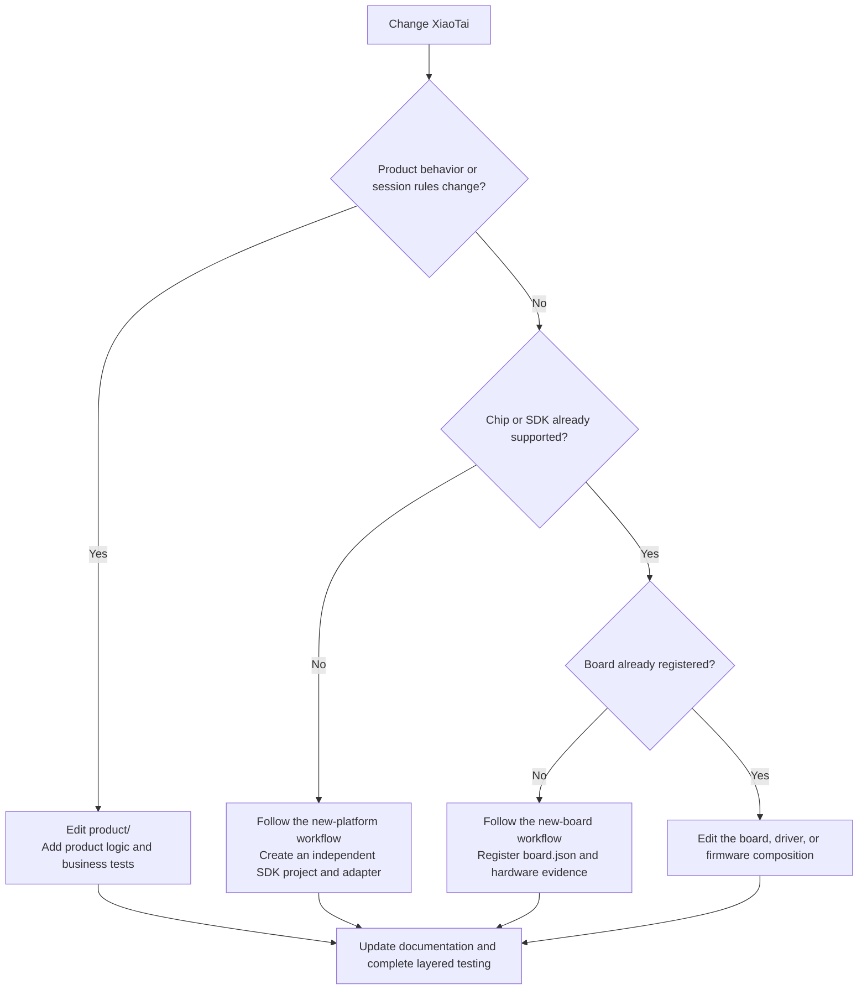

# Contributing to XiaoTai

[Quick start](README.en.md) · [Architecture and development](ARCHITECTURE.en.md) · [Contributing](CONTRIBUTING.en.md) · [All documentation](docs/README.en.md)

[中文](CONTRIBUTING.md) · [English](CONTRIBUTING.en.md)

Contributions may fix defects, improve tests, add boards, or support new chip platforms. Before editing, identify whether the change belongs to the product, platform, board, or firmware composition layer. Keep reusable logic out of individual board projects.

ESP32-S3 and ESP32-P4 projects use **ESP-IDF v5.5.5**, commit `b774170ff46c393eeb5e495ea37936038d3f4f4f`. Run `. tools/activate_esp_idf.sh` from the repository root before building, then check `idf.py --version`. The component requirement `>=5.5,<5.6` is a compatibility range, not the selected build version.

Historical third-party SDK compiler versions are recorded in their manifests.

## Prepare the environment

1. Read [Architecture and development](ARCHITECTURE.en.md) for directory boundaries and media lifecycles.
2. Open the target guide from the [Board directory](docs/boards/README.en.md) and install its pinned SDK and compiler.
3. Run `python3 tools/build.py --list-boards` to confirm the board ID, its unique repository identifier.
4. Run `python3 tools/build.py --board <board-id> --dry-run` to check the project and native command.

ESP-IDF and Beken use separate SDK projects and toolchains. Do not merge their build files merely to unify commands. Do not commit local toolchains, build directories, device keys, or Wi-Fi credentials.

Build with `python3 tools/build.py --board <board-id>`. Versions, artifact paths, packaging, and GitHub releases follow [Firmware versions and releases](#firmware-versions-and-releases).

## Rule index

Each rule is maintained at the authoritative location below; other documents link to it. Historical experiments, release notes, and conversations are evidence for their specific context. Update checks when changing rules, and do not treat historical parameters as current requirements.

| Scope | Authority | Existing checks |
|---|---|---|
| Agent operations and when to read detailed rules | Root `AGENTS.md`; board-level files add only board-specific requirements | Agent execution; documentation and test-entry checks |
| Product, platform, board, driver, and firmware boundaries | [Architecture](ARCHITECTURE.en.md#directory-guide) | `test_repository_layout.py` |
| Public model names, permanent board IDs, project directories, and chips | `boards/<vendor>/<board>/board.json` | `tools/build.py --validate`, `test_board_registry.py` |
| Development workflow, versions, release names, and delivery checks | This document | `test_firmware_versions.py`, `test_boot_identity.py`, `test_validation_packaging.py`, `test_esp_merged_firmware.py`; verify GitHub titles before and after publishing |
| SDK, compiler, ABI, native artifacts, and flash layout | Target board guide, native build scripts, and dependency manifests | Native builds and board contract checks |
| Product state, interaction, room refresh, and media parameters | [Requirements (Chinese)](docs/product/PRODUCT_REQUIREMENTS.md), [Interaction profiles (Chinese)](docs/product/PRODUCT_INTERACTION_PROFILES.md), [Media contract (Chinese)](docs/product/MEDIA_CONTRACT.md) | Product public-interface and platform regression tests |
| Test layers, coverage, and hardware evidence | [Testing](tests/README.en.md) | `bash tools/check.sh`; target-board HIL |

Board IDs use lowercase hyphenated names and are permanent build and package identifiers. Public model names help users match hardware. Keep native CMake project and BIN/ELF names, such as `lckfb_esp32s3_xiaotai.bin`; do not rename them just to match the board ID.

Register new names first; changes to existing names and paths require a migration.

## Choose the development path

Use the diagram to identify the correct layer, then follow the detailed workflow.



For a supported board, start with its guide and firmware project. Product behavior belongs in `product/`, shared platform capabilities in `platforms/`, and GPIO, buses, clocks, and power sequencing in board code.

For a new board using a supported chip, follow [Adding a board](#adding-a-board). Create `boards/<vendor>/<board>/board.json` and provide the board guide, hardware sources, and validation plan.

For a new chip or SDK, follow [Adding a chip platform](#adding-a-chip-platform). First create an independent firmware project that builds natively, then connect it to the product layer through stable C interfaces.

## Adding a board

Use this workflow when the chip and SDK are supported but the exact model or printed circuit board (PCB) revision is not.

Prepare the full sales model, PCB revision, front and back photos, schematics, key components, pins, and power sequencing. Identify Flash, PSRAM, partitions, flashing tools, SDK, TiRTC SDK, and intended capabilities. Mark missing facts as `unknown` and resolve them through device IDs, probes, or measurements.

Do not infer them from a similar-looking board or the same chip.

1. Create `boards/<vendor>/<board>/board.json` with a permanent unique board ID.
2. Create Hardware IR or a probe report, preserving sources and evidence grades for hardware facts.
3. Implement the board adapter. GPIO, buses, DMA, clocks, and power sequencing must not enter product business logic.
4. Write a self-contained guide covering specifications, dependencies, building, flashing, first use, tests, and troubleshooting.
5. Run manifest validation, host tests, and a full target firmware build, then hardware-in-the-loop (HIL) tests.
6. Record board ID, PCB revision, source commit, SDK/TiRTC versions, and SHA-256 checksums in the release package.

## Adding a chip platform

A new chip is not supported by copying the nearest firmware project and changing its target. Establish a platform boundary first:

1. Pin the SDK, toolchain, linker script, startup method, partitions, and TiRTC application binary interface (ABI) version.
2. Create `platforms/<sdk>/` with task, time, network, storage, media, and logging interfaces.
3. Create an independent `firmware/<sdk>/...` project that builds with vendor tooling.
4. Validate startup, serial output, memory, and networking in a minimal project before integrating the product layer and first board.
5. Integrate capability reporting, logical stream IDs, codecs, and session arbitration, with host contract tests.
6. Add the platform to manifest checks and the build matrix; complete full builds, crash symbolization, weak-network tests, and hardware validation.

Extract common drivers only after reusing the platform on at least two boards with the same chip, to avoid premature abstractions based on one board.

## Manual and AI-assisted development

Proceed through source review, minimal probes, board adaptation, platform media, product behavior, full build, and hardware validation. For media issues, first record direction, stream ID, codec, sample rate, frame counts, SDK return codes, and session generation.

Do not hide lifecycle defects with larger stacks or unlimited retries.

For AI-assisted work, supply the repository path, board ID, schematics or board support package (BSP), SDK and TiRTC versions, target feature, logs, serial/flashing permissions, and partitions or data that must remain unchanged. Reports must distinguish code checks, full builds, and hardware validation.

List unknowns instead of guessing.

The root `AGENTS.md` governs AI development tools. Before changing board structure, interaction flows, or room assignment, read the architecture and product documents it specifies.

## Product and media changes

Before editing, review [Development pitfalls and regressions](docs/development/pitfalls.en.md), especially UI action-ID separation, top-layer prompts, AI burst queues, and playback drain conditions.

Before changing UI, buttons, voice control, or user flows, read [Interaction profiles (Chinese)](docs/product/PRODUCT_INTERACTION_PROFILES.md) and `product/interaction/README.md`. Adapters emit intents; the product runtime owns business state.

Changes to audio formats, video resolution, frame rate, bitrate, stream IDs, or acoustic echo cancellation (AEC) paths must update the [Media contract (Chinese)](docs/product/MEDIA_CONTRACT.md), capability reports, and tests together.

Room-assignment triggers follow the [Room refresh rules (Chinese)](docs/product/PRODUCT_INTERACTION_PROFILES.md#64-房间分配刷新). MQTT notifications and explicit user entry are the only refresh intents.

## Shared implementations and cross-board regression

Before changing shared drivers or SDK patches in `platforms/beken/runtime` or `platforms/beken/src`, identify the boards that link them and affected features. This includes MGKFB and LCKFB BK7258. Patches added for one board also reach the other through shared build scripts.

- Keep pins, polarity, power sequencing, and component differences in board adapters. Select feature differences explicitly through variants; do not infer them from board names in shared media code or make one board's limits global defaults.
- Commit directory moves, interface extraction, and behavior fixes separately. Preserve parameters, formats, and lifecycles during migration; demonstrate this with existing tests and builds before changing functionality.
- Shared audio, session handover, storage compatibility, and network patches require native builds on all affected boards. Record each new firmware identity and hardware result; one board's pass does not validate another.
- On hardware, test directly affected features first, then other features sharing their resources. A ringtone handover change also requires audio start/stop checks for AI, H5, device calls, and room PTT. Keep untested boards pending and do not replace their stable release assets.

Full LCKFB BK7258 hardware acceptance steps are in [Hardware acceptance (Chinese)](firmware/beken/bk7258/lckfb-bk7258-xiaotai/HARDWARE_ACCEPTANCE.md#一次完整验收).

## Testing requirements

Use test-driven development for behavior changes: add a test that reproduces the target behavior or defect, confirm it fails before the change, implement the change, and run all checks. Prefer public interfaces in `product/include/` for business tests.

Platform-internal tests supplement drivers, concurrent shutdown, SDK callbacks, and conditional compilation; they do not replace business-interface tests. See [Testing](tests/README.en.md) for layers, coverage thresholds, and hardware matrices.

After board, project layout, or build-dispatch changes, run at least:

```bash
python3 tools/build.py --validate
python3 -m unittest discover -s tools/tests -v
```

Before committing, run the full repository check:

```bash
bash tools/check.sh
```

Firmware changes also require a full native SDK build. Driver, media, or product behavior changes require HIL, recording firmware identity, board revision, test direction, and results.

Local automated reports go in untracked `tests/.local/`. Lasting test rules belong in `tests/` or `tools/tests/`. Public documentation describes current capabilities and reproducible steps, not interim conversations.

## Documentation requirements

Each officially supported board needs a standalone guide, ordered as: flashing, first use, specifications, media parameters, environment and dependencies, hardware sources, development directories, building, tests, troubleshooting, validation status, and limitations.

First-use steps must state who uses a phone or computer, when setup or binding begins, where to enter information, what success looks like, and how to recover from failure.

`board.json` defines board IDs and build entry points. Hardware IR or probe reports establish GPIO, bus, and device facts. Public references use official sources only. Downloaded SDKs, schematics, and vendor examples belong in ignored `.tools/` or `.references/` and must not become undocumented source dependencies.

Public guides explain current use and development, not completed migrations or incident timelines. Every `.local/` directory is local only and must not be committed.

Chinese prose should be natural and direct, with one subject per paragraph and unavoidable abbreviations explained on first use. Review the Chinese first, then produce English with the same structure and factual sources.

### Public documentation and translation scope

Public documentation serves first-time users and developers. Technical prose should be concise, accurate, and actionable. Check Chinese facts, steps, and reasoning before translation.

The root README prioritizes purpose, board selection, downloads, and first use; board and development guides hold details without repeating parameters, internal diagnostics, or historical processes.

Maintain English for the following scope, rather than translating every file. Root `README.md` already has `README.en.md`; the following 15 Chinese sources are also in scope. Inclusion in this list does not itself indicate translation completion.

| Category | Chinese source |
|---|---|
| Architecture | `ARCHITECTURE.md` |
| Contributing | `CONTRIBUTING.md` |
| Third-party information | `THIRD_PARTY.md` |
| Documentation index | `docs/README.md` |
| Firmware downloads | `docs/downloads.md` |
| Glossary | `docs/glossary.md` |
| Board overview | `docs/boards/README.md` |
| LCKFB ESP32-S3 | `docs/boards/lckfb-esp32s3/README.md` |
| LCKFB BK7258 | `docs/boards/lckfb-bk7258/README.md` |
| Waveshare ESP32-P4 | `docs/boards/waveshare-esp32p4-touch-lcd-43c-v10/README.md` |
| M5Stack CoreS3-Lite | `docs/boards/m5stack-cores3-lite/README.md` |
| MGKFB BK7258 | `docs/boards/mgkfb-bk7258/README.md` |
| BK7258 serial commands | `docs/development/BK7258_SERIAL_COMMANDS.md` |
| Development pitfalls | `docs/development/pitfalls.md` |
| Testing guide | `tests/README.md` |

For `pitfalls.md`, separate integration timelines and old build records before translating lasting guidance. Translate `tests/README.md` as the contributor testing workflow, but not individual results or historical regressions. Place English files beside their Chinese sources as `<name>.en.md`, with language links.

Preserve commands, board IDs, versions, addresses, and parameters. Keep links to untranslated targets at their original addresses and label their language; never invent English targets.

### Internal materials and retention

- `docs/product/` contains internal product design and implementation specifications. Do not translate it or list it in public navigation. Put user-facing features and limits in the root README and board guides; development-contract references may remain.
- Do not translate internal testing, integration, performance experiments, historical releases, or regression timelines. Do not bulk-translate third-party originals, bundled SDK docs, version identity files, or legacy module notes.
- Short board and firmware READMEs remain code-location guides and links to full guides; do not duplicate full usage translations.
- Temporary logs, one-off debugging notes, and local reports go in ignored `.local/`, not public documentation directories.
- Keep release validation, firmware hashes, hardware sources, key design evidence, and required licensing records in version control. Clearly mark archived material; being outside translation scope is not a reason to delete it or retain it only locally.

These rules do not require bulk moves or deletions. Check references, build dependencies, and evidence uses before reorganizing tracked files. Ignore rules do not untrack existing files. Update this list when adding public documents or changing translation scope.

## Firmware versions and releases

### Versions and names

The release owner assigns `major.minor.patch`; builds, failures, and retries do not change it. ESP-IDF reads `PROJECT_VER`; BK7258 reads the project `VERSION.md`. BK, LCKFB ESP32-S3, Waveshare ESP32-P4, and M5 maintain independent `BUILD_NUMBER` values, producing identities such as `1.0.1+build.N`.

BK native scripts increment the counter; S3/P4 use `tools/build.py` before actual compilation, and native CMake reconfiguration reuses that number. Failed builds consume a number and retries increment it; queries, validation, dry runs, and packaging do not.

This is build identity, not a product-version change. Each board counts independently. S3/P4 started at 1 when enabled; BK retained its previous counter. Read the number from the actual artifact; never guess.

Use the following GitHub release names. Titles must include the board model, not just the chip platform. Describe hardware variants and features in the body; titles must follow the table. Register names before releasing a new board.

| Board | Stable GitHub tag | Release title |
|---|---|---|
| LCKFB ESP32-S3 | `lckfb-esp32s3-v<product-version>` | `立创·实战派 ESP32-S3 v<product-version> · build.<build-number>` |
| Waveshare ESP32-P4-WIFI6-Touch-LCD-4.3 | `waveshare-esp32p4-touch-lcd-43c-v10-v<product-version>` | `微雪 ESP32-P4-WIFI6-Touch-LCD-4.3 v<product-version> · build.<build-number>` |
| LCKFB BK7258 | `bk7258-v<product-version>` | `立创·实战派 BK7258 v<product-version> · build.<build-number>` |
| MGKFB AI Toy Development Board BK7258 | `mgkfb-bk7258-v<product-version>` | `觅感 AI 玩具开发板 BK7258 v<product-version> · build.<build-number>` |
| M5Stack CoreS3-Lite (ESP32-S3) | `m5stack-cores3-lite-v<product-version>` | `M5Stack CoreS3-Lite v<product-version> · build.<build-number>` |

M5 has its own board tag. Asset names start with the permanent ID `m5stack-cores3-lite`; identify the screen variant in the body.

Package names start with the permanent board ID and are generated by the existing tools: `<board-id>-<product-version>+build.<build-number>-validation.zip`. Firmware uses `+build.N`, and release titles use ` · build.N`; `v1.0.1.build.N` is not SemVer.

The release owner decides whether behavior or feature changes require a product-version increase. Rebuilding, documentation changes, or release-label corrections alone do not. Do not overwrite published tags or assets. A new build of the same version gets a board-specific Release at `<stable-tag>-build.<build-number>`.

Append `-<variant>` for separately published variants, for example `m5stack-cores3-lite-v1.0.1-build.47-ili9342e`. Specify the variant in the body while keeping the title format above.

Publish only images that have completed hardware validation. Keep historical tags for manual cleanup by maintainers, and retain historical 1.0.0 download names. A release operation does not implicitly authorize `git push`; respect explicit user restrictions.

### ESP32 split files and merged images

ESP32-S3 and ESP32-P4 use the asset rules below; BK keeps its existing packaging. These are project naming conventions; image formats and merging use Espressif esptool.

Espressif documents [writing multiple BINs at addresses and merging images](https://docs.espressif.com/projects/esptool/en/latest/esp32s3/esptool/basic-commands.html#merge-binaries-for-flashing-merge-bin).

Inputs must come from generated `flash_args` / `flasher_args.json`; example counts and addresses are not universal.

Current LCKFB S3 and M5 split packages contain 3 flashable BINs each; Waveshare P4 has 4, including `ota_data_initial.bin`. Counts depend on partitions and project configuration, so packaging must not assume three files.

This repository explicitly generates **raw BIN at base address `0x0`**, rather than relying on esptool version defaults.

The ZIP's `MANIFEST.json` lists each BIN's path, size, and SHA-256 under `files`. Normal flashing guides focus on BIN names, contents, and addresses without requiring a separate ZIP check. Releases retain external `SHA256SUMS` for download verification; READMEs do not list it as a separate download entry.

A ZIP is a distribution container, not a flash image.

| Asset | Contents and purpose |
|---|---|
| `<board-id>-<product-version>+build.<build-number>-validation.zip` | Split package: native BINs, flash manifest, instructions, and ELF; flash each file at its listed address |
| `<board-id>-<product-version>+build.<build-number>-merged.bin` | Complete image beside the ZIP; download directly and flash at `0x0`; do not wrap it in another ZIP or duplicate it inside the split package |
| `SHA256SUMS` | SHA-256 checksums for both the ZIP and merged BIN |

Generate the merged BIN with `esptool merge_bin` using original images and `flasher_args.json` from the same validated ZIP. Do not rebuild or increment the build number. Include every listed flash file; do not apply S3 layout to P4 or omit P4 OTA initialization data.

Verify original bytes, addresses, total length, and `0xFF` padding segment by segment. Validate again with release-tool `--merged`; never overwrite the same name with different contents.

Merged BINs are intended for first flashing and write gaps between images, including NVS on the currently released ESP32 boards. Download pages and release notes must state that Wi-Fi, binding, and other persistent settings are overwritten.

To retain configuration, use split files without full-chip erase after checking partition and configuration compatibility. Successful generation and validation do not prove browser flashing or hardware startup; record same-build hardware validation separately.

### Building and packaging

Use only `tools/build.py` for cross-platform dispatch. A native build selects one board and one variant. `--all` runs boards sequentially; it does not combine boards into one firmware. `--release` selects native release configuration but does not assign a product version or guarantee uniform SDK output directories.

Native SDK commands remain for board-level debugging and flashing; do not add a second cross-platform dispatcher.

Check the target guide and native scripts first, then run:

```bash
bash tools/check.sh
python3 tools/build.py --board <board-id> --release
python3 tools/package_validation_firmware.py --board <board-id>
python3 tools/release_firmware.py --package <actual-package-path>
```

BK7258 packaging also requires `--beken-build-profile release`; otherwise the tool checks the development configuration. ESP-IDF uses native `build/`; BK uses `build/bk7258/<project>/`, with flash files in `package/`.

Development, release, and feature configurations share one project output directory, without display/audio suffixes. `build_identity.json` identifies the current configuration. Default packages stay in native directories; `--output` explicitly exports copies.

Build and package the same variant. Omitting `--variant` selects the manifest default. BK selects configuration through SDK `CONFIG_SUBTITUTE_FILE` and retains official native project names and layout.

The packager checks both configuration and variant; rebuild on mismatch rather than assembling old images from another directory.

For ESP32 packaging, activate the project's ESP-IDF Python environment for esptool. The unified packager outputs ZIP, merged BIN, and checksums covering both. To add a merged image to an existing ZIP:

```bash
python3 tools/merge_esp_firmware.py --package <existing-package-path> --output <export-directory>
python3 tools/release_firmware.py --package <exported-ZIP> --merged <exported-merged-BIN>
```

This preserves the existing ZIP bytes. When adding a merged BIN to an existing Release, retain its tag, title, ZIP, and version. Explain the assets and update `SHA256SUMS` for both. A delivery-format change is not a new firmware version.

Uploading still requires user authorization and does not perform an automatic `git push`.

### Maintaining download links

[Firmware downloads](docs/downloads.en.md) is the sole current-release index. Root README, board directory, and guides link to `docs/downloads.md#<board-id>` rather than duplicating versions or versioned URLs. Use full board names for section headings and explicit HTML anchors for board IDs.

List M5 screen variants separately; MGKFB uses one firmware entry.

After checking remote assets and public downloads, update only the released board's version, BIN/ZIP links, and Release link. The release owner maintains the index manually; automatic updates are not implemented. Do not switch links for failed or draft releases, or overwrite historical releases, tags, and assets.

Each release adds board validation records with exact versions, hashes, and scope. Do not replace fixed historical links with current-version links. Update guides and product docs when features, buttons, flashing methods, or limitations change; a new build alone does not require bulk README version changes.

Old versions in screenshots are examples; update screenshots when UI or actions change. Documentation and releases are separate deliverables, with commits and pushes following existing authorization.

### Release completion criteria

1. Before upload, list board ID, product version, tag, title, asset names, and source commit; compare each against the table and actual artifacts. Read online metadata before replacing an existing Release.
2. Check BIN/ELF, manifest, and actual flashed-file identities and SHA-256. State original paths, versions, and full hashes; label exported packages as copies.
3. Describe additions, changes, and this image's hardware results. Old board bring-up cannot replace acceptance of the exact artifact. Keep untested packages as `BUILD_VERIFIED_HIL_PENDING` and do not publish them.
4. After publishing, read back GitHub titles, tags, and asset names, check remote hashes, and verify public downloads. Report publication complete only when all match; fix naming mismatches before handoff.

`tools/release_firmware.py` verifies package file sizes and SHA-256 and derives a base tag, title, and asset names. Check names against its output before uploading. Add required same-version build or variant suffixes from the table to avoid reusing published tags.

The tool reads local artifacts only and does not operate GitHub.

CI covers naming for all five boards and rejection of invalid artifacts. The tool permits inspecting HIL-pending packages, so a generated plan or passing `tools/check.sh` does not authorize publication. The HIL requirements and remote checks above still apply.

## Before committing

- Behavior changes and defect fixes have regression tests that fail before and pass after the implementation change.
- Changes without new tests explain why and identify existing coverage.
- Each build selects one board and one explicit variant.
- Board manifests are not treated as hardware proof.
- No build artifacts, toolchains, keys, Wi-Fi configuration, or local reports are committed.
- Static checks, unit tests, and relevant firmware builds pass.
- Hardware conclusions identify the board, firmware, and tested scope.
- Documentation, capability reports, and implementation parameters agree.
- Third-party SDKs, libraries, models, fonts, and media comply with their licenses.

Project-owned source and documentation use the [MIT License](LICENSE). Third-party content follows the [Third-party checklist](THIRD_PARTY.en.md) and its original licenses.
