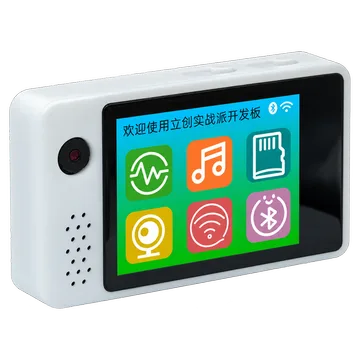
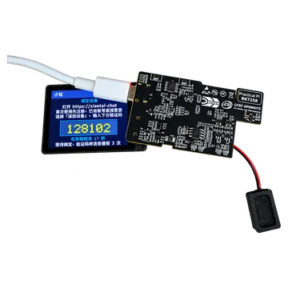
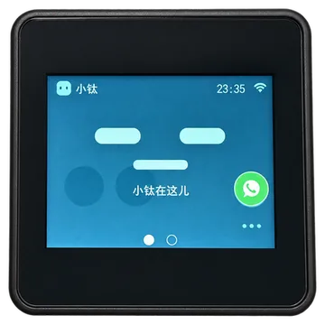
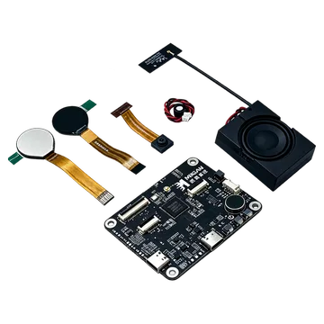
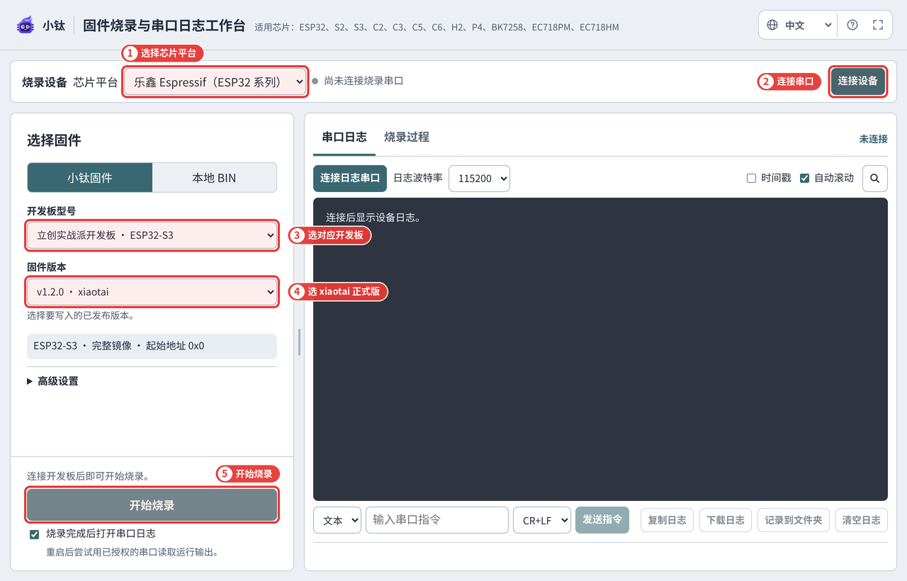

# Tange XiaoTai · Open-source AI Audio and Video Firmware

[Quick start](README.en.md) · [Architecture and development](ARCHITECTURE.en.md) · [Contributing](CONTRIBUTING.en.md) · [Documentation](docs/README.en.md)

[中文](README.md) · [English](README.en.md)

Flash open-source firmware from your desktop browser to turn a dev board into a device for **WeChat calls, browser live view and two-way audio, device intercom, and AI (artificial intelligence) chat**. No local toolchain is required to try a release; you can also build from source.


▶ [Watch demo video on Bilibili (Chinese)](https://www.bilibili.com/video/BV1JpsP63EhY/) · **Quick start**: choose a board → open the [XiaoTai Web Flasher](https://xiaotai.chat/web-flasher/) → configure Wi-Fi → bind the device. Features vary by board. Online features depend on the XiaoTai binding/signaling platform, TiRTC, and AI/WeChat services; self-hosted setups require separate addresses and credentials.

## Choose a board and firmware

Match the physical model, PCB (printed circuit board) revision, and display variant; firmware is not interchangeable just because boards share a chip.

| Board image | Model and board ID | Form factor & key features | Download & guide |
|---|---|---|---|
|  | LCKFB ShiZhanPai ESP32-S3<br>PCB V1.0.1<br>`lckfb-esp32s3` | 320×240 touchscreen<br>WeChat voice calls, browser live view & intercom, AI chat | [Downloads](docs/downloads.en.md#lckfb-esp32s3)<br>[Flashing guide](docs/boards/lckfb-esp32s3/README.en.md#flashing) |
|  | LCKFB ShiZhanPai BK7258<br>`lckfb-bk7258` | Touchscreen + buttons<br>WeChat voice calls, browser live view & intercom, AI chat, group intercom | [Downloads](docs/downloads.en.md#lckfb-bk7258)<br>[Flashing guide](docs/boards/lckfb-bk7258/README.en.md#flashing) |
|  | Waveshare ESP32-P4-WIFI6-Touch-LCD-4.3<br>PCB V1.0<br>`waveshare-esp32p4-touch-lcd-43c-v10` | 4.3" 800×480 touchscreen<br>WeChat audio/video calls, browser live view & intercom, AI chat | [Downloads](docs/downloads.en.md#waveshare-esp32p4-touch-lcd-43c-v10)<br>[Flashing guide](docs/boards/waveshare-esp32p4-touch-lcd-43c-v10/README.en.md#flashing) |
|  | M5Stack CoreS3-Lite<br>K128-Lite · ILI9342C display<br>`m5stack-cores3-lite` | 320×240 touchscreen<br>WeChat voice calls, browser live view & intercom, AI chat, group intercom | [Downloads](docs/downloads.en.md#m5stack-cores3-lite)<br>[Flashing guide](docs/boards/m5stack-cores3-lite/README.en.md#flashing) |
|  | MGKFB BK7258 AI toy board<br>Dual-eye displays · 8 MiB Flash<br>`mgkfb-bk7258` | Dual-eye displays + physical buttons<br>WeChat voice calls, browser live view & intercom, AI chat | [Downloads](docs/downloads.en.md#mgkfb-bk7258)<br>[Flashing guide](docs/boards/mgkfb-bk7258/README.en.md#flashing) |

M5 supports only the ILI9342C display controller; MGKFB BK7258 targets the 8 MiB Flash dual-eye board. See the [complete board catalog](docs/boards/README.en.md) and [Firmware downloads](docs/downloads.en.md) for full specs and archives.

## Flash the firmware

Flash directly from desktop Chrome or Edge (typically 2–3 minutes) without installing a build toolchain:

1. Connect the board to your computer with a data-capable USB cable and close any serial monitor using that port.
2. Open the [XiaoTai Web Flasher](https://xiaotai.chat/web-flasher/), select the chip platform, and click **连接设备** (Connect) to pick the board's serial port.
3. Under **小钛固件** (XiaoTai firmware), choose your board and the current stable release (such as `v1.2.0`), verify address `0x0`, and start flashing.



See each board's flashing guide above for USB ports and download mode. For a downloaded release, choose **本地 BIN** (local BIN) with `_merged.bin` for ESP32 or `_all-app.bin` for BK7258 at `0x0`. ESP32 full images overwrite Wi-Fi and binding settings; for BK7258, back up factory calibration first and avoid full-chip erase.

## First use

### 1. Configure Wi-Fi

After flashing and restarting, a device without a usable network configuration displays or speaks a setup prompt and broadcasts an open `XiaoTai-XXXX` hotspot. Connect your phone or computer; a “no internet” warning is expected.

If the setup page does not open automatically, visit `http://192.168.6.1`, select a 2.4 GHz Wi-Fi network, enter the router password, and submit. If the hotspot reappears, the connection failed. Check the password and signal, then retry.

### 2. Bind the device

An already bound device is ready to use once it comes online. If binding is required, the device displays or reads out a six-digit verification code.

Reconnect your phone or computer to the internet, sign in to the [XiaoTai devices page](https://xiaotai.chat/devices), and enter the code under “添加设备” (Add device). If it expires, use the newly generated code.

Binding succeeds when the device appears in the list and returns to its home screen, eye display, or ready state.

### 3. Start using the device

Follow your board guide to start an AI conversation using the screen or physical buttons. Open live view and two-way audio from the web device page. For WeChat calls, follow the device prompts to add a WeChat contact first. After a session ends, the device should return to standby and be ready for another session.

WeChat video support, device-to-device calls, and group intercom depend on the board; see its guide. For example, LCKFB ShiZhanPai ESP32-S3 currently supports WeChat voice calls while using its camera for browser live view.

### 4. Recovery and troubleshooting

To change networks or rebind a touchscreen device, open “设备设置 → 重置设备” (Device settings → Reset device), confirm, then configure Wi-Fi and bind again. For devices without touch input, use the physical buttons or serial commands described in the board guide. Do not perform an arbitrary full-chip erase.

If something goes wrong, check the troubleshooting section of the board guide first. When reporting a problem, include the board ID, firmware version, steps, and symptoms. For audio or video issues, specify the affected direction, such as “no sound from browser to device.” Include serial logs if available.

### Quick FAQ

- **Do I need ESP-IDF or a build toolchain?** No. Use the Chrome/Edge Web Flasher above to try a release; you only need a local toolchain when modifying firmware from source.
- **Does LCKFB ESP32-S3 support WeChat video calls?** Currently it supports WeChat voice calls while using its camera for browser live view; see Waveshare ESP32-P4 for WeChat audio/video calls.
- **Serial port not found or Wi-Fi setup fails?** Check your USB data cable, serial driver, and 2.4 GHz Wi-Fi, then check the board guide's troubleshooting section or ask in Discussions with your board ID and symptoms.

## Get involved

Pick the entry point that fits you:

- **Flash and try it**: If you have one of the boards above, flash it from the [XiaoTai Web Flasher](https://xiaotai.chat/web-flasher/). Share photos or ask setup questions in [GitHub Discussions](https://github.com/tangeai/xiaotai/discussions) rather than opening an issue for usage help.
- **Help without writing firmware**: Submit serial logs, board photos matching the exact PCB revision, flashing troubleshooting notes, or fixes for Chinese/English documentation mismatches.
- **Write code or add a board**: Start with issues labeled [`good first issue`](https://github.com/tangeai/xiaotai/labels/good%20first%20issue), or follow [Adding a board](CONTRIBUTING.en.md#adding-a-board) to register new hardware.

## Build from source

You do not need a development environment to use prebuilt firmware. For development, clone the source and inspect the board registry:

```bash
git clone https://github.com/tangeai/xiaotai.git
cd xiaotai
python3 tools/build.py --list-boards
python3 tools/build.py --validate
```

Install the toolchain and dependencies from your [board guide](docs/boards/README.en.md), then run these commands from the repository root:

```bash
# Replace <board-id> with the board ID from the table above
python3 tools/build.py --board <board-id> --dry-run
python3 tools/build.py --board <board-id>
```

ESP32-S3 / ESP32-P4 use **ESP-IDF v5.5.5**. Run `. tools/activate_esp_idf.sh` before building and check the version with `idf.py --version`. For M5, also select the display variant as described in its guide.

`tools/build.py` is the shared build entry point and dispatches to each board's native project. ESP-IDF and Beken use separate SDKs (software development kits) and toolchains. See [Contributing](CONTRIBUTING.en.md) for testing, packaging, and release requirements.

## Related repositories

The repositories below cover other hardware lines of the same product; firmware and development for the five boards above stay in this repository (`tangeai/xiaotai`):

- XiaoTai ESP32: [tangeai/xiaotai-esp32](https://github.com/tangeai/xiaotai-esp32)
- XiaoTai Lierda: [tangeai/xiaotai-lierda](https://github.com/tangeai/xiaotai-lierda)

## Next steps

- Share photos, ask setup questions, or discuss new boards in [GitHub Discussions](https://github.com/tangeai/xiaotai/discussions).
- See the top navigation for architecture, media lifecycle, and contributing guides.

This project's own source code and documentation use the [MIT License](LICENSE); third-party dependencies and assets are listed in [Third-party assets](THIRD_PARTY.en.md).
