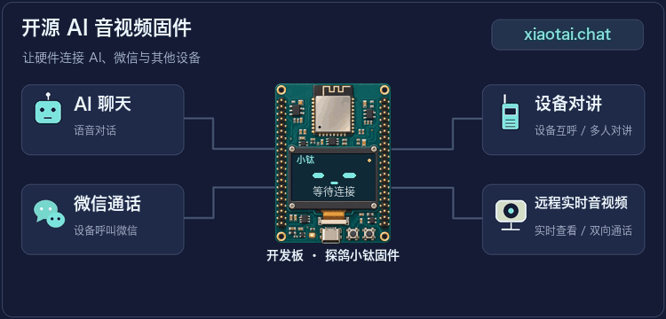
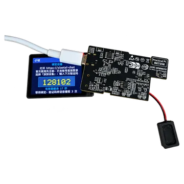
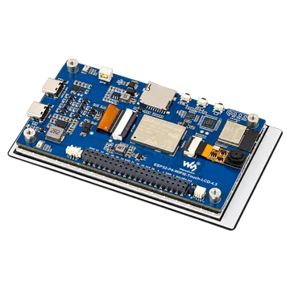
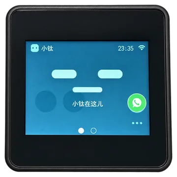
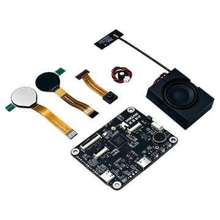

# Tange XiaoTai · Open-source AI Audio and Video Firmware

[Quick start](README.en.md) · [Architecture and development](ARCHITECTURE.en.md) · [Contributing](CONTRIBUTING.en.md) · [Documentation](docs/README.en.md)

[中文](README.md) · [English](README.en.md)

XiaoTai is open-source AI (artificial intelligence) audio and video firmware for devices with or without a display. It supports **AI chat, WeChat calls, device intercom, and remote viewing in a browser**. Download firmware to try it, or build your own device from source.



**Quick start: choose a board → download and flash firmware → configure Wi-Fi → bind the device.** Features vary by board. See its guide for supported features and known limitations.

Online features require a device binding and signaling platform, TiRTC real-time audio and video services, and AI or WeChat service configuration. This repository provides device firmware.

Follow the steps below to try a release package; connecting to a self-hosted platform requires separate service addresses and credentials.

## Choose a board and firmware

Match the physical model, PCB (printed circuit board) revision, and display variant. Firmware is not interchangeable just because boards use the same chip. The board ID uniquely identifies the board in build commands and firmware filenames.

See [Firmware downloads](docs/downloads.en.md) for current versions, exact filenames, and release notes.

| Board image | Model and board ID | Download entry | Guide |
|---|---|---|---|
|  | LCKFB ShiZhanPai BK7258<br>`lckfb-bk7258` | [Firmware and release notes](docs/downloads.en.md#lckfb-bk7258) | [Flashing guide](docs/boards/lckfb-bk7258/README.en.md#flashing) |
|  | LCKFB ShiZhanPai ESP32-S3<br>PCB V1.0.1<br>`lckfb-esp32s3` | [Firmware and release notes](docs/downloads.en.md#lckfb-esp32s3) | [Flashing guide](docs/boards/lckfb-esp32s3/README.en.md#flashing) |
|  | Waveshare ESP32-P4-WIFI6-Touch-LCD-4.3<br>PCB V1.0<br>`waveshare-esp32p4-touch-lcd-43c-v10` | [Firmware and release notes](docs/downloads.en.md#waveshare-esp32p4-touch-lcd-43c-v10) | [Flashing guide](docs/boards/waveshare-esp32p4-touch-lcd-43c-v10/README.en.md#flashing) |
|  | M5Stack CoreS3-Lite<br>K128-Lite · ILI9342E / ILI9342C display<br>`m5stack-cores3-lite` | [Firmware and release notes](docs/downloads.en.md#m5stack-cores3-lite) | [Flashing guide](docs/boards/m5stack-cores3-lite/README.en.md#flashing) |
|  | MGKFB BK7258 AI toy board<br>Dual-eye displays · 8 MiB Flash<br>`mgkfb-bk7258` | [Firmware and release notes](docs/downloads.en.md#mgkfb-bk7258) | [Flashing guide](docs/boards/mgkfb-bk7258/README.en.md#flashing) |

For M5, choose the variant matching the ILI9342E or ILI9342C display controller. MGKFB BK7258 firmware is for the board with 8 MiB Flash and dual-eye displays.

See the [complete board catalog](docs/boards/README.en.md) for specifications, features, and dependencies, and [GitHub Releases](https://github.com/tangeai/xiaotai/releases) for previous versions.

## Flash the firmware

Open the flashing guide for your board, connect it to your computer, and enter download mode. Then select the file listed below. Replace `<version>` with the full version from the download page, including the build number.

| Platform | File for the first installation | Tool and address |
|---|---|---|
| ESP32-S3 / ESP32-P4 | The `-merged.bin` image for your board and variant | Open [Espressif's browser flashing tool](https://espressif.github.io/esptool-js/) in Chrome or Edge; add only one BIN at `0x0` |
| LCKFB BK7258 | Extract the ZIP and select `lckfb-bk7258-<version>-all-app.bin` | Beken download tool, address `0x00000000` |
| MGKFB BK7258 | Extract the ZIP and select `mgkfb-bk7258-<version>-all-app.bin` | Beken download tool, address `0x00000000` |

For ESP32, you can also use the individual files from the ZIP. Flash every BIN listed in `flash_files` in `MANIFEST.json`: three files for LCKFB S3 or M5, and four for Waveshare P4. **Choose either the merged image or the individual files.** Do not flash an application BIN at `0x0` as if it were a merged image.

ZIP, ELF, and JSON files cannot be flashed directly.

An ESP32 merged image overwrites saved Wi-Fi and binding information. To preserve settings during an upgrade, use the individual files, check partition and configuration compatibility, and avoid a full-chip erase. BK `-app_pack.rbl` files are only for OTA (over-the-air) updates, not a first serial installation.

OTA has not received dedicated validation on MGKFB. See your board guide for connection, reset, and flashing steps.

## First use

### 1. Configure Wi-Fi

After flashing and restarting, a device without a usable network configuration displays or speaks a setup prompt and broadcasts an open `XiaoTai-XXXX` hotspot. Connect your phone or computer; a “no internet” warning is expected.

If the setup page does not open automatically, visit `http://192.168.6.1`, select a 2.4 GHz Wi-Fi network, enter the router password, and submit. If the hotspot reappears, the connection failed. Check the password and signal, then retry.

### 2. Bind the device

Once online, the device displays or speaks a six-digit verification code. Reconnect your phone or computer to the internet, sign in to the [XiaoTai devices page](https://xiaotai.chat/devices), and enter the code under “添加设备” (Add device). If it expires, use the newly generated code.

Binding succeeds when the device appears in the list and returns to its home screen, eye display, or ready state.

### 3. Start using the device

Follow your board guide to start an AI conversation using the screen or physical buttons. Open live view and two-way audio from the web device page. For WeChat calls, follow the device prompts to add a WeChat contact first. After a session ends, the device should return to standby and be ready for another session.

Device-to-device calls, group intercom, and video support depend on the board; see its guide.

### 4. Recovery and troubleshooting

To change networks or rebind a touchscreen device, open “设备设置 → 重置设备” (Device settings → Reset device), confirm, then configure Wi-Fi and bind again. For devices without touch input, use the physical buttons or serial commands described in the board guide. Do not perform an arbitrary full-chip erase.

If something goes wrong, check the troubleshooting section of the board guide first. When reporting a problem, include the board ID, firmware version, steps, and symptoms. For audio or video issues, specify the affected direction, such as “no sound from browser to device.” Include serial logs if available.

## Build from source

You do not need a development environment to use prebuilt firmware. For development, clone the source and inspect the board registry:

```bash
git clone https://github.com/tangeai/xiaotai.git
cd xiaotai
python3 tools/build.py --list-boards
python3 tools/build.py --validate
```

Install the toolchain and dependencies from your [board guide](docs/boards/README.en.md), then run these commands from the repository root:

```bash
# Replace <board-id> with the board ID from the table above
python3 tools/build.py --board <board-id> --dry-run
python3 tools/build.py --board <board-id>
```

ESP32-S3 / ESP32-P4 use **ESP-IDF v5.5.5**. Run `. tools/activate_esp_idf.sh` before building and check the version with `idf.py --version`. For M5, also select the display variant as described in its guide.

`tools/build.py` is the shared build entry point and dispatches to each board's native project. ESP-IDF and Beken use separate SDKs (software development kits) and toolchains. See [Contributing](CONTRIBUTING.en.md) for testing, packaging, and release requirements.

## Related repositories

| Project | Repository |
|---|---|
| XiaoTai ESP32 | [tangeai/xiaotai-esp32](https://github.com/tangeai/xiaotai-esp32) |
| XiaoTai Lierda | [tangeai/xiaotai-lierda](https://github.com/tangeai/xiaotai-lierda) |

Refer to each repository's README for supported models, build instructions, and firmware downloads.

## Next steps

- [Architecture and development](ARCHITECTURE.en.md): code layers, media lifecycle, and extension points.
- [Contributing](CONTRIBUTING.en.md): adding boards, testing, and releases.
- [Documentation](docs/README.en.md): board, product, engineering, and debugging references.

This project's own source code and documentation use the [MIT License](LICENSE). Third-party dependencies and assets retain their respective licenses; see the [third-party checklist](THIRD_PARTY.en.md).
