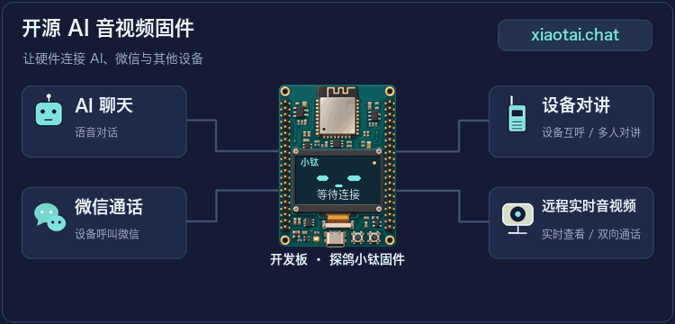
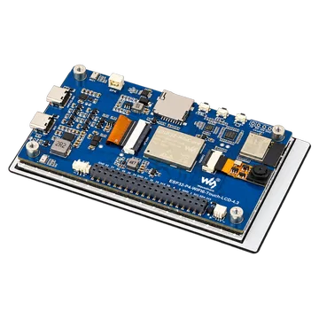
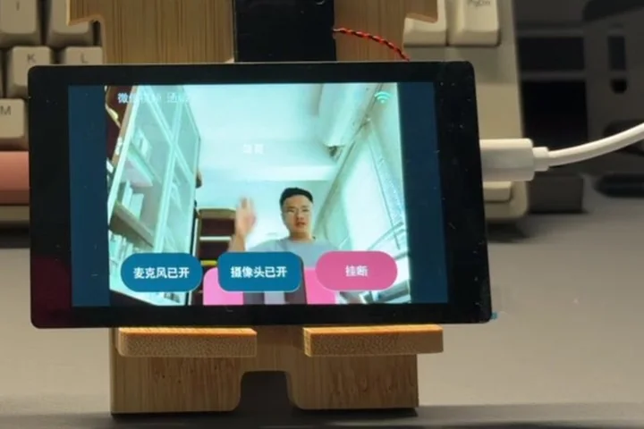
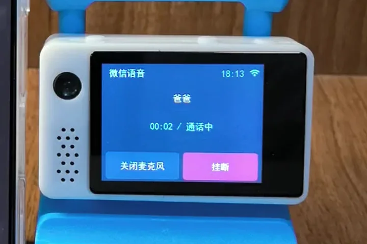
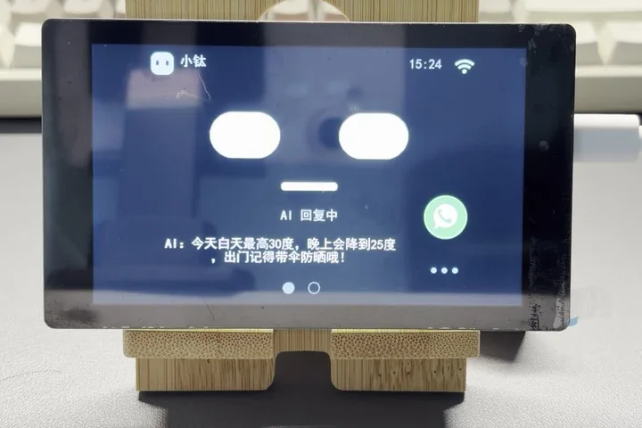
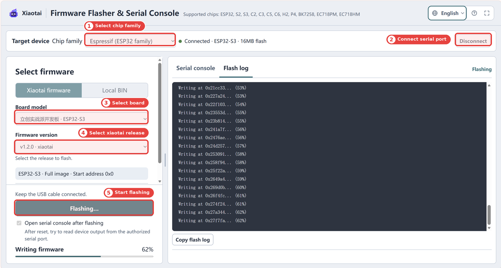

# Tange XiaoTai · Open-source AI Audio and Video Firmware

[Quick start](README.en.md) · [Architecture and development](ARCHITECTURE.en.md) · [Contributing](CONTRIBUTING.en.md) · [Documentation](docs/README.en.md)

[中文](README.md) · [English](README.en.md)

Flash open-source firmware from your desktop browser to turn a dev board into a device for **WeChat calls, browser live view and two-way audio, device intercom, and AI (artificial intelligence) chat**. No local toolchain is required to try a release; you can also build from source.



▶ [Watch demo video on Bilibili (Chinese)](https://www.bilibili.com/video/BV1JpsP63EhY/) · **Quick start**: choose a board → open the [XiaoTai Web Flasher](https://xiaotai.chat/web-flasher/) → configure Wi-Fi → bind the device.

**Online service**: Individuals can self-register and bind devices on [xiaotai.chat](https://xiaotai.chat) with no usage or time cap for test devices. WeChat voice calls work via the Tange XiaoTai Mini Program with no extra credentials required; custom model APIs and self-hosted backends are also supported.

## Choose a board and firmware

Match the physical model, PCB (printed circuit board) revision, and display variant; firmware is not interchangeable just because boards share a chip.

| Board image | Model and board ID | Form factor & key features | Download & guide |
|---|---|---|---|
|  | LCKFB ShiZhanPai ESP32-S3<br>PCB V1.0.1<br>`lckfb-esp32s3` | 320×240 touchscreen<br>WeChat voice calls, browser live view & intercom, AI chat | [Downloads](docs/downloads.en.md#lckfb-esp32s3)<br>[Flashing guide](docs/boards/lckfb-esp32s3/README.en.md#flashing) |
|  | LCKFB ShiZhanPai BK7258<br>`lckfb-bk7258` | Touchscreen + buttons<br>WeChat voice calls, browser live view & intercom, AI chat, group intercom | [Downloads](docs/downloads.en.md#lckfb-bk7258)<br>[Flashing guide](docs/boards/lckfb-bk7258/README.en.md#flashing) |
|  | Waveshare ESP32-P4-WIFI6-Touch-LCD-4.3<br>PCB V1.0<br>`waveshare-esp32p4-touch-lcd-43c-v10` | 4.3" 800×480 touchscreen<br>WeChat audio/video calls, browser live view & intercom, AI chat | [Downloads](docs/downloads.en.md#waveshare-esp32p4-touch-lcd-43c-v10)<br>[Flashing guide](docs/boards/waveshare-esp32p4-touch-lcd-43c-v10/README.en.md#flashing) |
|  | M5Stack CoreS3-Lite<br>K128-Lite · ILI9342C display<br>`m5stack-cores3-lite` | 320×240 touchscreen<br>WeChat voice calls, browser live view & intercom, AI chat, group intercom | [Downloads](docs/downloads.en.md#m5stack-cores3-lite)<br>[Flashing guide](docs/boards/m5stack-cores3-lite/README.en.md#flashing) |
|  | MGKFB BK7258 AI toy board<br>Dual-eye displays · 8 MiB Flash<br>`mgkfb-bk7258` | Dual-eye displays + physical buttons<br>WeChat voice calls, browser live view & intercom, AI chat | [Downloads](docs/downloads.en.md#mgkfb-bk7258)<br>[Flashing guide](docs/boards/mgkfb-bk7258/README.en.md#flashing) |

See the [complete board catalog](docs/boards/README.en.md) and [Firmware downloads](docs/downloads.en.md) for full specs and archives.

Example pictures:

  

## Flash the firmware

Flash directly from desktop Chrome or Edge (typically 2–3 minutes) without installing a build toolchain:

1. Connect the board to your computer with a data-capable USB cable and close any serial monitor using that port.
2. Open the [XiaoTai Web Flasher](https://xiaotai.chat/web-flasher/), select the chip family, and click **Connect device** to pick the board's serial port.
3. Under **Xiaotai firmware**, choose your board and the current `xiaotai` release (such as `v1.2.0`), verify address `0x0`, and click **Start flashing**.



See each board's flashing guide above for USB ports and download mode. For a downloaded release, choose **Local BIN** with `_merged.bin` for ESP32 or `_all-app.bin` for BK7258 at `0x0`. ESP32 full images overwrite Wi-Fi and binding settings; for BK7258, back up factory calibration first and avoid full-chip erase.

## First use

1. **Configure Wi-Fi**: After reboot, connect to the open `XiaoTai-XXXX` hotspot ("no internet" is expected). Visit `http://192.168.6.1` if the portal does not open, then submit your 2.4 GHz Wi-Fi credentials.
2. **Bind the device**: Reconnect to the internet, open the [XiaoTai devices page](https://xiaotai.chat/devices), and enter the six-digit code shown or spoken by the device under Add device.
3. **Start using**: Start AI chat or WeChat calls on the device, and open live view and two-way audio on the web page. Boards such as LCKFB ESP32-S3 use WeChat voice calls while streaming camera video to browser live view; see each board guide for details.
4. **Reset and troubleshoot**: To change Wi-Fi or rebind, use Device settings → Reset device on touchscreens (see the board guide for button/serial reset) and avoid arbitrary full-chip erase. Check the board guide's troubleshooting section first; include board ID, firmware version, audio/video direction, and serial logs when reporting issues.

## Get involved

Pick the entry point that fits you:

- **Flash and try it**: If you have one of the boards above, flash it from the [XiaoTai Web Flasher](https://xiaotai.chat/web-flasher/). Share photos or ask setup questions in [GitHub Discussions](https://github.com/tangeai/xiaotai/discussions) rather than opening an issue for usage help.
- **Help without writing firmware**: Submit serial logs, board photos matching the exact PCB revision, flashing troubleshooting notes, or fixes for Chinese/English documentation mismatches.
- **Write code or add a board**: Start with issues labeled [`good first issue`](https://github.com/tangeai/xiaotai/labels/good%20first%20issue), or follow [Adding a board](CONTRIBUTING.en.md#adding-a-board) to register new hardware.

## Build from source

You do not need a development environment to use prebuilt firmware. For development, clone the source and inspect the board registry:

```bash
git clone https://github.com/tangeai/xiaotai.git
cd xiaotai
python3 tools/build.py --list-boards
python3 tools/build.py --validate
```

Install the toolchain and dependencies from your [board guide](docs/boards/README.en.md), then run these commands from the repository root:

```bash
# Replace <board-id> with the board ID from the table above
python3 tools/build.py --board <board-id> --dry-run
python3 tools/build.py --board <board-id>
```

ESP32-S3 / ESP32-P4 use **ESP-IDF v5.5.5**. Run `. tools/activate_esp_idf.sh` before building and check the version with `idf.py --version`. For M5, also select the display variant as described in its guide.

`tools/build.py` is the shared build entry point and dispatches to each board's native project. ESP-IDF and Beken use separate SDKs (software development kits) and toolchains. See [Contributing](CONTRIBUTING.en.md) for testing, packaging, and release requirements.

## Related repositories

The repositories below cover other hardware lines of the same product; firmware and development for the five boards above stay in this repository (`tangeai/xiaotai`):

- XiaoTai ESP32: [tangeai/xiaotai-esp32](https://github.com/tangeai/xiaotai-esp32)
- XiaoTai Lierda: [tangeai/xiaotai-lierda](https://github.com/tangeai/xiaotai-lierda)

## Next steps

- Share photos, ask setup questions, or discuss new boards in [GitHub Discussions](https://github.com/tangeai/xiaotai/discussions).
- See the top navigation for architecture, media lifecycle, and contributing guides.

This project's own source code and documentation use the [MIT License](LICENSE); third-party dependencies and assets are listed in [Third-party assets](THIRD_PARTY.en.md).
