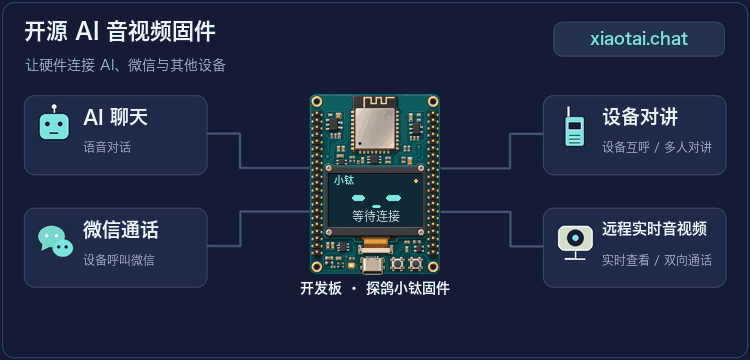
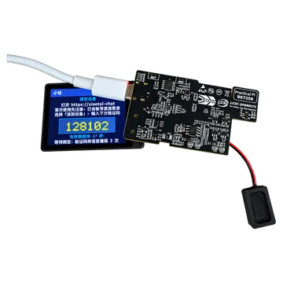
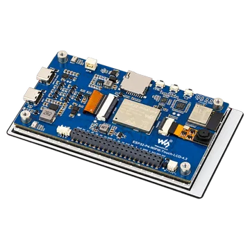
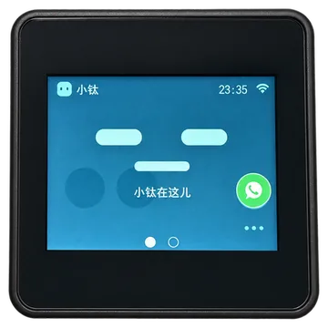
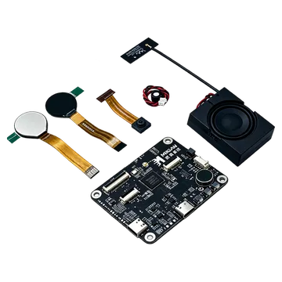
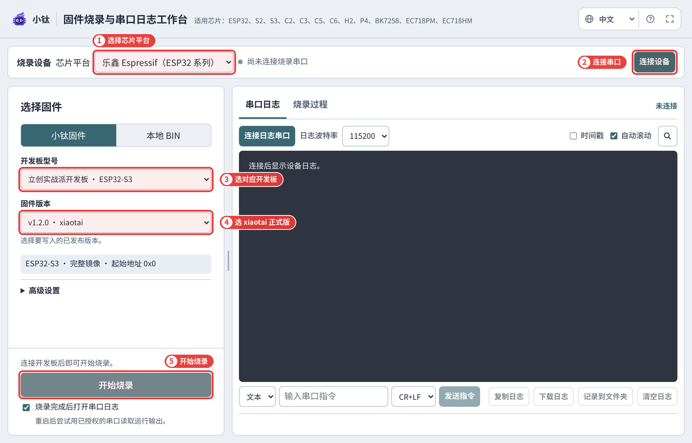

# 探鸽小钛 · 开源 AI 音视频固件

[快速体验](README.md) · [架构与二次开发](ARCHITECTURE.md) · [参与开发](CONTRIBUTING.md) · [完整文档](docs/README.md)

[中文](README.md) · [English](README.en.md)

用电脑浏览器把开源固件刷到开发板上，就能实现 **微信通话、网页实时看画面与对讲、设备互呼和 AI（人工智能）聊天**。无需先装编译环境，可直接烧录体验，也可从源码开发自己的设备。



▶ [观看 B 站演示视频](https://www.bilibili.com/video/BV1JpsP63EhY/) · **快速开始**：选择开发板 → 打开[小钛网页烧录工具](https://xiaotai.chat/web-flasher/) → 配置 Wi-Fi → 绑定设备。
各板支持的形态与能力不同，在线功能依赖小钛绑定与信令平台、TiRTC 音视频及 AI/微信服务；接入自建平台需另行配置服务地址和凭证。

## 选择开发板和固件

按实物型号、PCB（印刷电路板）版本和屏幕变体选板；同一芯片的固件不能随意混用。

| 开发板图片 | 型号与板卡 ID | 形态与主要能力 | 下载与指南 |
|---|---|---|---|
|  | 立创·实战派 ESP32-S3<br>PCB V1.0.1<br>`lckfb-esp32s3` | 320×240 触摸屏<br>微信语音通话、网页看画面对讲、AI 对话 | [下载固件](docs/downloads.md#lckfb-esp32s3)<br>[烧录指南](docs/boards/lckfb-esp32s3/README.md#烧录) |
|  | 立创·实战派 BK7258<br>`lckfb-bk7258` | 触摸屏 + 按键<br>微信语音通话、网页看画面对讲、AI 对话、多人对讲 | [下载固件](docs/downloads.md#lckfb-bk7258)<br>[烧录指南](docs/boards/lckfb-bk7258/README.md#烧录) |
|  | 微雪 ESP32-P4-WIFI6-Touch-LCD-4.3<br>PCB V1.0<br>`waveshare-esp32p4-touch-lcd-43c-v10` | 4.3 寸 800×480 触摸屏<br>微信音视频通话、网页看画面对讲、AI 对话 | [下载固件](docs/downloads.md#waveshare-esp32p4-touch-lcd-43c-v10)<br>[烧录指南](docs/boards/waveshare-esp32p4-touch-lcd-43c-v10/README.md#烧录) |
|  | M5Stack CoreS3-Lite<br>K128-Lite · ILI9342C 屏幕<br>`m5stack-cores3-lite` | 320×240 触摸屏<br>微信语音通话、网页看画面对讲、AI 对话、多人对讲 | [下载固件](docs/downloads.md#m5stack-cores3-lite)<br>[烧录指南](docs/boards/m5stack-cores3-lite/README.md#烧录) |
|  | 觅感 AI 玩具开发板 BK7258<br>双屏眼睛 · 8 MiB Flash<br>`mgkfb-bk7258` | 双屏眼睛 + 实体按键<br>微信语音通话、网页看画面对讲、AI 对话 | [下载固件](docs/downloads.md#mgkfb-bk7258)<br>[烧录指南](docs/boards/mgkfb-bk7258/README.md#烧录) |

M5 仅支持 ILI9342C 屏幕；觅感 BK7258 适用于 8 MiB Flash、双屏眼睛开发板。
完整规格与历史版本见[完整开发板目录](docs/boards/README.md)与[固件下载](docs/downloads.md)。

## 烧录

使用电脑上的 Chrome 或 Edge 浏览器即可直接烧录（通常约 2~3 分钟），无需安装编译工具链：

1. 用支持数据传输的 USB 线连接开发板与电脑，关闭占用串口的终端软件。
2. 打开[小钛网页烧录工具](https://xiaotai.chat/web-flasher/)，选择芯片平台并点击 **连接设备** 选中串口。
3. 在 **小钛固件** 中选中对应板型与当前正式版（如 `v1.2.0`），确认起始地址为 `0x0` 后点击 **开始烧录**。



各板 USB 接口与进入下载模式的方法见上表烧录指南。已有发布镜像时可选 **本地 BIN**（ESP32 选 `_merged.bin`，BK7258 选 `_all-app.bin`，均从 `0x0` 写入）。ESP32 完整镜像会覆盖 Wi-Fi 和绑定信息；BK7258 首次烧录前请备份原厂校准资料，避免全片擦除。

## 首次体验

### 1. 配置 Wi-Fi

烧录完成并重启后，没有可用网络配置的设备会显示或播报配网提示，广播无密码的
`XiaoTai-XXXX` 热点。用手机或电脑连接，提示“无互联网”属于正常现象。

配网页未自动打开时，访问 `http://192.168.6.1`，选择 2.4 GHz Wi-Fi，输入路由器密码并提交。
热点重新出现表示联网失败，请检查密码和信号后重试。

### 2. 绑定设备

已绑定的设备恢复在线后即可使用。需要绑定时，设备会显示或播报 6 位验证码。让手机或电脑恢复互联网连接，登录
[小钛设备页](https://xiaotai.chat/devices)，在“添加设备”中输入验证码；过期时使用设备新生成的号码。
设备出现在列表中，并进入首页、眼睛显示或“准备就绪”状态，表示绑定成功。

### 3. 开始使用

按对应板卡指南，通过屏幕或实体按键发起 AI 对话；在网页设备页打开实时查看与双向对讲。
需要微信通话时，先按设备提示添加微信联系人。结束会话后，应能回到待机状态并再次使用。
微信通话是否支持视频、设备互呼及多人对讲以各板指南为准；例如立创·实战派 ESP32-S3 当前为微信语音通话，摄像头画面用于网页实时查看。

### 4. 恢复与排查

触摸屏设备需要更换网络或重新绑定时，进入“设备设置 → 重置设备”，确认后重新配网、绑定。
无触摸屏设备按本板指南使用实体按键或串口命令，不要随意全片擦除。

遇到问题，先查看板卡指南的“排查”一节。反馈时提供板卡 ID、固件版本、操作步骤和现象；
音视频问题请注明方向，例如“网页到设备无声”。能获取串口日志时一并附上。

### 常见疑问

- **需要安装 ESP-IDF 或编译环境吗？** 不需要。直接体验请使用上方的 Chrome / Edge 网页烧录；只有二次开发修改固件时才需按下方说明搭建环境。
- **立创·实战派 ESP32-S3 支持微信视频通话吗？** 当前为微信语音通话，板载摄像头画面用于网页端实时查看；如需微信音视频通话可参考微雪 ESP32-P4。
- **刷机找不到串口或配网失败怎么办？** 先核对数据线、串口驱动和 2.4 GHz Wi-Fi，查看对应板卡指南的“排查”一节；仍未解决可携带板卡 ID 与现象到 Discussions 提问。

## 参与

欢迎按自己的方式参与小钛项目：

- **直接烧录体验**：手里有上表开发板时，打开[小钛网页烧录工具](https://xiaotai.chat/web-flasher/)即可体验。欢迎在 [GitHub Discussions](https://github.com/tangeai/xiaotai/discussions) 晒出你的设备或发帖求助；使用问题请优先发在 Discussions，不要直接堆进 Issues。
- **不改代码也能帮忙**：欢迎补充串口日志、与 PCB 版本一致的板卡实拍照片、烧录排查步骤，或修正中英文文档不一致的地方。
- **提交代码或适配新板**：想改代码可先看标有 [`good first issue`](https://github.com/tangeai/xiaotai/labels/good%20first%20issue) 的任务；想接入新开发板，请按[新增开发板](CONTRIBUTING.md#新增开发板)准备资料并提交登记。

## 从源码编译

不修改固件时，无需安装开发环境。二次开发先下载源码并查看板卡清单：

```bash
git clone https://github.com/tangeai/xiaotai.git
cd xiaotai
python3 tools/build.py --list-boards
python3 tools/build.py --validate
```

按目标[开发板指南](docs/boards/README.md)安装工具链与依赖，再从仓库根目录执行：

```bash
# 将 <board-id> 替换为上表中的板卡 ID
python3 tools/build.py --board <board-id> --dry-run
python3 tools/build.py --board <board-id>
```

ESP32-S3 / ESP32-P4 使用 **ESP-IDF v5.5.5**；构建前执行 `. tools/activate_esp_idf.sh`，
用 `idf.py --version` 核对。M5 还需按板卡指南选择屏幕变体。

`tools/build.py` 是统一构建入口，转调各板原生工程；ESP-IDF 与 Beken 使用独立的
SDK（软件开发工具包）和工具链。测试、打包与发布要求见[参与开发](CONTRIBUTING.md)。

## 相关仓库

以下仓库为同一产品的其他硬件线；上表五块开发板的固件下载与开发入口均在本仓库（`tangeai/xiaotai`）：

- 小钛 ESP32：[tangeai/xiaotai-esp32](https://github.com/tangeai/xiaotai-esp32)
- 小钛 Lierda（利尔达）：[tangeai/xiaotai-lierda](https://github.com/tangeai/xiaotai-lierda)

## 下一步

- 刷完晒图、配网排查或讨论新板适配：前往 [GitHub Discussions](https://github.com/tangeai/xiaotai/discussions)。
- 了解代码分层、媒体生命周期与贡献规范：见顶部导航中的架构与参与开发文档。

本项目自有源码和文档采用 [MIT License](LICENSE)，第三方依赖与资源详见[第三方资产清单](THIRD_PARTY.md)。
