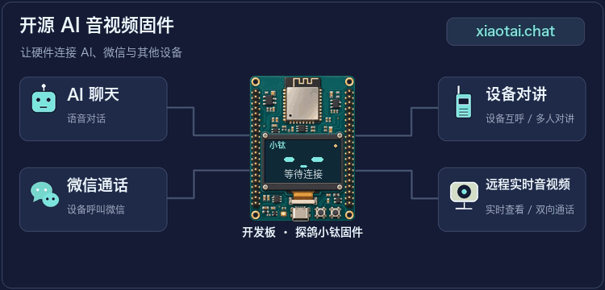
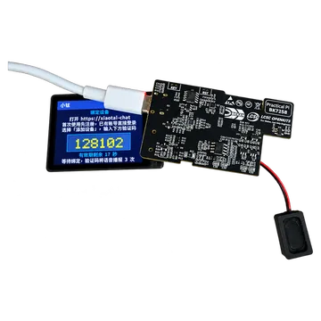
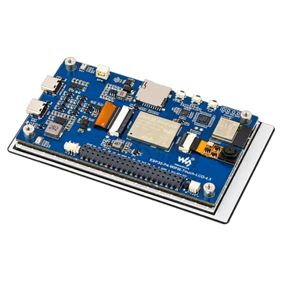
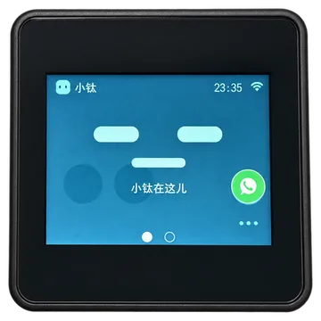
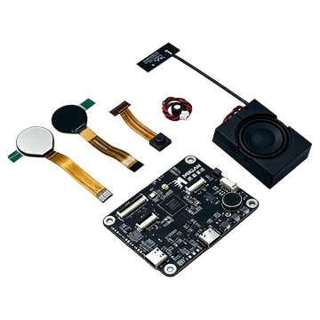

# 探鸽小钛 · 开源 AI 音视频固件

[快速体验](README.md) · [架构与二次开发](ARCHITECTURE.md) · [参与开发](CONTRIBUTING.md) · [完整文档](docs/README.md)

[中文](README.md) · [English](README.en.md)

探鸽小钛是面向带屏和无屏设备的开源 AI（人工智能）音视频固件，支持 **AI 聊天、微信通话、
设备对讲和网页远程查看**。可直接下载固件体验，也可从源码开发自己的设备。



**快速开始：选择开发板 → 下载并烧录固件 → 配置 Wi-Fi → 绑定设备。**
各板支持的功能不同，具体范围和已知限制见对应指南。

在线功能依赖设备绑定与信令平台、TiRTC 实时音视频服务，以及 AI 或微信服务配置。
本仓库提供设备固件；使用发布包可按下文体验，接入自建平台则需另行配置服务地址和凭证。

## 选择开发板和固件

按实物型号、PCB（印刷电路板）版本和屏幕变体选板。同一芯片的固件也不能随意混用。
板卡 ID 是构建与固件文件名中的唯一标识；当前版本、准确文件名和发布说明统一见[固件下载](docs/downloads.md)。

| 开发板图片 | 型号与板卡 ID | 固定下载入口 | 文档入口 |
|---|---|---|---|
|  | 立创·实战派 BK7258<br>`lckfb-bk7258` | [下载固件与发布说明](docs/downloads.md#lckfb-bk7258) | [烧录指南](docs/boards/lckfb-bk7258/README.md#烧录) |
|  | 立创·实战派 ESP32-S3<br>PCB V1.0.1<br>`lckfb-esp32s3` | [下载固件与发布说明](docs/downloads.md#lckfb-esp32s3) | [烧录指南](docs/boards/lckfb-esp32s3/README.md#烧录) |
|  | 微雪 ESP32-P4-WIFI6-Touch-LCD-4.3<br>PCB V1.0<br>`waveshare-esp32p4-touch-lcd-43c-v10` | [下载固件与发布说明](docs/downloads.md#waveshare-esp32p4-touch-lcd-43c-v10) | [烧录指南](docs/boards/waveshare-esp32p4-touch-lcd-43c-v10/README.md#烧录) |
|  | M5Stack CoreS3-Lite<br>K128-Lite · ILI9342E / ILI9342C 屏幕<br>`m5stack-cores3-lite` | [下载固件与发布说明](docs/downloads.md#m5stack-cores3-lite) | [烧录指南](docs/boards/m5stack-cores3-lite/README.md#烧录) |
|  | 觅感 AI 玩具开发板 BK7258<br>双屏眼睛 · 8 MiB Flash<br>`mgkfb-bk7258` | [下载固件与发布说明](docs/downloads.md#mgkfb-bk7258) | [烧录指南](docs/boards/mgkfb-bk7258/README.md#烧录) |

M5 必须按 ILI9342E/ILI9342C 屏幕控制器选择对应变体；觅感 BK7258 固件适用于 8 MiB Flash、
双屏眼睛开发板。各板规格、功能与依赖见[完整开发板目录](docs/boards/README.md)，历史版本见
[GitHub Releases](https://github.com/tangeai/xiaotai/releases)。

## 烧录

先打开上表中对应开发板的烧录指南，连接电脑并进入下载模式，再按下表选择文件。
文件名中的 `<版本>` 需替换为下载页给出的完整版本，包含构建号。

| 平台 | 首次烧录文件 | 工具与地址 |
|---|---|---|
| ESP32-S3 / ESP32-P4 | 对应板卡和变体的 `-merged.bin` 完整镜像 | Chrome 或 Edge 打开[乐鑫网页烧录工具](https://espressif.github.io/esptool-js/)，只添加一个 BIN，地址 `0x0` |
| 立创 BK7258 | 解压 ZIP，选择 `lckfb-bk7258-<版本>-all-app.bin` | Beken 下载工具，地址 `0x00000000` |
| 觅感 BK7258 | 解压 ZIP，选择 `mgkfb-bk7258-<版本>-all-app.bin` | Beken 下载工具，地址 `0x00000000` |

ESP32 也可使用分文件 ZIP，按 `MANIFEST.json` 的 `flash_files` 写入全部 BIN：
立创 S3 和 M5 各 3 个，微雪 P4 为 4 个。**完整镜像与分文件方式二选一**；应用 BIN
不能当作完整镜像写到 `0x0`，ZIP、ELF 和 JSON 也不能直接烧录。

ESP32 完整镜像会覆盖保存的 Wi-Fi 和绑定信息。需要保留配置的升级应使用分文件包，
核对新旧分区与配置兼容性，不执行全片擦除。BK 的 `-app_pack.rbl` 仅用于 OTA（无线升级），
不能用于首次串口烧录；觅感 OTA 尚未专项验收。各板具体连接、复位与烧录步骤见上表中的指南。

## 首次体验

### 1. 配置 Wi-Fi

烧录完成并重启后，没有可用网络配置的设备会显示或播报配网提示，广播无密码的
`XiaoTai-XXXX` 热点。用手机或电脑连接，提示“无互联网”属于正常现象。

配网页未自动打开时，访问 `http://192.168.6.1`，选择 2.4 GHz Wi-Fi，输入路由器密码并提交。
热点重新出现表示联网失败，请检查密码和信号后重试。

### 2. 绑定设备

设备联网后会显示或播报 6 位验证码。让手机或电脑恢复互联网连接，登录
[小钛设备页](https://xiaotai.chat/devices)，在“添加设备”中输入验证码；过期时使用设备新生成的号码。
设备出现在列表中，并进入首页、眼睛显示或“准备就绪”状态，表示绑定成功。

### 3. 开始使用

按对应板卡指南，通过屏幕或实体按键发起 AI 对话；在网页设备页打开实时查看与双向对讲。
需要微信通话时，先按设备提示添加微信联系人。结束会话后，应能回到待机状态并再次使用。
设备互呼、多人对讲及视频能力以各板指南为准。

### 4. 恢复与排查

触摸屏设备需要更换网络或重新绑定时，进入“设备设置 → 重置设备”，确认后重新配网、绑定。
无触摸屏设备按本板指南使用实体按键或串口命令，不要随意全片擦除。

遇到问题，先查看板卡指南的“排查”一节。反馈时提供板卡 ID、固件版本、操作步骤和现象；
音视频问题请注明方向，例如“网页到设备无声”。能获取串口日志时一并附上。

## 从源码编译

不修改固件时，无需安装开发环境。二次开发先下载源码并查看板卡清单：

```bash
git clone https://github.com/tangeai/xiaotai.git
cd xiaotai
python3 tools/build.py --list-boards
python3 tools/build.py --validate
```

按目标[开发板指南](docs/boards/README.md)安装工具链与依赖，再从仓库根目录执行：

```bash
# 将 <board-id> 替换为上表中的板卡 ID
python3 tools/build.py --board <board-id> --dry-run
python3 tools/build.py --board <board-id>
```

ESP32-S3 / ESP32-P4 使用 **ESP-IDF v5.5.5**；构建前执行 `. tools/activate_esp_idf.sh`，
用 `idf.py --version` 核对。M5 还需按板卡指南选择屏幕变体。

`tools/build.py` 是统一构建入口，转调各板原生工程；ESP-IDF 与 Beken 使用独立的
SDK（软件开发工具包）和工具链。测试、打包与发布要求见[参与开发](CONTRIBUTING.md)。

## 相关仓库

| 项目 | 仓库 |
|---|---|
| 小钛 ESP32 | [tangeai/xiaotai-esp32](https://github.com/tangeai/xiaotai-esp32) |
| 小钛 Lierda（利尔达） | [tangeai/xiaotai-lierda](https://github.com/tangeai/xiaotai-lierda) |

各仓库支持的型号、构建方式和固件下载以各自 README 为准。

## 下一步

- [架构与二次开发](ARCHITECTURE.md)：代码分层、媒体生命周期与扩展方式。
- [参与开发](CONTRIBUTING.md)：新增板卡、测试与发布流程。
- [完整文档](docs/README.md)：板卡、产品、工程和调试资料索引。

本项目自有源码和文档采用 [MIT License](LICENSE)。第三方依赖和资源遵守各自许可证，
详见[第三方清单](THIRD_PARTY.md)。
