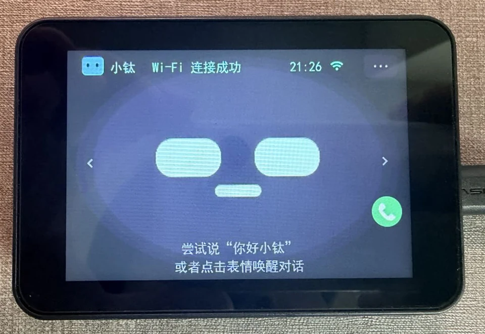
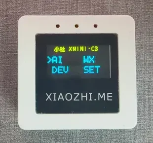
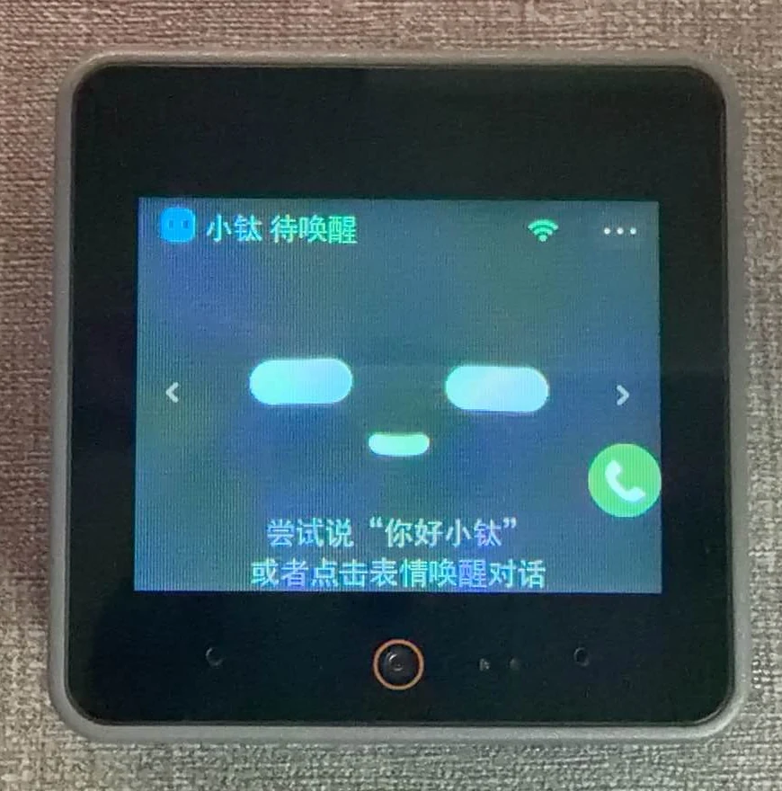
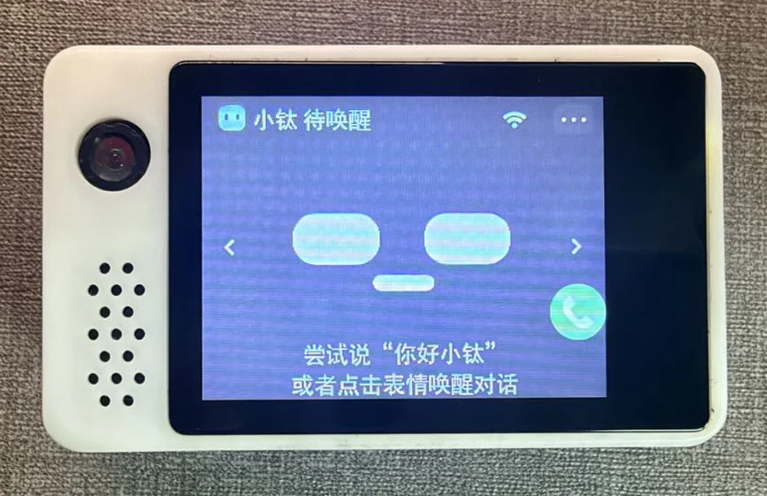

# 设备实拍

[返回快速体验](../../README.md) · [返回开发板目录](README.md)

下面是小钛在四款设备上的正面实拍，可用于对照外观和界面。照片中的外壳、界面和
固件版本可能与当前发布包不同；下载前仍需核对完整型号、PCB（印刷电路板）版本和屏幕变体。

## 微雪 P4

照片展示设备正面，未显示完整型号和 PCB 版本。不能仅凭这张照片判断是否对应
[微雪 4.3 英寸 P4 指南](waveshare-esp32p4-touch-lcd-43c-v10/README.md)中的硬件。

## Xmini-C3

屏幕显示 `XMINI-C3`。当前[开发板目录](README.md)尚未登记此板，照片不表示本仓库
已经提供它的适配工程或固件下载。

## M5Stack S3

照片展示设备外观，未显示底部型号标签。使用 [CoreS3-Lite 指南](m5stack-cores3-lite/README.md)
前，先确认实物为 `K128-Lite`；`ILI9342E`、`ILI9342C` 屏幕控制器不能从正面照片区分。

## 立创 S3

照片展示带外壳的设备正面。PCB 版本需另行核对，固件和使用步骤见
[立创·实战派 ESP32-S3 指南](lckfb-esp32s3/README.md)。

## 图片来源

以上四张照片由本次文档贡献者提供，设备名称按提供者标注。图片只裁切背景、缩放并
转换为 WebP，没有修改屏幕内容或板卡标识。界面显示用于展示拍摄时的状态，不作为当前固件的验证记录。
