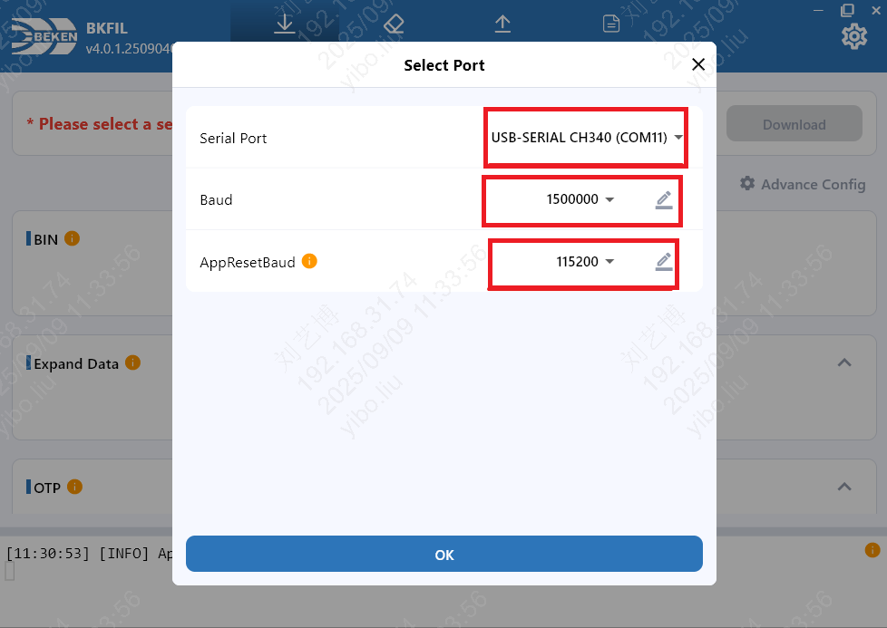
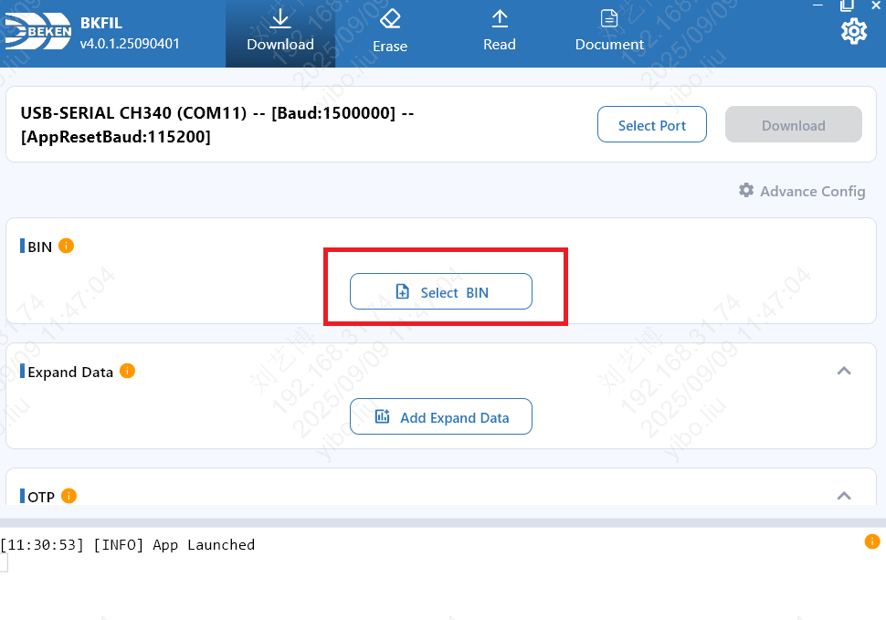
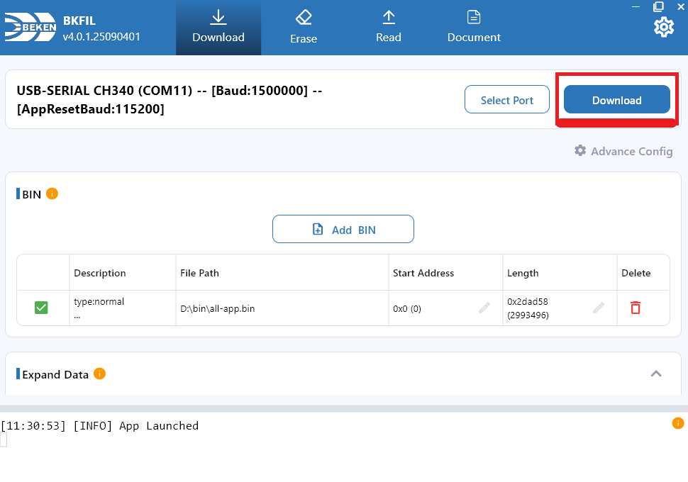

# LCKFB BK7258

[Back to boards](../README.en.md) · [Firmware and release notes](../../downloads.en.md#lckfb-bk7258)

[中文](README.md) · [English](README.en.md)

Board ID: `lckfb-bk7258`. Touchscreen and buttons control browser-based (H5) live view and two-way audio, AI conversations, device calls, WeChat VoIP, and group intercom.

## Flashing

`<version>` in filenames means the full download-page version, including build number. Select actual downloaded files and check the manifest; screenshot versions and paths are examples.

See [Downloads](../../downloads.en.md#lckfb-bk7258) for firmware for **LCKFB BK7258**. Current features have on-board usage validation; build identities, scope, and outstanding checks are in [Validation (Chinese)](VALIDATION.md) and [release notes](../../downloads.en.md#lckfb-bk7258).

### Install the flashing tool

Install Beken's official **BKFIL v4** for your computer:

| System | Official download directory |
|---|---|
| Windows | [Windows](https://dl.bekencorp.com/tools/bkfil/v4/gui/windows/) |
| macOS | [macOS](https://dl.bekencorp.com/tools/bkfil/v4/gui/macos/) |
| Linux | [Linux](https://dl.bekencorp.com/tools/bkfil/v4/gui/linux/) |

Choose the appropriate installer.

The [BKFIL v4 manual (Chinese)](https://docs.bekencorp.com/arminodoc/bk_app/bkfil_v4/zh_CN/latest/index.html) describes settings; the [official LCKFB flashing tutorial (Chinese)](https://wiki.lckfb.com/zh-hans/szpi-bk7258/szpi-bk7258/basic/burn.html) covers wiring, reset, and the download handshake.

### Flashing steps

1. Download and extract the [firmware ZIP](../../downloads.en.md#lckfb-bk7258).
2. Connect as described in the LCKFB tutorial and close serial log terminals. Open BKFIL and use **Select Port** to select this board.
3. Click **Select BIN**, choose **`lckfb-bk7258-<version>-all-app.bin`**, set **Start Address** to **`0x00000000`**, and check the file row.
4. Click **Download**, reset or power-cycle as prompted, and wait for writing and verification. Power-cycle afterward.
5. Open 115200-baud logs and verify board `lckfb-bk7258` and the downloaded full version before setup and binding.

The official BKFIL screenshots mark controls in red. Ports, paths, and baud rates are examples; select your detected device and the LCKFB BIN above. `Baud` is the flashing rate; `AppResetBaud` is the application-reset communication rate.

**Select the port.** Click **Select Port**, choose the board, then **OK**.



**Select firmware.** Click **Select BIN** and select `lckfb-bk7258-<version>-all-app.bin`.



**Check the address and download.** Use **`0x0`**, check the file, and click **Download**.



| File | Purpose |
|---|---|
| `lckfb-bk7258-<version>-all-app.bin` | **Serial flashing** at **`0x0`** |
| `lckfb-bk7258-<version>-app_pack.rbl` | **Not for serial flashing**; OTA updates only, not initial flashing |
| `MANIFEST.json` | File metadata and checksums; not a flash image |
| `symbols/`, `partitions/`, `build_identity.json` | Diagnostics; not flash images |

Use the package's `MANIFEST.json` SHA-256 values to verify files. Back up factory firmware and RF calibration before initial flashing. Preserve calibration, factory-data, and credential partitions during ordinary updates; do not erase the whole chip.

For source builds, flash the `package/all-app.bin` under Building, also at `0x0`.

Alternatively, import the complete BIN into the [LCKFB BK7258 browser flasher](https://wiki.lckfb.com/storage/html/bk7258-web-flasher/#/download) in Chrome or Edge, following the official tutorial.

## First use

Confirm `all-app.bin` was fully flashed and the board rebooted normally before setup and binding.

### 1. Configure Wi-Fi

On first flashing, after `ap_cmd wifi-clear`, or if the saved network fails, the display prompts for setup and the board broadcasts an open `XiaoTai-XXXX` hotspot. Connect a phone or computer; “no internet” is expected.

If the setup page does not open, visit `http://192.168.6.1`, select 2.4 GHz Wi-Fi, enter the router password, and submit. If the hotspot returns, check password and coverage. Setup behavior and wording follow [Product requirements 4.11 (Chinese)](../../product/PRODUCT_REQUIREMENTS.md#411-启动无网络与-ap-配网).

### 2. Bind the device

Once online, the screen displays and speaks a 6-digit code. Restore internet access on the phone/computer, sign in to the [XiaoTai device page](https://xiaotai.chat/devices), and enter the code under Add device. Use the refreshed code if it expires. The “Ready” display and serial `READY` indicate successful binding.

### 3. Try features and recover

Try AI, then browser live view and two-way audio. With WeChat contacts available, try a WeChat call. The device should return to Ready after the session. Development acceptance is described under Testing.

To change networks or rebind, open Device settings → Reset device, confirm, and repeat setup and binding. Serial `ap_cmd wifi-clear` clears Wi-Fi; `ap_cmd tirtc-clear` clears local binding credentials. See [BK7258 serial commands](../../development/BK7258_SERIAL_COMMANDS.en.md) for effects and reboot behavior.

## Specifications

| Item | Details |
| --- | --- |
| Board ID | `lckfb-bk7258` |
| Chip and platform | BK7258 / BK-AVDK SMP 3.1.1.10 (pinned SDK configuration; validation scope below) |
| Storage and memory | 8 MiB Flash, 16 MiB PSRAM, 640 KiB SRAM (current partition/memory configuration declarations) |
| Display and touch | ST7789V2 SPI display, FT6336 touch |
| Audio | On-chip ADC/DAC, microphone, speaker, amplifier; full-duplex AEC for AI, AGC for current 8 kHz calls |
| Camera | GC0308 DVP, H.264 target 640×480@20 |
| Network | 2.4 GHz Wi-Fi |
| Features | H5 live view/two-way audio, AI conversation, device calls, WeChat VoIP |

Photos clearly identifying PCB revision still need archiving. Check physical markings and startup probe reports. Flash, PSRAM, and SRAM values above come from partition/memory configuration. AP startup shows about 10.6 MiB of dynamic PSRAM heap, which is the AP allocation, not total physical capacity.

The AP probe cannot currently read Flash JEDEC ID, so 8 MiB Flash is not a runtime-measured capacity.

## Audio and video parameters

All audio is mono; uplink packets are 20 ms.

| Scenario | Direction | Codec and sample rate | Packet or video parameters |
|---|---|---|---|
| AI conversation | Uplink; downlink | Uplink A-law / 16 kHz; downlink Opus / 16 kHz | 320-byte uplink; downlink packet buffer maximum 512 bytes |
| H5, device calls, WeChat calls | Bidirectional | A-law / 8 kHz | 160-byte uplink; downlink decoded at actual packet length |
| Video uplink | Camera → network | H.264 | Target 640×480 / 20 fps |

AI hardware sampling and AEC/NS/AGC processing stay at 16 kHz, followed directly by A-law uplink encoding.

The device logs actual frame rate, bitrate, keyframes, and drops; target video settings alone do not establish link quality.

AI acoustic echo cancellation (AEC) processes 20 ms / 320 samples using the actual PCM sent to the digital-to-analog converter (DAC) as playback reference, followed by noise suppression (NS) and automatic gain control (AGC).

H5, device calls, WeChat, and group intercom at 8 kHz process 160 samples per block with AGC only. AEC/NS remain disabled there pending hardware validation.

See the [Media contract (Chinese)](../../product/MEDIA_CONTRACT.md) for stream IDs and AEC boundaries.

## Environment and dependencies

Flashing a release does not require a development environment. Source builds require:

| Dependency | Pinned version or file | Source | SHA-256 |
| --- | --- | --- | --- |
| Host | Linux/WSL2, Git, Python 3 | [Git](https://git-scm.com/downloads), [Python](https://www.python.org/downloads/) | — |
| BK-AVDK SMP | `release/v3.1.1.10`, commit `398cab28b938e69ba2071a597daf00845dd080b6` | [Official release](https://github.com/bekencorp/bk_avdk_smp/releases/tag/release%2Fv3.1.1.10) | — |
| C/C++ compiler | `arm-none-eabi-gcc 10.3.1 20210824`, `gcc-arm-none-eabi-10.3-2021.10-x86_64-linux.tar.bz2` | [Official Arm toolchains](https://dl.bekencorp.com/tools/toolchain/arm) | `97dbb4f019ad1650b732faffcc881689cedc14e2b7ee863d390e0a41ef16c9a3` |
| TiRTC-Nano | Locally delivered `tirtc__beken-bk7258__gcc-arm-none-eabi-10.3-2021.10__v2.5.0__mini`; manifest targets BK-AVDK 3.1.1.10 | Public download URL unconfirmed | Project static library: `1a6327ebed1d74b5008d56896a2110dc872633321124ad1267eeb740a80d4cf9` |
| Vendor components | AP/CP multimedia, network, display, touch, digital video port (DVP), and audio | [SDK source](https://github.com/bekencorp/bk_avdk_smp/tree/398cab28b938e69ba2071a597daf00845dd080b6) | — |

The project has independent AP/CP configuration, partitions, TLS libraries, and TiRTC static libraries. Compiler and library binary interfaces must match.

For first-time BK7258 development, prepare the host using [LCKFB environment setup (Chinese)](https://wiki.lckfb.com/zh-hans/szpi-bk7258/szpi-bk7258/basic/programming-environment-setup.html).

Then read the [AP/CP dual-image architecture (Chinese)](https://wiki.lckfb.com/zh-hans/szpi-bk7258/szpi-bk7258/advanced-guide/ap-cp-architecture.html).

Use [Beken BK7258 SDK documentation](https://docs.bekencorp.com/arminodoc/bk_avdk_smp/smp_doc/bk7258/en/v3.1.1/index.html) for build options and platform interfaces.

## Schematics and hardware sources

| Material | Version | Link | SHA-256 | Status |
| --- | --- | --- | --- | --- |
| Official BK7258 SMP documentation | v3.1.1 | [Documentation](https://docs.bekencorp.com/arminodoc/bk_avdk_smp/smp_doc/bk7258/en/v3.1.1/index.html) | — | Available |
| BK7258 datasheet | — | [PDF](https://docs.bekencorp.com/spec/BK7258/BK7258%C2%A0Datasheet.pdf) | — | Available |
| Official hardware index | v3.1.1 | [Documentation](https://docs.bekencorp.com/arminodoc/bk_ai_smp/bk7258/en/v3.1.1/hw-reference/index.html) | — | Available |
| Official LCKFB BK7258 environment tutorial | — | [Tutorial (Chinese)](https://wiki.lckfb.com/zh-hans/szpi-bk7258/szpi-bk7258/basic/programming-environment-setup.html) | — | Available; not a substitute for schematics |

Hardware IR and on-board validation establish pin and peripheral findings.

## Development directories

Familiarity with C, Git, and serial logs is required. The project builds application-core (AP) and communication-core (CP) images separately, then packages the complete flash image.

### Directory structure

```text
xiaotai/
├── boards/lckfb/bk7258/                       LCKFB pins and peripherals
├── product/                                  Shared product state and protocols
├── platforms/common/                         Common board C interfaces
├── platforms/beken/
│   ├── runtime/{src,include,assets}/          Shared BK business, network, media, display
│   ├── src/                                  Audio lifecycle and interaction adapters
│   ├── third_party/tirtc/                     Pinned headers, libraries, provenance
│   └── tools/                                Build, versions, SDK patches
└── firmware/beken/bk7258/lckfb-bk7258-xiaotai/
    ├── ap/                                   AP startup, probes, configuration
    ├── cp/                                   CP and AP bring-up entry
    ├── partitions/                           Partition configuration
    ├── tools/                                Native build wrappers, diagnostics, host tests
    ├── CMakeLists.txt、Makefile、pj_config.mk Build entry points
    └── probe-report.*.json                    Hardware probes and pre-build checks
```

`build/`, `output/`, and `tools/__pycache__/` are generated directories. Do not edit them directly or make source depend on them.

### Find code by task

| Task | Start here | Boundary |
| --- | --- | --- |
| Model, build entry, capabilities | [`board.json`](../../../boards/lckfb/bk7258/board.json) | Build metadata, not wiring evidence |
| GPIO, power, buttons, touch, display, camera, audio wiring | [`boards/lckfb/bk7258/`](../../../boards/lckfb/bk7258/) | `board_config.h` contains constants; `board_*.c` adapts peripherals |
| AP/CP startup and composition | [`ap/ap_main.c`](../../../firmware/beken/bk7258/lckfb-bk7258-xiaotai/ap/ap_main.c), [`cp/cp_main.c`](../../../firmware/beken/bk7258/lckfb-bk7258-xiaotai/cp/cp_main.c), [`ap/CMakeLists.txt`](../../../firmware/beken/bk7258/lckfb-bk7258-xiaotai/ap/CMakeLists.txt) | CP starts the platform; main product features run on AP |
| H5, AI, device/WeChat calls, and room priority | [`xiaotai_runtime.c`](../../../product/src/xiaotai_runtime.c), [`xiaotai_app.c`](../../../platforms/beken/runtime/src/xiaotai_app.c) | Shared rules in the former; serialized BK7258 transitions in the latter |
| Contacts, calls, rooms, AI protocols | [`product/src/`](../../../product/src/) | Update shared modules and `product/tests/`; do not duplicate protocols in BK adapters |
| Hotspot and `192.168.6.1` page | [`xiaotai_network.c`](../../../platforms/beken/runtime/src/xiaotai_network.c) | Router-client STA, setup SoftAP, and setup page |
| Binding, discovery, HTTP, MQTT | [`xiaotai_platform_client.c`](../../../platforms/beken/runtime/src/xiaotai_platform_client.c) | Platform interfaces and messaging, not media ownership |
| TiRTC, stream IDs, callbacks, recovery | [`xiaotai_tirtc.c`](../../../platforms/beken/runtime/src/xiaotai_tirtc.c), [`xiaotai_tirtc_recovery.c`](../../../platforms/beken/runtime/src/xiaotai_tirtc_recovery.c) | SDK callbacks post bounded events; no direct product-state mutation |
| Microphone, speaker, codecs, AEC | [`xiaotai_audio.c`](../../../platforms/beken/runtime/src/xiaotai_audio.c), [`board_audio.c`](../../../boards/lckfb/bk7258/board_audio.c) | Media flow in AP adapter; ADC, DAC, DMA, amplifier in board code |
| Camera, H.264, video sending | [`xiaotai_video.c`](../../../platforms/beken/runtime/src/xiaotai_video.c), [`board_camera.c`](../../../boards/lckfb/bk7258/board_camera.c) | Reuse `product/src/xiaotai_video_pacer.c` pacing rules |
| Pages, touch areas, button intents | [`xiaotai_ui.c`](../../../platforms/beken/runtime/src/xiaotai_ui.c), [`xiaotai_touch.c`](../../../platforms/beken/runtime/src/xiaotai_touch.c), [`xiaotai_button.c`](../../../platforms/beken/runtime/src/xiaotai_button.c) | Render in adapters; runtime retains business state |
| Persistence, console, metrics, probes | [`platforms/beken/runtime/src/`](../../../platforms/beken/runtime/src/) | Start with `xiaotai_storage.c`, `xiaotai_console.c`, `xiaotai_metrics.c`, `xiaotai_probe.c` |
| Partitions, build environment, packaging | [`partitions/`](../../../firmware/beken/bk7258/lckfb-bk7258-xiaotai/partitions/), [`tools/`](../../../firmware/beken/bk7258/lckfb-bk7258-xiaotai/tools/) | Validate AP, CP, complete package, and Flash layout together |

### Display layout and font constraints

The board uses **320×240 landscape**, **`compact`** layout, and a **16-pixel** font for body text, buttons, settings, contacts, and dynamic captions. Firmware links only the selected size, with no different-size fallback for missing glyphs.

`font_size_px` in `product/interaction/profiles.json` determines size, not the chip type.

A new screen requires registered resolution, orientation, and layout, plus font, wrapping, and touch tests. Hardware IR/probes remain the hardware evidence; layout settings are not a substitute. See [Interaction profiles §1.3 (Chinese)](../../product/PRODUCT_INTERACTION_PROFILES.md#13-屏幕布局与字库约束).

### Recommended workflow

1. Identify product rules, BK platform adaptation, or board hardware as the proper layer.
2. Add a failing regression in `product/tests/` or through an AP public interface before changing behavior.
3. Keep pin, bus, DMA, clock, power, and device-initialization changes in board/platform code; check `probe-report.hardware.json` and measurements.
4. Before UI, button, or flow changes, read [`PRODUCT_INTERACTION_PROFILES.md` (Chinese)](../../product/PRODUCT_INTERACTION_PROFILES.md). Room-assignment triggers follow its room-refresh section.
5. Run the checks and builds under Testing. Peripheral and media changes also require hardware validation; build success is insufficient.

The project's [`AGENTS.md` (Chinese)](../../../firmware/beken/bk7258/lckfb-bk7258-xiaotai/AGENTS.md) adds BK7258 constraints. Root [`ARCHITECTURE.md`](../../../ARCHITECTURE.en.md) explains layers, and [Testing](../../../tests/README.en.md) defines test requirements.

## Building

```bash
bash firmware/beken/bk7258/lckfb-bk7258-xiaotai/tools/setup_build_env.sh
python3 tools/build.py --board lckfb-bk7258
```

The complete image is `firmware/beken/bk7258/lckfb-bk7258-xiaotai/build/bk7258/lckfb-bk7258-xiaotai/package/all-app.bin`. Development, diagnostics, and releases use this fixed directory. Pass `--release` explicitly for publication; `build_identity.json` records configuration without adding a separate output directory.

Check configuration, version, and SHA-256 before flashing. `app_pack.rbl` is OTA-only.

The board's `BUILD_NUMBER` increments; `VERSION.md` stores product version. `build/bk7258/lckfb-bk7258-xiaotai/build_identity.json` records version, configuration, and complete-image checksum. The same `package/` also contains a board/version/build-named BIN identical to `all-app.bin`.

Build release firmware and a ZIP:

```bash
python3 tools/build.py --board lckfb-bk7258 --release
python3 tools/package_validation_firmware.py --board lckfb-bk7258 --beken-build-profile release
```

Development and release configurations share the output directory; packaging uses the preceding build. See [Firmware versions and releases](../../../CONTRIBUTING.en.md#firmware-versions-and-releases).

## Testing

```bash
bash tools/check.sh
python3 tools/build.py --board lckfb-bk7258
```

On hardware, cover display, touch, GC0308, 8 kHz A-law calls, AI 16 kHz A-law uplink and Opus downlink, AEC/NS/AGC, H5, AI, and WeChat VoIP. After sessions, confirm `READY`, correct audio counts, recovered task/memory levels, and no reboot.

## Troubleshooting

At 115200 baud in the CP shell:

```text
ap_cmd status
ap_cmd call-status
ap_cmd help
```

`status` shows connectivity, binding, current session, and memory; `call-status` shows call state. See [BK7258 serial commands](../../development/BK7258_SERIAL_COMMANDS.en.md) for complete commands, parameters, service addresses, and board applicability.

- H5 downlink silence: check stream 14 reception, A-law-to-PCM decoding, DAC writes, and amplifier GPIO.
- WeChat uplink silence: check platform acceptance for stream 0; persistent `rc=-40006` means uplink is not ready.
- Video disconnects: record TiRTC buffer use, actual bitrate, keyframes, and drops, not just Wi-Fi RSSI.
- AI problems or self-interruption: check 320-byte A-law uplink, Opus downlink, AEC reference, `ref-under`, and shutdown order.

## Validation status and limitations

H5 live view/two-way audio, AI, and WeChat have hardware usage records limited to their firmware and tested scope. Build.70 logs confirm automatic setup-page opening on iPhone. See [Validation (Chinese)](VALIDATION.md) for new image identities and scope.

TODO: complete per-image acceptance, long-run duration, Flash JEDEC identification, PCB revision, and board photos. OTA, weak-network recovery, double-talk AEC, and long-duration group intercom need dedicated validation.

Do not commit credential-bearing raw logs or dated stability investigations. Record current findings in HIL records tied to firmware SHA-256.
