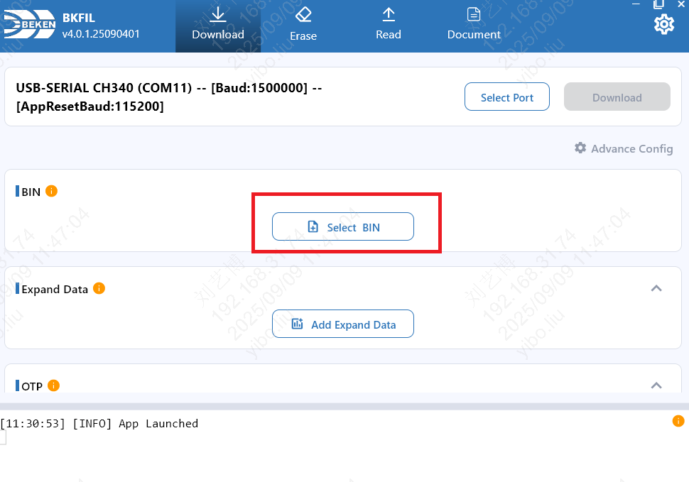
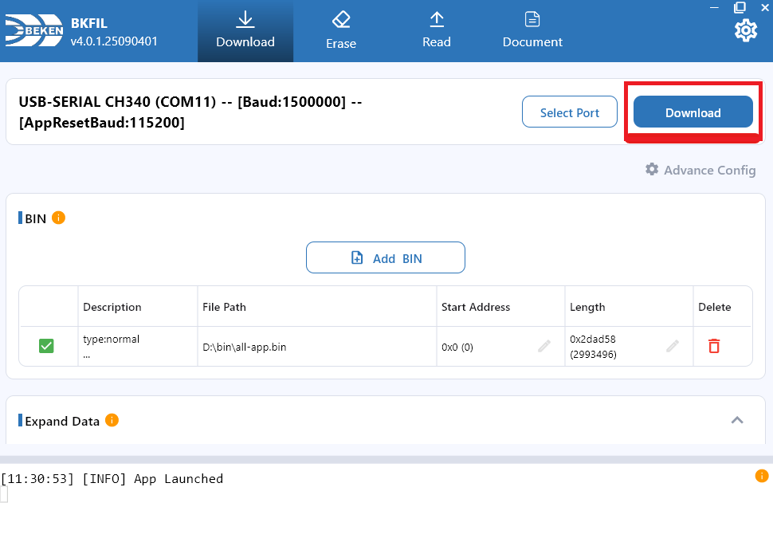

# 立创·实战派 BK7258

[返回开发板目录](../README.md) · [下载固件及发布说明](https://github.com/tangeai/xiaotai/releases/tag/bk7258-v1.0.2-build.72)

板卡 ID：`lckfb-bk7258`。本板通过触摸屏和按键操作，支持 H5（网页端）实时查看与
双向对讲、AI（人工智能）对讲、设备互呼、微信 VoIP（网络语音通话）和多人对讲。

## 烧录

当前发布版本为 **v1.0.2 · build.72**，适用于 **立创·实战派 BK7258**。
当前功能已完成实板使用验证，构建身份、验证范围和剩余专项见
[验证记录](VALIDATION.md)和[发布说明](https://github.com/tangeai/xiaotai/releases/tag/bk7258-v1.0.2-build.72)。

### 安装烧录工具

下载并安装 Beken 官方烧录工具 **BKFIL v4**，按电脑系统选择：

| 系统 | 官方下载目录 |
|---|---|
| Windows | [下载 Windows 版](https://dl.bekencorp.com/tools/bkfil/v4/gui/windows/) |
| macOS | [下载 macOS 版](https://dl.bekencorp.com/tools/bkfil/v4/gui/macos/) |
| Linux | [下载 Linux 版](https://dl.bekencorp.com/tools/bkfil/v4/gui/linux/) |

打开对应目录，下载适合电脑系统的安装包。界面与参数说明见
[BKFIL v4 官方操作指南](https://docs.bekencorp.com/arminodoc/bk_app/bkfil_v4/zh_CN/latest/index.html)；
本板接线、复位和下载握手方式见
[立创官方烧录教程](https://wiki.lckfb.com/zh-hans/szpi-bk7258/szpi-bk7258/basic/burn.html)。

### 烧录步骤

1. 下载并解压 [`lckfb-bk7258-1.0.2+build.72-validation.zip`](https://github.com/tangeai/xiaotai/releases/download/bk7258-v1.0.2-build.72/lckfb-bk7258-1.0.2%2Bbuild.72-validation.zip)。
2. 按立创官方烧录教程连接电脑，关闭占用串口的日志终端。打开 BKFIL，点击 **Select Port**，选择本板串口。
3. 点击 **Select BIN**，选择 **`lckfb-bk7258-1.0.2+build.72-all-app.bin`**，确认 **Start Address** 为 **`0x00000000`**，勾选该文件。
4. 点击 **Download**，按工具提示复位或重新上电。等待写入和工具校验完成，再重新上电。
5. 打开 115200 波特率串口日志，核对板卡 `lckfb-bk7258` 和版本 `1.0.2+build.72`，再进行配网与绑定。

下面使用 BKFIL 官方指南的界面截图，红框标出了操作位置。截图中的串口号、文件路径和
波特率是示例；串口选电脑实际识别的设备，固件选上面的立创 BIN 文件。
`Baud` 是烧录速率，`AppResetBaud` 是应用复位通信速率，两者不是同一项。

**选择串口。** 点击 **Select Port**，选择本板串口，再点击 **OK**。


**选择固件。** 点击 **Select BIN**，选择 `lckfb-bk7258-1.0.2+build.72-all-app.bin`。



**确认地址并下载。** 文件起始地址为 **`0x0`**，勾选文件后点击 **Download**。



| 文件 | 用途 |
|---|---|
| `lckfb-bk7258-1.0.2+build.72-all-app.bin` | **直接用于串口烧录**，起始地址 **`0x0`** |
| `lckfb-bk7258-1.0.2+build.72-app_pack.rbl` | **不能用于串口烧录**；仅用于 OTA（无线升级），首次烧录不使用 |
| `MANIFEST.json` | 文件信息与校验清单，不用于烧录 |
| `symbols/`、`partitions/`、`build_identity.json` | 开发排查资料，不用于烧录 |

如需核验文件，使用固件包内 `MANIFEST.json` 中的 SHA-256 校验值。
首次烧录前请备份原厂固件和射频校准资料；日常更新保留校准、工厂数据和凭证分区，
不要全片擦除。自行编译时，使用“编译”一节列出的 `package/all-app.bin`，地址同样为 `0x0`。

也可使用[立创 BK7258 网页烧录工具](https://wiki.lckfb.com/storage/html/bk7258-web-flasher/#/download)，
在 Chrome 或 Edge 中导入上述完整 BIN；操作见立创官方教程。

## 首次使用

确认 `all-app.bin` 已经完整烧录且设备正常重启，再进行下面的配网和绑定。

### 1. 配置 Wi-Fi

首次烧录、执行过 `ap_cmd wifi-clear` 或已保存网络连接失败时，屏幕显示配网提示，并广播
无密码的 `XiaoTai-XXXX` 热点。用手机或电脑连接该热点；提示“无互联网”属于正常现象。
配网页没有自动打开时，访问 `http://192.168.6.1`，选择 2.4 GHz Wi-Fi，输入路由器密码
并提交。热点重新出现表示联网失败，需要检查密码和信号覆盖。
配网页面及文案统一以[产品需求 4.11](../../product/PRODUCT_REQUIREMENTS.md#411-启动无网络与-ap-配网)为准。

### 2. 绑定设备

联网后，屏幕显示 6 位验证码，扬声器也会播报。让手机或电脑恢复互联网连接，登录
[小钛设备页](https://xiaotai.chat/devices)，在添加设备处输入屏幕上的验证码。验证码
过期时使用屏幕刷新后的号码。屏幕显示“准备就绪”且串口进入 `READY`，表示绑定成功。

### 3. 验证与恢复

依次检查屏幕、触摸、按键、摄像头、麦克风和扬声器，再验证 H5（网页端）双向对讲、
至少三轮 AI 对话以及微信 VoIP（网络语音通话）双向语音。每次会话结束后应回到
`READY`，且没有 UsageFault（处理器用法异常）、异常重启或持续内存下降。

需要更换网络或重新绑定时，进入“设备设置 → 重置设备”，确认后重新配网并绑定。
串口也可使用 `ap_cmd wifi-clear` 清除 Wi-Fi，或用 `ap_cmd tirtc-clear` 清除本机绑定凭证。
命令效果和重启说明见[BK7258 串口命令](../../development/BK7258_SERIAL_COMMANDS.md)。

## 规格

| 项目 | 内容 |
| --- | --- |
| 板卡 ID（仓库中的开发板唯一名称） | `lckfb-bk7258` |
| 芯片与平台 | BK7258 / BK-AVDK SMP 3.1.1.10（实板复验中） |
| 存储与内存 | 8 MiB Flash、16 MiB PSRAM、640 KiB SRAM（均为当前分区/内存配置声明） |
| 显示与触摸 | ST7789V2 SPI 屏、FT6336 触摸 |
| 音频 | 板载 ADC/DAC、麦克风、扬声器和功放；AI 支持全双工 AEC，8 kHz 通话当前使用 AGC |
| 摄像头 | GC0308 DVP，H.264 640×480@20 目标档位 |
| 网络 | 2.4 GHz Wi-Fi |
| 产品能力 | H5 实时查看/双向对讲、AI 对讲、设备呼叫、微信 VoIP |

板卡照片和 PCB（印刷电路板）版本仍需归档。当前身份要结合实物丝印与启动探针报告核对。
上述 Flash、PSRAM 和 SRAM 容量来自当前 BK7258 工程的分区与内存区域配置；其中 AP
启动日志显示约 10.6 MiB 的动态 PSRAM 堆，这是分配给 AP 的可用区域，不是物理 PSRAM
总容量。当前 AP 探针不能读取 Flash JEDEC ID，因此 8 MiB Flash 尚未获得运行时器件识别
结果，不能表述为实测容量。

## 音视频参数

当前正式版 **v1.0.2 · build.72** 的参数如下。音频均为单声道，上行每包 20 毫秒。

| 场景 | 方向 | 编码与采样率 | 包大小或画面参数 |
|---|---|---|---|
| AI 对讲 | 上行；下行 | 上行 A-law / 16 kHz；下行 Opus / 16 kHz | 上行 320 字节；下行单包缓冲上限 512 字节 |
| H5 对讲、设备呼叫、微信通话 | 双向 | A-law / 8 kHz | 上行 160 字节；下行按实际包长解码 |
| 视频上行 | 设备摄像头 → 网络 | H.264 | 目标 640×480 / 20 fps |

AI 的硬件采样和 AEC/NS/AGC 处理保持 16 kHz，处理后直接编码上行 A-law。

设备会记录实际帧率、码率、关键帧和丢帧数，不能只用视频目标值判断链路质量。

AI 的 AEC（声学回声消除）按 20 毫秒、320 个采样处理，播放参考来自实际送入 DAC
（数模转换器）的 PCM 音频，随后依次执行 NS 和 AGC。8 kHz H5、设备呼叫、微信 VoIP
及多人对讲每个处理块为 160 个采样，当前只启用 AGC；AEC/NS 在完成实板验证前保持关闭。

完整流编号和 AEC 边界见[音视频参数与媒体处理](../../product/MEDIA_CONTRACT.md)。

## 环境与依赖

仅烧录发布固件不需要搭建开发环境。从源码编译时，准备以下工具和依赖。

| 依赖项 | 固定版本或文件 | 来源或下载链接 | SHA-256 |
| --- | --- | --- | --- |
| 主机环境 | Linux/WSL2、Git、Python 3 | [Git](https://git-scm.com/downloads)、[Python](https://www.python.org/downloads/) | 无 |
| BK-AVDK SMP | `release/v3.1.1.10`，提交 `398cab28b938e69ba2071a597daf00845dd080b6` | [Beken 官方发布](https://github.com/bekencorp/bk_avdk_smp/releases/tag/release%2Fv3.1.1.10) | 无 |
| C/C++ 编译器 | `arm-none-eabi-gcc 10.3.1 20210824`，`gcc-arm-none-eabi-10.3-2021.10-x86_64-linux.tar.bz2` | [Beken 官方 Arm 工具链目录](https://dl.bekencorp.com/tools/toolchain/arm) | `97dbb4f019ad1650b732faffcc881689cedc14e2b7ee863d390e0a41ef16c9a3` |
| TiRTC-Nano | 本地交付的 `tirtc__beken-bk7258__gcc-arm-none-eabi-10.3-2021.10__v2.5.0__mini`，manifest 指向 BK-AVDK 3.1.1.10 | 公开下载链接待核实 | 工程内静态库：`1a6327ebed1d74b5008d56896a2110dc872633321124ad1267eeb740a80d4cf9` |
| 厂商组件 | AP/CP 多媒体、网络、显示、触摸、DVP（数字视频端口）和音频组件 | [BK-AVDK SMP 源码](https://github.com/bekencorp/bk_avdk_smp/tree/398cab28b938e69ba2071a597daf00845dd080b6) | 无 |

本工程使用独立的 AP/CP 配置、分区、TLS（安全传输）库和 TiRTC 静态库，
编译器与库的二进制接口需要匹配。

第一次开发 BK7258 时，先按[立创官方环境搭建](https://wiki.lckfb.com/zh-hans/szpi-bk7258/szpi-bk7258/basic/programming-environment-setup.html)
准备主机，再阅读 [AP/CP 双镜像架构](https://wiki.lckfb.com/zh-hans/szpi-bk7258/szpi-bk7258/advanced-guide/ap-cp-architecture.html)。

需要查阅编译选项和平台接口时，使用 [Beken BK7258 SDK 文档](https://docs.bekencorp.com/arminodoc/bk_avdk_smp/smp_doc/bk7258/en/v3.1.1/index.html)。

## 原理图与硬件资料

| 资料名称 | 版本或标识 | 链接 | SHA-256 | 资料状态 |
| --- | --- | --- | --- | --- |
| BK7258 SMP 官方文档 | v3.1.1 | [在线文档](https://docs.bekencorp.com/arminodoc/bk_avdk_smp/smp_doc/bk7258/en/v3.1.1/index.html) | 无 | 已提供 |
| BK7258 Datasheet | 无 | [PDF](https://docs.bekencorp.com/spec/BK7258/BK7258%C2%A0Datasheet.pdf) | 无 | 已提供 |
| BK7258 官方硬件资料索引 | v3.1.1 | [在线文档](https://docs.bekencorp.com/arminodoc/bk_ai_smp/bk7258/en/v3.1.1/hw-reference/index.html) | 无 | 已提供 |
| 立创·实战派 BK7258 官方板卡页 | 无 | | 无 | 未提供 |

引脚和外设结论以工程 Hardware IR（硬件信息记录）及实板验证为准。

## 开发目录

修改源码前，需要熟悉 C 语言、Git 和串口日志。BK7258 工程分别构建 AP（应用核）与
CP（通信核）镜像，再打包为完整烧录文件；入口和配置见下表。

### 目录结构

```text
xiaotai/
├── boards/lckfb/bk7258/                       立创板级引脚和外设适配
├── product/                                  跨芯片产品状态与协议
├── platforms/common/                         公共板级 C 接口
├── platforms/beken/
│   ├── runtime/{src,include,assets}/          BK 公共业务、网络、音视频和显示实现
│   ├── src/                                  公共音频生命周期和交互适配
│   ├── third_party/tirtc/                     固定 TiRTC 头文件、库及来源记录
│   └── tools/                                公共构建、版本与 SDK 补丁
└── firmware/beken/bk7258/lckfb-bk7258-xiaotai/
    ├── ap/                                   立创 AP 启动入口、探针与工程配置
    ├── cp/                                   CP 通信核及 AP 拉起入口
    ├── partitions/                           本工程分区配置
    ├── tools/                                原生构建封装、诊断和主机测试
    ├── CMakeLists.txt、Makefile、pj_config.mk 工程构建入口
    └── probe-report.*.json                    硬件探测与构建前检查结果
```

`build/`、`output/` 和 `tools/__pycache__/` 是生成目录，不是源码入口。不要直接修改其中
的文件，也不要让源码引用这些目录。

### 按任务查找代码

| 要修改的内容 | 首先查看 | 说明 |
| --- | --- | --- |
| 开发板型号、构建入口和能力声明 | [`boards/lckfb/bk7258/board.json`](../../../boards/lckfb/bk7258/board.json) | 只记录构建元数据，不作为硬件接线证据 |
| GPIO、电源、按键、触摸、显示、摄像头和音频接线 | [`boards/lckfb/bk7258/`](../../../boards/lckfb/bk7258/) | `board_config.h` 保存板级常量，`board_*.c` 实现具体外设适配 |
| AP/CP 启动顺序或组件装配 | [`ap/ap_main.c`](../../../firmware/beken/bk7258/lckfb-bk7258-xiaotai/ap/ap_main.c)、[`cp/cp_main.c`](../../../firmware/beken/bk7258/lckfb-bk7258-xiaotai/cp/cp_main.c)、[`ap/CMakeLists.txt`](../../../firmware/beken/bk7258/lckfb-bk7258-xiaotai/ap/CMakeLists.txt) | CP 负责平台启动，主要产品功能运行在 AP |
| H5、AI、设备呼叫、微信 VoIP 和多人对讲的优先级 | [`product/src/xiaotai_runtime.c`](../../../product/src/xiaotai_runtime.c)、[`platforms/beken/runtime/src/xiaotai_app.c`](../../../platforms/beken/runtime/src/xiaotai_app.c) | 前者维护跨芯片会话规则，后者串行执行 BK7258 上的状态切换 |
| 联系人、呼叫协议、多人房间和 AI 协议 | [`product/src/`](../../../product/src/) | 先改公共模块及对应 `product/tests/`，不要在 BK 适配层复制一套协议 |
| 配网热点和 `192.168.6.1` 页面 | [`xiaotai_network.c`](../../../platforms/beken/runtime/src/xiaotai_network.c) | 管理 STA（连接路由器的工作模式）、SoftAP（设备配网热点）和配网页 |
| 设备绑定、服务发现、HTTP 和 MQTT | [`xiaotai_platform_client.c`](../../../platforms/beken/runtime/src/xiaotai_platform_client.c) | 负责平台接口和消息通道，不负责媒体资源所有权 |
| TiRTC 连接、流编号、回调和异常恢复 | [`xiaotai_tirtc.c`](../../../platforms/beken/runtime/src/xiaotai_tirtc.c)、[`xiaotai_tirtc_recovery.c`](../../../platforms/beken/runtime/src/xiaotai_tirtc_recovery.c) | SDK 回调只投递有界事件，不能直接修改产品状态 |
| 麦克风、扬声器、编解码和 AEC | [`xiaotai_audio.c`](../../../platforms/beken/runtime/src/xiaotai_audio.c)、[`board_audio.c`](../../../boards/lckfb/bk7258/board_audio.c) | 通用媒体流程放 AP 适配层，ADC、DAC、DMA 和功放控制放板级代码 |
| 摄像头采集、H.264 和视频发送 | [`xiaotai_video.c`](../../../platforms/beken/runtime/src/xiaotai_video.c)、[`board_camera.c`](../../../boards/lckfb/bk7258/board_camera.c) | 业务节流规则复用 `product/src/xiaotai_video_pacer.c` |
| 屏幕页面、触摸区域和按键意图 | [`xiaotai_ui.c`](../../../platforms/beken/runtime/src/xiaotai_ui.c)、[`xiaotai_touch.c`](../../../platforms/beken/runtime/src/xiaotai_touch.c)、[`xiaotai_button.c`](../../../platforms/beken/runtime/src/xiaotai_button.c) | 页面渲染留在适配层，业务状态仍由产品运行时管理 |
| 持久化、串口命令、运行指标和硬件探针 | [`platforms/beken/runtime/src/`](../../../platforms/beken/runtime/src/) | 分别从 `xiaotai_storage.c`、`xiaotai_console.c`、`xiaotai_metrics.c` 和 `xiaotai_probe.c` 开始 |
| 分区、编译环境和打包 | [`partitions/`](../../../firmware/beken/bk7258/lckfb-bk7258-xiaotai/partitions/)、[`tools/`](../../../firmware/beken/bk7258/lckfb-bk7258-xiaotai/tools/) | 修改后同时验证 AP、CP、整包和 Flash 布局 |

### 屏幕布局与字体约束

本板当前屏幕适配为 **320×240 横屏**，variant 选择 **`compact`** 布局，产品正文、
按钮、设置值、联系人与动态字幕统一使用 **16 像素**字库。每个固件只链接所选字号，
不允许缺字后回退到另一字号。字号由 `product/interaction/profiles.json` 的
`font_size_px` 约束，不按芯片类型自行推断。

更换屏幕时必须重新登记分辨率、方向与布局，并验证字号、换行和触摸区域。当前屏幕
硬件证据仍以本板 Hardware IR / 探针资料为准；布局配置不能替代硬件证据。完整要求见
[产品交互规范 §1.3](../../product/PRODUCT_INTERACTION_PROFILES.md#13-屏幕布局与字库约束)。

### 推荐修改顺序

1. 先判断改动属于产品规则、BK 平台适配还是当前开发板硬件，避免在错误层级修补。
2. 修改业务行为前，从 `product/tests/` 或 AP 公共接口增加会失败的回归用例，再改实现。
3. 修改引脚、总线、DMA、时钟、电源或器件初始化时，只改板级/平台代码，并核对
   `probe-report.hardware.json` 和实板测量结果。
4. 修改界面、按钮或用户流程前，阅读
   [`PRODUCT_INTERACTION_PROFILES.md`](../../product/PRODUCT_INTERACTION_PROFILES.md)；修改房间
   分配触发条件时，以其中的“房间分配刷新”一节为准。
5. 完成后运行本页“测试”一节中的检查和构建命令；涉及外设或媒体时，还要执行对应实板
   验证，不能只看编译结果。

工程内 [`AGENTS.md`](../../../firmware/beken/bk7258/lckfb-bk7258-xiaotai/AGENTS.md) 记录
BK7258 的额外修改约束；根目录 [`ARCHITECTURE.md`](../../../ARCHITECTURE.md) 说明整体
分层，[测试说明](../../../tests/README.md)说明测试要求。

## 编译

```bash
bash firmware/beken/bk7258/lckfb-bk7258-xiaotai/tools/setup_build_env.sh
python3 tools/build.py --board lckfb-bk7258
```

整包产物位于
`firmware/beken/bk7258/lckfb-bk7258-xiaotai/build/bk7258/lckfb-bk7258-xiaotai/package/all-app.bin`。
开发、诊断和发布都使用这个固定目录；准备线上发布时显式传入 `--release`，
本次配置记录在 `build_identity.json`，不会增加另一套输出目录。烧录前应核对所选构建配置、
版本和文件 SHA-256；`app_pack.rbl` 仅用于 OTA。

构建号在本板 `BUILD_NUMBER` 中递增，产品版本保存在 `VERSION.md`。
`build/bk7258/lckfb-bk7258-xiaotai/build_identity.json` 记录本次版本、配置及完整镜像校验值。
同一 `package/` 目录还会生成带板卡名、版本和构建号的完整 BIN，内容与 `all-app.bin` 相同。

生成发布配置的固件和 ZIP 包：

```bash
python3 tools/build.py --board lckfb-bk7258 --release
python3 tools/package_validation_firmware.py --board lckfb-bk7258 --beken-build-profile release
```

开发配置和发布配置共用上述输出目录，打包命令使用前一条命令生成的固件。
版本、打包和发布要求见[固件版本与发布](../../../CONTRIBUTING.md#固件版本与发布)。

## 测试

```bash
bash tools/check.sh
python3 tools/build.py --board lckfb-bk7258
```

实板验证要覆盖显示、触摸、GC0308 摄像头、8 kHz A-law/AGC、16 kHz Opus/AEC/NS/AGC、H5、AI
和微信 VoIP。结束会话后确认状态回到 `READY`，音频上下行计数正确，任务数和内存水位
恢复且设备没有重启。

## 排查

使用 115200 波特率串口，在 CP 命令行输入：

```text
ap_cmd status
ap_cmd call-status
ap_cmd help
```

`status` 查看联网、绑定、当前会话和内存，`call-status` 查看通话状态。
完整命令、参数、平台地址设置及两块 BK7258 的适用范围见
[BK7258 串口命令](../../development/BK7258_SERIAL_COMMANDS.md)。


- H5 下行无声：检查流 14 是否收到数据、A-law 解码是否产出 PCM、DAC 写入和功放 GPIO。
- 微信上行无声：检查流 0 的平台接受状态；持续 `rc=-40006` 表示上行尚未就绪。
- 视频连接中断：记录 TiRTC 缓冲占用、实际码率、关键帧和丢帧，不只看 Wi-Fi RSSI。
- AI 异常或自打断：核对上行 A-law 的 160 字节包、下行 Opus 格式、AEC 播放参考、`ref-under` 统计和会话结束顺序。

## 验证状态与已知限制

H5 实时查看/双向对讲、AI 对讲和微信 VoIP 已有实板使用结果，本轮确认当前使用正常。
build.70 日志确认 iPhone 自动弹出配网页。新发布镜像的身份与实测边界见[验证记录](VALIDATION.md)。

TODO：补齐新镜像的逐项验收、长稳时长、Flash JEDEC 识别、PCB 版本和板卡照片；
OTA、弱网恢复、双讲 AEC 与多人对讲长测仍需专项验证。

含凭证的原始日志和按日期记录的稳定性调查不进入源码仓库；当前验证结论应写入与
固件 SHA-256 绑定的 HIL 记录。
