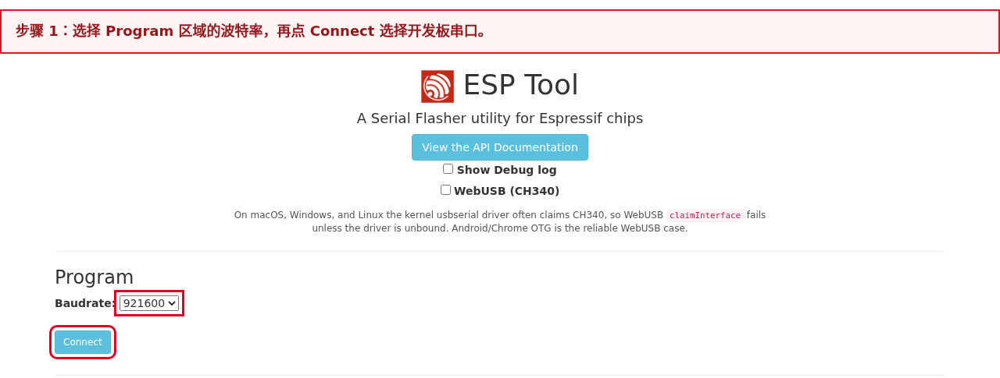
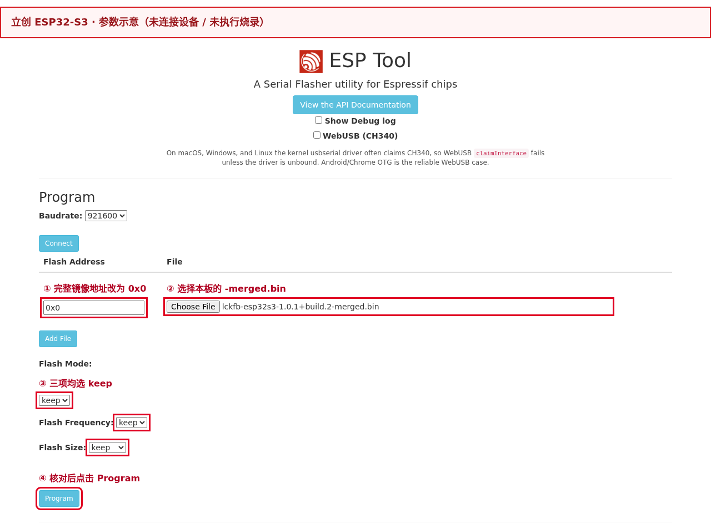
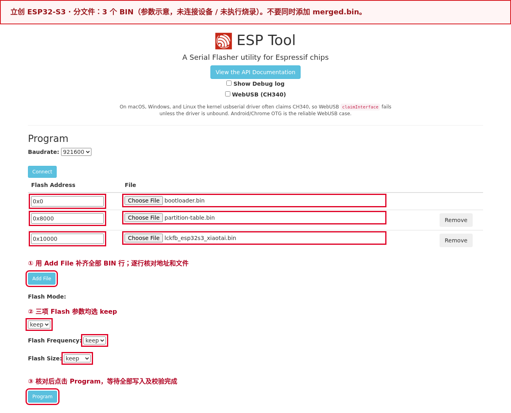
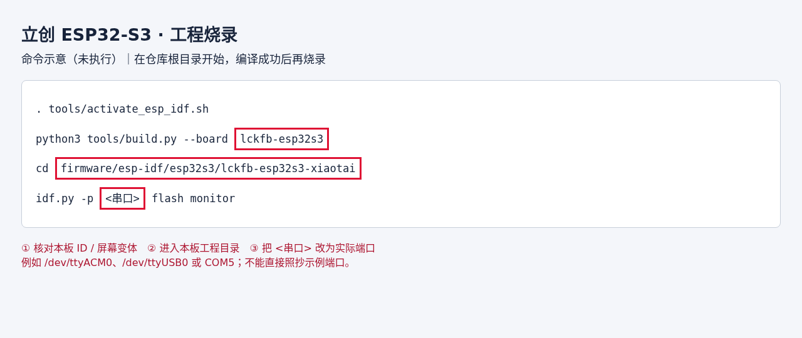

# LCKFB ESP32-S3

[Back to boards](../README.en.md) · [Firmware and release notes](../../downloads.en.md#lckfb-esp32s3)

[中文](README.md) · [English](README.en.md)

Board ID: `lckfb-esp32s3`. See [Downloads](../../downloads.en.md#lckfb-esp32s3) for the current release. Hardware validation scope is recorded at the end of this guide and in the linked release notes.

## Flashing

`<version>` in filenames means the complete version listed on the download page, including its build number. Use the actual downloaded files and check the package manifest. Screenshot versions and paths are examples only.

### Open the flashing tool

Open [Espressif ESP Web Tool](https://espressif.github.io/esptool-js/) in desktop **Chrome or Edge**. Browser flashing does not require ESP-IDF. Close terminals and other flashing pages using the serial port.

See the [official board guide (Chinese)](https://wiki.lckfb.com/zh-hans/szpi-esp32s3/beginner/introduction.html) for connectors and download-mode controls.

### Flashing steps

1. Download the [merged BIN](../../downloads.en.md#lckfb-esp32s3). Select only this complete image at **`0x0`**.
2. Connect the board's Type-C port to the computer. If connection fails, hold BOOT while cycling power, release BOOT after entering download mode, and select the port again. Detection must show **ESP32-S3**.
3. In **Program**, select `Baudrate` (start with `921600`, or use `115200` if unstable), click **Connect**, and select this board's port. Leave `WebUSB (CH340)` unchecked for desktop serial mode.
4. Click **Choose File**, select the merged BIN, and set **Flash Address to `0x0`**. Set Flash Mode, Flash Frequency, and Flash Size to `keep`. Add only this row and click **Program**.
5. Wait for `Hash of data verified.` for each file and a final `Leaving...` without `Error:`. Click **Disconnect**, reset the board, and use 115200-baud logs to verify project `lckfb_esp32s3_xiaotai` and the downloaded full version before first use.

The screenshots show connection and programming controls; port numbers and paths are examples:





**The merged image overwrites Wi-Fi, binding, and EP service-discovery overrides in nonvolatile storage (NVS).** Configure Wi-Fi and bind again after flashing. `keep` preserves image Flash parameters, not device settings. For connection failure, repeat step 2.

For write or verification failure, check the port, cable, file, and address before retrying. A 100% progress bar alone does not establish success.

| Download or package file | Purpose |
|---|---|
| `lckfb-esp32s3-<version>-merged.bin` | **Flash directly**: this file only, at `0x0` |
| `lckfb-esp32s3-<version>-validation.zip` | Split-file package; extract and write each file at the addresses below |
| `lckfb_esp32s3_xiaotai.bin` | Application BIN at `0x10000` for split-file flashing; never write it at `0x0` as a complete image |
| `MANIFEST.json`, `flasher_args.json`, `flash_args`, ELF | Manifests or diagnostic data; do not flash directly |

Use the corresponding Release's `SHA256SUMS` to verify the merged BIN.

On Windows use `Get-FileHash -Algorithm SHA256 "path-to-BIN"`; on Linux, `sha256sum "path-to-BIN"`; on macOS, `shasum -a 256 "path-to-BIN"`. Split-file hashes are in `MANIFEST.json`; complete release-asset hashes are in `SHA256SUMS` linked from [Downloads](../../downloads.en.md#lckfb-esp32s3).

## First use

For a merged image, confirm the single `-merged.bin` was written at `0x0` and the board rebooted normally. For split files, confirm all 3 BINs were written at their manifest addresses. Use either method, then configure Wi-Fi and bind.

### 1. Configure Wi-Fi

On first flashing, after `wifi-clear`, or when the saved network fails, the display requests a network connection and the device broadcasts an open `XiaoTai-XXXX` hotspot. Connect a phone; “no internet” is expected.

If the setup page does not open, visit `http://192.168.6.1`, select a 2.4 GHz Wi-Fi network, enter its password, and submit. A reappearing hotspot means connection failed; check password and signal coverage.

Page behavior and wording follow [Product requirements 4.11 (Chinese)](../../product/PRODUCT_REQUIREMENTS.md#411-启动无网络与-ap-配网).

### 2. Bind the device

Once online, the screen displays and speaks a 6-digit verification code. Restore the phone's internet connection, sign in to the [XiaoTai device page](https://xiaotai.chat/devices), and enter the code under Add device. Use a new code if it expires.

Successful binding opens the home screen; serial `status` should show the platform, MQTT messaging channel, and TiRTC real-time media SDK ready.

### 3. Try features and recover

Try an AI conversation, then open browser live view and two-way audio. With contacts available, try device or WeChat voice calls. Ending a session should return to the home screen. Development acceptance checks are in Testing.

To change networks or bind again, open Device settings → Reset device, confirm, then repeat setup and binding. Serial `wifi-clear` and `tirtc-clear` remain available for development/support; do not erase all Flash.

See the [firmware project guide (Chinese)](../../../firmware/esp-idf/esp32s3/lckfb-esp32s3-xiaotai/README.md) for diagnostic commands.

### AI audio recognition

The recognition-frame icon at the top of the home screen shows recognition status; tap to pause or resume local recognition. The server still controls recognition types and monthly quota. When idle, sound detection retains up to 5 seconds of pre-recording, records 10 more seconds, and uploads for analysis.

Recognition pauses during AI conversations, live view, and device/WeChat calls. At least 1 minute separates uploads and the next trigger. The screen shows recording, upload, analysis, and cooldown.

Result text scrolls twice before disappearing, and the analysis is spoken. “Audio recognition is disabled or unavailable” means server configuration disallows uploading; check the recognition switch, types, and quota. See [Interaction profiles (Chinese)](../../product/PRODUCT_INTERACTION_PROFILES.md) for full behavior.

## Other flashing methods

### Split-file flashing

Download and extract the [firmware ZIP](../../downloads.en.md#lckfb-esp32s3). Check the **3 BINs** for this board and release against `MANIFEST.json` and `flasher_args.json`:

| File | Address | Purpose |
|---|---|---|
| `bootloader/bootloader.bin` | `0x0` | Bootloader |
| `partition_table/partition-table.bin` | `0x8000` | Partition table |
| `lckfb_esp32s3_xiaotai.bin` | `0x10000` | Application; do not write at 0x0 |

Use **Add File** for each BIN, enter its address, then click **Program**. Do not also add the merged image. Bootloader addresses may differ by board. Split files can retain settings during upgrades, but first verify partition compatibility and do not erase the whole chip.



### Build and flash from source

Obtain the repository using [Building from source](../../../README.en.md#build-from-source) and install the required ESP-IDF. From the root:

```bash
. tools/activate_esp_idf.sh
python3 tools/build.py --board lckfb-esp32s3
cd firmware/esp-idf/esp32s3/lckfb-esp32s3-xiaotai
idf.py -p <serial-port> flash monitor
```

Replace `<serial-port>` with the actual serial port. `idf.py` uses the project's manifest and addresses. Do not run `erase-flash` for ordinary upgrades. The command screenshot is an example, not evidence of execution on the current board:



## Specifications

| Item | Details |
| --- | --- |
| Board ID | `lckfb-esp32s3` |
| Hardware revision | PCB V1.0.1 |
| Module | ESP32-S3-WROOM-1-N16R8 |
| Chip and platform | ESP32-S3 / ESP-IDF 5.5.5 |
| Storage | 16 MB Flash, 8 MB PSRAM |
| Display and touch | 320×240 display, capacitive touch |
| Audio | ES7210 capture, ES8311 playback, NS4150B amplifier, AEC |
| Camera | GC2145 on the tested board; firmware outputs MJPEG |
| Network | 2.4 GHz Wi-Fi |
| Features | H5 live view/two-way audio, AI conversation, AI audio recognition, device voice calls, WeChat voice calls, display interaction |

The public model name is “立创·实战派 ESP32-S3” (LCKFB ESP32-S3), using Espressif module `ESP32-S3-WROOM-1-N16R8`. Match physical hardware using the SZPI ESP32-S3 AIROBOT and PCB V1.0.1 markings.

## Audio and video parameters

All audio is mono, with 20 ms packets.

| Scenario | Direction and stream ID | Codec and sample rate | Packet or video parameters |
|---|---|---|---|
| AI conversation | Uplink/downlink: stream 1 | Uplink A-law / 16 kHz; downlink Opus / 16 kHz | 320 bytes uplink; variable Opus packet size |
| H5 two-way audio | Uplink 10; downlink 14 | A-law / 8 kHz both ways | 160 bytes per packet |
| Device and WeChat voice calls | Bidirectional audio | A-law / 8 kHz both ways | 160 bytes per packet |
| H5 live video | Uplink 11 | MJPEG | 320×240, target 8 fps, maximum frame 128 KiB |

Microphone and speaker-reference capture enter acoustic echo cancellation (AEC) at 16 kHz. AI uplink directly encodes the resulting 16 kHz PCM. H5 and voice calls still downsample to 8 kHz; AI downlink plays at 16 kHz. See the [Media contract (Chinese)](../../product/MEDIA_CONTRACT.md) for the full pipeline.

## Firmware configuration and layout

Serial `ep-show` displays the service-discovery base URL. `ep-set http://ep-open.tangeopen.com/pre` saves it and reboots, requesting `/pre/services`; `ep-reset` removes the override. TiRTC uses `tirtc-srv` from the `/services` response.

Factory reset removes the override; use `ep-reset` to restore only the default address.

## Display layout and font constraints

The board uses **320×240 landscape** and the **`compact`** variant layout. Body text, buttons, settings, contacts, and dynamic captions use a **16-pixel** font. Each firmware links only its selected size, with no fallback to another size for missing glyphs.

`font_size_px` in `product/interaction/profiles.json` sets the size; do not infer it from the chip.

A replacement screen requires registered resolution, orientation, and layout, plus checks for fonts, wrapping, and touch regions. Hardware IR/probe evidence still defines actual display hardware; layout configuration is not hardware proof.

See [Interaction profiles §1.3 (Chinese)](../../product/PRODUCT_INTERACTION_PROFILES.md#13-屏幕布局与字库约束).

## Environment and dependencies

| Dependency | Pinned version or file | Source | SHA-256 |
| --- | --- | --- | --- |
| Host | Linux/WSL2, Git, Python 3 | [Git](https://git-scm.com/downloads), [Python](https://www.python.org/downloads/) | — |
| ESP-IDF | `v5.5.5`, commit `b774170ff46c393eeb5e495ea37936038d3f4f4f` | [Official repository](https://github.com/espressif/esp-idf/tree/b774170ff46c393eeb5e495ea37936038d3f4f4f) | — |
| C/C++ compiler | `xtensa-esp-elf-gcc 14.2.0`, build `esp-14.2.0_20260121` | [ESP-IDF tools manifest](https://github.com/espressif/esp-idf/blob/b774170ff46c393eeb5e495ea37936038d3f4f4f/tools/tools.json) | Installer verifies downloads against the manifest |
| TiRTC | 2.6.0, `libTiRTC.a` | — | `4739ec70b895bde848205c36a114c34b2ed4ab27761f2c6bf37d1b2a982a451d` |
| ESP-IDF components | ESP-SR 2.4.7, LVGL 8.3.11, `esp_codec_dev` 1.6.2, `esp32-camera` 2.1.7, `esp_jpeg` 1.3.1 | [Dependency lockfile](../../../firmware/esp-idf/esp32s3/lckfb-esp32s3-xiaotai/dependencies.lock) | — |
| Board components | ES7210, ES8311, touch and display components | — | — |

The dependency lockfile and TiRTC component manifest define the complete resolved versions.

## Schematics and hardware sources

| Material | Version or identifier | Link | SHA-256 | Status |
| --- | --- | --- | --- | --- |
| Official LCKFB product documentation | LCKFB ESP32-S3, module `ESP32-S3-WROOM-1-N16R8` | [Documentation (Chinese)](https://wiki.lckfb.com/zh-hans/szpi-esp32s3/) | — | Available |
| LCKFB ESP32-S3 schematic | V1.0.1, design `ESP32-S3-V1_0_1 / XD-ESP32S3-V1_0_1` | [Official open hardware page (Chinese)](https://wiki.lckfb.com/zh-hans/szpi-esp32s3/open-source-hardware/) | `5b3718f8caa136597fb9a48e44aa7fd1ebf0001be6dd1506492538fee600fa79` | Available |
| Camera tutorial | — | [Documentation (Chinese)](https://wiki.lckfb.com/zh-hans/szpi-esp32s3/beginner/camera.html) | — | Available |
| ES7210 tutorial | — | [Documentation (Chinese)](https://wiki.lckfb.com/zh-hans/szpi-esp32s3/beginner/audio-input-es7210.html) | — | Available |
| ES8311 tutorial | — | [Documentation (Chinese)](https://wiki.lckfb.com/zh-hans/szpi-esp32s3/beginner/audio-output-es8311.html) | — | Available |
| ES7210, ES8311, NS4150B, ZTS6216, PCA9557 datasheets | — | | — | Not provided |

Schematic revisions and sources for hardware findings are recorded in the project's Hardware IR.

## Development

### Directory structure

Paths from the repository root:

```text
xiaotai/
├── boards/lckfb/esp32s3/              # Board identity, pins, display, buttons, buses
├── product/                                # Shared business state, protocols, tests
├── platforms/esp-idf/
│   ├── main/app_main.c                     # Shared ESP32-S3 startup
│   ├── components/                         # Runtime, UI, network, voice, TiRTC
│   └── third_party/tirtc/esp32s3/           # Shared S3 SDK
└── firmware/esp-idf/esp32s3/lckfb-esp32s3-xiaotai/
    ├── main/                               # Select shared entry and configure project
    ├── components/starter_media/           # GC2145, audio, JPEG adapters
    ├── components/starter_voice/           # Wake model and board voice settings
    ├── components/starter_product/         # UI and product resources
    ├── tools/                               # Project host-test entry points
    └── *-contract.json                      # Hardware, interaction, media contracts
```

`build/` is generated output, not a source entry point. Update dependencies through `idf_component.yml` and the lockfile; do not edit downloaded `managed_components/` copies directly.

### Find code by task

| Task | Start here | Boundary |
| --- | --- | --- |
| Model, pins, buses, buttons, display initialization | `boards/lckfb/esp32s3/` | This board's hardware facts only |
| Startup and component composition | `platforms/esp-idf/main/app_main.c`, project `main/` | The manifest selects the adapter for the common entry point |
| H5, AI, device/WeChat state and priority | `product/src/`, `platforms/esp-idf/components/starter_runtime/` | Session rules remain host-testable |
| UI state, contacts, feedback | `platforms/esp-idf/components/starter_product/`, `product/interaction/` | Emit intents; do not independently own business state |
| Microphone, speaker, AEC, GC2145, JPEG | Project `components/starter_media/`, `platforms/esp-idf/components/starter_media_common/` | Pins and peripheral timing remain board-specific |
| Offline wake detection and models | Project `components/starter_voice/`, `platforms/esp-idf/components/starter_voice/` | Separate model files from runtime logic |
| Setup, binding, MQTT, configuration, serial commands | Relevant `platforms/esp-idf/components/` component | Board projects select/configure shared components |
| TiRTC, stream IDs, media transport | `platforms/esp-idf/components/starter_tirtc/`, `platforms/esp-idf/components/tirtc_sdk/` | Keep H5, device, and WeChat stream settings distinct |
| Regressions and build constraints | `product/tests/`, project `tools/`, `tools/tests/` | Add a failing case before changing behavior |

### Recommended workflow

1. Read root [`AGENTS.md` (Chinese)](../../../AGENTS.md), [`ARCHITECTURE.md`](../../../ARCHITECTURE.en.md), and [Testing](../../../tests/README.en.md) to identify the correct layer.
2. Before UI, button, or voice-interaction changes, read [Interaction profiles (Chinese)](../../product/PRODUCT_INTERACTION_PROFILES.md).
3. For hardware changes, check `hardware-ir.json` and contracts; do not infer exact parts or pins from similar boards.
4. Complete public interfaces and host tests, integrate board code, then validate on hardware as described below.

## Building

```bash
bash tools/setup_esp_idf.sh esp32s3
. tools/activate_esp_idf.sh
python3 tools/build.py --board lckfb-esp32s3
```

The project is `firmware/esp-idf/esp32s3/lckfb-esp32s3-xiaotai/`. Use its default `build/`; do not reuse a CMake cache copied from another path.

## Testing

```bash
bash tools/check.sh
bash firmware/esp-idf/esp32s3/lckfb-esp32s3-xiaotai/tools/run_host_tests.sh
python3 tools/build.py --board lckfb-esp32s3
```

On hardware, check display, touch, GC2145 camera, H5, AI, device calls, and WeChat VoIP. Audio checks include single-talk and double-talk, with AEC input, playback reference, first uplink packet, and resource release after sessions recorded.

## Troubleshooting

- Incorrect display/touch orientation: verify PCB V1.0.1, display size, and coordinate transforms; do not use another S3 board's settings.
- One-way H5 or WeChat silence: check stream IDs by direction, subscriptions, first-packet counts, and SDK return codes.
- AI interrupts itself: verify AEC uses actual playback reference and continuous 16 kHz PCM for capture and reference.
- Camera problems: match the physical sensor and startup probe (GC2145 or GC0308), then inspect JPEG collection and stream 11 logs.

## Validation status and limitations

Historical record: the user confirmed build.23 worked on hardware. This does not validate later versions. Its complete BIN SHA-256 is `14f5fdab44c30478efd4ef462026a7b863b427f76314b358c5b3a14616c3aa4b`. TODO: add itemized startup/media logs, single-talk/double-talk AEC metrics, and photos showing PCB revision clearly.

Board configuration and adapter are in `boards/lckfb/esp32s3/`; Hardware IR defines precise hardware facts.

### WeChat voice calls

ESP32-S3 currently does not support video calls. WeChat VoIP reports uplink/downlink video as `none` with `no_video=true`; audio remains bidirectional A-law / 8 kHz on stream 0. Home quick-call defaults to voice, and contact details offer voice calls only. Device calls are also audio-only.

The camera is used for H5 live view. Host regressions block legacy video requests/states; incoming/outgoing WeChat calls, continuous audio, redial, and H5 handover still require hardware checks.
