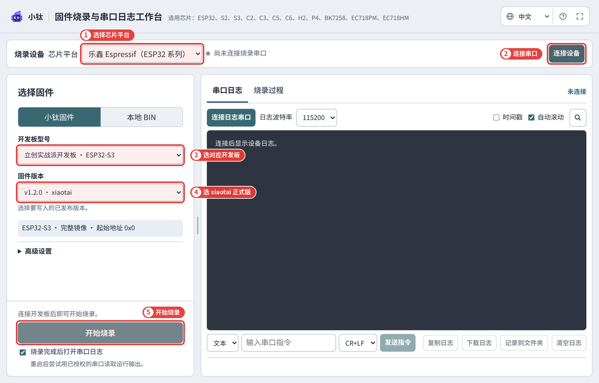
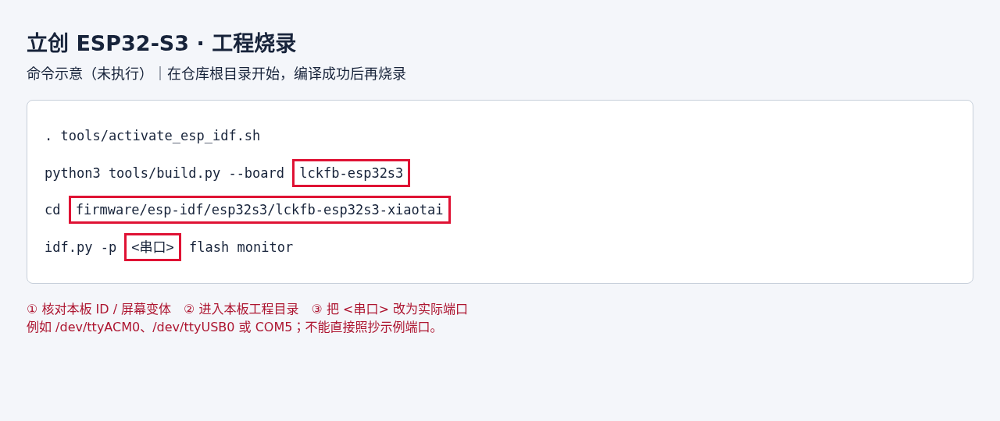

# 立创·实战派 ESP32-S3

[返回开发板目录](../README.md) · [固件下载与发布说明](../../downloads.md#lckfb-esp32s3)

[中文](README.md) · [English](README.en.md)

板卡 ID：`lckfb-esp32s3`。当前版本见[固件下载](../../downloads.md#lckfb-esp32s3)。
实板验证范围见文末记录及下载页对应的发布说明。

## 烧录

### 网页烧录

用 USB 数据线把开发板的 Type-C 接口接到电脑。关闭占用该串口的日志终端。

完整镜像会覆盖 NVS 中的 Wi-Fi 凭证、设备绑定和服务发现地址。烧录后需要重新配网、绑定。

1. 用电脑上的 Chrome 或 Edge 打开[小钛网页烧录工具](https://xiaotai.chat/web-flasher/)。在 **芯片平台** 选择 **乐鑫 Espressif（ESP32 系列）**，点击 **连接设备**，在浏览器弹窗中选择本板串口。若连接失败，按住 BOOT 重新上电，松开 BOOT 后重选串口。确认识别到 ESP32-S3。
2. 在 **小钛固件** 下选择 **立创实战派开发板 · ESP32-S3**，再选择固件版本。
   已下载[发布镜像](../../downloads.md#lckfb-esp32s3)时，切换到 **本地 BIN**，打开 `v<发行版本>_lckfb-esp32s3_merged.bin`。
3. 确认完整镜像起始地址为 `0x0`，点击 **开始烧录**。写入期间保持 USB 连接，在 **烧录过程** 中查看结果。
4. 设备重启后，打开 **串口日志**，波特率设为 115200。确认项目名为 `lckfb_esp32s3_xiaotai`，再将日志中的固件版本与发布说明里的内嵌版本对照。



接口与下载模式详见[板卡官方说明](https://wiki.lckfb.com/zh-hans/szpi-esp32s3/beginner/introduction.html)。

如需校验，使用发布说明中的 BIN SHA-256；Windows 用 `Get-FileHash -Algorithm SHA256 "实际BIN路径"`，
Linux 用 `sha256sum "实际BIN路径"`，macOS 用 `shasum -a 256 "实际BIN路径"`。

## 首次使用

确认完整 `_merged.bin` 已从 `0x0` 烧录且设备正常重启，然后配网和绑定。

### 1. 配置 Wi-Fi

首次烧录、执行过 `wifi-clear` 或已保存网络连接失败时，屏幕显示“需要连接网络”，并
广播无密码的 `XiaoTai-XXXX` 热点。用手机连接该热点；提示“无互联网”属于正常现象。
配网页没有自动打开时，访问 `http://192.168.6.1`，选择 2.4 GHz Wi-Fi，输入路由器密码
并提交。热点重新出现表示联网失败，需要检查密码和信号覆盖。
配网页面及文案统一以[产品需求 4.11](../../product/PRODUCT_REQUIREMENTS.md#411-启动无网络与-ap-配网)为准。

### 2. 绑定设备

联网后，屏幕显示并播报 6 位验证码。让手机恢复互联网连接，登录
[小钛设备页](https://xiaotai.chat/devices)，在添加设备处输入屏幕上的验证码。验证码
过期时使用新号码。绑定成功后设备进入首页；串口执行 `status` 应显示平台、MQTT
（设备消息通道）和 TiRTC（实时音视频软件开发工具包）均已就绪。

### 3. 验证与恢复

先尝试 AI 对话，再从网页打开实时查看和双向对讲。有联系人后可体验设备呼叫或
微信语音通话。结束会话后应回到首页；开发验收项目见“测试”一节。

需要更换网络或重新绑定时，进入“设备设置 → 重置设备”，确认后重新配网并绑定。
研发/售后串口仍保留 `wifi-clear` 和 `tirtc-clear`；不要擦除整片 Flash。完整诊断
命令见[固件工程说明](../../../firmware/esp-idf/esp32s3/lckfb-esp32s3-xiaotai/README.md)。

### AI 音频识别

首页顶部的识别框图标表示 AI 音频识别状态，点击可暂停或恢复本机识别；服务端仍控制
识别类型和月额度。设备空闲时检测到声音，连同最多 5 秒预录音再录 10 秒并上传分析；
AI 通话、远程查看和设备/微信通话期间暂停识别。上传后至少间隔 1 分钟才再次触发。
屏幕显示录制、上传、分析和冷却状态，结果文字滚动两次后消失，并播放分析语音。
“声音识别未开启或不可用”表示服务端配置当前不允许上传，需检查设备的识别开关、
识别类型和额度。完整行为见[产品交互规范](../../product/PRODUCT_INTERACTION_PROFILES.md)。

## 其他烧录方式

### 从源码编译后烧录

按[源码获取说明](../../../README.md#从源码编译)准备仓库，并安装本板要求的 ESP-IDF。
在仓库根目录执行：

```bash
. tools/activate_esp_idf.sh
python3 tools/build.py --board lckfb-esp32s3
cd firmware/esp-idf/esp32s3/lckfb-esp32s3-xiaotai
idf.py -p <串口> flash monitor
```

`<串口>` 换成本机实际端口；`idf.py` 会使用工程烧录清单和正确地址。
普通升级不执行 `erase-flash`。示例命令截图不代表已在当前硬件执行：



## 规格

| 项目 | 内容 |
| --- | --- |
| 板卡 ID（仓库中的开发板唯一名称） | `lckfb-esp32s3` |
| 硬件版本 | PCB V1.0.1 |
| 模组型号 | ESP32-S3-WROOM-1-N16R8 |
| 芯片与平台 | ESP32-S3 / ESP-IDF 5.5.5 |
| 存储 | 16 MB Flash、8 MB PSRAM |
| 显示与触摸 | 320×240 显示，电容触摸 |
| 音频 | ES7210 采集、ES8311 播放、NS4150B 功放，支持 AEC |
| 摄像头 | 实板使用 GC2145，固件输出 MJPEG |
| 网络 | 2.4 GHz Wi-Fi |
| 产品能力 | H5 实时查看/对讲、AI 对讲、AI 音频识别、设备语音呼叫、微信语音呼叫、屏幕交互 |

开发板对外名称为“立创·实战派 ESP32-S3”，板上使用的乐鑫模组是
`ESP32-S3-WROOM-1-N16R8`。实物硬件以 SZPI ESP32-S3 AIROBOT 和
PCB（印刷电路板）V1.0.1 丝印为准。

## 音视频参数

音频参数如下。音频均为单声道，每包 20 毫秒。

| 场景 | 方向与流编号 | 编码与采样率 | 包大小或画面参数 |
|---|---|---|---|
| AI 对讲 | 上行、下行：流 1 | 上行 A-law / 16 kHz；下行 Opus / 16 kHz | 上行每包 320 字节；Opus 包长可变 |
| H5 实时对讲 | 上行：流 10；下行：流 14 | 双向 A-law / 8 kHz | 每包 160 字节 |
| 设备呼叫、微信语音通话 | 双向音频 | 双向 A-law / 8 kHz | 每包 160 字节 |
| H5 实时画面 | 上行：流 11 | MJPEG（逐帧 JPEG） | 320×240，目标 8 fps，单帧上限 128 KiB |

麦克风和扬声器回采先以 16 kHz 进入 AEC（声学回声消除）。AI 上行直接编码
AEC 输出的 16 kHz PCM；H5 和语音呼叫仍降采样到 8 kHz，AI 下行以 16 kHz 播放。
完整处理链见[音视频参数与媒体处理](../../product/MEDIA_CONTRACT.md)。

## 固件配置与布局

串口 `ep-show` 查看平台服务发现基址；`ep-set http://ep-open.tangeopen.com/pre`
保存并重启，实际请求为 `/pre/services`；`ep-reset` 清除覆盖项。TiRTC 地址取自
`/services` 响应的 `tirtc-srv`。恢复出厂设置会清除覆盖项；单独恢复默认地址可用 `ep-reset`。


## 屏幕布局与字体约束

本板当前屏幕适配为 **320×240 横屏**，variant 选择 **`compact`** 布局，产品正文、
按钮、设置值、联系人与动态字幕统一使用 **16 像素**字库。每个固件只链接所选字号，
不允许缺字后回退到另一字号。字号由 `product/interaction/profiles.json` 的
`font_size_px` 约束，不按芯片类型自行推断。

更换屏幕时必须重新登记分辨率、方向与布局，并验证字号、换行和触摸区域。当前屏幕
硬件证据仍以本板 Hardware IR / 探针资料为准；布局配置不能替代硬件证据。完整要求见
[产品交互规范 §1.3](../../product/PRODUCT_INTERACTION_PROFILES.md#13-屏幕布局与字库约束)。

## 环境与依赖

| 依赖项 | 固定版本或文件 | 来源或下载链接 | SHA-256 |
| --- | --- | --- | --- |
| 主机环境 | Linux/WSL2、Git、Python 3 | [Git](https://git-scm.com/downloads)、[Python](https://www.python.org/downloads/) | 无 |
| ESP-IDF | `v5.5.5`，提交 `b774170ff46c393eeb5e495ea37936038d3f4f4f` | [Espressif 官方仓库](https://github.com/espressif/esp-idf/tree/b774170ff46c393eeb5e495ea37936038d3f4f4f) | 无 |
| C/C++ 编译器 | `xtensa-esp-elf-gcc 14.2.0`，构建标识 `esp-14.2.0_20260121` | [ESP-IDF 工具清单](https://github.com/espressif/esp-idf/blob/b774170ff46c393eeb5e495ea37936038d3f4f4f/tools/tools.json) | 无，安装器按工具清单校验下载文件 |
| TiRTC | 2.6.3，`libTiRTC.a` | 无 | `87f9fc6eac5d1c5bd1bd4877fc00abdd115101e85181c035e76089343486f850` |
| ESP-IDF 组件 | ESP-SR 2.4.7、LVGL 8.3.11、`esp_codec_dev` 1.6.2、`esp32-camera` 2.1.7、`esp_jpeg` 1.3.1 | [工程依赖锁定文件](../../../firmware/esp-idf/esp32s3/lckfb-esp32s3-xiaotai/dependencies.lock) | 无 |
| 板级组件 | ES7210、ES8311、触摸与屏幕组件 | 无 | 无 |

组件的完整解析版本以工程依赖锁定文件和 TiRTC 组件 manifest（依赖清单）为准。

## 原理图与硬件资料

| 资料名称 | 版本或标识 | 链接 | SHA-256 | 资料状态 |
| --- | --- | --- | --- | --- |
| 立创开发板官方产品资料 | 立创·实战派 ESP32-S3，模组 `ESP32-S3-WROOM-1-N16R8` | [在线文档](https://wiki.lckfb.com/zh-hans/szpi-esp32s3/) | 无 | 已提供 |
| 立创·实战派 ESP32-S3 开发板原理图 | V1.0.1，设计标识 `ESP32-S3-V1_0_1 / XD-ESP32S3-V1_0_1` | [官方开源硬件页面](https://wiki.lckfb.com/zh-hans/szpi-esp32s3/open-source-hardware/) | `5b3718f8caa136597fb9a48e44aa7fd1ebf0001be6dd1506492538fee600fa79` | 已提供 |
| 摄像头教程 | 无 | [在线文档](https://wiki.lckfb.com/zh-hans/szpi-esp32s3/beginner/camera.html) | 无 | 已提供 |
| ES7210 教程 | 无 | [在线文档](https://wiki.lckfb.com/zh-hans/szpi-esp32s3/beginner/audio-input-es7210.html) | 无 | 已提供 |
| ES8311 教程 | 无 | [在线文档](https://wiki.lckfb.com/zh-hans/szpi-esp32s3/beginner/audio-output-es8311.html) | 无 | 已提供 |
| ES7210、ES8311、NS4150B、ZTS6216、PCA9557 数据手册 | 无 | | 无 | 未提供 |

原理图版本和硬件结论的来源记录在工程 Hardware IR（硬件信息记录）中。

## 开发

### 目录结构

从仓库根目录看，这块板相关的代码分布如下：

```text
xiaotai/
├── boards/lckfb/esp32s3/              # 板卡身份、引脚、显示、按键和总线适配
├── product/                                # 跨芯片复用的业务状态、协议与测试
├── platforms/esp-idf/
│   ├── main/app_main.c                     # ESP32-S3 公共启动入口
│   ├── components/                         # 公共运行时、页面、联网、语音和 TiRTC 组件
│   └── third_party/tirtc/esp32s3/           # 两个 S3 板共用的 SDK
└── firmware/esp-idf/esp32s3/lckfb-esp32s3-xiaotai/
    ├── main/                               # 选择公共入口并配置本工程
    ├── components/starter_media/           # GC2145、音频和 JPEG 媒体适配
    ├── components/starter_voice/           # 唤醒模型和板级语音配置
    ├── components/starter_product/         # 本板使用的页面资源和产品资源
    ├── tools/                               # 本工程主机测试入口
    └── *-contract.json                      # 硬件、交互和媒体契约
```

`build/` 是构建生成目录，不是源码入口。依赖组件通过 `idf_component.yml` 和锁定文件
更新，不要直接修改 `managed_components/` 中的下载副本。

### 按任务查找代码

| 要修改的内容 | 首先查看 | 边界说明 |
| --- | --- | --- |
| 板卡型号、引脚、总线、按键和显示初始化 | `boards/lckfb/esp32s3/` | 只放这块板特有的硬件事实 |
| 启动顺序和组件装配 | `platforms/esp-idf/main/app_main.c`、工程 `main/` | 公共入口由板卡清单选择具体适配 |
| H5、AI、设备呼叫和微信 VoIP 的状态与优先级 | `product/src/`、`platforms/esp-idf/components/starter_runtime/` | 产品会话规则必须保持可做主机测试 |
| 页面状态、联系人和交互反馈 | `platforms/esp-idf/components/starter_product/`、`product/interaction/` | 交互层发送意图，不自行维护业务状态 |
| 麦克风、扬声器、AEC、GC2145 和 JPEG | 工程 `components/starter_media/`、`platforms/esp-idf/components/starter_media_common/` | 引脚和外设时序留在板级适配 |
| 离线唤醒和语音模型 | 工程 `components/starter_voice/`、`platforms/esp-idf/components/starter_voice/` | 模型文件和运行逻辑分开维护 |
| 配网、绑定、MQTT、配置和串口命令 | `platforms/esp-idf/components/` 下对应组件 | 板级工程只选择和配置公共组件 |
| TiRTC 连接、流编号和媒体收发 | `platforms/esp-idf/components/starter_tirtc/`、`platforms/esp-idf/components/tirtc_sdk/` | 不把 H5、设备呼叫和微信流配置混用 |
| 回归测试和构建约束 | `product/tests/`、工程 `tools/`、`tools/tests/` | 修改行为时先补失败用例，再改实现 |

### 推荐修改顺序

1. 先读根目录 [`AGENTS.md`](../../../AGENTS.md)、[`ARCHITECTURE.md`](../../../ARCHITECTURE.md)
   和[测试说明](../../../tests/README.md)，确认改动属于产品、平台还是板级代码。
2. 修改页面、按键或语音交互前，再读[产品交互规范](../../product/PRODUCT_INTERACTION_PROFILES.md)。
3. 涉及硬件时核对 `hardware-ir.json` 和对应契约；准确器件与引脚不能从相似板卡推断。
4. 先完成公共接口和主机测试，再接入板级实现，最后按本页“测试”章节做实板验证。

## 编译

```bash
bash tools/setup_esp_idf.sh esp32s3
. tools/activate_esp_idf.sh
python3 tools/build.py --board lckfb-esp32s3
```

工程目录为 `firmware/esp-idf/esp32s3/lckfb-esp32s3-xiaotai/`。日常构建使用工程默认 `build/`，
不要复用从其他路径复制来的 CMake cache。

## 测试

```bash
bash tools/check.sh
bash firmware/esp-idf/esp32s3/lckfb-esp32s3-xiaotai/tools/run_host_tests.sh
python3 tools/build.py --board lckfb-esp32s3
```

实板依次验证显示、触摸、GC2145 摄像头、H5、AI、设备呼叫和微信 VoIP。音频测试要
覆盖单讲与双讲，并记录 AEC 输入、播放参考、上行首包和会话结束后的资源释放。

## 排查

- 屏幕或触摸方向错误：先核对 PCB V1.0.1、显示尺寸和触摸坐标变换，不套用其他 S3 板配置。
- H5 或微信单向无声：按发送方向核对流编号、订阅状态、首包计数和 SDK 返回码。
- AI 自己打断自己：确认 AEC 使用实际播放参考，采集和参考均为连续 16 kHz PCM。
- 摄像头异常：先核对实物传感器和启动探测结果（GC2145 或 GC0308），再检查 JPEG 收集和流 11 发送日志。

## 验证状态与已知限制

历史记录：用户确认 build.23 实板可用；该结论不代替后续版本验收。该版完整 BIN SHA-256 为
`14f5fdab44c30478efd4ef462026a7b863b427f76314b358c5b3a14616c3aa4b`。
TODO：补充逐项启动与媒体日志、AEC 单讲/双讲指标及可辨认 PCB 版本的照片。

板级配置和 adapter 位于 `boards/lckfb/esp32s3/`；准确硬件事实以 Hardware IR 为准。

### 微信语音通话

ESP32-S3 当前不支持视频通话。微信 VoIP 上报上下行视频均为 `none`、
`no_video=true`，音频保持双向 A-law / 8 kHz、流 0。
首页快捷呼叫默认语音，联系人详情仅提供“语音通话”；设备间呼叫也为纯语音。
摄像头只用于 H5 实时查看。主机回归覆盖旧视频请求/状态拦截，
仍须实板验证微信主被叫、连续音频、挂断重拨与 H5 切换。

## 串口配置时间服务器

`ntp-show` 查看已保存的主 NTP 服务器覆盖项（`default` 表示没有覆盖项）。
使用 `ntp-set time.example.com` 或 `ntp-set 192.168.1.10` 保存；
`ntp-reset` 恢复默认。保存或恢复成功后设备会重启，中断正在进行的通话；
保存失败不重启。

支持最长 253 字符的 DNS 主机名或 IPv4 地址，不支持 URL、端口、路径、空格或 IPv6；
NTP 使用 UDP/123。原有备用服务器保留，因此这是主服务器优先配置，不是唯一时间源。
恢复出厂设置会清除覆盖项。重启后先确认校时成功，再测试通话。

## 启动异常时使用串口

恢复配置命令在媒体、界面和联网之前开放，不依赖 Wi-Fi 连接、设备绑定、校时、鉴权或平台上线成功。
可使用 `wifi-set`、`wifi-clear`、`tirtc-clear`、`ntp-show/set/reset`、`ep-show/set/reset` 和 `restart`；
具体参数仍按本板命令说明输入。BK 命令须加 `ap_cmd` 前缀，ESP32 直接输入命令。

本地业务未就绪时，`status` 只提示恢复模式，通话、媒体、语音诊断等业务命令返回 `Local runtime not ready`。
修改配置成功后按命令提示重启；写入失败不会报告保存成功或重启。
此入口不能修复串口驱动不可用、系统死机或 Flash 损坏；存储初始化失败时可以查看提示并重启，但保存配置可能失败。

验收应覆盖未配网、未绑定、NTP 不可达、鉴权失败、媒体初始化失败和断网重连；
每种情况下执行查询、修改、重启，并确认配置保留。主机故障注入不能替代当前镜像的实板串口验证。

NTP IPv4 地址使用不带前导零的十进制格式，例如 `10.0.0.1`；`010.0.0.1` 会被拒绝。

`tirtc-set` / `tirtc-clear` 成功后会阻止后台绑定在重启前覆盖身份；存储忙时请重试。
凭证现在以整条版本记录保存，兼容读取旧版三键格式，并在成功更新前清理旧字段。升级不要求重新绑定；
修改凭证后若需降级到不支持新格式的旧固件，应先在当前固件清除绑定，降级后重新绑定，避免读取旧凭证。

Wi-Fi 名称和密码也以整条记录保存，兼容读取旧格式；保存失败不会把新名称与旧密码混用。
保存尝试可能完成格式迁移，即使最终更新失败；降级到不支持新格式的固件需要重新配网。
音量、扬声器/麦克风静音等设置也改用整条记录，兼容读取旧设置。迁移后降级会恢复旧固件默认值，
请重新核对声音和静音设置。

`wifi-set` / `wifi-clear` 成功后，重启前的后台配网不能覆盖串口恢复结果。
网页保存成功但自动重启启动失败时，会提示手动重启；可执行 `restart` 或重新上电。
恢复出厂设置会阻止后台配置写回；若提示存储忙或清除失败，请稍后重试。

TiRTC 异步启动等待超过 30 秒时，设备保留串口恢复入口并关闭业务指令入口。
可以检查或修改配置，再执行 `restart`；不会在旧 SDK 状态不明时反复初始化。
