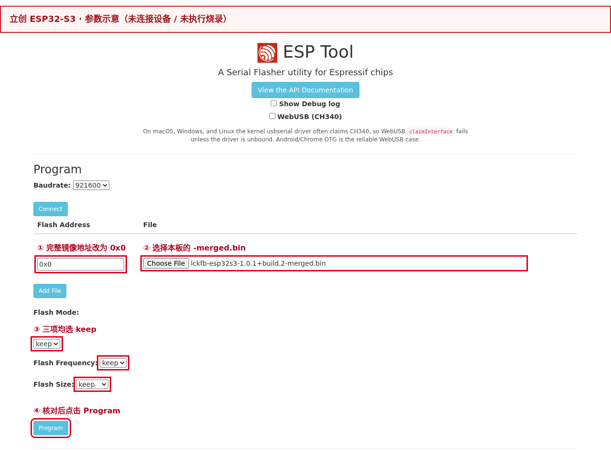
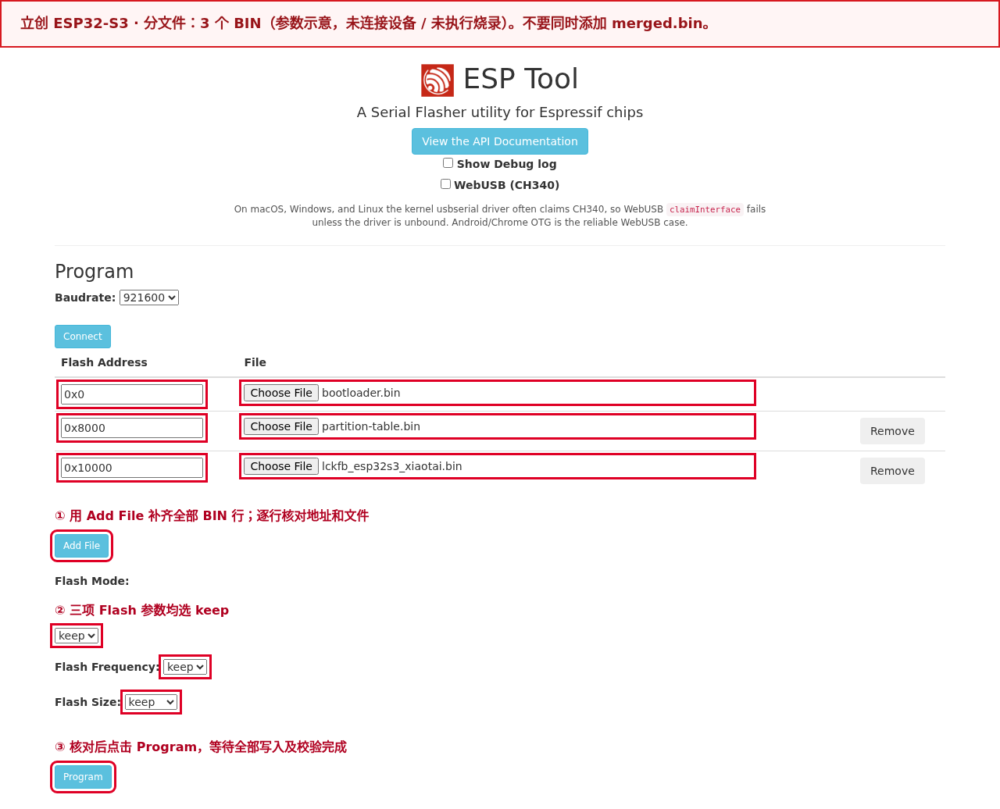
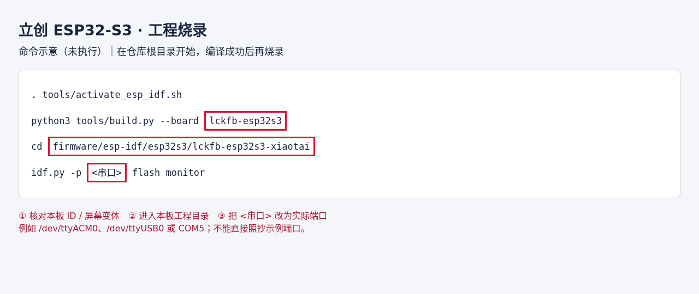

# 立创·实战派 ESP32-S3

串口 `ep-show` 查看平台服务发现基址；`ep-set http://ep-open.tangeopen.com/pre`
保存基址并重启，实际请求为 `http://ep-open.tangeopen.com/pre/services`；
`ep-reset` 删除覆盖项并重启。TiRTC 地址始终从 `/services` 响应的 `tirtc-srv` 获取。

本文中的 H5 指网页端，AI 指人工智能对讲，AEC 指声学回声消除。
Flash 是闪存，PSRAM 是用于音视频缓冲的大块运行内存。

如果只想体验小钛，直接下载发布固件，按“烧录”和“首次使用”操作即可，不需要先搭建
开发环境。

准备修改或编译源码时，需要掌握 C/C++、Git、串口日志和乐鑫 ESP-IDF 的基本
开发流程。第一次接触 ESP32-S3 时，建议先阅读
[ESP32-S3 ESP-IDF 5.5.5 入门指南](https://docs.espressif.com/projects/esp-idf/en/v5.5.5/esp32s3/get-started/)
和[立创开发板官方教程](https://wiki.lckfb.com/zh-hans/szpi-esp32s3/)。

## 屏幕布局与字体约束

本板当前屏幕适配为 **320×240 横屏**，variant 选择 **`compact`** 布局，产品正文、
按钮、设置值、联系人与动态字幕统一使用 **16 像素**字库。每个固件只链接所选字号，
不允许缺字后回退到另一字号。字号由 `product/interaction/profiles.json` 的
`font_size_px` 约束，不按芯片类型自行推断。

更换屏幕时必须重新登记分辨率、方向与布局，并验证字号、换行和触摸区域。当前屏幕
硬件证据仍以本板 Hardware IR / 探针资料为准；布局配置不能替代硬件证据。完整要求见
[产品交互规范 §1.3](../../product/PRODUCT_INTERACTION_PROFILES.md#13-屏幕布局与字库约束)。

## 烧录

提供两种方式：**网页烧录**适合直接体验，无需安装开发环境；**工程烧录**适合修改源码后编译、调试。
两种方式任选其一。先核对完整板型，不能只按 `ESP32-S3` 选择固件。

使用 USB 数据线连接开发板 Type-C 接口。连接失败时按住 BOOT，再重新上电，
进入下载模式后松开 BOOT 并重新选择串口；接口与按键位置见
[立创官方开发板教程](https://wiki.lckfb.com/zh-hans/szpi-esp32s3/beginner/introduction.html)。

### 先选烧录文件：单文件与分文件二选一

网页烧录和工程烧录是操作方式；**单文件与分文件是两种文件组织方式**。
本页文件名和地址对应 **v1.0.1 · build.2**；其他版本必须重新核对该版本清单。

| 文件方式 | 下载文件的完整名称 | 网页中应添加的内容 |
|---|---|---|
| 单文件（首次体验推荐） | `lckfb-esp32s3-1.0.1+build.2-merged.bin` | 只添加这个 BIN，地址 `0x0` |
| 分文件（也可首次烧录） | `lckfb-esp32s3-1.0.1+build.2-validation.zip` | 先解压，再添加下文列出的 **3 个 BIN**，各填各的地址 |

乐鑫支持按“地址 + 文件”写入多个 BIN，也支持用 `merge-bin` 合并后写入。
**分文件数量不是固定三个，地址也不能直接照抄官方示例**；以本工程生成的清单为准。
参见[乐鑫写入与合并镜像说明](https://docs.espressif.com/projects/esptool/en/latest/esp32s3/esptool/basic-commands.html#merge-binaries-for-flashing-merge-bin)。

### 方式一：网页烧录（推荐首次体验）

#### 1. 下载完整镜像

下载 [v1.0.1 · build.2 完整 merged.bin](https://github.com/tangeai/xiaotai/releases/download/esp32s3-v1.0.1/lckfb-esp32s3-1.0.1%2Bbuild.2-merged.bin)。

下载后先核对下方完整文件名；BIN 的 SHA-256 及核对方法见本节“文件与写入校验”。

文件名应为 `lckfb-esp32s3-1.0.1+build.2-merged.bin`。

版本内容与限制见[发布说明](https://github.com/tangeai/xiaotai/releases/tag/esp32s3-v1.0.1)。

**完整镜像会覆盖 NVS 中的 Wi-Fi、绑定等持久配置，烧录后需要重新配网、绑定。**
需要保留配置的升级请使用本节末尾的分文件方法，并核对分区布局与配置兼容性。

#### 2. 连接开发板

1. 关闭串口助手、`idf.py monitor` 和其他占用设备串口的网页。
2. 在电脑 Chrome 或 Edge 中打开[乐鑫 ESP Web Tool](https://espressif.github.io/esptool-js/)；Safari 不支持。
3. 使用 **Program** 区域的 `Baudrate`，可先保留 `921600`；传输不稳定时改为 `115200` 重试。桌面串口方式不勾选 `WebUSB (CH340)`。
4. 点击红框中的 **Connect**，在浏览器弹出的串口列表中选中本板，再点击“连接”。端口名可能是 COM、USB Serial 或 USB JTAG/serial；通过拔插前后的变化确认。
5. 等待日志识别出 **ESP32-S3**，再添加固件。若一直连接失败，按上面的板级步骤进入下载模式后重连。


#### 3. 选文件、改地址并烧录

1. 在 `File` 一栏点击 **Choose File / 选择文件**，选择 **`lckfb-esp32s3-1.0.1+build.2-merged.bin`**，不要选 ZIP、ELF 或单独的应用 BIN。
2. 将 **Flash Address 从默认值改为 `0x0`**。完整镜像只添加这一行，不再同时添加 bootloader、分区表或应用文件。
3. 将 **Flash Mode、Flash Frequency、Flash Size 都选为 `keep`**，保留发布固件中的参数。`keep` 不表示保留 Wi-Fi 或绑定数据。
4. 再次核对芯片、文件名和 `0x0`，点击 **Program**。等待全部写入和校验完成；烧录期间保持供电和数据线连接，不点击 `Erase Flash`。



红框依次标出地址、文件、Flash 参数与烧录按钮。
图中参数区为未连接设备时展开的操作示意，不是实板烧录成功截图。

#### 4. 重启并检查

完成后点击 **Disconnect** 释放串口，按开发板复位键重启。
看到小钛启动及配网界面后，继续下方“首次使用”。需要日志时，可在网页 Console
区域以 `115200` 点击 `Start`，或打开本地串口工具，检查启动版本和报错。
只有烧录进度完成而设备不能正常启动时，应先核对板型、镜像和下载地址。

#### 另一种选择：分文件烧录（3 个 BIN）

下载 [lckfb-esp32s3-1.0.1+build.2-validation.zip](https://github.com/tangeai/xiaotai/releases/download/esp32s3-v1.0.1/lckfb-esp32s3-1.0.1%2Bbuild.2-validation.zip)，解压到独立目录。
不要将不同板卡或不同版本的解压文件放在一起；即使同名 `bootloader.bin`，内容也可能不同。

以下路径相对于 ZIP 的解压目录，已与本版 `MANIFEST.json` 和 `flasher_args.json` 核对：

| File：选择的 BIN 文件 | Flash Address：填写地址 | 用途 |
|---|---|---|
| `bootloader/bootloader.bin` | `0x0` | 启动引导程序 |
| `partition_table/partition-table.bin` | `0x8000` | 分区表 |
| `lckfb_esp32s3_xiaotai.bin` | `0x10000` | 小钛应用程序，不能当作完整镜像 |

1. 按前面的步骤连接开发板；清空此前的文件行，不保留 `-merged.bin`。
2. 首行选择表中第一个 BIN 并填写对应地址，点击 **Add File** 添加其余行，直到总共 **3 行**。
3. 逐行检查完整文件名与地址。三项 Flash 参数仍选 `keep`，点击 **Program**，等待所有文件写入和校验完成后重启。

**应用 BIN 的地址是 `0x10000`，不是 `0x0`。** ZIP、ELF、JSON、`flash_args` 和 `SHA256SUMS`
均不是可直接烧录的文件，不要在 File 栏中选择它们。分文件清单中不能再加 merged.bin。



上图为未连接设备时展开的参数示意。分文件方式也适用于首次烧录；用于升级时，不执行全片擦除，
并核对分区布局与配置兼容性。它不会像 raw merged.bin 那样写入镜像间的填充区域。

#### 文件与写入校验

解压成功只说明压缩包可以读取，不能证明板型和版本正确。本指南不要求额外校验 ZIP 本身。
烧录前核对本板 ID、版本、BIN 文件名和地址；需要核对文件内容时，使用以下 SHA-256：

- 分文件 BIN：打开包内 `MANIFEST.json`，按 `files[].path` 找到对应文件，比较其 `sha256`。
- 单文件 `lckfb-esp32s3-1.0.1+build.2-merged.bin`：本版 SHA-256 如下，也可在[发布页](https://github.com/tangeai/xiaotai/releases/tag/esp32s3-v1.0.1)的 `SHA256SUMS` 中查找同名 BIN 的条目。

```text
f27ea251c04586fc625b9b1d8b5eda096d03fb86439588563885f4b52ca02737
```

Windows PowerShell 执行 `Get-FileHash -Algorithm SHA256 "实际BIN路径"`；Linux 执行
`sha256sum "实际BIN路径"`；macOS 执行 `shasum -a 256 "实际BIN路径"`，再对照上述值或清单。

文件 SHA-256 与烧录后的写入校验用途不同。乐鑫 esptool 的 `write-flash` 自动进行 MD5 写入校验，
通常不需要另跑 `verify-flash`；网页操作仍须等待写入及校验完成。参见
[乐鑫写入校验说明](https://docs.espressif.com/projects/esptool/en/latest/esp32s3/esptool/advanced-commands.html#verify-flash-data-verify-flash)。

### 方式二：工程烧录（源码编译与调试）

1. 按根目录[源码获取说明](../../../README.md#从源码编译)下载仓库；未安装工具链时，先完成本页“环境与依赖”和“编译”。
2. 连接本板并关闭网页烧录连接。在仓库根目录执行下列命令，编译成功后进入对应工程目录烧录。
3. **将 `<串口>` 替换为本机实际端口**，例如 Linux 的 `/dev/ttyACM0`、`/dev/ttyUSB0` 或 Windows ESP-IDF 终端的 `COM5`；不要照抄示例端口。

```bash
. tools/activate_esp_idf.sh
python3 tools/build.py --board lckfb-esp32s3
cd firmware/esp-idf/esp32s3/lckfb-esp32s3-xiaotai
idf.py -p <串口> flash monitor
```



上图为命令示意，不是已执行编译或烧录的终端记录。可复制的命令见上方代码块。

以上环境激活命令适用于 Linux/WSL；WSL 还需将 USB 设备接入该环境。
`idf.py` 按工程生成的烧录清单调用 esptool，不必手填地址。
出现启动日志后核对版本与板型，使用 `Ctrl+]` 退出监视器；不能连接时按本页下载模式步骤重试。
普通升级不执行 `erase-flash`。修改屏幕等硬件配置前，先核对本板支持的变体。

## 首次使用

确认发布包中的全部烧录文件都已写入且设备正常重启，再进行下面的配网和绑定。

### 1. 配置 Wi-Fi

首次烧录、执行过 `wifi-clear` 或已保存网络连接失败时，屏幕显示“需要连接网络”，并
广播无密码的 `XiaoTai-XXXX` 热点。用手机连接该热点；提示“无互联网”属于正常现象。
配网页没有自动打开时，访问 `http://192.168.6.1`，选择 2.4 GHz Wi-Fi，输入路由器密码
并提交。热点重新出现表示联网失败，需要检查密码和信号覆盖。
配网页面及文案统一以[产品需求 4.11](../../product/PRODUCT_REQUIREMENTS.md#411-启动无网络与-ap-配网)为准。

### 2. 绑定设备

联网后，屏幕显示并播报 6 位验证码。让手机恢复互联网连接，登录
[小钛设备页](https://xiaotai.chat/devices)，在添加设备处输入屏幕上的验证码。验证码
过期时使用新号码。绑定成功后设备进入首页；串口执行 `status` 应显示平台、MQTT
（设备消息通道）和 TiRTC（实时音视频软件开发工具包）均已就绪。

### 3. 验证与恢复

依次检查屏幕、触摸、按键、摄像头和音频，再验证 H5（网页端）双向对讲、至少三轮 AI
对话、设备呼叫和微信 VoIP（语音通话）。每次会话结束后应回到首页，且无异常重启
或持续内存下降。

需要更换网络或重新绑定时，进入“设备设置 → 重置设备”，确认后重新配网并绑定。
研发/售后串口仍保留 `wifi-clear` 和 `tirtc-clear`；不要擦除整片 Flash。完整诊断
命令见[固件工程说明](../../../firmware/esp-idf/esp32s3/lckfb-esp32s3-xiaotai/README.md)。

## 规格

| 项目 | 内容 |
| --- | --- |
| 板卡 ID（仓库中的开发板唯一名称） | `lckfb-esp32s3` |
| 硬件版本 | PCB V1.0.1 |
| 模组型号 | ESP32-S3-WROOM-1-N16R8 |
| 芯片与平台 | ESP32-S3 / ESP-IDF 5.5.5 |
| 存储 | 16 MB Flash、8 MB PSRAM |
| 显示与触摸 | 320×240 显示，电容触摸 |
| 音频 | ES7210 采集、ES8311 播放、NS4150B 功放，支持 AEC |
| 摄像头 | 实板使用 GC2145，固件输出 MJPEG |
| 网络 | 2.4 GHz Wi-Fi |
| 产品能力 | H5 实时查看/对讲、AI 对讲、设备语音呼叫、微信语音呼叫、屏幕交互 |

开发板对外名称为“立创·实战派 ESP32-S3”，板上使用的乐鑫模组是
`ESP32-S3-WROOM-1-N16R8`。实物硬件以 SZPI ESP32-S3 AIROBOT 和
PCB（印刷电路板）V1.0.1 丝印为准。

## 音视频参数

H5 和设备/微信语音呼叫使用 8 kHz 单声道 A-law，每包 20 毫秒、160 字节。H5 上行
音频为流 10、下行为流 14。AI 双向音频为流 1，上行 A-law / 8 kHz / 160 字节，下行 Opus / 16 kHz，
均为单声道、每包 20 毫秒。

H5 视频使用流 11，格式为 MJPEG（逐帧 JPEG 图像），分辨率 320×240，目标帧率为
8 fps（每秒 8 帧），单张 JPEG 上限为 128 KiB。

麦克风和扬声器回采先以 16 kHz 进入 AEC（声学回声消除）。AI、H5 和语音呼叫
使用净化音频低通降采样到 8 kHz 后编码 A-law；AI 下行仍以 16 kHz 播放。完整处理链见[音视频参数与媒体处理](../../product/MEDIA_CONTRACT.md)。

## 环境与依赖

| 依赖项 | 固定版本或文件 | 来源或下载链接 | SHA-256 |
| --- | --- | --- | --- |
| 主机环境 | Linux/WSL2、Git、Python 3 | [Git](https://git-scm.com/downloads)、[Python](https://www.python.org/downloads/) | 无 |
| ESP-IDF | `v5.5.5`，提交 `b774170ff46c393eeb5e495ea37936038d3f4f4f` | [Espressif 官方仓库](https://github.com/espressif/esp-idf/tree/b774170ff46c393eeb5e495ea37936038d3f4f4f) | 无 |
| C/C++ 编译器 | `xtensa-esp-elf-gcc 14.2.0`，构建标识 `esp-14.2.0_20260121` | [ESP-IDF 工具清单](https://github.com/espressif/esp-idf/blob/b774170ff46c393eeb5e495ea37936038d3f4f4f/tools/tools.json) | 无，安装器按工具清单校验下载文件 |
| TiRTC | 2.5.0，`libTiRTC.a` | 无 | `7334e846ed4261b5297607c85acafe1d586a22374f7c8e37b102b2742e47c7aa` |
| ESP-IDF 组件 | ESP-SR 2.4.7、LVGL 8.3.11、`esp_codec_dev` 1.6.2、`esp32-camera` 2.1.7、`esp_jpeg` 1.3.1 | [工程依赖锁定文件](../../../firmware/esp-idf/esp32s3/lckfb-esp32s3-xiaotai/dependencies.lock) | 无 |
| 板级组件 | ES7210、ES8311、触摸与屏幕组件 | 无 | 无 |

组件的完整解析版本以工程依赖锁定文件和 TiRTC 组件 manifest（依赖清单）为准。

## 原理图与硬件资料

| 资料名称 | 版本或标识 | 链接 | SHA-256 | 资料状态 |
| --- | --- | --- | --- | --- |
| 立创开发板官方产品资料 | 立创·实战派 ESP32-S3，模组 `ESP32-S3-WROOM-1-N16R8` | [在线文档](https://wiki.lckfb.com/zh-hans/szpi-esp32s3/) | 无 | 已提供 |
| 立创·实战派 ESP32-S3 开发板原理图 | V1.0.1，设计标识 `ESP32-S3-V1_0_1 / XD-ESP32S3-V1_0_1` | [官方开源硬件页面](https://wiki.lckfb.com/zh-hans/szpi-esp32s3/open-source-hardware/) | `5b3718f8caa136597fb9a48e44aa7fd1ebf0001be6dd1506492538fee600fa79` | 已提供 |
| 摄像头教程 | 无 | [在线文档](https://wiki.lckfb.com/zh-hans/szpi-esp32s3/beginner/camera.html) | 无 | 已提供 |
| ES7210 教程 | 无 | [在线文档](https://wiki.lckfb.com/zh-hans/szpi-esp32s3/beginner/audio-input-es7210.html) | 无 | 已提供 |
| ES8311 教程 | 无 | [在线文档](https://wiki.lckfb.com/zh-hans/szpi-esp32s3/beginner/audio-output-es8311.html) | 无 | 已提供 |
| ES7210、ES8311、NS4150B、ZTS6216、PCA9557 数据手册 | 无 | | 无 | 未提供 |

原理图版本和硬件结论的来源记录在工程 Hardware IR（硬件信息记录）中。

## 开发

### 目录结构

从仓库根目录看，这块板相关的代码分布如下：

```text
xiaotai/
├── boards/lckfb/esp32s3/              # 板卡身份、引脚、显示、按键和总线适配
├── product/                                # 跨芯片复用的业务状态、协议与测试
├── platforms/esp-idf/
│   ├── main/app_main.c                     # ESP32-S3 公共启动入口
│   └── components/                         # 公共运行时、页面、联网、语音和 TiRTC 组件
└── firmware/esp-idf/esp32s3/lckfb-esp32s3-xiaotai/
    ├── main/                               # 选择公共入口并配置本工程
    ├── components/starter_media/           # GC2145、音频和 JPEG 媒体适配
    ├── components/starter_voice/           # 唤醒模型和板级语音配置
    ├── components/starter_product/         # 本板使用的页面资源和产品资源
    ├── components/tirtc_sdk/                # TiRTC 库接入与任务策略
    ├── third_party/tirtc/                   # 当前工程使用的 TiRTC 库
    ├── tools/                               # 本工程主机测试入口
    └── *-contract.json                      # 硬件、交互和媒体契约
```

`build/` 是构建生成目录，不是源码入口。依赖组件通过 `idf_component.yml` 和锁定文件
更新，不要直接修改 `managed_components/` 中的下载副本。

### 按任务查找代码

| 要修改的内容 | 首先查看 | 边界说明 |
| --- | --- | --- |
| 板卡型号、引脚、总线、按键和显示初始化 | `boards/lckfb/esp32s3/` | 只放这块板特有的硬件事实 |
| 启动顺序和组件装配 | `platforms/esp-idf/main/app_main.c`、工程 `main/` | 公共入口由板卡清单选择具体适配 |
| H5、AI、设备呼叫和微信 VoIP 的状态与优先级 | `product/src/`、`platforms/esp-idf/components/starter_runtime/` | 产品会话规则必须保持可做主机测试 |
| 页面状态、联系人和交互反馈 | `platforms/esp-idf/components/starter_product/`、`product/interaction/` | 交互层发送意图，不自行维护业务状态 |
| 麦克风、扬声器、AEC、GC2145 和 JPEG | 工程 `components/starter_media/`、`platforms/esp-idf/components/starter_media_common/` | 引脚和外设时序留在板级适配 |
| 离线唤醒和语音模型 | 工程 `components/starter_voice/`、`platforms/esp-idf/components/starter_voice/` | 模型文件和运行逻辑分开维护 |
| 配网、绑定、MQTT、配置和串口命令 | `platforms/esp-idf/components/` 下对应组件 | 板级工程只选择和配置公共组件 |
| TiRTC 连接、流编号和媒体收发 | `platforms/esp-idf/components/starter_tirtc/`、工程 `components/tirtc_sdk/` | 不把 H5、设备呼叫和微信流配置混用 |
| 回归测试和构建约束 | `product/tests/`、工程 `tools/`、`tools/tests/` | 修改行为时先补失败用例，再改实现 |

### 推荐修改顺序

1. 先读根目录 [`AGENTS.md`](../../../AGENTS.md)、[`ARCHITECTURE.md`](../../../ARCHITECTURE.md)
   和[测试说明](../../../tests/README.md)，确认改动属于产品、平台还是板级代码。
2. 修改页面、按键或语音交互前，再读[产品交互规范](../../product/PRODUCT_INTERACTION_PROFILES.md)。
3. 涉及硬件时核对 `hardware-ir.json` 和对应契约；准确器件与引脚不能从相似板卡推断。
4. 先完成公共接口和主机测试，再接入板级实现，最后按本页“测试”章节做实板验证。

## 编译

```bash
bash tools/setup_esp_idf.sh esp32s3
. tools/activate_esp_idf.sh
python3 tools/build.py --board lckfb-esp32s3
```

工程目录为 `firmware/esp-idf/esp32s3/lckfb-esp32s3-xiaotai/`。日常构建使用工程默认 `build/`，
不要复用从其他路径复制来的 CMake cache。

## 测试

```bash
bash tools/check.sh
bash firmware/esp-idf/esp32s3/lckfb-esp32s3-xiaotai/tools/run_host_tests.sh
python3 tools/build.py --board lckfb-esp32s3
```

实板依次验证显示、触摸、GC2145 摄像头、H5、AI、设备呼叫和微信 VoIP。音频测试要
覆盖单讲与双讲，并记录 AEC 输入、播放参考、上行首包和会话结束后的资源释放。

## 排查

- 屏幕或触摸方向错误：先核对 PCB V1.0.1、显示尺寸和触摸坐标变换，不套用其他 S3 板配置。
- H5 或微信单向无声：按发送方向核对流编号、订阅状态、首包计数和 SDK 返回码。
- AI 自己打断自己：确认 AEC 使用实际播放参考，采集和参考均为连续 16 kHz PCM。
- 摄像头异常：确认实板传感器为 GC2145，并检查探测、JPEG 收集和流 11 发送日志。

## 验证状态与已知限制

项目方确认当前固件已在实板跑通。TODO：把结果绑定到精确 BIN/ELF SHA-256，补齐
测试日期、启动与媒体日志摘要、AEC 单讲/双讲指标及板卡照片。

板级配置和 adapter 位于 `boards/lckfb/esp32s3/`；准确硬件事实以 Hardware IR 为准。

### 微信语音通话

ESP32-S3 当前不支持视频通话。微信 VoIP 上报上下行视频均为 `none`、
`no_video=true`，音频保持双向 A-law / 8 kHz、流 0。
首页快捷呼叫默认语音，联系人详情仅提供“语音通话”；设备间呼叫也为纯语音。
摄像头只用于 H5 实时查看。主机回归覆盖旧视频请求/状态拦截，
仍须实板验证微信主被叫、连续音频、挂断重拨与 H5 切换。
