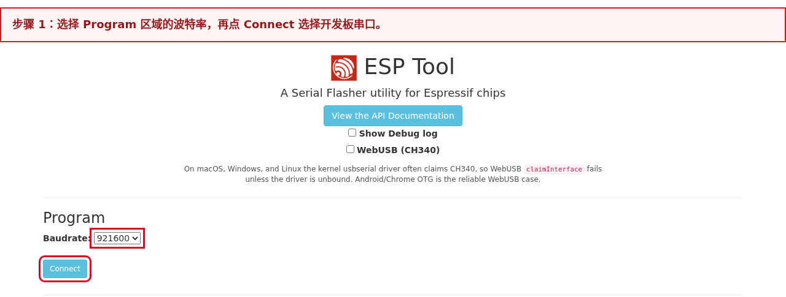
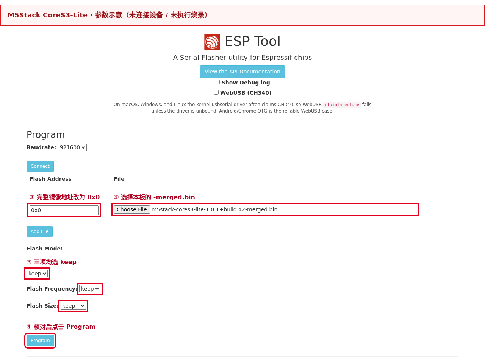
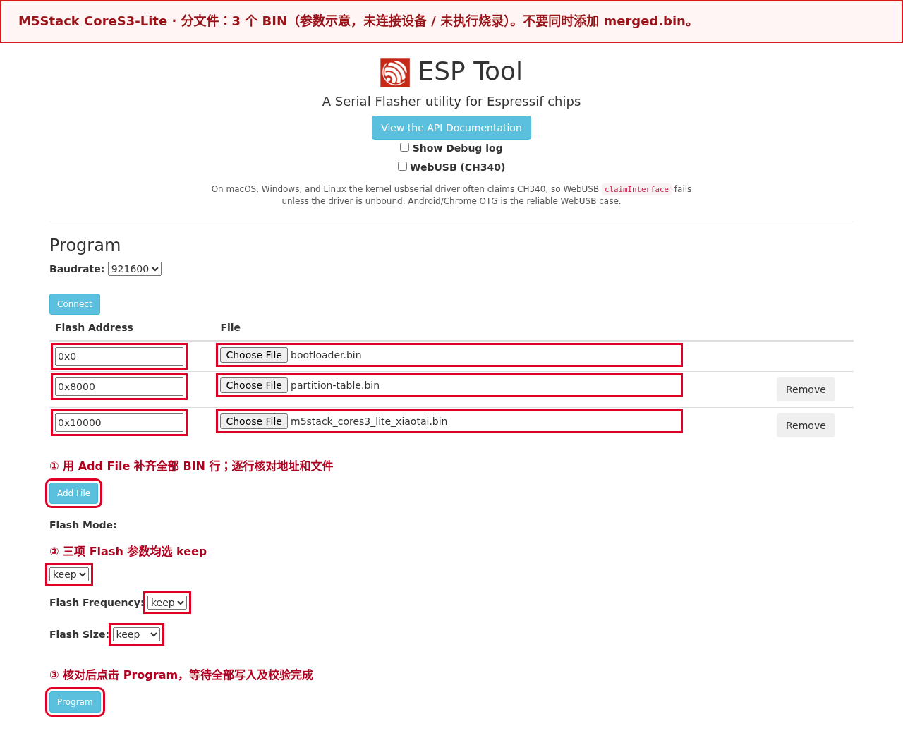
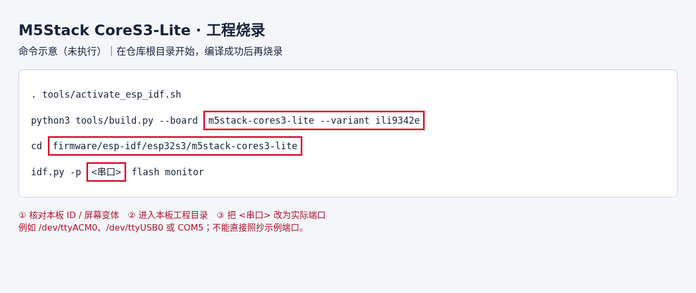

# M5Stack CoreS3-Lite

[Back to boards](../README.en.md) · [Firmware and release notes](../../downloads.en.md#m5stack-cores3-lite)

[中文](README.md) · [English](README.en.md)

Board ID: `m5stack-cores3-lite`. See [Downloads](../../downloads.en.md#m5stack-cores3-lite) for both screen variants. Short-phrase recognition, AI interruption, and double-talk still need regression testing; see [Validation status and limitations](#validation-status-and-limitations).

## Flashing

`<version>` in filenames means the full download-page version, including build number. Use actual downloaded files and verify the manifest; screenshot versions and paths are examples.

### Identify the screen first

Confirm the device is **CoreS3-Lite K128-Lite**, then ask the seller or M5Stack whether its controller is `ILI9342E` or `ILI9342C`. Use an explicit part identification, not purchase date, product name, or enclosure appearance.

Official materials describe both panels, and [M5GFX panel detection](https://github.com/m5stack/M5GFX/releases/tag/0.2.30) handles C/E separately. If uncertain, obtain the controller model from the seller before choosing firmware.

| Controller | Merged image for first flashing | Split package for retaining settings |
|---|---|---|
| ILI9342E | Check [Downloads](../../downloads.en.md#m5stack-cores3-lite) for availability | Check [Downloads](../../downloads.en.md#m5stack-cores3-lite) for availability |
| ILI9342C | [Merged BIN](../../downloads.en.md#m5stack-cores3-lite) | [Firmware ZIP](../../downloads.en.md#m5stack-cores3-lite) |

### Open the flashing tool

Open [Espressif ESP Web Tool](https://espressif.github.io/esptool-js/) in desktop **Chrome or Edge**. ESP-IDF installation is unnecessary for browser flashing. Close terminals and other pages using the serial port. See the [official guide](https://docs.m5stack.com/en/core/CoreS3-Lite) for connectors and download mode.

### Flashing steps

1. Download the complete `merged.bin` for the correct controller from the table. Select only this BIN at **`0x0`**.
2. Connect Type-C to the computer. Hold the bottom reset button for about 3 seconds, release when the green LED lights, and wait until it goes out to enter download mode. Detection must show **ESP32-S3**.
3. In **Program**, set `Baudrate` to `921600`, or `115200` if unstable. Click **Connect** and select the board. Leave `WebUSB (CH340)` unchecked for desktop serial mode.
4. Click **Choose File**, select the merged BIN, and set **Flash Address to `0x0`**. Set Flash Mode, Flash Frequency, and Flash Size to `keep`. Add only one row and click **Program**.
5. Wait for `Hash of data verified.` and a final `Leaving...` with no `Error:`. Click **Disconnect**, reset, and check 115200-baud logs for `m5stack_cores3_lite_xiaotai`, the selected screen variant, and the full version before first use.

Connection and programming controls are shown below; port numbers and paths are examples:





**The merged image overwrites Wi-Fi, binding, and EP service-discovery overrides in nonvolatile storage (NVS).** Configure Wi-Fi and bind again afterward. `keep` preserves image Flash parameters, not device settings.

Repeat step 2 for connection failures; check the port, cable, file, and address for write/verification failures. A 100% progress bar alone does not prove success.

| Download or package file | Purpose |
|---|---|
| Correct variant's `-merged.bin` | **Flash directly**, this file only, at `0x0` |
| Correct variant's `-validation.zip` | Extract and flash individual files at the addresses below |
| `m5stack_cores3_lite_xiaotai.bin` | Application at `0x10000`; not a complete image for `0x0` |
| `MANIFEST.json`, `flasher_args.json`, `flash_args`, ELF | Manifests/diagnostics; do not flash directly |

The corresponding Release's `SHA256SUMS` contains the complete BIN checksum.

Windows: `Get-FileHash -Algorithm SHA256 "path-to-BIN"`; Linux: `sha256sum "path-to-BIN"`; macOS: `shasum -a 256 "path-to-BIN"`. Individual hashes are in `MANIFEST.json`; release-asset hashes are in `SHA256SUMS` on the corresponding Release.

## First use

Confirm the merged image was flashed at `0x0` and the device rebooted. For split files, confirm all 3 BINs were written at their listed addresses. Use either method, then configure Wi-Fi and bind.

1. **Wi-Fi:** without saved credentials, the screen prompts for setup. Connect a phone/computer to the open hotspot beginning `XiaoTai-`; “no internet” is normal. Select 2.4 GHz Wi-Fi in the setup page, enter the password, and submit. If no page opens, visit `http://192.168.6.1`. A reappearing hotspot indicates failure; check password and signal.
2. **Binding:** after connection, the display shows a six-digit code. Restore the phone/computer's internet connection, open the [XiaoTai device page](https://xiaotai.chat/devices), sign up or sign in, and enter the code under Add device. Use a refreshed code if expired. The home screen and an entry in the device list indicate success.
3. **Try features and recover:** use the touch menu for AI, contacts, group intercom, and settings. To change network or rebind, confirm Reset device in settings, then set up and bind again. Do not erase the entire Flash.

Wi-Fi and binding credentials are stored in NVS; source code contains no account or password.

## Other flashing methods

### Split-file flashing

Download and extract the ZIP for the correct display controller. Verify this board/version's **3 BINs** against `MANIFEST.json` and `flasher_args.json`:

| File | Address | Purpose |
|---|---|---|
| `bootloader/bootloader.bin` | `0x0` | Bootloader |
| `partition_table/partition-table.bin` | `0x8000` | Partition table |
| `m5stack_cores3_lite_xiaotai.bin` | `0x10000` | Application; never write at 0x0 |

Use **Add File** for each BIN and enter its address, then **Program**. Do not also add the merged image. Bootloader addresses vary by board. To retain settings, first check partition compatibility and avoid full-chip erase.



### Build and flash from source

Follow [Building from source](../../../README.en.md#build-from-source) to obtain the repository and install this board's ESP-IDF. From the root:

```bash
. tools/activate_esp_idf.sh
python3 tools/build.py --board m5stack-cores3-lite --variant ili9342e
cd firmware/esp-idf/esp32s3/m5stack-cores3-lite
idf.py -p <serial-port> flash monitor
```

This selects ILI9342E; for ILI9342C, change `--variant` to `ili9342c`. Replace `<serial-port>` with the actual port; `idf.py` uses the project manifest and addresses. Ordinary upgrades do not use `erase-flash`. The screenshot is an example, not proof these commands ran on the current board:



## Specifications

| Item | Configuration |
|---|---|
| Chip / framework | ESP32-S3 / **ESP-IDF v5.5.5** |
| Storage | 16 MB Flash / 8 MB Quad PSRAM, configured at 80 MHz |
| Display / touch | 320×240 ILI9342C or ILI9342E / FT6336U |
| Camera | GC0308 with onboard 24 MHz clock |
| Audio | ES7210 dual-microphone input and electrical playback reference; AW88298 + 1 W speaker |
| Power | AXP2101 + AW9523B, 200 mAh battery (official rating, capacity unmeasured) |
| Interaction | `touch-full` / `compact`, 16-pixel Chinese font |

## Audio and video parameters

These are current-source parameters shared by both screen variants. See [Downloads](../../downloads.en.md#m5stack-cores3-lite) for available firmware and its feature scope. All audio is mono, with 20 ms packets.

| Scenario | Direction and stream ID | Codec and sample rate | Packet or video parameters |
|---|---|---|---|
| AI conversation | Uplink/downlink: 1 | Uplink A-law / 16 kHz; downlink Opus / 16 kHz | 320-byte uplink; variable Opus size |
| H5 two-way audio | Uplink 10; downlink 14 | A-law / 8 kHz both ways | 160 bytes |
| Device calls | Bidirectional audio 10 | A-law / 8 kHz both ways | 160 bytes |
| WeChat voice | Bidirectional audio 0 | A-law / 8 kHz both ways | 160 bytes |
| H5 live video | Uplink 11 | MJPEG | 320×240, target maximum 8 fps; actual frame rate requires measurement |

Device and WeChat calls are audio-only. WeChat reports `up_video_mt=none`, `down_video_mt=none`, and `no_video=true`, using A-law / 8 kHz on audio stream 0. Home quick-call submits `wx_room_type=voice`; contact details offer voice calls only.

S3 policy constrains runtime, UI, camera tasks, and SDK send entry points: accidental video requests or old subscriptions must not start VoIP video uplink. LCKFB S3 also uses voice-only calls; P4 retains its capabilities. Room PTT uses the shared room runtime.

With the camera at the top, `stream/call/voip.camera_rotation` and device-call request/answer metadata report numeric `180`. H5 receivers rotate raw MJPEG accordingly; firmware does not additionally rotate camera pixels.

Orientation metadata retained for voice calls does not imply video support: M5 device/WeChat calls send no video, while H5 retains it. Capabilities are resubmitted after upgrade and connection; close old live-view pages and reopen to verify orientation.

Hardware capture and playback stay at 16 kHz. I2S0 four-slot TDM RX and two-slot standard I2S TX are created together, sharing 64fs BCLK and 256fs MCLK; AW88298 BCLK configuration is read back after writing.

Following Espressif's CoreS3 BSP, AW88298 uses 15 dB PA gain compensation for correct volume attenuation mapping. The same setting may sound quieter than early adaptations; sound quality and double-talk still need hardware confirmation.

The first two ES7210 wire slots are MIC1 speech and MIC3 electrical speaker reference. Board code packs them as MR for shared ESP-SR AEC. Schematics prove wiring only; echo performance, clipping, double-talk, and acoustic delay require measurement.

See the [audio review (Chinese)](../../../boards/m5stack/cores3-lite/OFFICIAL_AUDIO_REVIEW.md) for official-source checks, gain quantization, and evidence limits.

If continuous conversation requires repetition or is hard to interrupt during playback, run `voice-diag 30` then `status` to capture playback, clipping, uplink, and I2S overflow in the same window. See [capture diagnostics (Chinese)](../../development/MEDIA_PIPELINE_DIAGNOSTICS.md#cores3-持续对话采音观测).

These commands read statistics without changing audio settings.

Shared ESP internal configuration `CONFIG_STARTER_AI_UPLINK_G711A_16K=y` fixes the AI uplink format. AI start_session uses the official protocol name `alaw` and accepts response alias `g711a`.

This jointly controls input declaration/validation, pre-recorded/live PCM, encoder selection, and TiRTC A-law / 16 kHz frame flags. Output declaration and decoding remain Opus / 16 kHz.

AEC stays at 16 kHz; AI directly encodes processed 16 kHz PCM, while H5 and calls retain 8 kHz paths. Server rejection of this input/output combination causes negotiation failure and termination, not a successful acoustic test.

LCKFB S3, Waveshare P4, and BK7258 use the same AI network formats while retaining their board DSP pipelines.

## Environment and dependencies

The application toolchain is **ESP-IDF v5.5.5**, commit `b774170ff46c393eeb5e495ea37936038d3f4f4f`. Run `. tools/activate_esp_idf.sh` from the root and verify `idf.py --version`. Install missing tools with `bash tools/setup_esp_idf.sh esp32s3`. `>=5.5,<5.6` is a compatibility range, not the selected version.

TiRTC SDK 2.5.0 comes from this project's `third_party/tirtc` and follows its ABI build contract. Dependencies include LVGL 8.3.11, esp_lvgl_port 2.7.2, esp32-camera 2.1.7, esp-sr 2.4.7, esp_audio_codec 2.4.0, and esp_lcd_ili9341 2.1.0. `dependencies.lock` records resolved versions and hashes.

Builds do not read `.references` or user-supplied old projects.

## Schematics and hardware sources

Official page: [CoreS3-Lite (Chinese)](https://docs.m5stack.com/zh_CN/core/CoreS3-Lite).

For [schematic v1.0](https://m5stack-doc.oss-cn-shenzhen.aliyuncs.com/490/Sch_M5_CoreS3_v1.0.pdf), datasheets, BSP, and download SHA-256, see [Sources and reference decisions (Chinese)](../../../boards/m5stack/cores3-lite/SOURCES.md).

The current official page's audio GPIO13/14 directions conflict with the schematic. Implementation uses RX14/TX13, matching the schematic and official BSP. Both C and E panels exist; identify physical hardware before selecting firmware.

## Development

Board code is in `boards/m5stack/cores3-lite/`: `board_power.c` handles power/reset, `board_adapter.c` audio/camera, and `board_display.c` display/touch. `hardware-ir.json` stores sources, pins, and evidence grades.

S3 media orchestration is in `platforms/esp-idf/components/starter_media_s3/`; runtime, UI, setup, and other features use shared components directly.

The old `m5stack-cores3-se-xiaotai` supplies reference power sequencing, codec initialization, AW88298 clock readback, and ILI9342C/FT6336 initialization because sources confirmed matching parts/wiring. Its business state machine, UI, AGC, and ISR queues were not ported.

See [Reference notes (Chinese)](../../../boards/m5stack/cores3-lite/SOURCES.md) for files and reasons.

GPIO0 is audio MCLK, not a product button. Power/RST retains hardware functions; touch emits business intents. Only MQTT notifications and entry to the group-intercom page refresh room assignment; no startup or periodic queries are added.

Board `LCD_SWAP_XY` and `LCD_MIRROR_X/Y` define orientation. With the camera at the top, CoreS3 uses swap=false, mirror_x=true, mirror_y=true, rotating native landscape 180°. Panel, touch, and shared LVGL registration use the same values so UI initialization does not overwrite native 320×240 addressing.

## Building

Private component definition `XIAOTAI_UI_TEXT_PSRAM=1` places AI caption history (2048 bytes) and display text (2304 bytes) in static PSRAM BSS, reducing internal static allocation by 4352 bytes.

It uses [ESP-IDF v5.5.5 external BSS](https://github.com/espressif/esp-idf/blob/v5.5.5/docs/en/api-guides/external-ram.rst), retaining fixed capacity, boot-time clearing, and UI-lifetime storage without per-conversation allocation/free.

Effective configuration must enable `CONFIG_SPIRAM_ALLOW_BSS_SEG_EXTERNAL_MEMORY` or compilation fails. LCKFB S3/P4 do not enable this definition. DMA, locks, task stacks, and LVGL object pools retain their allocation policies.

Reduced static usage does not prove equivalent contiguous-heap gains or faster AEC; measure the same build.

From the root, select one screen only:

```bash
. tools/activate_esp_idf.sh
idf.py --version
python3 tools/build.py --board m5stack-cores3-lite --variant ili9342e
# For ILI9342C hardware, replace ili9342e above with ili9342c.
```

Omitting `--variant` selects `ili9342e`. Switching reconfigures panel commands, without runtime guessing. Native output is `firmware/esp-idf/esp32s3/m5stack-cores3-lite/build/`; the application is `m5stack_cores3_lite_xiaotai.bin` / `.elf`. Use that directory's `flasher_args.json` for addresses.

Independent `BUILD_NUMBER` increments on every build, including failures, without changing product version.

Native CMake checks effective PSRAM configuration and rejects Octal or disabled PSRAM. Changing `sdkconfig.defaults` does not overwrite an existing Octal `sdkconfig`. In the project directory, run `idf.py menuconfig`, open `Component config → ESP PSRAM`, select Quad, save, and rebuild through the unified entry above.

Retain other local settings; NVS erase is unnecessary.

## Testing

```bash
python3 tools/tests/test_cores3_board.py
python3 tools/tests/test_cores3_memory_config.py
python3 tools/tests/test_s3_display_geometry.py
python3 tools/build.py --validate
python3 -m unittest discover -s tools/tests -v
bash tools/check.sh
```

Host tests cover variants/versions, real power-interface bit preservation and failure propagation, microphone/reference slot packing, both panel command sets, and GPIO0 exclusivity. PSRAM regressions check new-project defaults and execute real CMake checks, rejecting old Octal, disabled PSRAM, and conflicting settings.

Shared S3 regressions cover existing sessions, audio, playback tails, and UI. Code reuse does not establish this board's network or acoustic validation.

## Troubleshooting

`octal_psram: PSRAM chip is not connected, or wrong PSRAM line mode` followed by `Failed to init external RAM` means external RAM failed before `app_main`. Check effective `CONFIG_SPIRAM_MODE_QUAD=y` and disabled Octal. RST or network reset cannot fix the flashed bus mode; rebuild and flash.

Keep PSRAM initialization and memory testing enabled rather than ignoring errors.

For a dark screen, check C/E variant, PMIC backlight, and LCD reset before SPI; do not use LCKFB backlight GPIO42. For misplaced text or partial-screen output, check `cores3_display` startup logs for `native=320x240 UI=320x240 swap_xy=0 mirror=1/1` and match the physical panel.

For touch, check I²C0 SDA12/SCL11 and address 0x38; native landscape coordinates are not swapped. For camera initialization, check GC0308 PID, external clock, and AW9523/AXP power; do not silently substitute another model.

For silence, check RX14/TX13, codec addresses, and AW88298 register 0x06 64fs readback, then test speech-only, speaker-only, and double-talk slots. GPIO0 must not be a button input.

## Validation status and limitations

The 1.1.0 test firmware adds AI audio analysis: triggered raw MIC1 16 kHz PCM retains up to 5 seconds of pre-recording and records 10 more seconds for upload. The home AI icon toggles recognition; its background shows 60-second cooldown, status shows recording/upload, and results scroll twice with spoken output.

Recognition pauses during calls, live view, AI conversations, and room activity. MIC3 playback reference is excluded; thresholds and acoustics still require M5 hardware validation.

Validated release records are **v1.0.1 · build.47 / ILI9342E** and **v1.0.1 · build.48 / ILI9342C**. See [Release records (Chinese)](FREEZE.md) for features/fixes and [Validation (Chinese)](../../../boards/m5stack/cores3-lite/VALIDATION.md) for build identity, scope, and historical logs.

- Capture, AI interruption, and double-talk need ongoing testing. Unstable recognition of the short Chinese phrase “好的” and possible loss of initial speech remain unresolved.
- This version does not offer experimental recording export to TF cards. Diagnose with `voice-diag`, `status`, and `face-animation`.
- AEC and UI processing headroom during playback remains tight. Weak networks, repeated switching, and long runs need continued regression. See [Audio performance review (Chinese)](AUDIO_PERFORMANCE_REVIEW.md).
- Select firmware by display controller; see Downloads for current availability.
- SD card, IMU, magnetometer, proximity sensor, and RTC are not integrated into XiaoTai features.
