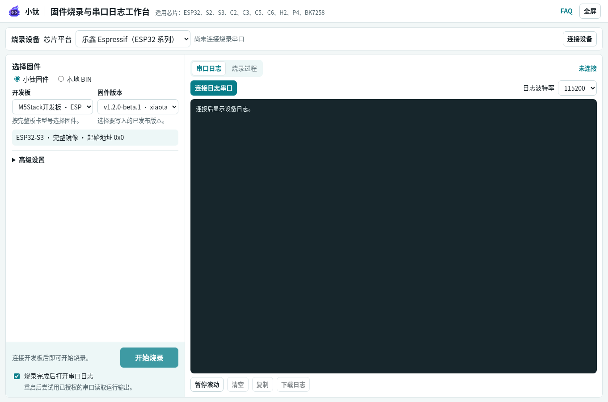
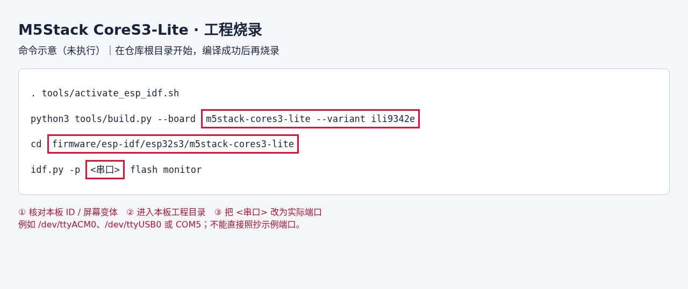

# M5Stack CoreS3-Lite

[ESP32 与 BK7258 串口命令](../../development/SERIAL_COMMANDS.md)

[返回开发板目录](../README.md) · [固件下载与发布说明](../../downloads.md#m5stack-cores3-lite)

[中文](README.md) · [English](README.en.md)

板卡 ID：`m5stack-cores3-lite`。当前固件版本见[固件下载](../../downloads.md#m5stack-cores3-lite)。
短句识别、AI 打断和双讲效果仍需回归；详情见[验证状态与已知限制](#验证状态与已知限制)。

## 烧录

### 确认开发板

本项目仅支持 **CoreS3-Lite K128-Lite / ILI9342C**。下载页只提供这一种完整镜像，
不需要选择屏幕型号，也不提供其他面板的构建配置。

### 网页烧录

用 USB 数据线连接开发板的 Type-C 接口。长按底部复位键约 3 秒，绿灯亮起后松手，灯灭时即进入下载模式。关闭占用该串口的日志终端。

完整镜像会覆盖 NVS 中的 Wi-Fi 凭证、设备绑定和服务发现地址。烧录后需要重新配网、绑定。

1. 用电脑上的 Chrome 或 Edge 打开[小钛网页烧录工具](https://xiaotai.chat/web-flasher/)。在 **芯片平台** 选择 **乐鑫 Espressif（ESP32 系列）**，点击 **连接设备**，在浏览器弹窗中选择本板串口。确认识别到 ESP32-S3。
2. 在 **小钛固件** 下选择 **M5Stack开发板 · ESP32-S3(CoreS3-Lite)**。在 **固件版本** 中选择标有 `xiaotai`、版本号与下载页一致的条目。
   已下载[发布镜像](../../downloads.md#m5stack-cores3-lite)时，切换到 **本地 BIN**，打开 `v<发行版本>_m5stack-cores3-lite_ili9342c_merged.bin`。
3. 确认完整镜像起始地址为 `0x0`，点击 **开始烧录**。写入期间保持 USB 连接，在 **烧录过程** 中查看结果。
4. 设备重启后，打开 **串口日志**，波特率设为 115200。确认项目名为 `m5stack_cores3_lite_xiaotai`，再将日志中的固件版本与发布说明里的内嵌版本对照。



接口与下载模式详见[板卡官方说明](https://docs.m5stack.com/en/core/CoreS3-Lite)。

如需校验，使用发布说明中的 BIN SHA-256；Windows 用 `Get-FileHash -Algorithm SHA256 "实际BIN路径"`，
Linux 用 `sha256sum "实际BIN路径"`，macOS 用 `shasum -a 256 "实际BIN路径"`。

## 首次使用

确认完整 `_merged.bin` 已从 `0x0` 烧录且设备正常重启，然后配网和绑定。

1. **配置 Wi-Fi**：设备没有 Wi-Fi 凭证时会显示配网提示。用手机或电脑连接 `XiaoTai-`
   开头的开放热点；提示“无互联网”属于正常现象。在弹出页面选择目标 2.4 GHz Wi-Fi，
   输入密码并提交。没有弹窗时打开 `http://192.168.6.1`。热点重新出现表示联网失败，
   请检查密码和信号后重试。
2. **绑定设备**：需要绑定时，屏幕显示六位绑定码。让手机或电脑恢复互联网连接，打开
   [小钛设备页](https://xiaotai.chat/devices)，注册或登录，在“添加设备”中输入屏幕上的码。
   验证码过期时使用屏幕刷新后的新码。设备进入首页且出现在设备列表中，表示绑定成功。
3. **体验与恢复**：从触摸菜单进入 AI、联系人、多人对讲和设置。更换网络或重新绑定时，
   在设置页选择“重置设备”并确认，再重新配网绑定；不要擦除整片 Flash。

Wi-Fi 和绑定凭证保存在 NVS，源码不带账号或密码。

## 其他烧录方式

### 从源码编译后烧录

按[源码获取说明](../../../README.md#从源码编译)准备仓库，并安装本板要求的 ESP-IDF。
在仓库根目录执行：

```bash
. tools/activate_esp_idf.sh
python3 tools/build.py --board m5stack-cores3-lite --variant ili9342c
cd firmware/esp-idf/esp32s3/m5stack-cores3-lite
idf.py -p <串口> flash monitor
```

默认与显式构建均选择 ILI9342C。
`<串口>` 换成本机实际端口；`idf.py` 会使用工程烧录清单和正确地址。
普通升级不执行 `erase-flash`。示例命令截图不代表已在当前硬件执行：



## 规格

| 项目 | 配置 |
|---|---|
| 芯片 / 当前框架 | ESP32-S3 / **ESP-IDF v5.5.5** |
| 存储 | 16 MB Flash / 8 MB Quad PSRAM，PSRAM 配置 80 MHz |
| 屏幕 / 触摸 | 320×240 ILI9342C / FT6336U |
| 摄像头 | GC0308，板载 24 MHz 时钟 |
| 音频 | ES7210 双麦输入及电气回采；AW88298 + 1 W 扬声器 |
| 电源 | AXP2101 + AW9523B，200 mAh 电池（官方规格，未测容量） |
| 交互 | `touch-full` / `compact`，16 像素中文字库 |

## 音视频参数

以下为当前源码的媒体参数，两种屏幕变体共用。可下载的固件及其功能范围见
[固件下载](../../downloads.md#m5stack-cores3-lite)。音频均为单声道，每包 20 毫秒。

| 场景 | 方向与流编号 | 编码与采样率 | 包大小或画面参数 |
|---|---|---|---|
| AI 对讲 | 上行、下行：流 1 | 上行 A-law / 16 kHz；下行 Opus / 16 kHz | 上行 320 字节；Opus 包长可变 |
| H5 实时对讲 | 上行：流 10；下行：流 14 | 双向 A-law / 8 kHz | 每包 160 字节 |
| 设备呼叫 | 双向：音频流 10 | 双向 A-law / 8 kHz | 每包 160 字节 |
| 微信语音通话 | 双向：音频流 0 | 双向 A-law / 8 kHz | 每包 160 字节 |
| H5 实时画面 | 上行：流 11 | MJPEG（逐帧 JPEG） | 320×240，目标上限 8 fps；实际帧率需测量 |

设备间呼叫和微信 VoIP 均为纯音频。微信能力上报 `up_video_mt=none`、
`down_video_mt=none`、`no_video=true`，双向 A-law / 8 kHz 使用音频流 0。
首页微信快捷呼叫提交 `wx_room_type=voice`，联系人详情仅提供“语音通话”。
S3 平台策略同时约束 runtime、UI、摄像头任务与 SDK 发送入口；即使误传 video 请求
或存在旧视频订阅，也不得启动 VoIP 视频上行。立创 S3 同样为纯音频通话，P4 保留原能力。
房间 PTT 沿用公共房间运行时。

摄像头朝上使用时，设备能力的 `stream/call/voip.camera_rotation` 以及设备呼叫
请求、接听信息均上报数值 `180`。H5 接收端据此旋转原始 MJPEG 画面；
固件不再额外旋转摄像头像素。语音呼叫保留的方向元数据不代表视频能力；
M5 设备间呼叫和微信 VoIP 均不发送视频，H5 实时查看保留视频。
升级联网后会重新提交能力；关闭旧的实时查看页面，再重新进入验证画面方向。

硬件采集和播放固定 16 kHz。I2S0 的四槽 TDM RX 与双槽标准 I2S TX 成对创建，
共享 64fs BCLK、256fs MCLK；AW88298 的 BCLK 配置写后读回。
AW88298 按乐鑫官方 CoreS3 BSP 配置 15 dB PA 增益补偿，用于正确映射音量衰减；
补齐后相同音量设置可能比早期适配更轻，实板音质和双讲效果仍待确认。

ES7210 前两线槽是 MIC1 人声和 MIC3 扬声器电气回采，板级整理成 MR 后进入公共 ESP-SR AEC。
原理图只能证明参考接线，回声效果、削波、双讲和声学延时必须实测。
官方源码核对、驱动增益量化及当前证据边界见
[音频核查](../../../boards/m5stack/cores3-lite/OFFICIAL_AUDIO_REVIEW.md)。

持续对话需要重复或播放时难以打断时，可用 `voice-diag 30` 后接 `status`
采集同窗口播放、削顶、上行与 I2S 溢出观测，详见
[采音诊断](../../development/MEDIA_PIPELINE_DIAGNOSTICS.md#cores3-持续对话采音观测)。
诊断命令只读取统计数据，不修改音频参数。

AI 上行格式由 ESP 共享内部配置 `CONFIG_STARTER_AI_UPLINK_G711A_16K=y` 固定。
AI start_session 请求使用官方协议名 `alaw`，响应兼容 `g711a` 别名。
它同步控制 start_session 输入声明/响应校验、预录音/实时 PCM、编码器选择和
TiRTC 的 A-law / 16 kHz 帧标志；输出声明及解码仍为 Opus / 16 kHz。

AEC 继续在 16 kHz 域运行，AI 上行直接编码处理后的 16 kHz PCM；
H5 和通话仍使用原有 8 kHz 路径。
服务端若拒绝该输入/输出组合，会报协商错误并停止，不能视为声学测试通过。
立创 S3、微雪 P4 和 BK7258 现在采用相同 AI 网络格式，各板保留原有 DSP 处理。

## 环境与依赖

当前应用工具链固定 **ESP-IDF v5.5.5**，提交
`b774170ff46c393eeb5e495ea37936038d3f4f4f`。从仓库根目录执行
`. tools/activate_esp_idf.sh` 后用 `idf.py --version` 核对；缺少工具时使用
`bash tools/setup_esp_idf.sh esp32s3` 安装仓库指定版本。
组件声明的 `>=5.5,<5.6` 只是兼容范围，不是本次使用版本。

TiRTC SDK 2.6.3 使用公共目录 `platforms/esp-idf/third_party/tirtc/esp32s3`，受其 ABI 构建合同约束。
LVGL 8.3.11、esp_lvgl_port 2.7.2、esp32-camera 2.1.7、esp-sr 2.4.7、
esp_audio_codec 2.4.0、esp_lcd_ili9341 2.1.0；全部实际解析版本及哈希见 `dependencies.lock`。
编译不读取 `.references` 或用户提供的旧工程。

## 原理图与硬件资料

官方入口：[CoreS3-Lite](https://docs.m5stack.com/zh_CN/core/CoreS3-Lite)。
[原理图 v1.0](https://m5stack-doc.oss-cn-shenzhen.aliyuncs.com/490/Sch_M5_CoreS3_v1.0.pdf)、
数据手册、BSP 及下载 SHA-256 见[资料与参考取舍](../../../boards/m5stack/cores3-lite/SOURCES.md)。

当前官方页面的音频 GPIO13/14 方向与原理图冲突；实现采用原理图和官方 BSP 一致的
RX14/TX13。同系列存在 C、E 两种屏幕，不能只凭产品名确定面板；选固件前须核对实物。

## 开发

板级代码在 `boards/m5stack/cores3-lite/`：`board_power.c` 管电源和复位，
`board_adapter.c` 管音频与摄像头，`board_display.c` 管屏幕和触摸。
`hardware-ir.json` 保存来源、引脚和证据等级。S3 媒体编排在
`platforms/esp-idf/components/starter_media_s3/`，其余运行时、UI、配网等直接使用公共组件。

参考旧 `m5stack-cores3-se-xiaotai` 的电源时序、codec 初始化、AW88298 时钟读回和
ILI9342C/FT6336 硬件初始化；原因是器件和接线经资料核对一致。没有移植旧业务状态机、
UI、AGC 或 ISR 队列；具体文件和采用原因见[参考说明](../../../boards/m5stack/cores3-lite/SOURCES.md)。

GPIO0 用作音频 MCLK，不作为业务按键。电源键/RST 保留硬件功能，业务由触摸发出意图。
房间分配仅由 MQTT 通知和进入多人对讲页刷新，不增加启动或定时查询。

显示方向由板级 `LCD_SWAP_XY`、`LCD_MIRROR_X/Y` 定义。按摄像头位于顶部的握持方向，
CoreS3 设置 swap=false、mirror_x=true、mirror_y=true，原生横屏旋转 180°。
面板、触摸与共享 LVGL 注册使用同一组值，避免 UI 初始化覆盖原生 320×240 地址方向。

## 编译

M5 工程通过组件私有定义 `XIAOTAI_UI_TEXT_PSRAM=1`，将 AI 字幕历史（2048 字节）
和显示文本（2304 字节）放入 PSRAM 的静态 BSS，减少 4352 字节内部静态占用。
它采用 [ESP-IDF v5.5.5 外部 BSS 机制](https://github.com/espressif/esp-idf/blob/v5.5.5/docs/en/api-guides/external-ram.rst)，
保留固定容量、开机清零和整个 UI 生命周期，不增加每轮对话的分配/释放。

有效配置必须开启 `CONFIG_SPIRAM_ALLOW_BSS_SEG_EXTERNAL_MEMORY`，否则编译拒绝。
立创 S3/P4 未启用这个定义；DMA、锁、任务栈与 LVGL 对象池保持原分配策略。
静态占用降低不等于运行时连续堆块等量增加，也不代表 AEC 耗时降低；需同版实测。

在仓库根目录执行，一次只选一种屏幕：

```bash
. tools/activate_esp_idf.sh
idf.py --version
python3 tools/build.py --board m5stack-cores3-lite --variant ili9342c

```

省略 `--variant` 选择唯一的 `ili9342c`，原生工程也拒绝其他面板配置。
原生输出在 `firmware/esp-idf/esp32s3/m5stack-cores3-lite/build/`，应用为
`m5stack_cores3_lite_xiaotai.bin` / `.elf`；烧录地址以同目录 `flasher_args.json` 为准。
独立 `BUILD_NUMBER` 每次编译递增，失败也消耗编号，不自动改变产品版本。

原生 CMake 检查最终生效的 PSRAM 配置，拒绝 Octal 或关闭 PSRAM 的构建。
若已有 `sdkconfig` 保存了旧的 Octal 设置，修改 `sdkconfig.defaults` 不会覆盖它：
在工程目录执行 `idf.py menuconfig`，进入 `Component config → ESP PSRAM`，
将模式改为 Quad，保存后通过上述统一入口重新编译。保留其他本机设置，无需擦除 NVS。

## 测试

```bash
python3 tools/tests/test_cores3_board.py
python3 tools/tests/test_cores3_memory_config.py
python3 tools/tests/test_s3_display_geometry.py
python3 tools/build.py --validate
python3 -m unittest discover -s tools/tests -v
bash tools/check.sh
```

主机测试覆盖构建变体与版本、真实电源接口的位保护及失败传播、MIC/回采槽位整理、
两版面板命令和 GPIO0 排他性。PSRAM 回归检查新建工程默认值，并执行真实 CMake
检查入口，确认旧 Octal 配置、关闭 PSRAM 和冲突配置均被拒绝。
公共 S3 回归覆盖既有会话、音频、尾音和 UI 行为；
源码复用不等于本板的网络或声学测试已通过。

## 排查

若启动出现 `octal_psram: PSRAM chip is not connected, or wrong PSRAM line mode`
及 `Failed to init external RAM`，说明程序在 `app_main` 之前初始化外部 RAM 失败。
先核对有效配置必须为 `CONFIG_SPIRAM_MODE_QUAD=y`，且 Octal 关闭。
仅按 RST 或恢复网络设置不能修正已烧录固件的总线模式；需重新编译并烧录。
保持 PSRAM 初始化与内存测试开启，不用忽略 PSRAM 错误的选项绕过启动检查。

屏幕不亮先确认 C/E 变体、PMIC 背光和 LCD 复位，再检查 SPI；不要套用立创背光 GPIO42。
文字错行或画面只占部分区域时，检查 `cores3_display` 启动日志应为
`native=320x240 UI=320x240 swap_xy=0 mirror=1/1`，并与实物 C/E 面板核对。

触摸异常检查 I²C0 SDA12/SCL11 和 0x38，屏幕原生横向坐标不交换。
摄像头初始化失败检查 GC0308 PID、外部时钟及 AW9523/AXP 电源，不接受其他型号静默替代。
无声先检查 RX14/TX13、codec 地址、AW88298 寄存器 0x06 的 64fs 读回，
再做仅人声、仅扬声器和双讲三种槽位测试。GPIO0 不允许配置为按键输入。

## 验证状态与已知限制

1.1.0 测试固件新增 AI 音频分析：原始 MIC1 的 16 kHz PCM 触发后保留最多 5 秒预录，
再录 10 秒上传。首页 AI 图标支持开关，底色表示 60 秒冷却，状态显示录制和上传阶段，
结果滚动两次并语音播报。通话、实时查看、AI 对话和房间业务占用期间暂停识别。
MIC3 回放参考不进入识别录音，阈值与实际声学表现仍待 M5 实板验证。

本板已有实板使用记录。当前版本见[固件下载](../../downloads.md#m5stack-cores3-lite)。
功能与修复列表见[发布记录](FREEZE.md)，具体构建身份、验证范围和历史日志见
[验证记录](../../../boards/m5stack/cores3-lite/VALIDATION.md)。

- 收音、AI 打断和双讲效果仍需持续测试；短句“好的”识别不稳定、可能丢失句首的问题尚未修复。
- 本版不提供录音导出到 TF 卡的实验功能。诊断使用 `voice-diag`、`status` 和 `face-animation`。
- 播放期间的 AEC 与 UI 实时处理余量仍偏紧；弱网、反复切换和长时间运行需持续回归。分析见[音频性能排查](AUDIO_PERFORMANCE_REVIEW.md)。
- SD 卡、IMU、磁力计、接近传感器和 RTC 尚未接入小钛产品功能。

## 串口配置时间服务器

`ntp-show` 查看已保存的主 NTP 服务器覆盖项（`default` 表示没有覆盖项）。
使用 `ntp-set time.example.com` 或 `ntp-set 192.168.1.10` 保存；
`ntp-reset` 恢复默认。保存或恢复成功后设备会重启，中断正在进行的通话；
保存失败不重启。

支持最长 253 字符的 DNS 主机名或 IPv4 地址，不支持 URL、端口、路径、空格或 IPv6；
NTP 使用 UDP/123。原有备用服务器保留，因此这是主服务器优先配置，不是唯一时间源。
恢复出厂设置会清除覆盖项。重启后先确认校时成功，再测试通话。

## 启动异常时使用串口

恢复配置命令在媒体、界面和联网之前开放，不依赖 Wi-Fi 连接、设备绑定、校时、鉴权或平台上线成功。
可使用 `wifi-set`、`wifi-clear`、`tirtc-clear`、`ntp-show/set/reset`、`ep-show/set/reset` 和 `restart`；
具体参数仍按本板命令说明输入。BK 命令须加 `ap_cmd` 前缀，ESP32 直接输入命令。

本地业务未就绪时，`status` 只提示恢复模式，通话、媒体、语音诊断等业务命令返回 `Local runtime not ready`。
修改配置成功后按命令提示重启；写入失败不会报告保存成功或重启。
此入口不能修复串口驱动不可用、系统死机或 Flash 损坏；存储初始化失败时可以查看提示并重启，但保存配置可能失败。

验收应覆盖未配网、未绑定、NTP 不可达、鉴权失败、媒体初始化失败和断网重连；
每种情况下执行查询、修改、重启，并确认配置保留。主机故障注入不能替代当前镜像的实板串口验证。

NTP IPv4 地址使用不带前导零的十进制格式，例如 `10.0.0.1`；`010.0.0.1` 会被拒绝。

`tirtc-set` / `tirtc-clear` 成功后会阻止后台绑定在重启前覆盖身份；存储忙时请重试。
凭证现在以整条版本记录保存，兼容读取旧版三键格式，并在成功更新前清理旧字段。升级不要求重新绑定；
修改凭证后若需降级到不支持新格式的旧固件，应先在当前固件清除绑定，降级后重新绑定，避免读取旧凭证。

Wi-Fi 名称和密码也以整条记录保存，兼容读取旧格式；保存失败不会把新名称与旧密码混用。
保存尝试可能完成格式迁移，即使最终更新失败；降级到不支持新格式的固件需要重新配网。
音量、扬声器/麦克风静音等设置也改用整条记录，兼容读取旧设置。迁移后降级会恢复旧固件默认值，
请重新核对声音和静音设置。

`wifi-set` / `wifi-clear` 成功后，重启前的后台配网不能覆盖串口恢复结果。
网页保存成功但自动重启启动失败时，会提示手动重启；可执行 `restart` 或重新上电。
恢复出厂设置会阻止后台配置写回；若提示存储忙或清除失败，请稍后重试。

TiRTC 异步启动等待超过 30 秒时，设备保留串口恢复入口并关闭业务指令入口。
可以检查或修改配置，再执行 `restart`；不会在旧 SDK 状态不明时反复初始化。
