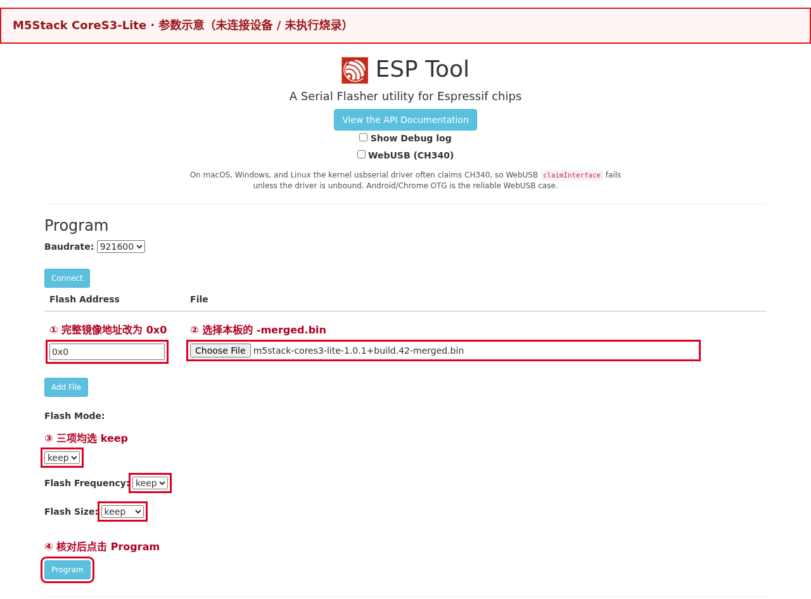
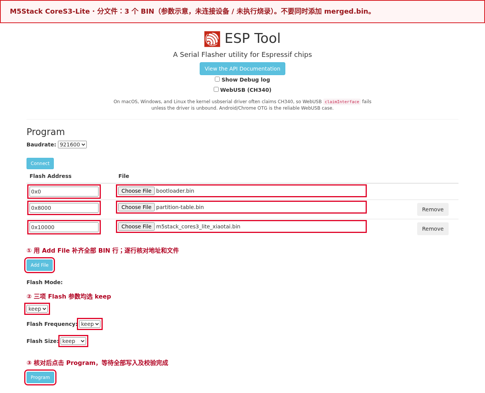
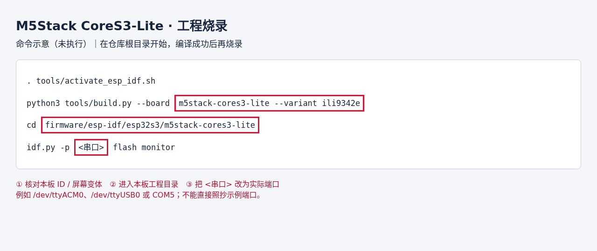

# M5Stack CoreS3-Lite 探鸽小钛

板卡 ID：`m5stack-cores3-lite`，商品编号 K128-Lite。当前正式固件为 v1.0.1 · build.42（ILI9342E）。
ESP32-S3 与立创相同，但接线、电源、功放、屏幕和触摸方向不同，固件不能互刷。

## 烧录

提供两种方式：**网页烧录**适合直接体验，无需安装开发环境；**工程烧录**适合修改源码后编译、调试。
两种方式任选其一。先核对完整板型，不能只按 `ESP32-S3` 选择固件。

发布固件仅适用于 **CoreS3-Lite（K128-Lite）的 ILI9342E 屏幕变体**。
使用 USB 数据线连接本机 Type-C 接口。长按底侧复位键约 3 秒，绿色灯亮后松开，
灯熄灭后进入下载模式；烧录后单击底侧 RST 重启。
按键位置与操作见[M5Stack 官方说明](https://docs.m5stack.com/en/core/CoreS3-Lite)。

### 先选烧录文件：单文件与分文件二选一

网页烧录和工程烧录是操作方式；**单文件与分文件是两种文件组织方式**。
本页文件名和地址对应 **v1.0.1 · build.42**；其他版本必须重新核对该版本清单。

| 文件方式 | 下载文件的完整名称 | 网页中应添加的内容 |
|---|---|---|
| 单文件（首次体验推荐） | `m5stack-cores3-lite-1.0.1+build.42-merged.bin` | 只添加这个 BIN，地址 `0x0` |
| 分文件（也可首次烧录） | `m5stack-cores3-lite-1.0.1+build.42-validation.zip` | 先解压，再添加下文列出的 **3 个 BIN**，各填各的地址 |

乐鑫支持按“地址 + 文件”写入多个 BIN，也支持用 `merge-bin` 合并后写入。
**分文件数量不是固定三个，地址也不能直接照抄官方示例**；以本工程生成的清单为准。
参见[乐鑫写入与合并镜像说明](https://docs.espressif.com/projects/esptool/en/latest/esp32s3/esptool/basic-commands.html#merge-binaries-for-flashing-merge-bin)。

### 方式一：网页烧录（推荐首次体验）

#### 1. 下载完整镜像

下载 [v1.0.1 · build.42 完整 merged.bin](https://github.com/tangeai/xiaotai/releases/download/m5stack-cores3-lite-v1.0.1/m5stack-cores3-lite-1.0.1%2Bbuild.42-merged.bin)。

下载后先核对下方完整文件名；BIN 的 SHA-256 及核对方法见本节“文件与写入校验”。

文件名应为 `m5stack-cores3-lite-1.0.1+build.42-merged.bin`。

版本内容与限制见[发布说明](https://github.com/tangeai/xiaotai/releases/tag/m5stack-cores3-lite-v1.0.1)。

**完整镜像会覆盖 NVS 中的 Wi-Fi、绑定等持久配置，烧录后需要重新配网、绑定。**
需要保留配置的升级请使用本节末尾的分文件方法，并核对分区布局与配置兼容性。

#### 2. 连接开发板

1. 关闭串口助手、`idf.py monitor` 和其他占用设备串口的网页。
2. 在电脑 Chrome 或 Edge 中打开[乐鑫 ESP Web Tool](https://espressif.github.io/esptool-js/)；Safari 不支持。
3. 使用 **Program** 区域的 `Baudrate`，可先保留 `921600`；传输不稳定时改为 `115200` 重试。桌面串口方式不勾选 `WebUSB (CH340)`。
4. 点击红框中的 **Connect**，在浏览器弹出的串口列表中选中本板，再点击“连接”。端口名可能是 COM、USB Serial 或 USB JTAG/serial；通过拔插前后的变化确认。
5. 等待日志识别出 **ESP32-S3**，再添加固件。若一直连接失败，按上面的板级步骤进入下载模式后重连。


#### 3. 选文件、改地址并烧录

1. 在 `File` 一栏点击 **Choose File / 选择文件**，选择 **`m5stack-cores3-lite-1.0.1+build.42-merged.bin`**，不要选 ZIP、ELF 或单独的应用 BIN。
2. 将 **Flash Address 从默认值改为 `0x0`**。完整镜像只添加这一行，不再同时添加 bootloader、分区表或应用文件。
3. 将 **Flash Mode、Flash Frequency、Flash Size 都选为 `keep`**，保留发布固件中的参数。`keep` 不表示保留 Wi-Fi 或绑定数据。
4. 再次核对芯片、文件名和 `0x0`，点击 **Program**。等待全部写入和校验完成；烧录期间保持供电和数据线连接，不点击 `Erase Flash`。



红框依次标出地址、文件、Flash 参数与烧录按钮。
图中参数区为未连接设备时展开的操作示意，不是实板烧录成功截图。

#### 4. 重启并检查

完成后点击 **Disconnect** 释放串口，按开发板复位键重启。
看到小钛启动及配网界面后，继续下方“首次使用”。需要日志时，可在网页 Console
区域以 `115200` 点击 `Start`，或打开本地串口工具，检查启动版本和报错。
只有烧录进度完成而设备不能正常启动时，应先核对板型、镜像和下载地址。

#### 另一种选择：分文件烧录（3 个 BIN）

下载 [m5stack-cores3-lite-1.0.1+build.42-validation.zip](https://github.com/tangeai/xiaotai/releases/download/m5stack-cores3-lite-v1.0.1/m5stack-cores3-lite-1.0.1%2Bbuild.42-validation.zip)，解压到独立目录。
不要将不同板卡或不同版本的解压文件放在一起；即使同名 `bootloader.bin`，内容也可能不同。

以下路径相对于 ZIP 的解压目录，已与本版 `MANIFEST.json` 和 `flasher_args.json` 核对：

| File：选择的 BIN 文件 | Flash Address：填写地址 | 用途 |
|---|---|---|
| `bootloader/bootloader.bin` | `0x0` | 启动引导程序 |
| `partition_table/partition-table.bin` | `0x8000` | 分区表 |
| `m5stack_cores3_lite_xiaotai.bin` | `0x10000` | 小钛应用程序，不能当作完整镜像 |

1. 按前面的步骤连接开发板；清空此前的文件行，不保留 `-merged.bin`。
2. 首行选择表中第一个 BIN 并填写对应地址，点击 **Add File** 添加其余行，直到总共 **3 行**。
3. 逐行检查完整文件名与地址。三项 Flash 参数仍选 `keep`，点击 **Program**，等待所有文件写入和校验完成后重启。

**应用 BIN 的地址是 `0x10000`，不是 `0x0`。** ZIP、ELF、JSON、`flash_args` 和 `SHA256SUMS`
均不是可直接烧录的文件，不要在 File 栏中选择它们。分文件清单中不能再加 merged.bin。



上图为未连接设备时展开的参数示意。分文件方式也适用于首次烧录；用于升级时，不执行全片擦除，
并核对分区布局与配置兼容性。它不会像 raw merged.bin 那样写入镜像间的填充区域。

#### 文件与写入校验

解压成功只说明压缩包可以读取，不能证明板型和版本正确。本指南不要求额外校验 ZIP 本身。
烧录前核对本板 ID、版本、BIN 文件名和地址；需要核对文件内容时，使用以下 SHA-256：

- 分文件 BIN：打开包内 `MANIFEST.json`，按 `files[].path` 找到对应文件，比较其 `sha256`。
- 单文件 `m5stack-cores3-lite-1.0.1+build.42-merged.bin`：本版 SHA-256 如下，也可在[发布页](https://github.com/tangeai/xiaotai/releases/tag/m5stack-cores3-lite-v1.0.1)的 `SHA256SUMS` 中查找同名 BIN 的条目。

```text
383412b207086e21edbc90fc194bab84dac0e5ed317581b7de511a5b2bef807f
```

Windows PowerShell 执行 `Get-FileHash -Algorithm SHA256 "实际BIN路径"`；Linux 执行
`sha256sum "实际BIN路径"`；macOS 执行 `shasum -a 256 "实际BIN路径"`，再对照上述值或清单。

文件 SHA-256 与烧录后的写入校验用途不同。乐鑫 esptool 的 `write-flash` 自动进行 MD5 写入校验，
通常不需要另跑 `verify-flash`；网页操作仍须等待写入及校验完成。参见
[乐鑫写入校验说明](https://docs.espressif.com/projects/esptool/en/latest/esp32s3/esptool/advanced-commands.html#verify-flash-data-verify-flash)。

### 方式二：工程烧录（源码编译与调试）

1. 按根目录[源码获取说明](../../../README.md#从源码编译)下载仓库；未安装工具链时，先完成本页“环境与依赖”和“编译”。
2. 连接本板并关闭网页烧录连接。在仓库根目录执行下列命令，编译成功后进入对应工程目录烧录。
3. **将 `<串口>` 替换为本机实际端口**，例如 Linux 的 `/dev/ttyACM0`、`/dev/ttyUSB0` 或 Windows ESP-IDF 终端的 `COM5`；不要照抄示例端口。

```bash
. tools/activate_esp_idf.sh
python3 tools/build.py --board m5stack-cores3-lite --variant ili9342e
cd firmware/esp-idf/esp32s3/m5stack-cores3-lite
idf.py -p <串口> flash monitor
```



上图为命令示意，不是已执行编译或烧录的终端记录。可复制的命令见上方代码块。

以上环境激活命令适用于 Linux/WSL；WSL 还需将 USB 设备接入该环境。
`idf.py` 按工程生成的烧录清单调用 esptool，不必手填地址。
出现启动日志后核对版本与板型，使用 `Ctrl+]` 退出监视器；不能连接时按本页下载模式步骤重试。
普通升级不执行 `erase-flash`。修改屏幕等硬件配置前，先核对本板支持的变体。

## 首次使用

设备没有 Wi-Fi 凭证时显示配网提示。使用者用手机或电脑连接 `XiaoTai-` 开头的开放热点，
在弹出页面填写目标 2.4 GHz Wi-Fi；没有弹窗时打开 `http://192.168.6.1`。
联网后屏幕显示六位绑定码，在 `https://xiaotai.chat` 注册或登录，选择“添加设备”并输入该码。
绑定成功后进入首页，使用触摸菜单进入 AI、联系人、多人对讲和设置。

Wi-Fi 连接失败时返回配网页重填；验证码过期等待刷新。更换网络或身份时从设置页选择
“重置设备”并确认，清除 Wi-Fi、绑定凭证和本机设置后重新配网绑定。凭证保存在 NVS，源码不带账号或密码。

## 规格

| 项目 | 配置 |
|---|---|
| 芯片 / 当前框架 | ESP32-S3 / **ESP-IDF v5.5.5** |
| 存储 | 16 MB Flash / 8 MB Quad PSRAM，PSRAM 配置 80 MHz |
| 屏幕 / 触摸 | 320×240 ILI9342C 或 ILI9342E / FT6336U |
| 摄像头 | GC0308，板载 24 MHz 时钟 |
| 音频 | ES7210 双麦输入及电气回采；AW88298 + 1 W 扬声器 |
| 电源 | AXP2101 + AW9523B，200 mAh 电池（官方规格，未测容量） |
| 交互 | `touch-full` / `compact`，16 像素中文字库 |

## 音视频参数

复用当前 S3 产品媒体契约：H5 上行 MJPEG 320×240，目标上限 8 fps；实际帧率需测量。
H5 的 A-law 8 kHz 单声道音频使用流 10/14，视频流 11。AI 使用流 1、20 ms 单声道帧：
上行为 G.711 A-law / 8 kHz，每包 160 字节；下行为 Opus / 16 kHz。

设备间呼叫和微信 VoIP 均为纯音频。微信能力上报 `up_video_mt=none`、
`down_video_mt=none`、`no_video=true`，双向 A-law / 8 kHz 使用音频流 0。
首页微信快捷呼叫提交 `wx_room_type=voice`，联系人详情仅提供“语音通话”。
S3 平台策略同时约束 runtime、UI、摄像头任务与 SDK 发送入口；即使误传 video 请求
或存在旧视频订阅，也不得启动 VoIP 视频上行。立创 S3 同样为纯音频通话，P4 保留原能力。
房间 PTT 沿用公共房间运行时。

摄像头朝上使用时，设备能力的 `stream/call/voip.camera_rotation` 以及设备呼叫
请求、接听信息均上报数值 `180`。H5 接收端据此旋转原始 MJPEG 画面；
固件不再额外旋转摄像头像素。语音呼叫保留的方向元数据不代表视频能力；
M5 设备间呼叫和微信 VoIP 均不发送视频，H5 实时查看保留视频。
升级联网后会重新提交能力；关闭旧的实时查看页面，再重新进入验证画面方向。

硬件采集和播放固定 16 kHz。I2S0 的四槽 TDM RX 与双槽标准 I2S TX 成对创建，
共享 64fs BCLK、256fs MCLK；AW88298 的 BCLK 配置写后读回。
AW88298 按乐鑫官方 CoreS3 BSP 配置 15 dB PA 增益补偿，用于正确映射音量衰减；
补齐后相同音量设置可能比早期适配更轻，实板音质和双讲效果仍待确认。

ES7210 前两线槽是 MIC1 人声和 MIC3 扬声器电气回采，板级整理成 MR 后进入公共 ESP-SR AEC。
原理图只能证明参考接线，回声效果、削波、双讲和声学延时必须实测。
官方源码核对、驱动增益量化及当前证据边界见
[音频核查](../../../boards/m5stack/cores3-lite/OFFICIAL_AUDIO_REVIEW.md)。

持续对话需要重复或播放时难以打断时，可用 `voice-diag 30` 后接 `status`
采集同窗口播放、削顶、上行与 I2S 溢出观测，详见
[采音诊断](../../development/MEDIA_PIPELINE_DIAGNOSTICS.md#cores3-持续对话采音观测)。
诊断命令只读取统计数据，不修改音频参数。

AI 上行格式由 ESP 共享内部配置 `CONFIG_STARTER_AI_UPLINK_G711A=y` 固定。
AI start_session 请求使用官方协议名 `alaw`，响应兼容 `g711a` 别名。
它同步控制 start_session 输入声明/响应校验、预录音/实时 PCM、编码器选择和
TiRTC 的 A-law / 8 kHz 帧标志；输出声明及解码仍为 Opus / 16 kHz。

AEC 继续在 16 kHz 域运行，再复用既有低通降采样结果。为了只比较编码开销，
保留原来的 codec 初始化、缓存容量、任务调度、增益和音量设置。
服务端若拒绝该输入/输出组合，会报协商错误并停止，不能视为声学测试通过。
立创 S3、微雪 P4 和 BK7258 现在采用相同 AI 网络格式，各板保留原有 DSP 处理。

## 环境与依赖

当前应用工具链固定 **ESP-IDF v5.5.5**，提交
`b774170ff46c393eeb5e495ea37936038d3f4f4f`。从仓库根目录执行
`. tools/activate_esp_idf.sh` 后用 `idf.py --version` 核对；缺少工具时使用
`bash tools/setup_esp_idf.sh esp32s3` 安装仓库指定版本。
组件声明的 `>=5.5,<5.6` 只是兼容范围，不是本次使用版本。

TiRTC SDK 2.5.0 使用本工程 `third_party/tirtc`，受其 ABI 构建合同约束。
LVGL 8.3.11、esp_lvgl_port 2.7.2、esp32-camera 2.1.7、esp-sr 2.4.7、
esp_audio_codec 2.4.0、esp_lcd_ili9341 2.1.0；全部实际解析版本及哈希见 `dependencies.lock`。
编译不读取 `.references` 或用户提供的旧工程。

## 原理图与硬件资料

官方入口：[CoreS3-Lite](https://docs.m5stack.com/zh_CN/core/CoreS3-Lite)。
[原理图 v1.0](https://m5stack-doc.oss-cn-shenzhen.aliyuncs.com/490/Sch_M5_CoreS3_v1.0.pdf)、
数据手册、BSP 及下载 SHA-256 见[资料与参考取舍](../../../boards/m5stack/cores3-lite/SOURCES.md)。

当前官方页面的音频 GPIO13/14 方向与原理图冲突；实现采用原理图和官方 BSP 一致的
RX14/TX13。2026-08-07 起官方屏幕由 C 改 E，不能从产品名确定实物屏幕。

## 开发

板级代码在 `boards/m5stack/cores3-lite/`：`board_power.c` 管电源和复位，
`board_adapter.c` 管音频与摄像头，`board_display.c` 管屏幕和触摸。
`hardware-ir.json` 保存来源、引脚和证据等级。S3 媒体编排在
`platforms/esp-idf/components/starter_media_s3/`，其余运行时、UI、配网等直接使用公共组件。

参考旧 `m5stack-cores3-se-xiaotai` 的电源时序、codec 初始化、AW88298 时钟读回和
ILI9342C/FT6336 硬件初始化；原因是器件和接线经资料核对一致。没有移植旧业务状态机、
UI、AGC 或 ISR 队列；具体文件和采用原因见[参考说明](../../../boards/m5stack/cores3-lite/SOURCES.md)。

GPIO0 用作音频 MCLK，不作为业务按键。电源键/RST 保留硬件功能，业务由触摸发出意图。
房间分配仅由 MQTT 通知和进入多人对讲页刷新，不增加启动或定时查询。

显示方向由板级 `LCD_SWAP_XY`、`LCD_MIRROR_X/Y` 定义。按摄像头位于顶部的握持方向，
CoreS3 设置 swap=false、mirror_x=true、mirror_y=true，原生横屏旋转 180°。
面板、触摸与共享 LVGL 注册使用同一组值，避免 UI 初始化覆盖原生 320×240 地址方向。

## 编译

M5 工程通过组件私有定义 `XIAOTAI_UI_TEXT_PSRAM=1`，将 AI 字幕历史（2048 字节）
和显示文本（2304 字节）放入 PSRAM 的静态 BSS，减少 4352 字节内部静态占用。
它采用 [ESP-IDF v5.5.5 外部 BSS 机制](https://github.com/espressif/esp-idf/blob/v5.5.5/docs/en/api-guides/external-ram.rst)，
保留固定容量、开机清零和整个 UI 生命周期，不增加每轮对话的分配/释放。

有效配置必须开启 `CONFIG_SPIRAM_ALLOW_BSS_SEG_EXTERNAL_MEMORY`，否则编译拒绝。
立创 S3/P4 未启用这个定义；DMA、锁、任务栈与 LVGL 对象池保持原分配策略。
静态占用降低不等于运行时连续堆块等量增加，也不代表 AEC 耗时降低；需同版实测。

在仓库根目录执行，一次只选一种屏幕：

```bash
. tools/activate_esp_idf.sh
idf.py --version
python3 tools/build.py --board m5stack-cores3-lite --variant ili9342e
# 确认是旧 ILI9342C 屏时改用：
python3 tools/build.py --board m5stack-cores3-lite --variant ili9342c
```

省略 `--variant` 选择 `ili9342e`。切换会重新配置面板命令表，不会运行时猜测屏幕。
原生输出在 `firmware/esp-idf/esp32s3/m5stack-cores3-lite/build/`，应用为
`m5stack_cores3_lite_xiaotai.bin` / `.elf`；烧录地址以同目录 `flasher_args.json` 为准。
独立 `BUILD_NUMBER` 每次编译递增，失败也消耗编号，不改变产品版本 `1.0.1`。

原生 CMake 检查最终生效的 PSRAM 配置，拒绝 Octal 或关闭 PSRAM 的构建。
若已有 `sdkconfig` 保存了旧的 Octal 设置，修改 `sdkconfig.defaults` 不会覆盖它：
在工程目录执行 `idf.py menuconfig`，进入 `Component config → ESP PSRAM`，
将模式改为 Quad，保存后通过上述统一入口重新编译。保留其他本机设置，无需擦除 NVS。

## 测试

```bash
python3 tools/tests/test_cores3_board.py
python3 tools/tests/test_cores3_memory_config.py
python3 tools/tests/test_s3_display_geometry.py
python3 tools/build.py --validate
python3 -m unittest discover -s tools/tests -v
bash tools/check.sh
```

主机测试覆盖构建变体与版本、真实电源接口的位保护及失败传播、MIC/回采槽位整理、
两版面板命令和 GPIO0 排他性。PSRAM 回归检查新建工程默认值，并执行真实 CMake
检查入口，确认旧 Octal 配置、关闭 PSRAM 和冲突配置均被拒绝。
公共 S3 回归覆盖既有会话、音频、尾音和 UI 行为；
源码复用不等于本板的网络或声学测试已通过。

## 排查

若启动出现 `octal_psram: PSRAM chip is not connected, or wrong PSRAM line mode`
及 `Failed to init external RAM`，说明程序在 `app_main` 之前初始化外部 RAM 失败。
先核对有效配置必须为 `CONFIG_SPIRAM_MODE_QUAD=y`，且 Octal 关闭。
仅按 RST 或恢复网络设置不能修正已烧录固件的总线模式；需重新编译并烧录。
保持 PSRAM 初始化与内存测试开启，不用忽略 PSRAM 错误的选项绕过启动检查。

屏幕不亮先确认 C/E 变体、PMIC 背光和 LCD 复位，再检查 SPI；不要套用立创背光 GPIO42。
文字错行或画面只占部分区域时，检查 `cores3_display` 启动日志应为
`native=320x240 UI=320x240 swap_xy=0 mirror=1/1`，并与实物 C/E 面板核对。

触摸异常检查 I²C0 SDA12/SCL11 和 0x38，屏幕原生横向坐标不交换。
摄像头初始化失败检查 GC0308 PID、外部时钟及 AW9523/AXP 电源，不接受其他型号静默替代。
无声先检查 RX14/TX13、codec 地址、AW88298 寄存器 0x06 的 64fs 读回，
再做仅人声、仅扬声器和双讲三种槽位测试。GPIO0 不允许配置为按键输入。

## 验证状态与已知限制

M5 已完成实板验证，当前正式发布为 **v1.0.1 · build.42 / ILI9342E**。
功能与修复列表见[发布记录](FREEZE.md)，具体构建身份、验证范围和历史日志见
[验证记录](../../../boards/m5stack/cores3-lite/VALIDATION.md)。

- 收音、AI 打断和双讲效果仍需持续测试；短句“好的”识别不稳定、可能丢失句首的问题尚未修复。
- 本版不提供录音导出到 TF 卡的实验功能。诊断使用 `voice-diag`、`status` 和 `face-animation`。
- 播放期间的 AEC 与 UI 实时处理余量仍偏紧；弱网、反复切换和长时间运行需持续回归。分析见[音频性能排查](AUDIO_PERFORMANCE_REVIEW.md)。
- ILI9342C 旧屏需要单独选择 `ili9342c` 变体编译，不能使用当前 ILI9342E 发布镜像。
- SD 卡、IMU、磁力计、接近传感器和 RTC 尚未接入小钛产品功能。
