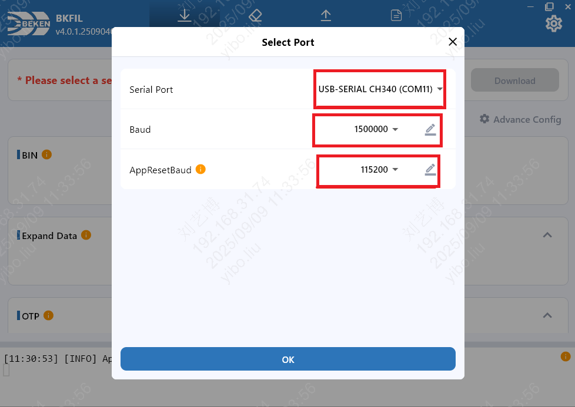
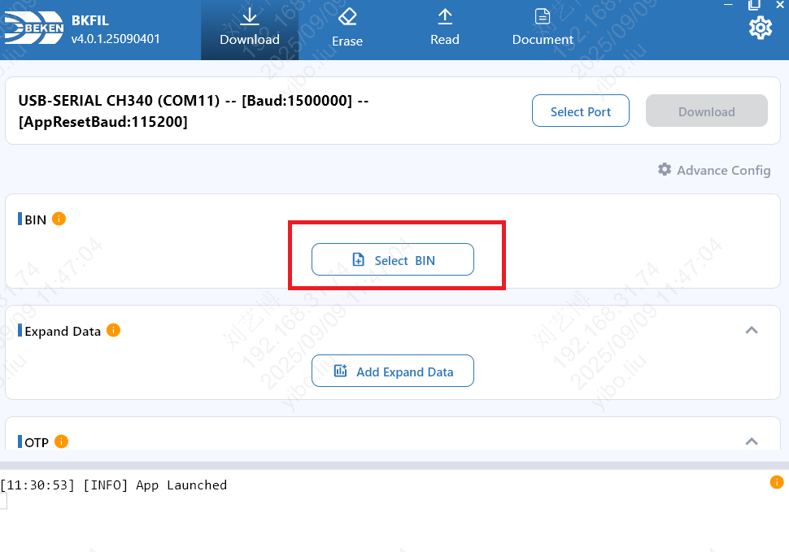
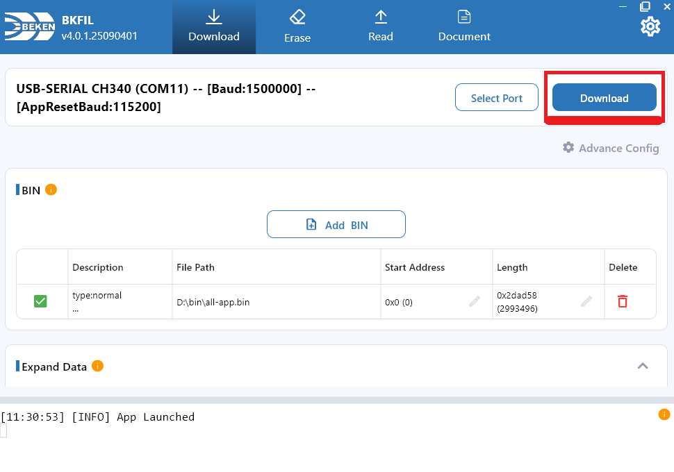
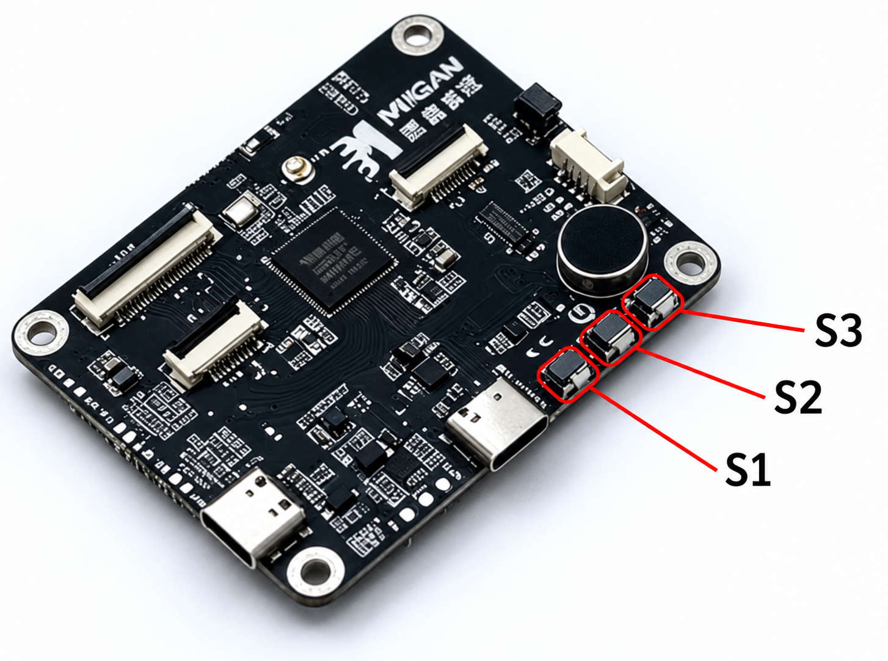

# MGKFB AI Toy Development Board BK7258

[Back to boards](../README.en.md) · [Firmware and release notes](../../downloads.en.md#mgkfb-bk7258)

[中文](README.md) · [English](README.en.md)

Task-exit warnings may still appear after calls. Long-duration operation and fault recovery have not completed dedicated validation. Read [Validation status and limitations](#validation-status-and-limitations) before selecting this board.

Board ID: `mgkfb-bk7258`. Supports AI conversations, WeChat VoIP, and browser-based (H5) live view. Two displays show the left and right eyes, changing expressions with AI emotion tags and showing prompts during setup, binding, and calls.

Operation uses physical buttons; touch, device-to-device calls, and group intercom are unsupported.

## Flashing

`<version>` in filenames means the full download-page version, including build number. Select actual downloaded files and check the manifest; screenshot versions and paths are examples.

See [Downloads](../../downloads.en.md#mgkfb-bk7258) for firmware for the **MGKFB BK7258 dual-display board with 8 MiB Flash**.

### Install the flashing tool

Install Beken's official **BKFIL v4** for your computer:

| System | Official download directory |
|---|---|
| Windows | [Windows](https://dl.bekencorp.com/tools/bkfil/v4/gui/windows/) |
| macOS | [macOS](https://dl.bekencorp.com/tools/bkfil/v4/gui/macos/) |
| Linux | [Linux](https://dl.bekencorp.com/tools/bkfil/v4/gui/linux/) |

Choose the appropriate installer from the directory. See the [BKFIL v4 manual (Chinese)](https://docs.bekencorp.com/arminodoc/bk_app/bkfil_v4/zh_CN/latest/index.html) for UI and settings.

### Flashing steps

1. Download and extract the [firmware ZIP](../../downloads.en.md#mgkfb-bk7258).
2. Connect the board's communication Type-C port, close serial log terminals, open BKFIL, and use **Select Port** to choose the corresponding COM port.
3. Select the package's **`-all-app.bin`** at **`0x00000000`**.
4. Start downloading and reset or power-cycle as prompted to complete the handshake. Wait for writing and verification, then power-cycle.
5. Open 115200-baud logs and verify board `mgkfb-bk7258` and the downloaded full version before setup and binding.

The following screenshots come from the [official BKFIL v4 guide (Chinese)](https://docs.bekencorp.com/arminodoc/bk_app/bkfil_v4/zh_CN/latest/quick_start/quick_start_guide/quick_start_guide.html#id3), with controls marked in red.

**Select the port.** Click **Select Port**, choose this board's serial port, then **OK**. `COM11` and baud rates are official examples; use the port detected on your computer. `Baud` is the flashing rate; `AppResetBaud` is the application-reset communication rate.



**Select firmware.** Click **Select BIN** and choose the extracted `mgkfb-bk7258-<version>-all-app.bin`.



**Check the address and flash.** Set **Start Address** to **`0x0`**, check the file row, and click **Download** at the upper right. Reset or power-cycle as prompted and wait for completion. `D:\bin\all-app.bin` in the image is an example; use the MGKFB file selected above.



| File | Purpose |
|---|---|
| `mgkfb-bk7258-<version>-all-app.bin` | **Serial flashing**, starting at **`0x0`** |
| `mgkfb-bk7258-<version>-app_pack.rbl` | **Not for serial flashing**; over-the-air (OTA) updates are unvalidated, so do not use yet |
| `MANIFEST.json` | File metadata and checksums, not a flash image |
| `symbols/`, `partitions/`, `build_identity.json` | Development diagnostics, not flash images |

Verify files using SHA-256 values in the package's `MANIFEST.json`.

Flashing uses UART0 (TX GPIO11, RX GPIO10). Back up factory firmware and RF calibration before first flashing. Use **Download** for ordinary updates, retaining data partitions.

**Full-chip erase removes this board's Flash-stored MAC, Wi-Fi, and binding data; the MAC may change after reboot.** For source builds, flash the `package/all-app.bin` listed under Building, also at `0x0`.

## First use

1. Without Wi-Fi configuration, the display shows the hotspot name; serial logs also show it after `配网热点=`. Connect a phone and open `http://192.168.6.1`, choose 2.4 GHz Wi-Fi, and enter the password. “No internet” on the device hotspot is expected. Save and wait for connectivity; reconnect to the hotspot and check settings if it fails.
2. Once online, the display shows and speaks a binding code; logs also expose `串口备用验证码=`. Restore the phone's internet connection, open the [XiaoTai device page](https://xiaotai.chat/devices), sign up or sign in, and enter the code under Add device. Confirm success on the platform; the eye display returns. Use the newly refreshed code if it expires.
3. Single-click S2 to start AI, and again to end. Use the table below for volume and WeChat calls.
4. Open the bound device's live-view entry in the phone browser to see its camera. If no image appears, inspect camera logs as described under Troubleshooting.

The picture identifies the three buttons. In this orientation, S1 is nearest the communication Type-C port, S2 is in the middle, and S3 is nearest the mounting hole.



| Button | Action |
|---|---|
| S2 single-click | Start AI when idle; end AI; answer a WeChat incoming call; hang up an active call |
| S2 double-click | When idle, call the first WeChat contact in platform order, skipping device contacts; reject an incoming WeChat call |
| S1 single-click | Increase volume one level, up to 10 |
| S3 single-click | Decrease volume one level, down to 0 |
| S1 long-press | Enter Wi-Fi setup when idle; unavailable during AI, live view, or a call |

S2 single-click waits briefly to distinguish it from a double-click. Each S1/S3 click changes one level. Incoming calls play a ringtone; outgoing calls play ringback; playback stops on connection or termination. S1/S3 also control ringing volume. During AI, single-click S2 to end first, then double-click to call.

## Specifications

| Item | Specification |
|---|---|
| Board | MGKFB AI Toy Development Board BK7258 |
| Chip | Beken BK7258 |
| Program Flash | 8 MiB |
| PSRAM | Physical capacity unconfirmed |
| Displays | Two GC9D01 SPI displays, each 160×160 |
| Input | S1 GPIO13, S2 GPIO12, S3 GPIO8, active low; no touch |
| Audio | Analog microphone; amplifier GPIO50; shared peripheral power GPIO52 |
| Camera | GC2145, parallel DVP interface |
| Resource storage | 128 MB SD NAND (datasheet rating) |

See [Hardware IR](hardware-ir.json) for complete pins and evidence sources.

## Audio and video parameters

See [Downloads](../../downloads.en.md#mgkfb-bk7258) for the current firmware, including dual eye displays.

| Scenario | Direction | Codec and sample rate | Packet or video parameters |
|---|---|---|---|
| AI conversation | Uplink; downlink | Uplink A-law / 16 kHz; downlink Opus / 16 kHz | Mono uplink, 20 ms / 320 bytes per packet; AEC enabled |
| H5 two-way audio, WeChat voice | Bidirectional | A-law / 8 kHz | Mono; uplink 20 ms / 160 bytes per packet |
| H5 live video | GC2145 uplink | H.264 | Target 640×480 / 20 fps |

WeChat VoIP enables audio only. The [Media contract (Chinese)](../../product/MEDIA_CONTRACT.md) defines actual parameters and per-feature stream IDs.

## Environment and dependencies

Flashing releases does not require a development environment. For source builds, prepare:

- Beken AVDK SMP `release/v3.1.1.10`, commit `398cab28b938e69ba2071a597daf00845dd080b6`; [official SDK source](https://github.com/bekencorp/bk_avdk_smp/tree/release/v3.1.1.10).
- Linux or WSL2 with Git, Python 3, CMake, and Ninja.
- ARM GCC `10.3-2021.10`; select `gcc-arm-none-eabi-10.3-2021.10-x86_64-linux.tar.bz2` from the [official toolchain directory](https://dl.bekencorp.com/tools/toolchain/arm/).
- TiRTC in `platforms/beken/third_party/tirtc`; see [Source provenance (Chinese)](../../../firmware/beken/bk7258/lckfb-bk7258-xiaotai/SOURCE_PROVENANCE.md) for compiler/library ABI requirements.

The build script defaults to `.tools/bk_avdk_smp-release-v3.1.1.10` for the SDK and `.tools/gcc-arm-none-eabi-10.3-2021.10/bin` for the compiler. Set `SDK_DIR` and `XIAOTAI_TOOLCHAIN_DIR` for other locations.

## Schematics and hardware sources

Board introductions and specification PDFs are on the [official MGKFB product page](https://www.moresense-tech.com/product/2112502712851202050.html). This project references the AI Toy Development Board Specification V1.0. [Hardware IR](hardware-ir.json) records its checksum, wiring evidence, and unknowns.

See also [Beken hardware references (Chinese)](https://docs.bekencorp.com/arminodoc/bk_aidk/bk7258/zh_CN/v2.0.1/hw-reference/index.html).

## Development directories

| Directory | Purpose |
|---|---|
| `boards/mgkfb/bk7258/` | Registration, GPIO, power, buttons, audio, camera, and display drivers |
| `firmware/beken/bk7258/mgkfb-bk7258-xiaotai/` | Native project, AP/CP configuration, partitions, and versions |
| `platforms/beken/` | Shared runtime, platform adapters, build scripts, and SDK patches |
| `product/` | Sessions, AI tags, interaction model, and shared rendering logic |

## Building

From the repository root:

```bash
python3 tools/build.py --validate
python3 tools/build.py --board mgkfb-bk7258
```

This board has one firmware configuration with dual eye displays enabled; no variant selection is needed. Its fixed native output is:

```text
firmware/beken/bk7258/mgkfb-bk7258-xiaotai/build/bk7258/mgkfb-bk7258-xiaotai/
├── bk7258_ap/         AP build output
├── bk7258/            CP build output
├── partitions/        Partition configuration
├── build_identity.json
└── package/
    ├── all-app.bin
    └── app_pack.rbl
```

After each build, use `package/all-app.bin` for complete flashing and `package/app_pack.rbl` for the OTA image. `build_identity.json` records version, configuration, and the complete-image checksum. The board's `BUILD_NUMBER` increments while product version remains unchanged.

Build release configuration and package a ZIP:

```bash
python3 tools/build.py --board mgkfb-bk7258 --release
python3 tools/package_validation_firmware.py --board mgkfb-bk7258 --beken-build-profile release
```

Release builds use the same directory; packaging consumes the preceding build. See [Contributing](../../../CONTRIBUTING.en.md#firmware-versions-and-releases) for GitHub release workflow.

## Testing

```bash
python3 -m unittest discover -s tools/tests -v
bash tools/check.sh
```

Host tests cover button gestures, AI expressions, setup text, dual-display buffer ownership, media contracts, board isolation, and package identity. GPIO, display, audio, or camera changes also need hardware checks for displays, setup/binding, AI, WeChat calls, and H5 live view.

## Troubleshooting

AI timing logs default to INFO, preserving connection stages, first audio write, per-round summaries, and disconnect outcomes. To inspect queues, decoding, writes, uplink processing, or signaling backlog, use `ap_cmd log-level app 4` for application DEBUG, then restore INFO with `ap_cmd log-level app 3`.

Raising TiRTC logging is unnecessary. Detailed logs add overhead; redact secrets before sharing. A completed write does not prove audible playback.

- **Wi-Fi setup unavailable:** check that startup reached network initialization. Saved Wi-Fi is tried first; long-press S1 while idle to reopen setup.
- **Setup page does not open:** connect to the hotspot and browse to `http://192.168.6.1`.
- **Display stays dark:** verify board/configuration, then GPIO52 power and GPIO25 backlight. LCD1 is the left eye: QSPI1 GPIO2/3/4, DC5, RESET45. LCD2 is the right eye: QSPI0 GPIO22/23/24, DC7, RESET6.
- **No camera image:** check GC2145 ID and sent-frame counts. Camera power is GPIO49, reset GPIO28, control bus GPIO42/43; DVP GPIO27 and 29…39 need correct multiplexing.
- **No sound or unchanged volume:** click S1/S3 and inspect before/after volume, mute, and save errors in `volume key` logs; then check power GPIO52 and amplifier GPIO50.
- **WeChat quick-call fails:** confirm binding, synchronized contacts, and at least one WeChat contact.

Serial connects to the CP shell; prefix application commands with `ap_cmd`:

```text
ap_cmd status
ap_cmd call-status
ap_cmd help
```

`status` shows network, binding, current activity, and memory; `call-status` shows call state. See [BK7258 serial commands](../../development/BK7258_SERIAL_COMMANDS.en.md) for parameters, platform addresses, and board applicability.

## Validation status and limitations

Hardware records cover outgoing/incoming calls and AI-to-WeChat handover, with working ringing, post-answer audio, and recovery after hangup. This does not validate arbitrary source builds; use release notes and validation records for specific firmware.

[Validation records (Chinese)](VALIDATION.md) identify images, scope, and diagnostics. Dedicated long-term stability and fault-recovery checks remain incomplete.

Touch, device-to-device calls, and group intercom are unsupported. OTA, long-duration operation, weak networks, double-talk AEC, volume boundaries and persistence, and dual-display DMA fault recovery need dedicated checks. Complete voice prompts for incoming calls and errors remain unfinished.

Task-exit warnings may appear after calls, periodic status may remain `BOOT`, and SRAM recovery after repeated calls needs longer testing. Physical PCB revision, Flash device ID, PSRAM capacity, reference-path resistor, and amplifier timing remain unconfirmed.
