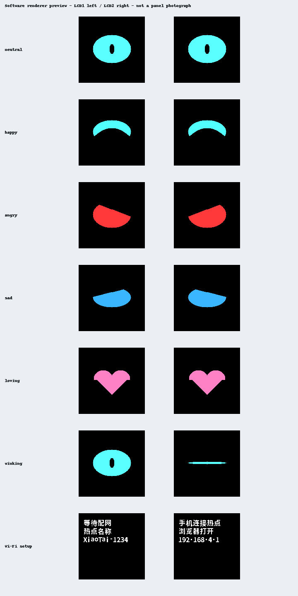

# 觅感 AI 玩具开发板 BK7258

板卡 ID：`mgkfb-bk7258`。使用现有 AVDK SMP AP/CP 平台，现提供 `eyes`（默认双屏）和 `headless`（无屏）两个构建变体。
独立工程及双屏版已完成开发板验证（用户确认），音量键调节已单独确认有效。
目标业务为 AI 对讲、微信 VoIP 语音通话和 H5 实时查看；设备互呼、多人对讲禁用。
双屏版一屏一只眼、不显示嘴巴；AI Tag 驱动表情，配网/绑定临时显示文字。引脚资料及证据等级见 [Hardware IR](hardware-ir.json)，接入细节见 [BRINGUP](BRINGUP.md)。

发布版本：[v1.0.1 · build.11](https://github.com/tangeai/xiaotai/releases/tag/mgkfb-bk7258-v1.0.1)，
选择 `eyes` 变体，8 MiB Flash，使用 release 配置。验证范围见[验证记录](VALIDATION.md)。

## 烧录

1. 下载并解压 [`mgkfb-bk7258-1.0.1+build.11-validation.zip`](https://github.com/tangeai/xiaotai/releases/download/mgkfb-bk7258-v1.0.1/mgkfb-bk7258-1.0.1%2Bbuild.11-validation.zip)。
2. 通过通讯 Type-C 连接电脑，关闭占用该串口的日志终端，在 Beken 下载工具中选择本板对应 COM 口及 BK7258。
3. 选择解压后的 **`mgkfb-bk7258-1.0.1+build.11-all-app.bin`**，起始地址 **`0x00000000`**。不要选 ZIP、ELF 或 `mgkfb-bk7258-1.0.1+build.11-app_pack.rbl`。
4. 启动下载，按下载工具提示复位或重新上电进入下载握手，等待写入和工具校验完成，再重新上电。
5. 打开 115200 波特率日志，核对 `mgkfb-bk7258`、`1.0.1+build.11` 和 `eyes-key`；无 Wi-Fi 配置时按屏幕热点提示配网。

ZIP 内 `MANIFEST.json` 包含 BIN 的长度、SHA-256 和烧录地址；`all-app.bin` 的 SHA-256 为
`5a8d24a9d058822e41b2700c325b924c6958385ce2d54e0aa4bbf05511dc90fb`。

用户确认 Flash 为 8 MiB，当前分区末端为 `0x800000`，容量匹配。首次烧录前核对原厂启动程序和分区，
保存原厂固件及 RF 校准数据。用户确认完成实板功能验证，不代表已测得 Flash JEDEC 或完成全项压力测试。
程序采用仓库现有 SMP 分区布局，不采用 AIDK 的 CPU0/CPU1/CPU2 分区。

构建目录前缀为 `firmware/beken/bk7258/mgkfb-bk7258-xiaotai/build/bk7258/`；
双屏开发构建使用 `mgkfb-bk7258-xiaotai_eyes/`，无屏使用 `mgkfb-bk7258-xiaotai/`；
release 构建分别追加 `_release`。每个目录有独立构建身份和 package：

| 文件 | 用途 |
|---|---|
| `package/all-app.bin`（具名副本为 `package/mgkfb-bk7258-<版本>-all-app.bin`） | SMP 启动程序、CP 和 AP 的打包镜像；核对硬件和分区后用于 Beken 下载工具的串口烧录 |
| `package/app_pack.rbl` | SDK 生成的升级包；本板 OTA 尚未验收，不能当作完整串口烧录镜像 |
| `build_identity.json` | 构建版本、源码身份和产物校验记录，核对时以实际构建目录为准 |

本板烧录接口为通讯 Type-C 内的 UART0（TX GPIO11 / RX GPIO10）。
不要使用 ESP32 的 esptool-js，
也不要使用 `lckfb-bk7258`、其他 BK7258 板或厂家 AIDK 工程的镜像代替本板固件。

## 首次使用

下列为本板操作流程：

1. 未配置 Wi-Fi 时进入配网热点；通过手机连接设备热点并打开 `http://192.168.4.1` 配网。串口输出热点名称。
2. 联网后通过现有服务获取绑定验证码并语音播报，在 `https://xiaotai.chat` 添加设备。播报失败会报错，不能视为绑定成功。
3. S2 单击开始/结束 AI 对讲；微信来电时单击接听，通话中单击挂断，来电时双击拒接。
4. 空闲时 S2 双击向平台排序的第一个联系人发起微信 VoIP 呼叫；该联系人不支持微信 VoIP 时拒绝，不改拨其他联系人。
5. S1/S3 单击在去抖松开后立即增加/减少一档音量（0～10），连续点击逐次生效。空闲时长按 S1 进入配网；业务进行中拒绝进入配网。AI 中需先单击结束 AI，才能双击呼叫微信。
6. 在手机 H5 发起实时查看，验证摄像头视频和音频；该链路不依赖本地屏幕。

指示灯适配 GPIO40 红灯、GPIO41 绿灯：就绪绿灯常亮；来电/通话绿灯常亮、红灯闪烁；
配网红绿交替；错误红灯常亮；启动/等待及绑定使用绿灯闪烁。灯态和电平仍待实板确认。
当前保留绑定验证码语音；其他来电、错误的完整语音引导尚未补齐，开发阶段同时看指示灯和串口。

## 规格

| 项目 | 资料声明 / 当前实现 |
|---|---|
| SoC | BK7258，实物 PCB 版本待核对 |
| 程序 Flash / PSRAM | Flash 8 MiB（用户确认，JEDEC 未读）；PSRAM 实物容量待测 |
| 资源存储 | 规格书的 128 MB 指 SD NAND，首阶段禁用 |
| 显示 | 两块 GC9D01 SPI 160×160 屏，eyes 变体绘制双眼和短文案；headless 不初始化、不分配显示缓冲、不链接字库 |
| 输入 | S1 GPIO13、S2 GPIO12、S3 GPIO8；低电平有效 |
| 音频 | MIC1 模拟输入，GPIO50 功放控制，共享 3.3 V 电源使能 GPIO52 |
| 摄像头 | GC2145 DVP，用户日志已读出 ID 0x2145，并记录首帧及 H.264 上行 |

## 音视频参数

沿用 SMP 公共音频链路：AI 上行 A-law 8 kHz、下行 Opus 16 kHz，保留 AEC；
用户确认本板功能实测通过；双讲效果、增益余量和长期压力测试未提供量化报告。
H5 保留 H.264 摄像头上行，当前 GC2145 配置目标 640×480 / 20 fps，实际帧率待量测。
微信 VoIP 只启用音频。

## 环境与依赖

- AVDK SMP `release/v3.1.1.10`，提交 `398cab28b938e69ba2071a597daf00845dd080b6`。
- ARM GCC `10.3-2021.10`，沿用仓库 Beken 构建环境。
- TiRTC 使用 `platforms/beken/third_party/tirtc` 的匹配库；ABI 和来源见[来源记录](../../../firmware/beken/bk7258/lckfb-bk7258-xiaotai/SOURCE_PROVENANCE.md)。
- AIDK 仅作硬件/驱动参考，不参与本工程构建。

## 原理图与硬件资料

用户提供的《觅感 AI 玩具开发板规格书 V1.0》及 SHA-256 记录在 [Hardware IR](hardware-ir.json)，
原始文件未提交仓库。V1.0 是规格书版本，不代表实物 PCB 版本。
参考[博通官方硬件资料](https://docs.bekencorp.com/arminodoc/bk_aidk/bk7258/zh_CN/v2.0.1/hw-reference/index.html)。
所有引脚目前是资料声明；Flash JEDEC ID、PSRAM、MIC2 回采电阻和功放极性仍须实物核验。

## 开发

- 独立板级代码：[boards/mgkfb/bk7258](../../../boards/mgkfb/bk7258/README.md)。
- 独立原生工程：`firmware/beken/bk7258/mgkfb-bk7258-xiaotai`，拥有自己的 AP/CP 配置、分区和版本计数。
- 公共实现：`platforms/beken/runtime`、`platforms/beken/src`，不从立创原生工程取源文件。
- 交互选择：eyes 选择 `eyes-key` / `compact`，headless 选择 `headless-key` / `none`。按键适配器发送意图，业务状态仍由公共 runtime 持有。

## 编译

在仓库根目录运行：

```bash
python3 tools/build.py --validate
python3 tools/build.py --board mgkfb-bk7258 --dry-run
python3 tools/build.py --board mgkfb-bk7258 --variant eyes
python3 tools/build.py --board mgkfb-bk7258 --variant headless
```

每次构建只选择一个变体，默认 `eyes`。每次真实构建递增本板 `BUILD_NUMBER`，不改变立创板版本。
公共构建脚本 `platforms/beken/tools/build.sh` 由本板薄封装调用。

## 测试

```bash
python3 -m unittest discover -s tools/tests -p 'test_mgkfb_headless.py' -v
python3 -m unittest discover -s tools/tests -p 'test_mgkfb_eyes.py' -v
python3 -m unittest discover -s tools/tests -v
bash tools/check.sh
```

主机回归覆盖本板构建选源、无显示依赖、能力上报、禁用业务入口、按键去抖/单击/双击/长按、
功放和共享供电边界、无屏指示反馈。SMP 固件编译不能替代板上 GPIO、音频、相机和网络验收。
实板按启动探针→按键→低音量收放/AEC→配网绑定→AI/VoIP/H5 的顺序进行，再验证双屏与音视频共存。

## 排查

- 若心跳正常但一直 `BOOT`，检查启动早期的按键初始化错误。开启 SDK GPIO 默认表检查时，所用引脚必须登记；空表会使启动在网络之前退出。修复版已登记本板按键、指示灯、电源和相机引脚，保持驱动自行初始化。
- 启动日志应包含 `mgkfb-bk7258` 和本次版本；若显示 `lckfb-bk7258`，先检查选择的工程和镜像。
- headless 不启用屏幕/触摸/字库，黑屏符合预期。eyes 应显示双眼或配网文字，仍不启用触摸；H5 视频独立于本地显示。
- LCD1 约定左眼：QSPI1 GPIO2/3/4、DC GPIO5、复位 GPIO45；LCD2 约定右眼：QSPI0 GPIO22/23/24、DC GPIO7、复位 GPIO6。公共背光 GPIO25 高有效，共享外设电源 GPIO52 不随音频停止关闭。
- 无声音时检查 GPIO52 共享供电、GPIO50 控制极性和实际功放型号，不调整立创板 GPIO8/23。
- 摄像头使用电源 GPIO49、复位 GPIO28、SCCB GPIO42/43。若 GC2145 ID 读出而 H5 无帧，检查 DVP 复用：GPIO27=MCLK，GPIO29/30/31=PCLK/HSYNC/VSYNC，GPIO32…39=D0…D7。开启默认 GPIO 表时，SDK 不再运行时配置 DVP；这些引脚需要有效功能复用并启用初始化，不能全部 INIT_DISABLE。
- 按键问题先核对 S1/S2/S3 引脚和释放电平；上电时一直按住不产生单击，需先松开。

## 验证状态与已知限制

已完成独立 SMP 工程、主机回归及 release 构建；立创原工程此前同步重编译检查公共代码迁移。
build.4 的 DVP 无帧问题已修复，后续用户日志记录首个 H.264 帧及持续上行；用户确认开发板验证完成，
并明确确认 S1/S3 可调音量。发布的 build.11 从同一功能源码生成，使用 INFO 日志 release 配置；
开发版的实板确认不自动等同于新 BIN 的逐字节验收，包内如实保留 `BUILD_VERIFIED_HIL_PENDING`。

已知限制：不支持触摸、设备互呼、多人房间；OTA 尚未专项验收。来电和错误的完整语音引导待完善，
目前通过眼屏短文案、指示灯和串口反馈。Flash JEDEC、物理 PSRAM、回采电阻及功放时序没有量测报告；
长期运行、弱网、双讲 AEC、音量边界/重启保存和双 DMA 异常恢复仍需专项验证。

## 双屏软件预览

下面是同一生产渲染器在主机生成的图，不是实屏照片。上方依次为平静、开心、生气、难过、
喜爱、眨眼；最下方为两屏配网提示。逻辑 LCD1 左眼、LCD2 右眼，实际方向和颜色待实屏确认。



当前 eyes 开发构建 `1.0.1+build.10`，输出目录为 `build/bk7258/mgkfb-bk7258-xiaotai_eyes/package/`；
烧录完整镜像 `mgkfb-bk7258-1.0.1+build.10-all-app.bin`，从地址 `0x00000000` 写入。
用户随后确认已完成开发板验证；未提供逐项量测记录，不扩展为长期稳定性或异常注入验收。

音量键诊断：启动日志 `key inputs` 显示 S2/GPIO12、S1/GPIO13、S3/GPIO8 的电平，
1 为释放；按下/松开应出现 `key input`，识别后有 `key gesture`，runtime 接受后出现
`volume key=S1/up` 或 `S3/down` 及 `level=前值->后值`。到达 0/10 时数值保持在边界；
`muted=1` 表示扬声器仍静音，`save-error=1` 表示存储失败。交付 build.10 后用户已确认
音量可以调节；边界 0/10、重启保存及各媒体模式仍需专项验证。
