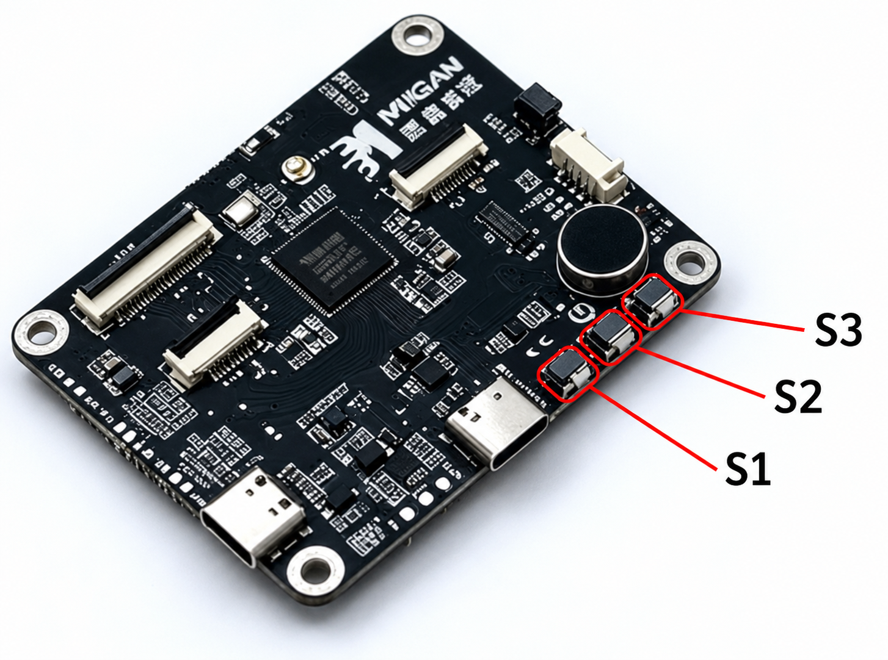

# 觅感 AI 玩具开发板 BK7258

[返回开发板目录](../README.md) · [双屏眼睛版发布说明](https://github.com/tangeai/xiaotai/releases/tag/mgkfb-bk7258-v1.0.3-build.22-eyes) · [无屏版发布说明](https://github.com/tangeai/xiaotai/releases/tag/mgkfb-bk7258-v1.0.3-build.21-headless)

通话结束后仍可能出现任务退出告警，长时间运行与异常恢复尚未专项验收；
选择本板前请阅读[验证状态与已知限制](#验证状态与已知限制)。

板卡 ID：`mgkfb-bk7258`。本板支持 AI 对讲、微信 VoIP（网络语音通话）和 H5（网页端）
实时查看。两块屏幕分别显示左右眼，随 AI 情绪标签切换表情；配网、绑定和通话时显示操作提示。
操作使用实体按键，不支持屏幕触摸、设备互呼和多人对讲。

## 烧录

当前发布版本为 **v1.0.3 · build.22**，适用于 **8 MiB Flash 的觅感 BK7258 双屏板**。
无屏变体使用 **v1.0.3 · build.21**，下载[无屏版固件包](https://github.com/tangeai/xiaotai/releases/download/mgkfb-bk7258-v1.0.3-build.21-headless/mgkfb-bk7258-1.0.3%2Bbuild.21-validation.zip)，
按相同串口步骤选择包内 `mgkfb-bk7258-1.0.3+build.21-all-app.bin`。

### 安装烧录工具

下载并安装 Beken 官方烧录工具 **BKFIL v4**，按电脑系统选择：

| 系统 | 官方下载目录 |
|---|---|
| Windows | [下载 Windows 版](https://dl.bekencorp.com/tools/bkfil/v4/gui/windows/) |
| macOS | [下载 macOS 版](https://dl.bekencorp.com/tools/bkfil/v4/gui/macos/) |
| Linux | [下载 Linux 版](https://dl.bekencorp.com/tools/bkfil/v4/gui/linux/) |

打开对应目录，下载适合电脑系统的安装包。界面与参数说明见
[BKFIL v4 官方操作指南](https://docs.bekencorp.com/arminodoc/bk_app/bkfil_v4/zh_CN/latest/index.html)。

### 烧录步骤

1. 双屏版下载并解压 [`mgkfb-bk7258-1.0.3+build.22-validation.zip`](https://github.com/tangeai/xiaotai/releases/download/mgkfb-bk7258-v1.0.3-build.22-eyes/mgkfb-bk7258-1.0.3%2Bbuild.22-validation.zip)；无屏版下载上方 build.21 固件包。
2. 用本板通讯 Type-C 连接电脑，关闭占用串口的日志终端，打开 BKFIL，点击 **Select Port** 选择对应 COM 口。
3. 选择所下载固件包中的 **`-all-app.bin`**，起始地址为 **`0x00000000`**。
4. 启动下载，按工具提示复位或重新上电完成下载握手；等待写入及工具校验完成，再重新上电。
5. 打开 115200 波特率日志，核对板卡 `mgkfb-bk7258` 和版本：双屏版 `1.0.3+build.22`，无屏版 `1.0.3+build.21`，再进行配网与绑定。

下面是 [BKFIL v4 官方操作指南](https://docs.bekencorp.com/arminodoc/bk_app/bkfil_v4/zh_CN/latest/quick_start/quick_start_guide/quick_start_guide.html#id3)中的界面截图，红框标出了操作位置。

**选择串口。** 点击主界面的 **Select Port**，在弹窗中选择本板的串口，再点击 **OK**。
图中的 `COM11` 和波特率是官方示例，COM 口以电脑实际识别的设备为准。
`Baud` 是烧录速率；`AppResetBaud` 是应用复位通信速率，两者不是同一项。


**选择固件。** 点击 **Select BIN**，选择解压后的
双屏版选择 `mgkfb-bk7258-1.0.3+build.22-all-app.bin`；无屏版选择 `mgkfb-bk7258-1.0.3+build.21-all-app.bin`。


**确认地址并开始烧录。** 文件行中的 **Start Address** 应为 **`0x0`**，
勾选该文件，点击右上角的 **Download**。按工具提示复位或重新上电，等待烧录完成。
图中的 `D:\bin\all-app.bin` 是官方示例路径，本板使用上一步选择的觅感固件文件。


| 文件 | 用途 |
|---|---|
| `mgkfb-bk7258-1.0.3+build.22-all-app.bin` | **直接用于串口烧录**，起始地址 **`0x0`** |
| `mgkfb-bk7258-1.0.3+build.22-app_pack.rbl` | **不能用于串口烧录**；OTA（无线升级）尚未验证，暂不使用 |
| `MANIFEST.json` | 文件信息与校验清单，不用于烧录 |
| `symbols/`、`partitions/`、`build_identity.json` | 开发排查资料，不用于烧录 |

如需核验文件，使用固件包内 `MANIFEST.json` 中的 SHA-256 校验值。

烧录接口使用 UART0（TX GPIO11、RX GPIO10）。
首次烧录前请备份原厂固件和射频校准资料。日常更新使用 **Download** 写入固件，保留数据分区。
**全片擦除会清除本板保存在 Flash 中的 MAC、配网和绑定信息，重新启动后 MAC 可能变化。**
自行编译时，使用“编译”一节列出的 `package/all-app.bin`，地址同样为 `0x0`。

## 首次使用

1. 设备没有 Wi-Fi 配置时，双屏版在屏幕显示配网热点名；无屏版从串口日志查看 `配网热点=` 后的名称。使用手机连接该热点，再用手机浏览器打开
   `http://192.168.6.1`，填写家中 Wi-Fi 信息。保存后等待设备联网；连接失败时重新连接热点检查配置。
2. 联网后，双屏版在屏幕显示绑定验证码并语音播报；无屏版语音播报验证码，也可从串口日志的 `串口备用验证码=` 查看。使用手机打开 `https://xiaotai.chat`，注册或登录账号，
   在“添加设备”中输入验证码。以平台提示绑定成功为准；双屏版设备恢复眼睛显示。
   验证码过期时使用设备刷新的新码。
3. 单击 S2 开始 AI 对讲，再单击结束；按下表进行音量和微信通话操作。
4. 需要实时查看时，在手机网页中打开已绑定设备的实时查看入口。画面来自本板摄像头，
   没有画面时参照“排查”一节检查相机日志。

下图标出了三个按键的位置。以图中方向为准，S1 靠近通讯 Type-C 接口，S2 位于中间，S3 靠近安装孔。



| 按键 | 操作 |
|---|---|
| S2 单击 | 空闲时开始 AI；AI 中结束；微信来电时接听；通话中挂断 |
| S2 双击 | 空闲时呼叫平台顺序中的首个微信联系人，跳过设备联系人；微信来电时拒接 |
| S1 单击 | 音量加一档，最高 10 档 |
| S3 单击 | 音量减一档，最低 0 档 |
| S1 长按 | 空闲时进入配网；正在使用 AI、实时查看或通话时不进入配网 |

S2 单击后稍候片刻，设备确认不是双击后执行操作；S1/S3 每点击一次调节一档。
呼入等待时播放来电铃声，呼出等待时播放回铃，接通或结束后停止；铃声音量随 S1/S3 调节。
使用 AI 时，先单击 S2 结束对讲，再双击发起呼叫。

## 规格

| 项目 | 规格 |
|---|---|
| 开发板 | 觅感 AI 玩具开发板 BK7258 |
| 芯片 | Beken BK7258 |
| 程序 Flash | 8 MiB |
| PSRAM（外部运行内存） | 物理容量待核实 |
| 显示 | 两块 GC9D01 SPI 屏，每块分辨率为 160×160 |
| 输入 | S1 GPIO13、S2 GPIO12、S3 GPIO8，低电平有效；无触摸 |
| 音频 | 模拟麦克风；功放 GPIO50，共享外设电源 GPIO52 |
| 摄像头 | GC2145，DVP（并行视频）接口 |
| 资源存储 | 128 MB SD NAND（规格书标称） |

完整引脚与硬件资料依据见[硬件信息记录](hardware-ir.json)。

## 音视频参数

当前源码的 AI 语音上行采用 A-law 16 kHz，每 20 毫秒 320 字节；下行采用 Opus 16 kHz，启用 AEC（回声消除）。
H5 摄像头上行为 H.264，GC2145 配置目标为 640×480 / 20 fps；微信 VoIP 仅启用音频。
实际参数及不同业务的媒体编号以[音视频合同](../../product/MEDIA_CONTRACT.md)为准。

## 环境与依赖

仅烧录发布固件不需要搭建开发环境。从源码编译时，准备以下工具和依赖。

- Beken AVDK SMP `release/v3.1.1.10`，提交 `398cab28b938e69ba2071a597daf00845dd080b6`；[官方 SDK 源码](https://github.com/bekencorp/bk_avdk_smp/tree/release/v3.1.1.10)。
- 编译主机：Linux 或 WSL2，安装 Git、Python 3、CMake 和 Ninja。
- ARM GCC `10.3-2021.10`；[官方工具链下载目录](https://dl.bekencorp.com/tools/toolchain/arm/)，选择 `gcc-arm-none-eabi-10.3-2021.10-x86_64-linux.tar.bz2`。
- TiRTC 库位于 `platforms/beken/third_party/tirtc`；编译器与库的二进制接口要求见[来源说明](../../../firmware/beken/bk7258/lckfb-bk7258-xiaotai/SOURCE_PROVENANCE.md)。

构建脚本默认从仓库的 `.tools/bk_avdk_smp-release-v3.1.1.10` 读取 SDK，
从 `.tools/gcc-arm-none-eabi-10.3-2021.10/bin` 读取编译器。安装在其他位置时，
通过 `SDK_DIR` 和 `XIAOTAI_TOOLCHAIN_DIR` 指定对应路径。

## 原理图与硬件资料

开发板介绍、规格书等 PDF 资料见[觅感官方产品页面](https://www.moresense-tech.com/product/2112502712851202050.html)。
本工程参考《AI 玩具开发板规格书 V1.0》。
规格书校验值、接线依据与待核实项目见[硬件信息记录](hardware-ir.json)。
Beken 参考资料见[官方硬件资料](https://docs.bekencorp.com/arminodoc/bk_aidk/bk7258/zh_CN/v2.0.1/hw-reference/index.html)。

## 开发目录

| 目录 | 用途 |
|---|---|
| `boards/mgkfb/bk7258/` | 板卡登记、GPIO、供电、按键、音频、相机与屏幕驱动 |
| `firmware/beken/bk7258/mgkfb-bk7258-xiaotai/` | 本板原生工程、AP/CP 配置、分区及版本号 |
| `platforms/beken/` | 公共运行时、平台适配、构建脚本和 SDK 补丁 |
| `product/` | 产品会话、AI 标签、交互模型及公共渲染逻辑 |

## 编译

在仓库根目录执行：

```bash
python3 tools/build.py --validate
python3 tools/build.py --board mgkfb-bk7258
```

本板使用固定的原生输出目录：

```text
firmware/beken/bk7258/mgkfb-bk7258-xiaotai/build/bk7258/mgkfb-bk7258-xiaotai/
├── bk7258_ap/         AP 编译结果
├── bk7258/            CP 编译结果
├── partitions/        分区配置
├── build_identity.json
└── package/
    ├── all-app.bin
    └── app_pack.rbl
```

每次编译后，从 `package/all-app.bin` 获取本次完整烧录镜像，
从 `package/app_pack.rbl` 获取 OTA 镜像。`build_identity.json` 记录版本、配置和完整镜像校验值。
构建号在本板 `BUILD_NUMBER` 中递增，产品版本保持不变。

生成发布配置的固件和 ZIP 包：

```bash
python3 tools/build.py --board mgkfb-bk7258 --release
python3 tools/package_validation_firmware.py --board mgkfb-bk7258 --beken-build-profile release
```

发布配置也输出到上述目录；打包命令使用前一条命令生成的固件。
GitHub 发布流程见[参与开发](../../../CONTRIBUTING.md#固件版本与发布)。

## 测试

```bash
python3 -m unittest discover -s tools/tests -v
bash tools/check.sh
```

主机测试覆盖按键手势、AI 表情、配网文字、双屏缓冲所有权、媒体合同、板卡隔离和打包身份。
涉及 GPIO、屏幕、音频或相机的修改，还需在本板检查显示、配网绑定、AI、微信通话和 H5 实时查看。

## 排查

- **无法配网**：检查启动日志是否进入网络初始化；已有 Wi-Fi 配置时会优先连接，空闲长按 S1 可重新配网。
- **手机未自动打开配网页**：连接设备热点后，用浏览器打开 `http://192.168.6.1`。
- **屏幕不亮**：先核对固件板卡和配置，再检查 GPIO52 供电及 GPIO25 背光。LCD1 为左眼，QSPI1 GPIO2/3/4、DC5、RESET45；LCD2 为右眼，QSPI0 GPIO22/23/24、DC7、RESET6。
- **相机无画面**：检查 GC2145 ID 及发送帧数。相机电源 GPIO49、复位 GPIO28、控制总线 GPIO42/43；DVP 引脚 GPIO27、29…39 需要正确复用。
- **无声音或音量不变**：单击 S1/S3，核对 `volume key` 日志中的音量前后值、静音标志和保存错误；再检查供电 GPIO52 与功放 GPIO50。
- **快捷微信呼叫失败**：确认已绑定、联系人已同步，并且至少有一个微信联系人。

串口连接到 CP 核命令行，查看应用状态时加 `ap_cmd` 前缀：

```text
ap_cmd status
ap_cmd call-status
ap_cmd help
```

`status` 查看联网、绑定、当前会话和内存，`call-status` 查看通话状态。
完整命令、参数、平台地址设置及两块 BK7258 的适用范围见
[BK7258 串口命令](../../development/BK7258_SERIAL_COMMANDS.md)。

## 验证状态与已知限制

本轮修复已完成呼出、呼入及 AI 转微信通话的实板功能验证，铃声、接听后声音和挂断恢复正常。
发布镜像身份、验证范围和诊断项见[验证记录](VALIDATION.md)。长期稳定性与异常恢复等专项验证尚未完成。

不支持触摸、设备互呼和多人对讲。OTA、长期运行、弱网、双讲 AEC、音量边界与重启保存、
双屏 DMA（直接内存访问）异常恢复仍需专项验证；来电和错误的完整语音引导待完善。
通话结束后仍可能出现任务退出告警，周期状态统计可能停留在 `BOOT`；多轮通话后的 SRAM 回收还需长测。
实物 PCB 版本、Flash 器件 ID、PSRAM 物理容量、回采电阻及功放时序仍待核实。
