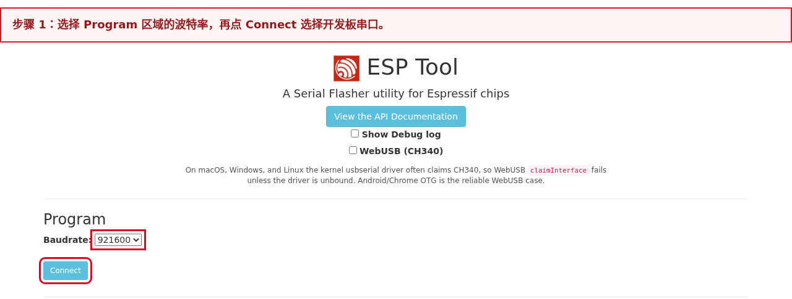
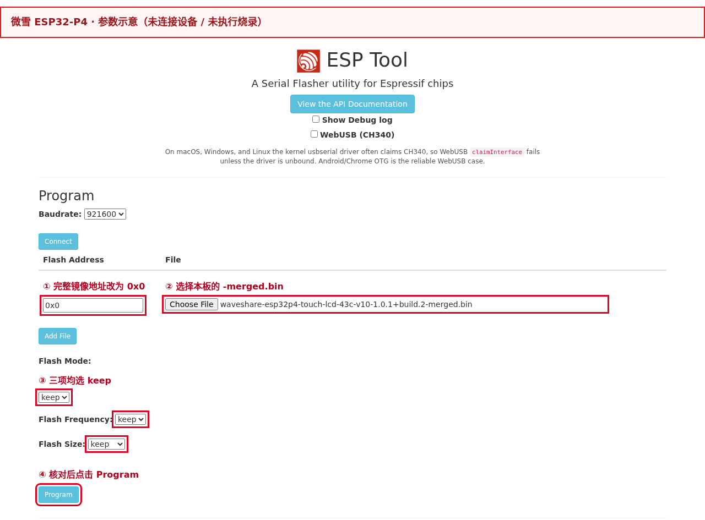
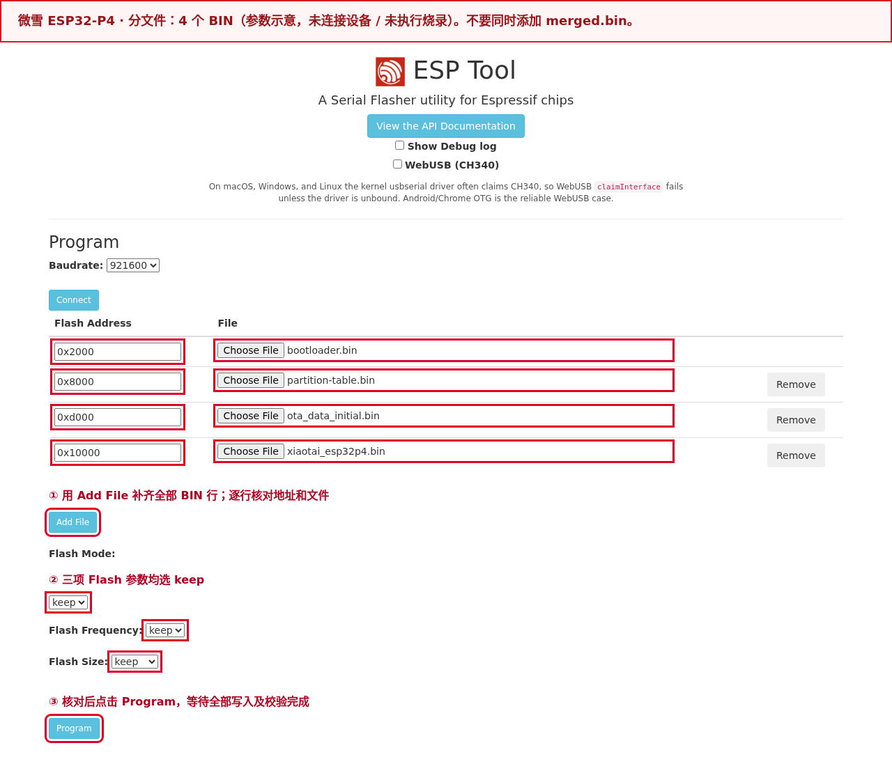
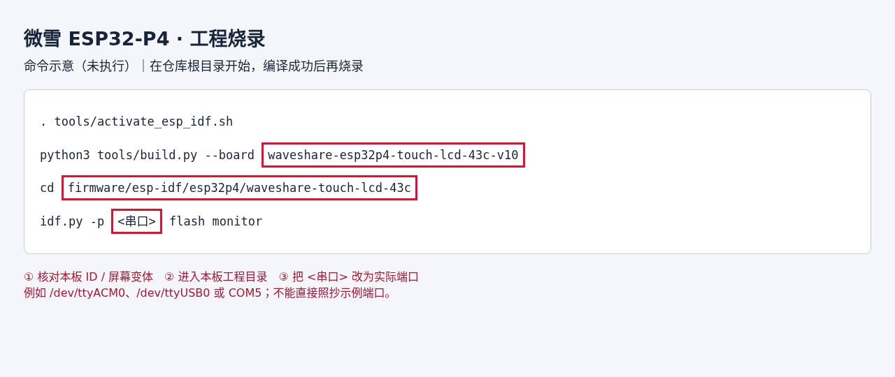

# Waveshare ESP32-P4-WIFI6-Touch-LCD-4.3

[Back to boards](../README.en.md) · [Firmware and release notes](../../downloads.en.md#waveshare-esp32p4-touch-lcd-43c-v10)

[中文](README.md) · [English](README.en.md)

Board ID: `waveshare-esp32p4-touch-lcd-43c-v10`. See [Downloads](../../downloads.en.md#waveshare-esp32p4-touch-lcd-43c-v10) for the current release. Hardware validation scope is recorded below and in the linked release notes.

## Flashing

`<version>` in filenames means the full download-page version, including build number. Select actual downloaded files and verify the manifest; screenshot versions and paths are examples.

### Open the flashing tool

Open [Espressif ESP Web Tool](https://espressif.github.io/esptool-js/) in desktop **Chrome or Edge**. ESP-IDF installation is unnecessary. Close terminals and other flashing pages using the port. See the [official board guide](https://docs.waveshare.net/ESP32-P4-WIFI6-Touch-LCD-4.3/) for connectors and download mode.

### Flashing steps

1. Download the [merged BIN](../../downloads.en.md#waveshare-esp32p4-touch-lcd-43c-v10). Select only this complete image at **`0x0`**.
2. Connect the **USB TO UART** Type-C port, not USB OTG or C6 flashing pads. If connection fails, hold BOOT, press RESET, then release BOOT. Detection must show **ESP32-P4**; if it shows ESP32-C6, check the connector.
3. In **Program**, select `Baudrate` (`921600` initially, `115200` if unstable), click **Connect**, and choose the board. Leave `WebUSB (CH340)` unchecked for desktop serial mode.
4. Click **Choose File**, select the merged BIN, and set **Flash Address to `0x0`**. Set Flash Mode, Flash Frequency, and Flash Size to `keep`. Add only one row, then **Program**.
5. Wait for `Hash of data verified.` and a final `Leaving...` without `Error:`. Click **Disconnect**, reset, and check 115200-baud logs for project `xiaotai_esp32p4` and the downloaded full version before first use.

Connection and programming controls are shown below; port numbers and paths are examples:





**The merged image overwrites Wi-Fi, binding, and EP service-discovery overrides in nonvolatile storage (NVS).** Configure Wi-Fi and bind again afterward. `keep` preserves image Flash parameters, not device settings. For connection failure, repeat step 2.

For write or verification failures, check port, cable, file, and address. A 100% progress bar alone does not prove success.

| Download or package file | Purpose |
|---|---|
| `waveshare-esp32p4-touch-lcd-43c-v10-<version>-merged.bin` | **Flash directly**, this file only, at `0x0` |
| `waveshare-esp32p4-touch-lcd-43c-v10-<version>-validation.zip` | Extract and flash individual files at the addresses below |
| `xiaotai_esp32p4.bin` | Application at `0x10000`; not a complete image for `0x0` |
| `MANIFEST.json`, `flasher_args.json`, `flash_args`, ELF | Manifests/diagnostics; do not flash directly |

Use the corresponding Release's `SHA256SUMS` to verify the merged BIN.

Windows: `Get-FileHash -Algorithm SHA256 "path-to-BIN"`; Linux: `sha256sum "path-to-BIN"`; macOS: `shasum -a 256 "path-to-BIN"`. Individual hashes are in `MANIFEST.json`; release-asset hashes are in `SHA256SUMS` linked from [Downloads](../../downloads.en.md#waveshare-esp32p4-touch-lcd-43c-v10).

## First use

Confirm the single `-merged.bin` was flashed at `0x0` and the board rebooted normally. For split-file flashing, confirm all 4 BINs were written at their manifest addresses. Use either method before setup and binding.

### 1. Configure Wi-Fi

On first flashing, after clearing Wi-Fi, or when the saved network fails, the display shows setup guidance and broadcasts an open `XiaoTai-XXXX` hotspot. Connect a phone; “no internet” is normal. If no page opens, visit `http://192.168.6.1`, choose 2.4 GHz Wi-Fi, enter the password, and submit.

If the hotspot returns, check password, coverage, and ESP-Hosted, the P4/C6 networking system. Setup behavior and wording follow [Product requirements 4.11 (Chinese)](../../product/PRODUCT_REQUIREMENTS.md#411-启动无网络与-ap-配网), rather than a separate board-specific definition.

### 2. Bind the device

Once connected, the display shows a 6-digit code and QR code. Restore the phone's internet connection, scan the QR code or open the [XiaoTai device page](https://xiaotai.chat/devices), and enter the code under Add device. Use a refreshed code if expired.

Binding succeeds only when the device reaches the home screen/online state.

### 3. Try features and recover

Try AI, then browser live view and two-way audio. With contacts available, try device or WeChat calls. Ending a session should return to the home screen. Development acceptance checks are under Testing.

If setup will not open, confirm the phone remains on the device hotspot. If no binding code appears, check IP address, system time, and service discovery. To change networks or rebind, open Device settings → Reset device, confirm, then repeat setup and binding. Do not erase the whole Flash.

## Other flashing methods

### Split-file flashing

Download and extract the [firmware ZIP](../../downloads.en.md#waveshare-esp32p4-touch-lcd-43c-v10). Verify this board/version's **4 BINs** against `MANIFEST.json` and `flasher_args.json`:

| File | Address | Purpose |
|---|---|---|
| `bootloader/bootloader.bin` | `0x2000` | Bootloader |
| `partition_table/partition-table.bin` | `0x8000` | Partition table |
| `ota_data_initial.bin` | `0xd000` | OTA initialization data; do not omit |
| `xiaotai_esp32p4.bin` | `0x10000` | Application; never write at 0x0 |

Use **Add File** for each BIN and address, then **Program**. Do not also add the merged image. Bootloader addresses vary by board. Split-file upgrades may retain settings after verifying partition compatibility and avoiding full-chip erase.



### Build and flash from source

Follow [Building from source](../../../README.en.md#build-from-source) to obtain the repository and install this board's ESP-IDF. From the root:

```bash
. tools/activate_esp_idf.sh
python3 tools/build.py --board waveshare-esp32p4-touch-lcd-43c-v10
cd firmware/esp-idf/esp32p4/waveshare-touch-lcd-43c
idf.py -p <serial-port> flash monitor
```

Replace `<serial-port>` with the actual port. `idf.py` uses the project manifest and correct addresses. Ordinary upgrades do not use `erase-flash`. The screenshot is an example, not proof of execution on current hardware:



## Specifications

| Item | Details |
| --- | --- |
| Board ID | `waveshare-esp32p4-touch-lcd-43c-v10` |
| Chip and platform | ESP32-P4 / ESP-IDF 5.5.5 |
| Storage | 32 MB Flash, 32 MB PSRAM |
| Display and touch | 4.3-inch 800×480 landscape layout, ST7701 DSI, GT911 |
| Audio | ES7210 capture, ES8311 playback, AEC |
| Camera | OV5647 MIPI-CSI |
| Network | ESP32-C6 + ESP-Hosted/SDIO |
| Features | H5, AI, device calls, WeChat VoIP, display and touch interaction |

Match the full model, product number 33875, and PCB V1.0 markings. Use only configuration and firmware for `waveshare-esp32p4-touch-lcd-43c-v10`.

## Audio and video parameters

All audio is mono, with 20 ms packets.

| Scenario | Direction | Codec and sample rate | Packet size |
|---|---|---|---|
| AI conversation | Uplink; downlink | Uplink A-law / 16 kHz; downlink Opus / 16 kHz | 320-byte uplink; variable Opus size |
| H5, device calls, group intercom, WeChat | Bidirectional | A-law / 8 kHz | 160 bytes |

Project `main/media/media_tuning.h` defines video targets; actual throughput comes from hardware logs:

| Feature | Device uplink | Device downlink | Capture and presentation |
| --- | --- | --- | --- |
| H5 live view | H.264 1280×960, 20 fps, target 3 Mbit/s | H.264 stream 15 | Full 1280×960 capture; H5 rotates clockwise 270° as reported |
| Device calls | MJPEG 640×480, 8 fps, JPEG quality 75, 4 Mbit/s send budget | MJPEG with P4 hardware JPEG decoding | Full 1280×960 capture scaled by half to UYVY; 640×480 canvas uses `contain`, default local 0° |
| WeChat VoIP | H.264 Annex-B 320×240, 15 fps, target 200 kbit/s, GOP30 | MJPEG with P4 hardware JPEG decoding | Full 1280×960 capture scaled proportionally; local downlink clockwise 90°, `cover` |

For device calls and WeChat, high/low congestion tiers retain the same encoding parameters within each feature. Sustained congestion may pause local video uplink while audio and downlink continue. The 4 Mbit/s value is a device-call JPEG payload send budget, not a fixed-quality JPEG encoder bitrate target.

See the [Media contract (Chinese)](../../product/MEDIA_CONTRACT.md#视频上行参数) for tier and pause conditions. Build.102/103 H.264 QVGA device-call downlink was historical experimentation, not the current MJPEG path.

Audio first runs AEC at 16 kHz PCM. AI uplink then applies aggressive noise suppression (NS) and digital automatic gain control (AGC) targeting -3 dBFS before 16 kHz A-law encoding. Other 8 kHz call paths downsample, apply limited AGC with maximum 30 dB gain and target -1 dBFS, then encode A-law.

Periodic logs report pre/post-AGC average amplitude, peaks, and failures; failed frames fall back to original PCM rather than undefined data. Settings provide matching minus/plus controls for volume and microphone sensitivity levels 1–5, default 4.

Opus encoder and decoder workers each use a 40 KiB PSRAM stack and periodically report minimum remaining stack. This covers deep SILK/CELT calls and must not revert to the generic 6 KiB audio-task stack. See the [Media contract (Chinese)](../../product/MEDIA_CONTRACT.md) for stream IDs.

When a six-digit binding code appears, open `https://xiaotai.chat` in a browser, enter device binding, and submit the code.

WeChat audio send/receive uses protocol stream 0; host tests check these constants.

TODO: capture fresh outgoing/incoming call, first-uplink-packet, and bidirectional-call evidence in the next hardware regression. Release validation must tie results to the exact firmware hash.

## Firmware configuration and layout

Serial `ep-show` displays discovery overrides. `ep-set http://ep-open.tangeopen.com/pre` saves, reboots, and requests `/pre/services`; `ep-reset` clears the override. TiRTC uses the discovery response's `tirtc-srv`. Factory reset also clears the override. Save/clear failures must not report success.

## Display layout and font constraints

The board uses **800×480 landscape**, **`large`** layout, and a **24-pixel** font for body text, buttons, settings, contacts, and dynamic captions. Each firmware links only its selected size, with no different-size fallback for missing glyphs.

`font_size_px` in `product/interaction/profiles.json` defines size, not the chip.

Screen changes require registered resolution, orientation, and layout plus font, wrapping, and touch checks. Hardware IR/probes remain the evidence for display hardware; layout configuration is not hardware proof. See [Interaction profiles §1.3 (Chinese)](../../product/PRODUCT_INTERACTION_PROFILES.md#13-屏幕布局与字库约束).

## Environment and dependencies

| Dependency | Pinned version or file | Source | SHA-256 |
| --- | --- | --- | --- |
| Host | Linux/WSL2, Git, Python 3 | [Git](https://git-scm.com/downloads), [Python](https://www.python.org/downloads/) | — |
| ESP-IDF | `v5.5.5`, commit `b774170ff46c393eeb5e495ea37936038d3f4f4f` | [Official repository](https://github.com/espressif/esp-idf/tree/b774170ff46c393eeb5e495ea37936038d3f4f4f) | — |
| C/C++ compiler | `riscv32-esp-elf-gcc 14.2.0`, build `esp-14.2.0_20260121` | [ESP-IDF tools manifest](https://github.com/espressif/esp-idf/blob/b774170ff46c393eeb5e495ea37936038d3f4f4f/tools/tools.json) | Installer checks downloads against manifest |
| TiRTC | 2.5.0, `lib/libTiRTC.a` | [ESP32-P4 releases](https://repo-sdk.tange-ai.com/service/rest/repository/browse/tirtc-sdks/releases/espressif_esp32p4/) | `6c5c1543f4a099c2f8fdfdff5b50ef728cf181ce09931c2798d34e84d22473b1` |
| ESP-IDF components | ESP-Hosted 1.4.7, ESP-SR 2.4.6, `esp_h264` 1.3.8, `esp_codec_dev` 1.5.10, Waveshare 4.3 BSP v1.0.1 | [Dependency lockfile](../../../firmware/esp-idf/esp32p4/waveshare-touch-lcd-43c/dependencies.lock) | — |
| C6 slave firmware | Version matching the current host project | — | — |

The TiRTC library is local fix batch `20260922-p4-fixes2`, still reporting runtime 2.5.0. Project `third_party/tirtc/VERSION.md` and `BUILD_EVIDENCE.md` describe provenance and validation limits. The checksum identifies the repository library, not necessarily every historical release's library.

Full resolved versions come from the lockfile and TiRTC [checksum manifest](../../../firmware/esp-idf/esp32p4/waveshare-touch-lcd-43c/third_party/tirtc/SHA256SUMS.txt).

TiRTC uses the same layout as S3: `third_party/tirtc/` holds vendor libraries, headers, versions, and build contracts; `components/tirtc_sdk/CMakeLists.txt` retains project ABI checks and linking. Upgrade only the former and verify the latter's library SHA-256, target, and ABI requirements.

Do not overwrite the entire component with an SDK package. P4 and S3 libraries are not interchangeable.

## Schematics and hardware sources

| Material | Version or identifier | Link | SHA-256 | Status |
| --- | --- | --- | --- | --- |
| Official Waveshare product documentation | SKU 33874/33875 | [Documentation](https://docs.waveshare.net/ESP32-P4-WIFI6-Touch-LCD-4.3/) | — | Available |
| Official resources page | — | [Resources](https://docs.waveshare.net/ESP32-P4-WIFI6-Touch-LCD-4.3/Resources-And-Documents/) | — | Available |
| ESP32-P4-WIFI6-Touch-LCD-4.3 schematic | Physical PCB V1.0 | [PDF](https://www.waveshare.net/w/upload/b/b8/ESP32-P4-WIFI6-Touch-LCD-4.3-schematic.pdf) | `3697baa3ded0089446baf09705f437d13cf0324874031ccc57fd9b72cd9dfe53` | Available |
| Official reference repository | Checked commit `74d1a81` | [GitHub](https://github.com/waveshareteam/ESP32-P4-WIFI6-Touch-LCD-4.3), [Gitee](https://gitee.com/waveshare/esp32-p4-wifi6-touch-lcd-4.3) | — | Available |

Hardware IR records the schematic's physical revision, BSP version, and measured differences.

## Development

### Directory structure

Paths from the repository root:

```text
xiaotai/
├── boards/waveshare/esp32p4-touch-lcd-43c/ # Identity, hardware parameters, media entry
├── product/                                # Shared state, protocols, tests
├── platforms/esp-idf/main/                 # Shared startup
├── platforms/esp-idf/components/           # Runtime, TiRTC, media, product UI
├── platforms/esp-idf/waveshare_p4/         # Camera, display, memory, shared board code
└── firmware/esp-idf/esp32p4/waveshare-touch-lcd-43c/
    ├── main/CMakeLists.txt                 # Include shared startup
    ├── main/drivers/display/              # DSI display adapter
    ├── main/media/                         # Camera pipeline and media load control
    ├── main/services/call_video_renderer_config.h # Downlink rendering parameters
    ├── components/                         # BSP, ESP-Hosted, shared components
    └── *-contract.json                     # Hardware, interaction, media contracts
```

`build/` is generated output, not a source entry point. Update dependencies via `idf_component.yml` and the lockfile, not downloaded `managed_components/` copies.

P4 changes are recorded in project [`CHANGELOG.md` (Chinese)](../../../firmware/esp-idf/esp32p4/waveshare-touch-lcd-43c/CHANGELOG.md). Capture, codec, and display experiments and diagnostic data are in [Media diagnostics (Chinese)](../../development/MEDIA_PIPELINE_DIAGNOSTICS.md).

The [Media contract (Chinese)](../../product/MEDIA_CONTRACT.md) defines user-facing parameters. Outstanding hardware checks are in [Board issues (Chinese)](../ISSUES_AND_REQUIREMENTS.md); project `hardware-ir.json` defines pins, peripherals, and evidence grades.

### Find code by task

| Task | Start here | Boundary |
| --- | --- | --- |
| Model, pins, media entry | `boards/waveshare/esp32p4-touch-lcd-43c/` | Facts specific to this PCB/peripheral combination |
| Startup and product composition | `platforms/esp-idf/main/` | Registered by project `main/CMakeLists.txt` |
| H5, AI, device/WeChat state and priority | `product/src/`, `platforms/esp-idf/components/starter_runtime/` | Shared rules through testable product interfaces |
| C6 networking, setup, network state | `platforms/esp-idf/components/wifi_manager/`, project `components/espressif__esp_hosted/` | P4 must not assume Wi-Fi readiness |
| Microphone, speaker, AEC, playback | Project `components/starter_media/`, `platforms/esp-idf/components/starter_media_common/` | Check audio contracts and actual playback reference |
| MIPI-CSI, conversion, load control | `main/media/`, `platforms/esp-idf/waveshare_p4/` | Separate capture, conversion, and feature encoding parameters |
| TiRTC, stream IDs, media bridge | `platforms/esp-idf/components/starter_tirtc/` | Keep H5, device, and WeChat stream configurations separate |
| Platform HTTP/MQTT and binding | `platforms/esp-idf/components/platform_client/` | Runtime handles signaling results |
| Pages, touch feedback, layout | `platforms/esp-idf/components/starter_product/`, project `main/drivers/display/` | Pages do not directly own session state |
| Regressions and build constraints | `product/tests/`, `tools/tests/` | Add a failing case before changing behavior |

### Recommended workflow

1. Read root [`AGENTS.md` (Chinese)](../../../AGENTS.md), [`ARCHITECTURE.md`](../../../ARCHITECTURE.en.md), and [Testing](../../../tests/README.en.md); identify product, service, platform, or board scope.
2. Before media changes, check `board-audio-contract.json`, `board-video-contract.json`, and `platform-media-contract.json` for feature, IDs, formats, and resource budgets.
3. Change public business interfaces and host tests before integrating P4/C6, camera, display, or audio implementations.
4. Run the tests below, then verify bidirectional media, session exclusion, and resource release on hardware.

## Building

```bash
bash tools/setup_esp_idf.sh esp32p4
. tools/activate_esp_idf.sh
python3 tools/build.py --board waveshare-esp32p4-touch-lcd-43c-v10
```

Project directory: `firmware/esp-idf/esp32p4/waveshare-touch-lcd-43c/`.

## Testing

```bash
bash tools/check.sh
python3 tools/build.py --board waveshare-esp32p4-touch-lcd-43c-v10
```

On hardware, cover display/touch orientation, C6 networking, camera keyframes, H5, AI, device calls, and WeChat VoIP. Record actual frame rates, bitrates, drops, first packets, AEC reference underruns, and session release separately for audio/video.

## Troubleshooting

- Network failure: check C6 slave version, SDIO initialization, and ESP-Hosted status first.
- Wrong video orientation/aspect ratio: check H5 H.264 1280×960, device MJPEG 640×480, and WeChat uplink H.264 320×240 separately. Device-call downlink starts at local 0°; WeChat uses `down_video_rotation=0` and local P4 `cw90`. Do not mix uplink/downlink rotation.
- One-way silence: check feature type, audio stream ID, subscriptions, and first-packet statistics. WeChat audio uses stream 0.
- Problems after session exit: check rejection of old-generation callbacks and camera/audio resource release.

## Validation status and limitations

Current source supports AI audio recognition: while idle, raw MIC2 16 kHz PCM detects sound, retains up to 5 seconds of pre-recording, and records 10 more seconds for upload. Cooldown is at least 60 seconds. Recognition pauses during calls, live view, AI conversation, and room activity.

The home AI icon toggles it; background shows cooldown and text shows stage. Results scroll twice and are spoken. Release-specific hardware scope is in notes linked from [Downloads](../../downloads.en.md#waveshare-esp32p4-touch-lcd-43c-v10); source parameters alone are not validation.

The validated `1.0.1+build.20` complete BIN SHA-256 is `f451b706940a551c1ddd4d7f5d164618e514f45495e7e95a14002d67e22dc4d1`. The user confirmed that build worked on P4, without itemized logs. Older performance data below therefore cannot establish build.20 frame rate, audio quality, or long-term stability.

The project owner confirms PCB V1.0 has run on hardware. Validation applies only to recorded firmware and test scope, not builds from arbitrary commits.

Two-device call logs for build.112 (ELF SHA-256 prefix `a14250e62`) show uplink about 6.3–6.6 fps and 2.67–3.30 Mbit/s; downlink about 8 fps received, 7.2 fps decoded, and 4.8 fps submitted for display, with zero decode failures and audio receive-buffer overflow.

`presented` counts display-queue submissions, not actual LCD refresh or end-to-end latency.

About 15 minutes of same-build logs show local video uplink paused under sustained congestion at about 75 KiB backlog, while audio/downlink continued. Manually reopening the camera restored uplink.

Four-direction geometry logs were normal, but 90°/270° used center cropping under `cover`; build.14 changed this to `contain`.

The historical first v1.0.0 firmware was build.113, application BIN SHA-256 `b46088f12733d76b202e01958392c0989448169b948a896b363a24a85008cd94`.

User call logs show a 10-second uplink window at 7.9 fps with 80 frames sent and none dropped, zero audio receive overflow, and cumulative downlink counts of 776 received, 689 decoded, and 442 submitted for display. This is hardware execution evidence, not proof of LCD refresh rate or acceptance across all scenarios.

Older build.87 and build.101/103 H.264 experiments are historical comparisons only. See [Call diagnostics (Chinese)](../../development/MEDIA_PIPELINE_DIAGNOSTICS.md) and [Video performance records (Chinese)](../../product/P4_VIDEO_PERFORMANCE.md) for paired logs, conditions, and limits.

Board configuration is in `boards/waveshare/esp32p4-touch-lcd-43c/`; project `hardware-ir.json` contains hardware facts and evidence grades.
