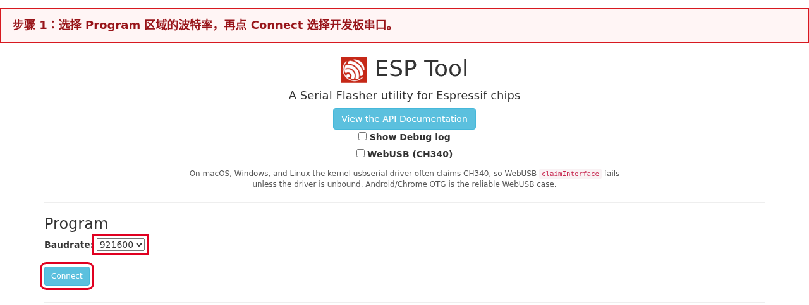
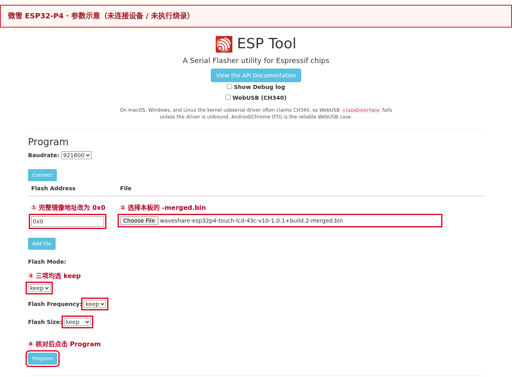
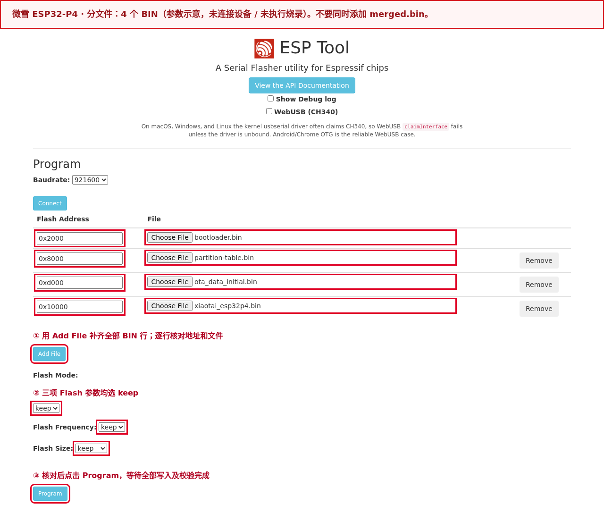
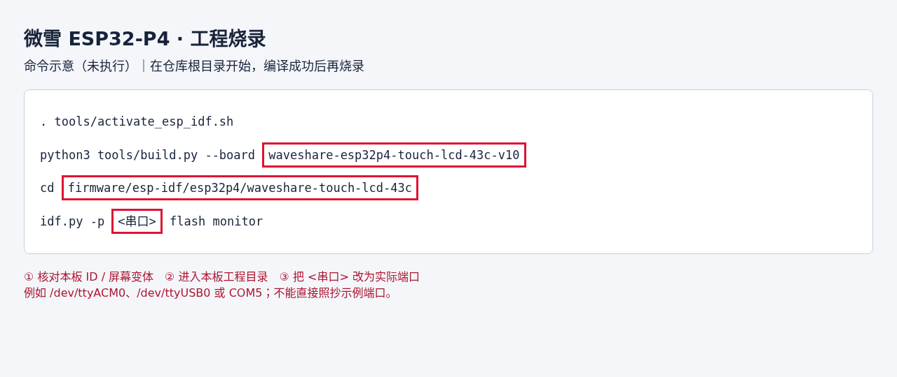

# 微雪 ESP32-P4-WIFI6-Touch-LCD-4.3

[返回开发板目录](../README.md) · [下载固件及发布说明](https://github.com/tangeai/xiaotai/releases/tag/esp32p4-v1.0.1)

板卡 ID：`waveshare-esp32p4-touch-lcd-43c-v10`。当前发布固件为 **v1.0.1 · build.14**。
本版已由用户完成实板验证，使用正常。下文的历史性能记录对应旧构建，不代表 build.14 的已知问题。

另有 [v1.0.2 · build.15 预发布验证包](https://github.com/tangeai/xiaotai/releases/tag/esp32p4-v1.0.2)：
它将固件及平台上报版本改为 `1.0.2`，构建与包校验已通过，尚无该镜像的实板结果。
首次使用仍建议选择上方已验证的 build.14；测试新版时请核对新包的文件名和版本。

从源码复现本版请使用[对应源码提交 `c2d75e9`](https://github.com/tangeai/xiaotai/tree/c2d75e9eadcc1c24af1bb09b3f9972ebdad84e2b)；
发布标签早于 build.14，发布页自动生成的 Source code 压缩包不对应本版固件。

## 烧录

### 打开烧录工具

使用电脑上的 **Chrome 或 Edge** 打开[乐鑫 ESP Web Tool](https://espressif.github.io/esptool-js/)；
网页烧录无需安装 ESP-IDF。关闭占用设备串口的终端或其他烧录网页。
接口和下载模式位置见[板卡官方说明](https://docs.waveshare.net/ESP32-P4-WIFI6-Touch-LCD-4.3/)。

### 烧录步骤

1. 下载 [waveshare-esp32p4-touch-lcd-43c-v10-1.0.1+build.14-merged.bin](https://github.com/tangeai/xiaotai/releases/download/esp32p4-v1.0.1/waveshare-esp32p4-touch-lcd-43c-v10-1.0.1%2Bbuild.14-merged.bin)。本版只选择这一个完整 BIN，地址为 **`0x0`**。
2. 使用板上的 **USB TO UART** Type-C 接口连接电脑，不要连接 USB OTG 或 C6 烧录焊盘。连接失败时按住 BOOT，按一下 RESET，再松开 BOOT。识别结果必须是 **ESP32-P4**；若显示 ESP32-C6，检查接口。
3. 在网页工具的 **Program** 区域选择 `Baudrate`（可先用 `921600`，不稳定时改为 `115200`），点击 **Connect** 并选择本板串口。桌面串口方式不勾选 `WebUSB (CH340)`。
4. 点击 **Choose File** 选择下载的完整 BIN，**Flash Address 改为 `0x0`**；Flash Mode、Flash Frequency、Flash Size 均选 `keep`。只添加这一行，点击 **Program**。
5. 等待每个文件显示 `Hash of data verified.`，最终显示 `Leaving...` 且没有 `Error:`。点击 **Disconnect**，按板卡复位键重启，用 115200 波特率日志核对项目 `xiaotai_esp32p4` 和版本 `1.0.1+build.14`，再进入“首次使用”。

连接位置和烧录参数见下图，图中的端口号与路径只是示例：





**完整镜像会覆盖 NVS 中的 Wi-Fi、绑定和 EP 覆盖项等持久配置。** 烧录后需重新配网、绑定。
`keep` 仅保留镜像中的 Flash 参数，不表示保留设备配置。若网页连接失败，按第 2 步进入下载模式后重连；
若写入或校验失败，检查串口、数据线、文件和地址后重试，不按进度条 100% 判定成功。

| 下载或包内文件 | 用途 |
|---|---|
| `waveshare-esp32p4-touch-lcd-43c-v10-1.0.1+build.14-merged.bin` | **直接烧录**，只此一个文件，地址 `0x0` |
| `waveshare-esp32p4-touch-lcd-43c-v10-1.0.1+build.14-validation.zip` | 分文件烧录包，先解压，按下表各地址写入 |
| `xiaotai_esp32p4.bin` | 应用 BIN，仅在分文件方式中写入 `0x10000`，不可当完整镜像写入 `0x0` |
| `MANIFEST.json`、`flasher_args.json`、`flash_args`、ELF | 清单或排查资料，不直接烧录 |

如需核验完整 BIN，SHA-256 为：

```text
c578976bb353509fb38b4884ade9053993eead16a8d3700386c0f5bf531cdb35
```

Windows 可用 `Get-FileHash -Algorithm SHA256 "实际BIN路径"`；Linux 用 `sha256sum "实际BIN路径"`；
macOS 用 `shasum -a 256 "实际BIN路径"`。分文件的哈希见包内 `MANIFEST.json`，
发布附件的完整哈希见[发布页](https://github.com/tangeai/xiaotai/releases/tag/esp32p4-v1.0.1)中的 `SHA256SUMS`。

## 首次使用

使用完整镜像时，只需确认单个 `-merged.bin` 已从 `0x0` 写入并正常重启；使用分文件包时，
确认清单中的 4 个 BIN 都已按各自地址写入。两种方式任选一种，然后配网和绑定。

### 1. 配置 Wi-Fi

首次烧录、清除过 Wi-Fi 或已保存网络连接失败时，屏幕显示配网引导，并广播无密码的
`XiaoTai-XXXX` 热点。用手机连接该热点；提示“无互联网”属于正常现象。配网页没有
自动打开时，访问 `http://192.168.6.1`，选择 2.4 GHz Wi-Fi，输入路由器密码并提交。
热点重新出现表示联网失败，需要检查密码、信号覆盖和 ESP-Hosted（P4 与 C6 的联网方案）。
配网页面及文案不在板卡手册中另行定义，统一以[产品需求 4.11](../../product/PRODUCT_REQUIREMENTS.md#411-启动无网络与-ap-配网)为准。

### 2. 绑定设备

联网后，屏幕显示 6 位验证码和二维码。让手机恢复互联网连接，扫描二维码或打开
[小钛设备页](https://xiaotai.chat/devices)，在添加设备处输入验证码。验证码过期时使用
屏幕刷新后的号码。设备进入首页/在线状态后，才表示绑定成功。

### 3. 验证与恢复

依次检查屏幕、触摸、摄像头和音频，再验证 H5（网页端）双向对讲、至少三轮 AI 对话、
设备呼叫和微信 VoIP（网络语音通话）。每次会话结束后应回到首页，且无异常重启、持续
内存下降或异常音视频计数。

配网页打不开时确认手机仍连接设备热点；绑定页没有验证码时检查 IP 地址、系统时间和
服务发现。需要更换网络或重新绑定时，进入“设备设置 → 重置设备”，确认后重新配网并
绑定。不要擦除整片 Flash。

## 其他烧录方式

### 分文件烧录

下载并解压 [waveshare-esp32p4-touch-lcd-43c-v10-1.0.1+build.14-validation.zip](https://github.com/tangeai/xiaotai/releases/download/esp32p4-v1.0.1/waveshare-esp32p4-touch-lcd-43c-v10-1.0.1%2Bbuild.14-validation.zip)。
此方式需按包内 `MANIFEST.json` 和 `flasher_args.json` 核对本板、本版的 **4 个 BIN**：

| 文件 | 烧录地址 | 用途 |
|---|---|---|
| `bootloader/bootloader.bin` | `0x2000` | 启动引导程序 |
| `partition_table/partition-table.bin` | `0x8000` | 分区表 |
| `ota_data_initial.bin` | `0xd000` | OTA 初始化数据，不可遗漏 |
| `xiaotai_esp32p4.bin` | `0x10000` | 应用程序，不可写入 0x0 |

在网页工具用 **Add File** 添加上述每个 BIN，各填对应地址，然后点击 **Program**。
不要同时添加完整镜像；不同板卡的 bootloader 地址也可能不同。分文件方式可用于保留配置的升级，
但必须先确认分区布局兼容，不执行全片擦除。操作位置见下图：



### 从源码编译后烧录

按[源码获取说明](../../../README.md#从源码编译)准备仓库，并安装本板要求的 ESP-IDF。
在仓库根目录执行：

```bash
. tools/activate_esp_idf.sh
python3 tools/build.py --board waveshare-esp32p4-touch-lcd-43c-v10
cd firmware/esp-idf/esp32p4/waveshare-touch-lcd-43c
idf.py -p <串口> flash monitor
```

`<串口>` 换成本机实际端口；`idf.py` 会使用工程烧录清单和正确地址。
普通升级不执行 `erase-flash`。示例命令截图不代表已在当前硬件执行：



## 规格

| 项目 | 内容 |
| --- | --- |
| 板卡 ID（仓库中的开发板唯一名称） | `waveshare-esp32p4-touch-lcd-43c-v10` |
| 芯片与平台 | ESP32-P4 / ESP-IDF 5.5.5 |
| 存储 | 32 MB Flash、32 MB PSRAM |
| 显示与触摸 | 4.3 英寸 800×480 横屏产品布局，ST7701 DSI、GT911 |
| 音频 | ES7210 采集、ES8311 播放，支持 AEC |
| 摄像头 | OV5647 MIPI-CSI |
| 网络 | ESP32-C6 + ESP-Hosted/SDIO |
| 产品能力 | H5、AI、设备呼叫、微信 VoIP、屏幕与触摸交互 |

实物以完整型号、商品编号 33875 和 PCB（印刷电路板）V1.0 丝印为准。
本板只能使用与 `waveshare-esp32p4-touch-lcd-43c-v10` 对应的配置和固件包。

## 音视频参数

H5、设备呼叫、多人对讲和微信通话使用 8 kHz 单声道 A-law，每包 20 毫秒、160 字节。
AI 上行使用 8 kHz 单声道 A-law，每包 20 毫秒、160 字节；下行使用 Opus / 16 kHz。

当前参数由工程 `main/media/media_tuning.h` 定义，均为目标值，实际吞吐以实板日志为准：

| 业务 | 设备上行 | 设备下行 | 采集与呈现 |
| --- | --- | --- | --- |
| H5 实时查看 | H.264 1280×960、20 fps、目标 3 Mbit/s | H.264 视频流 15 | 1280×960 全幅采集；H5 按上报的顺时针 270° 旋转 |
| 设备互呼 | MJPEG 640×480、8 fps、JPEG 质量 75、4 Mbit/s 发送预算 | MJPEG，P4 硬件 JPEG 解码 | 1280×960 全幅采集后等比半缩为 UYVY；640×480 画布用 `contain`，本地默认 0° |
| 微信 VoIP | H.264 Annex-B 320×240、15 fps、目标 200 kbit/s、GOP30 | MJPEG，P4 硬件 JPEG 解码 | 1280×960 全幅采集后等比缩小；下行本地顺时针 90°、`cover` |

设备互呼和微信通话的高、低拥塞档位分别保持相同的编码参数；持续拥塞可暂停本端视频
上行，音频与下行继续。4 Mbit/s 是设备互呼 JPEG 净载荷的发送预算，不是固定质量
JPEG 的编码器目标码率。切档和停发条件见[音视频合同](../../product/MEDIA_CONTRACT.md#视频上行参数)。
build.102/103 的 H.264 QVGA 设备互呼下行是历史实验，不适用于当前 MJPEG 路径。

音频先在 16 kHz PCM 域完成 AEC（声学回声消除）。AI 上行继续执行激进 NS（噪声抑制）
和目标 -3 dBFS 的数字 AGC（自动增益控制）后低通降采样为 8 kHz，再编码 A-law；其他 8 kHz 通话链路降采样后执行
最大 30 dB、目标 -1 dBFS、带限幅的 AGC 并编码 A-law；运行日志周期性报告 AGC
前后平均幅度、峰值和处理失败数，失败帧回退原始 PCM，不会编码未定义数据。设置页可用相同的减/加控件
调节音量和 1–5 档麦克风灵敏度，灵敏度默认 4 档。

Opus 编码和解码工作任务各使用 40 KiB PSRAM 栈，并周期输出栈最低余量；该预算覆盖
SILK/CELT 的深调用路径，不能退回通用音频任务的 6 KiB 栈配置。
完整流编号见[音视频参数与媒体处理](../../product/MEDIA_CONTRACT.md)。

设备显示六位绑定码时，请使用浏览器打开 `https://xiaotai.chat`，进入设备绑定并输入验证码。

微信通话的音频收发已经统一使用协议规定的流 0，主机测试会检查实现常量。

TODO：下一次实板回归时，重新保存主叫、被叫、上行首包和双向通话证据。
发布验证需把这些结果绑定到本次固件哈希。

## 固件配置与布局

串口修改服务发现基址：`ep-show` 查看覆盖项，`ep-set http://ep-open.tangeopen.com/pre`
保存后重启并请求 `/pre/services`，`ep-reset` 清除覆盖项。TiRTC 地址取自服务发现响应的
`tirtc-srv`。恢复出厂设置也会清除 `ep-set` 覆盖项；保存或清除失败不能报成功。


## 屏幕布局与字体约束

本板当前屏幕适配为 **800×480 横屏**，variant 选择 **`large`** 布局，产品正文、
按钮、设置值、联系人与动态字幕统一使用 **24 像素**字库。每个固件只链接所选字号，
不允许缺字后回退到另一字号。字号由 `product/interaction/profiles.json` 的
`font_size_px` 约束，不按芯片类型自行推断。

更换屏幕时必须重新登记分辨率、方向与布局，并验证字号、换行和触摸区域。当前屏幕
硬件证据仍以本板 Hardware IR / 探针资料为准；布局配置不能替代硬件证据。完整要求见
[产品交互规范 §1.3](../../product/PRODUCT_INTERACTION_PROFILES.md#13-屏幕布局与字库约束)。

## 环境与依赖

| 依赖项 | 固定版本或文件 | 来源或下载链接 | SHA-256 |
| --- | --- | --- | --- |
| 主机环境 | Linux/WSL2、Git、Python 3 | [Git](https://git-scm.com/downloads)、[Python](https://www.python.org/downloads/) | 无 |
| ESP-IDF | `v5.5.5`，提交 `b774170ff46c393eeb5e495ea37936038d3f4f4f` | [Espressif 官方仓库](https://github.com/espressif/esp-idf/tree/b774170ff46c393eeb5e495ea37936038d3f4f4f) | 无 |
| C/C++ 编译器 | `riscv32-esp-elf-gcc 14.2.0`，构建标识 `esp-14.2.0_20260121` | [ESP-IDF 工具清单](https://github.com/espressif/esp-idf/blob/b774170ff46c393eeb5e495ea37936038d3f4f4f/tools/tools.json) | 无，安装器按工具清单校验下载文件 |
| TiRTC | 2.5.0，`lib/libTiRTC.a` | [ESP32-P4 发布目录](https://repo-sdk.tange-ai.com/service/rest/repository/browse/tirtc-sdks/releases/espressif_esp32p4/) | `9b4e35c7a2cb203fc463417739199429057c8b036936faa11f844c726455301f` |
| ESP-IDF 组件 | ESP-Hosted 1.4.7、ESP-SR 2.4.6、`esp_h264` 1.3.8、`esp_codec_dev` 1.5.10、Waveshare 4.3 BSP v1.0.1 | [工程依赖锁定文件](../../../firmware/esp-idf/esp32p4/waveshare-touch-lcd-43c/dependencies.lock) | 无 |
| C6 从机固件 | 与当前主工程匹配的版本 | 无 | 无 |

组件的完整解析版本以工程依赖锁定文件和 TiRTC
[校验清单](../../../firmware/esp-idf/esp32p4/waveshare-touch-lcd-43c/third_party/tirtc/SHA256SUMS.txt)为准。

TiRTC SDK 与 S3 工程采用相同目录划分：`third_party/tirtc/` 存放厂商库、
头文件、版本和编译契约；`components/tirtc_sdk/CMakeLists.txt` 保留项目的
ABI 校验和链接配置。升级时仅替换前者，并核对后者锁定的库 SHA-256、
目标芯片和 ABI 要求；不要用 SDK 包覆盖整个 component。P4 与 S3 的库不能混用。

## 原理图与硬件资料

| 资料名称 | 版本或标识 | 链接 | SHA-256 | 资料状态 |
| --- | --- | --- | --- | --- |
| 微雪官方产品文档 | SKU 33874/33875 | [在线文档](https://docs.waveshare.net/ESP32-P4-WIFI6-Touch-LCD-4.3/) | 无 | 已提供 |
| 官方相关资料页 | 无 | [在线文档](https://docs.waveshare.net/ESP32-P4-WIFI6-Touch-LCD-4.3/Resources-And-Documents/) | 无 | 已提供 |
| ESP32-P4-WIFI6-Touch-LCD-4.3 原理图 | 实物 PCB V1.0 | [PDF](https://www.waveshare.net/w/upload/b/b8/ESP32-P4-WIFI6-Touch-LCD-4.3-schematic.pdf) | `3697baa3ded0089446baf09705f437d13cf0324874031ccc57fd9b72cd9dfe53` | 已提供 |
| 微雪官方参考仓库 | 核对提交 `74d1a81` | [GitHub](https://github.com/waveshareteam/ESP32-P4-WIFI6-Touch-LCD-4.3)、[Gitee](https://gitee.com/waveshare/esp32-p4-wifi6-touch-lcd-4.3) | 无 | 已提供 |

原理图对应实物版本、BSP 版本和实测差异记录在工程 Hardware IR（硬件信息记录）中。

## 开发

### 目录结构

从仓库根目录看，这块板相关的代码分布如下：

```text
xiaotai/
├── boards/waveshare/esp32p4-touch-lcd-43c/ # 板卡身份、硬件参数与媒体接入
├── product/                                # 跨芯片复用的业务状态、协议与测试
├── platforms/esp-idf/main/                 # 共享启动入口
├── platforms/esp-idf/components/           # runtime、TiRTC、媒体和产品界面
├── platforms/esp-idf/waveshare_p4/         # P4 摄像头、显示、内存和板级公共实现
└── firmware/esp-idf/esp32p4/waveshare-touch-lcd-43c/
    ├── main/CMakeLists.txt                 # 引入共享启动入口
    ├── main/drivers/display/              # DSI 显示适配
    ├── main/media/                         # 摄像头管线和媒体负载控制
    ├── main/services/call_video_renderer_config.h # 下行渲染参数
    ├── components/                         # BSP、ESP-Hosted 和公共组件接入
    └── *-contract.json                     # 硬件、交互和媒体契约
```

`build/` 是构建生成目录，不是源码入口。依赖组件通过 `idf_component.yml` 和锁定文件
更新，不要直接修改 `managed_components/` 中的下载副本。

P4 的版本改动记在工程 [`CHANGELOG.md`](../../../firmware/esp-idf/esp32p4/waveshare-touch-lcd-43c/CHANGELOG.md)；
采集、编解码和显示的试验过程及踩坑数据记在[媒体诊断记录](../../development/MEDIA_PIPELINE_DIAGNOSTICS.md)。

面向用户的音视频参数以[媒体合同](../../product/MEDIA_CONTRACT.md)为准；
未完成的实板验收项见[开发板问题清单](../ISSUES_AND_REQUIREMENTS.md)。
引脚、外设及证据等级以工程 `hardware-ir.json` 为准。

### 按任务查找代码

| 要修改的内容 | 首先查看 | 边界说明 |
| --- | --- | --- |
| 板卡型号、引脚和媒体入口 | `boards/waveshare/esp32p4-touch-lcd-43c/` | 只放该 PCB 和外设组合特有的事实 |
| 启动流程和产品装配 | `platforms/esp-idf/main/` | 由工程 `main/CMakeLists.txt` 注册 |
| H5、AI、设备呼叫和微信 VoIP 的状态与优先级 | `product/src/`、`platforms/esp-idf/components/starter_runtime/` | 公共规则优先落在可测试的产品接口 |
| C6 联网、配网和网络状态 | `platforms/esp-idf/components/wifi_manager/`、工程 `components/espressif__esp_hosted/` | P4 不直接假设 Wi-Fi 已就绪 |
| 麦克风、扬声器、AEC 和播放控制 | 工程 `components/starter_media/`、`platforms/esp-idf/components/starter_media_common/` | 同时核对音频契约和实际播放参考 |
| MIPI-CSI 摄像头、视频转换和负载控制 | `main/media/`、`platforms/esp-idf/waveshare_p4/` | 采集、转换和业务编码参数分层维护 |
| TiRTC 连接、流编号和媒体桥接 | `platforms/esp-idf/components/starter_tirtc/` | 不把 H5、设备呼叫和微信流配置混用 |
| 平台 HTTP/MQTT 与绑定 | `platforms/esp-idf/components/platform_client/` | 信令结果交由 runtime 处理 |
| 页面、触摸反馈和显示布局 | `platforms/esp-idf/components/starter_product/`、工程 `main/drivers/display/` | 页面不直接接管会话状态 |
| 回归测试和构建约束 | `product/tests/`、`tools/tests/` | 修改行为时先补失败用例，再改实现 |

### 推荐修改顺序

1. 先读根目录 [`AGENTS.md`](../../../AGENTS.md)、[`ARCHITECTURE.md`](../../../ARCHITECTURE.md)
   和[测试说明](../../../tests/README.md)，确认改动属于产品、服务、平台还是板级代码。
2. 修改媒体链路前核对 `board-audio-contract.json`、`board-video-contract.json` 和
   `platform-media-contract.json`，明确业务类型、流编号、格式和资源预算。
3. 先修改公共业务接口和主机测试，再接入 P4/C6、摄像头、显示或音频实现。
4. 运行本页“测试”中的命令，最后上板验证双向媒体、会话互斥和资源释放。

## 编译

```bash
bash tools/setup_esp_idf.sh esp32p4
. tools/activate_esp_idf.sh
python3 tools/build.py --board waveshare-esp32p4-touch-lcd-43c-v10
```

工程目录为 `firmware/esp-idf/esp32p4/waveshare-touch-lcd-43c/`。

## 测试

```bash
bash tools/check.sh
python3 tools/build.py --board waveshare-esp32p4-touch-lcd-43c-v10
```

实板验证要覆盖显示与触摸方向、C6 联网、摄像头关键帧、H5、AI、设备呼叫和微信
VoIP。音视频分别记录实际帧率、码率、丢帧、首包、AEC 参考不足和会话释放结果。

## 排查

- 无法联网：先检查 C6 slave 固件版本、SDIO 初始化和 ESP-Hosted 状态。
- 视频方向或比例错误：分别核对 H5 H.264 1280×960、设备互呼 MJPEG 640×480、微信上行 H.264 320×240 的配置。设备互呼下行从本地 0° 开始；微信核对 `down_video_rotation=0` 和 P4 本地 `cw90`，不要混用上下行旋转值。
- 单向无声：核对业务类型、音频流编号、订阅状态和首包统计，微信音频固定使用流 0。
- 会话结束后异常：检查旧 generation（会话代次）回调是否被拒绝，以及相机和音频资源是否释放。

## 验证状态与已知限制

当前 `1.0.1+build.14` 完整 BIN SHA-256 为
`c578976bb353509fb38b4884ade9053993eead16a8d3700386c0f5bf531cdb35`；
用户于 2026-10-23 确认该版 P4 实板验证可用、使用无问题。反馈未附逐项测试日志，
因此下列旧构建的性能数据不能作为 build.14 的帧率、音质或长时间稳定性指标。

项目方确认该型号的 PCB V1.0 实板已有跑通记录。“已验证”只适用于记录中的固件和
测试范围，不代表从任意提交构建的固件已经验收。

设备互呼 build.112（ELF SHA-256 前缀 `a14250e62`）双机日志显示：上行实际约
6.3–6.6 fps、2.67–3.30 Mbit/s；下行约 8 fps 接收、约 7.2 fps 解码、
约 4.8 fps 提交显示，解码失败和音频接收缓冲溢出均为零。`presented` 是向显示
队列交付的计数，不能单凭它证明液晶实际刷新率或端到端延迟。

同版约 15 分钟日志显示，积压约 75 KiB 时本端视频上行因持续拥塞停发，
音频和下行继续；人工重新打开摄像头后上行恢复。四向旋转的几何日志正常，
但该版 90°/270° 因 `cover` 策略曾中心裁切；build.14 已改为 `contain` 显示策略。

历史 v1.0.0 首版固件
为 build.113（应用 BIN SHA-256 `b46088f12733d76b202e01958392c0989448169b948a896b363a24a85008cd94`）。
用户提供的该版设备互呼日志中，10 秒窗口上行 7.9 fps、80 帧发送无丢帧，
音频接收缓冲溢出为零；同期累计下行接收 776 帧、解码 689 帧、提交显示 442 帧。
这已是实板运行证据，但不能据此确认液晶实际刷新率和全场景验收。

旧版 build.87 与 build.101/103 的 H.264 试验仅作历史对照。双机日志、比较条件和限制见
[通话诊断记录](../../development/MEDIA_PIPELINE_DIAGNOSTICS.md)及[视频性能记录](../../product/P4_VIDEO_PERFORMANCE.md)。

板级配置位于 `boards/waveshare/esp32p4-touch-lcd-43c/`；硬件事实和证据等级见工程
`hardware-ir.json`。
