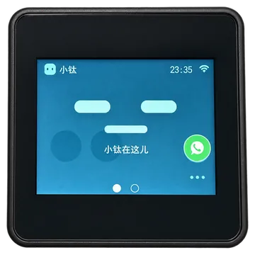

# Firmware downloads and development

[中文](downloads.md) · [English](downloads.en.md)

Current distribution: **v1.2.0 — stable**. See the historical archives below for `v1.0.0` and `v1.1.0`. Download from this page. Older per-board Releases have been removed.

[Release notes, SHA-256 and known issues](https://github.com/tangeai/xiaotai/releases/tag/v1.2.0) · [Release policy](development/release-policy.en.md)

Open the [XiaoTai Web Flasher](https://xiaotai.chat/web-flasher/) in desktop Chrome or Edge. Select your board and the matching `xiaotai` release listed below, or choose **本地 BIN** (local BIN) to load a file from the table below.

Use the complete image for your board and display variant. ESP32 files end in `_merged.bin` and BK7258 files in `_all-app.bin`. Both start at `0x0`.

An ESP32 full image overwrites Wi-Fi and binding settings in NVS. For BK7258, back up the factory calibration data before flashing and avoid a full-chip erase.

All five boards use TiRTC SDK 2.6.3 and firmware base version 1.2.0. Check the boot log against the embedded version for your board.

## LCKFB ShiZhanPai BK7258

立创·实战派 BK7258 / LCKFB ShiZhanPai BK7258

| Variant | Embedded firmware identity | Complete BIN |
|---|---|---|
| Default | `1.2.0+build.112` | [v1.2.0_lckfb-bk7258_all-app.bin](https://github.com/tangeai/xiaotai/releases/download/v1.2.0/v1.2.0_lckfb-bk7258_all-app.bin) |

[Flashing and board guide](boards/lckfb-bk7258/README.en.md)

## LCKFB ShiZhanPai ESP32-S3

立创·实战派 ESP32-S3 / LCKFB ShiZhanPai ESP32-S3

| Variant | Embedded firmware identity | Complete BIN |
|---|---|---|
| Default | `1.2.0+build.98` | [v1.2.0_lckfb-esp32s3_merged.bin](https://github.com/tangeai/xiaotai/releases/download/v1.2.0/v1.2.0_lckfb-esp32s3_merged.bin) |

[Flashing and board guide](boards/lckfb-esp32s3/README.en.md)

## Waveshare ESP32-P4-WIFI6-Touch-LCD-4.3

微雪 ESP32-P4-WIFI6-Touch-LCD-4.3 / Waveshare ESP32-P4-WIFI6-Touch-LCD-4.3

For the 4.3-inch display and **PCB V1.0**.

| Variant | Embedded firmware identity | Complete BIN |
|---|---|---|
| Default | `1.2.0+build.66` | [v1.2.0_waveshare-esp32p4-touch-lcd-43c-v10_merged.bin](https://github.com/tangeai/xiaotai/releases/download/v1.2.0/v1.2.0_waveshare-esp32p4-touch-lcd-43c-v10_merged.bin) |

[Flashing and board guide](boards/waveshare-esp32p4-touch-lcd-43c-v10/README.en.md)

## M5Stack CoreS3-Lite

M5Stack CoreS3-Lite / M5Stack CoreS3-Lite

For CoreS3-Lite **K128-Lite / ILI9342C**. Download the single complete image below.

| Variant | Embedded firmware identity | Complete BIN |
|---|---|---|
| ILI9342C | `1.2.0+build.108` | [v1.2.0_m5stack-cores3-lite_ili9342c_merged.bin](https://github.com/tangeai/xiaotai/releases/download/v1.2.0/v1.2.0_m5stack-cores3-lite_ili9342c_merged.bin) |

[Flashing and board guide](boards/m5stack-cores3-lite/README.en.md)

## MGKFB AI Toy Development Board BK7258

觅感 AI 玩具开发板 BK7258 / MGKFB AI Toy Development Board BK7258

For the **8 MiB Flash, dual-eye-display** board.

| Variant | Embedded firmware identity | Complete BIN |
|---|---|---|
| Default | `1.2.0+build.60` | [v1.2.0_mgkfb-bk7258_all-app.bin](https://github.com/tangeai/xiaotai/releases/download/v1.2.0/v1.2.0_mgkfb-bk7258_all-app.bin) |

[Flashing and board guide](boards/mgkfb-bk7258/README.en.md)

## Historical firmware archives

- [Previous pre-release v1.2.0-beta.3](https://github.com/tangeai/xiaotai/releases/tag/v1.2.0-beta.3)

- [Archived pre-release v1.2.0-beta.2](https://github.com/tangeai/xiaotai/releases/tag/v1.2.0-beta.2)

- [Archived pre-release v1.2.0-beta.1](https://github.com/tangeai/xiaotai/releases/tag/v1.2.0-beta.1)

- [v1.0.0: five historical complete BINs](https://github.com/tangeai/xiaotai/releases/tag/v1.0.0).
- [v1.1.0: five historical complete BINs](https://github.com/tangeai/xiaotai/releases/tag/v1.1.0). LCKFB S3 build.68 has a known AI SDK issue. The release notes describe the archive as a pre-release. GitHub does not mark it as one.

Archives retain actual embedded versions and hashes. They are for historical reproduction; current use is v1.2.0 above.

## Development

Start with [Architecture](../ARCHITECTURE.en.md) and the board guides for SDKs, native project paths, build and debugging steps. Use [source setup](../README.en.md#build-from-source) and `tools/build.py --board <board-id>`; select the correct M5 screen variant.

For unified distributions, check out the version tag. Use source commit SHAs from archived release records. The main branch may contain unreleased changes.

Online features depend on binding/signaling, TiRTC, and the AI or WeChat services used. Configure service addresses and credentials as described in the [project overview](../README.en.md). Validate modified firmware using [Testing](../tests/README.en.md) and follow [Contributing](../CONTRIBUTING.en.md).
