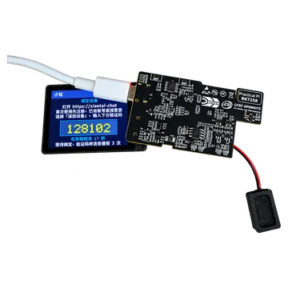
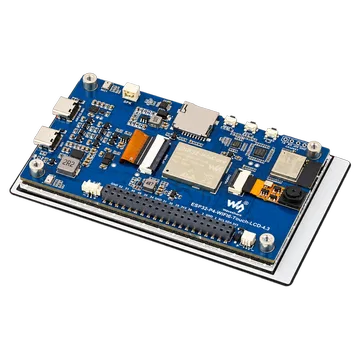
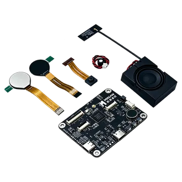

# Firmware downloads and development

[中文](downloads.md) · [English](downloads.en.md)

Current distribution: **v1.2.0-beta.1 — pre-release, pending hardware acceptance**. There is currently no unified stable download on this page. Legacy board tags and their invalid download links have been removed.

[Release notes, SHA-256 and known issues](https://github.com/tangeai/xiaotai/releases/tag/v1.2.0-beta.1) · [Release policy](development/release-policy.en.md)

Download one complete BIN for your board and display variant; no extraction or split-file package is needed. ESP images end in `_merged.bin`; BK images end in `_all-app.bin`. Do not mix firmware between boards sharing a chip.

ESP full images are flashed at `0x0` and overwrite NVS settings, including Wi-Fi and binding. For BK, use the board guide’s native serial tool at `0x0`, not esptool; preserve factory calibration and avoid full-chip erase. Prepare to configure the device again.

The distribution version differs from the reused firmware’s embedded identity. Check the device log against the identity column below. No firmware was rebuilt for this distribution change.

## LCKFB ShiZhanPai BK7258

立创·实战派 BK7258 / LCKFB ShiZhanPai BK7258

| Variant | Embedded firmware identity | Complete BIN |
|---|---|---|
| Default | `1.0.2+build.99` | [v1.2.0-beta.1_lckfb-bk7258_all-app.bin](https://github.com/tangeai/xiaotai/releases/download/v1.2.0-beta.1/v1.2.0-beta.1_lckfb-bk7258_all-app.bin) |

[Flashing and board guide](boards/lckfb-bk7258/README.en.md)

## LCKFB ShiZhanPai ESP32-S3

立创·实战派 ESP32-S3 / LCKFB ShiZhanPai ESP32-S3

| Variant | Embedded firmware identity | Complete BIN |
|---|---|---|
| Default | `1.1.0+build.82` | [v1.2.0-beta.1_lckfb-esp32s3_merged.bin](https://github.com/tangeai/xiaotai/releases/download/v1.2.0-beta.1/v1.2.0-beta.1_lckfb-esp32s3_merged.bin) |

[Flashing and board guide](boards/lckfb-esp32s3/README.en.md)

## Waveshare ESP32-P4-WIFI6-Touch-LCD-4.3

微雪 ESP32-P4-WIFI6-Touch-LCD-4.3 / Waveshare ESP32-P4-WIFI6-Touch-LCD-4.3

For the 4.3-inch display and **PCB V1.0**.

| Variant | Embedded firmware identity | Complete BIN |
|---|---|---|
| Default | `1.1.0+build.48` | [v1.2.0-beta.1_waveshare-esp32p4-touch-lcd-43c-v10_merged.bin](https://github.com/tangeai/xiaotai/releases/download/v1.2.0-beta.1/v1.2.0-beta.1_waveshare-esp32p4-touch-lcd-43c-v10_merged.bin) |

[Flashing and board guide](boards/waveshare-esp32p4-touch-lcd-43c-v10/README.en.md)

## M5Stack CoreS3-Lite

M5Stack CoreS3-Lite / M5Stack CoreS3-Lite

For CoreS3-Lite **K128-Lite / ILI9342C**. Download the single complete image below.

| Variant | Embedded firmware identity | Complete BIN |
|---|---|---|
| ILI9342C | `1.1.0+build.91` | [v1.2.0-beta.1_m5stack-cores3-lite_ili9342c_merged.bin](https://github.com/tangeai/xiaotai/releases/download/v1.2.0-beta.1/v1.2.0-beta.1_m5stack-cores3-lite_ili9342c_merged.bin) |

[Flashing and board guide](boards/m5stack-cores3-lite/README.en.md)

## MGKFB AI Toy Development Board BK7258

觅感 AI 玩具开发板 BK7258 / MGKFB AI Toy Development Board BK7258

For the **8 MiB Flash, dual-eye-display** board.

| Variant | Embedded firmware identity | Complete BIN |
|---|---|---|
| Default | `1.0.3+build.49` | [v1.2.0-beta.1_mgkfb-bk7258_all-app.bin](https://github.com/tangeai/xiaotai/releases/download/v1.2.0-beta.1/v1.2.0-beta.1_mgkfb-bk7258_all-app.bin) |

[Flashing and board guide](boards/mgkfb-bk7258/README.en.md)

## Development

Start with [Architecture](../ARCHITECTURE.en.md) and the board guides for SDKs, native project paths, build and debugging steps. Use [source setup](../README.en.md#build-from-source) and `tools/build.py --board <board-id>`; select the correct M5 screen variant.

For unified distributions, check out the version tag. Historical board tags were removed; use source commit SHAs from archived release records. The main branch may contain unreleased changes.

Online features depend on binding/signaling, TiRTC, and the AI or WeChat services used. Configure service addresses and credentials as described in the [project overview](../README.en.md). Validate modified firmware using [Testing](../tests/README.en.md) and follow [Contributing](../CONTRIBUTING.en.md).
