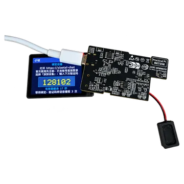
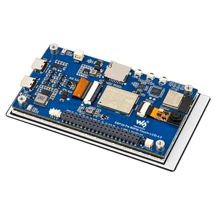
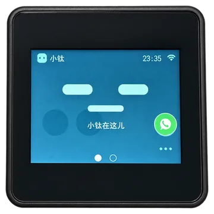
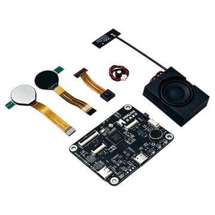

# Firmware Downloads and Development

[Quick start](../README.en.md) · [Board directory](boards/README.en.md) · [Architecture and development](../ARCHITECTURE.en.md)

[中文](downloads.md) · [English](downloads.en.md)

Choose released firmware matching your board, then follow its flashing guide to configure Wi-Fi and bind the device. Before changing code, use a release to confirm hardware and service connectivity, then prepare your environment using [Development](#development) below.

Check the physical model, printed circuit board (PCB) revision, and display controller before downloading. Different boards using the same chip cannot share firmware. M5 requires the correct ILI9342E / ILI9342C variant; MGKFB BK7258 uses one firmware with dual eye displays.

| Scenario | File | Flashing method |
|---|---|---|
| ESP32 first use | Merged BIN | Write at `0x0`; overwrites Wi-Fi, binding, and other nonvolatile storage (NVS) settings. Configure Wi-Fi and bind again afterward |
| ESP32 upgrade retaining settings | Firmware ZIP | Extract and flash files at manifest addresses after checking partition and configuration compatibility; do not erase the entire chip |
| BK7258 first use | Firmware ZIP | Extract `-all-app.bin` and flash over serial as described in the board guide |

The BK package's `-app_pack.rbl` is for over-the-air (OTA) updates, not initial serial flashing. MGKFB OTA has not completed dedicated validation.

Verify downloads with the release's `SHA256SUMS`. Package files, versions, and flash addresses are listed in `MANIFEST.json`. Release notes describe validation scope and known issues. Historical versions are available in [GitHub Releases](https://github.com/tangeai/xiaotai/releases).

## LCKFB BK7258

Use firmware for LCKFB BK7258. The ZIP contains the complete image for initial flashing.

| Hardware | Current release | Merged image (BIN) | Firmware package (ZIP) | Release notes |
|---|---|---|---|---|
| LCKFB BK7258 | v1.0.2 · build.73 | Included in ZIP | [Download ZIP](https://github.com/tangeai/xiaotai/releases/download/bk7258-v1.0.2-build.73/lckfb-bk7258-1.0.2%2Bbuild.73-validation.zip) | [Release notes](https://github.com/tangeai/xiaotai/releases/tag/bk7258-v1.0.2-build.73) |

[Flashing guide](boards/lckfb-bk7258/README.en.md#flashing) · [Hardware](boards/lckfb-bk7258/README.en.md#specifications) · [Build and debug](boards/lckfb-bk7258/README.en.md#development-directories)

## LCKFB ESP32-S3

For PCB V1.0.1. Check the revision printed on the board before downloading.

| Hardware | Current release | Merged image (BIN) | Firmware package (ZIP) | Release notes |
|---|---|---|---|---|
| PCB V1.0.1 | v1.1.0 · build.45 | [Download BIN](https://github.com/tangeai/xiaotai/releases/download/lckfb-esp32s3-v1.1.0-build.45/lckfb-esp32s3-1.1.0%2Bbuild.45-merged.bin) | [Download ZIP](https://github.com/tangeai/xiaotai/releases/download/lckfb-esp32s3-v1.1.0-build.45/lckfb-esp32s3-1.1.0%2Bbuild.45-validation.zip) | [Release notes](https://github.com/tangeai/xiaotai/releases/tag/lckfb-esp32s3-v1.1.0-build.45) |

This release supports AI audio recognition. See the [release notes (Chinese)](boards/lckfb-esp32s3/RELEASE_NOTES_1.1.0_BUILD45.md) for features and validation scope.

[Flashing guide](boards/lckfb-esp32s3/README.en.md#flashing) · [Hardware](boards/lckfb-esp32s3/README.en.md#specifications) · [Build and debug](boards/lckfb-esp32s3/README.en.md#development)

## Waveshare ESP32-P4-WIFI6-Touch-LCD-4.3

For the 4.3-inch display model with PCB V1.0. Check both display size and board revision.

| Hardware | Current release | Merged image (BIN) | Firmware package (ZIP) | Release notes |
|---|---|---|---|---|
| PCB V1.0 | v1.1.0 · build.27 | [Download BIN](https://github.com/tangeai/xiaotai/releases/download/waveshare-esp32p4-touch-lcd-43c-v10-v1.1.0/waveshare-esp32p4-touch-lcd-43c-v10-1.1.0%2Bbuild.27-merged.bin) | [Download ZIP](https://github.com/tangeai/xiaotai/releases/download/waveshare-esp32p4-touch-lcd-43c-v10-v1.1.0/waveshare-esp32p4-touch-lcd-43c-v10-1.1.0%2Bbuild.27-validation.zip) | [Release notes](https://github.com/tangeai/xiaotai/releases/tag/waveshare-esp32p4-touch-lcd-43c-v10-v1.1.0) |

[Flashing guide](boards/waveshare-esp32p4-touch-lcd-43c-v10/README.en.md#flashing) · [Hardware](boards/waveshare-esp32p4-touch-lcd-43c-v10/README.en.md#specifications) · [Build and debug](boards/waveshare-esp32p4-touch-lcd-43c-v10/README.en.md#development)

## M5Stack CoreS3-Lite

For model K128-Lite. Identify whether the display controller is ILI9342E or ILI9342C before selecting firmware; appearance alone is insufficient.

| Hardware | Current release | Merged image (BIN) | Firmware package (ZIP) | Release notes |
|---|---|---|---|---|
| ILI9342E | No release assets available | — | — | [Historical validation (Chinese)](../boards/m5stack/cores3-lite/VALIDATION.md) |
| ILI9342C | v1.0.1 · build.48 | [Download BIN](https://github.com/tangeai/xiaotai/releases/download/m5stack-cores3-lite-v1.0.1-build.48-ili9342c/m5stack-cores3-lite-1.0.1%2Bbuild.48-merged.bin) | [Download ZIP](https://github.com/tangeai/xiaotai/releases/download/m5stack-cores3-lite-v1.0.1-build.48-ili9342c/m5stack-cores3-lite-1.0.1%2Bbuild.48-validation.zip) | [Release notes](https://github.com/tangeai/xiaotai/releases/tag/m5stack-cores3-lite-v1.0.1-build.48-ili9342c) |

Historical ILI9342E build.47 assets are currently unavailable. Build from source using the board guide and validate it yourself; do not substitute ILI9342C firmware.

[Flashing guide](boards/m5stack-cores3-lite/README.en.md#flashing) · [Hardware](boards/m5stack-cores3-lite/README.en.md#specifications) · [Build and debug](boards/m5stack-cores3-lite/README.en.md#development)

## MGKFB AI Toy Development Board BK7258

For the MGKFB board with dual eye displays and 8 MiB Flash, using one firmware image.

| Hardware | Current release | Merged image (BIN) | Firmware package (ZIP) | Release notes |
|---|---|---|---|---|
| Dual eye displays · 8 MiB Flash | v1.0.3 · build.30 | [Download BIN](https://github.com/tangeai/xiaotai/releases/download/mgkfb-bk7258-v1.0.3-build.30/mgkfb-bk7258-1.0.3%2Bbuild.30-all-app.bin) | [Download ZIP](https://github.com/tangeai/xiaotai/releases/download/mgkfb-bk7258-v1.0.3-build.30/mgkfb-bk7258-1.0.3%2Bbuild.30-validation.zip) | [Release notes](https://github.com/tangeai/xiaotai/releases/tag/mgkfb-bk7258-v1.0.3-build.30) |

[Flashing guide](boards/mgkfb-bk7258/README.en.md#flashing) · [Hardware](boards/mgkfb-bk7258/README.en.md#specifications) · [Build and debug](boards/mgkfb-bk7258/README.en.md#development-directories)

## Development

Before changing features or adapting hardware, read [Architecture and development](../ARCHITECTURE.en.md) for product, platform, and board-driver boundaries. The board guides above specify toolchains, SDK dependencies, native project directories, build steps, and debugging.

For current source development, follow [Building from source](../README.en.md#build-from-source) to obtain the repository, then select a board with `tools/build.py --board <board-id>`. M5 also requires the correct screen variant.

To reproduce a published version, check out its Release tag; the main branch may contain unreleased changes.

Online features depend on the binding/signaling platform, TiRTC, and the selected AI or WeChat services. Self-hosted integration requires service addresses and credentials; see the [project overview](../README.en.md).

Revalidate affected features on hardware after modifying firmware, following [Testing and hardware validation](../tests/README.en.md).

Before committing or publishing, follow [Contributing](../CONTRIBUTING.en.md). See [Maintaining download links](../CONTRIBUTING.en.md#maintaining-download-links) for download-page update scope.
