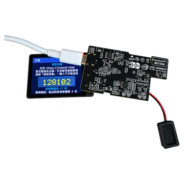
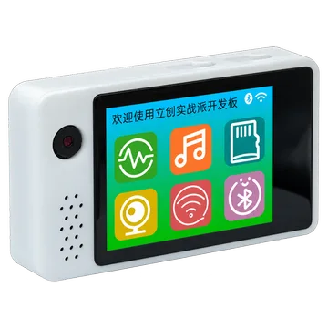
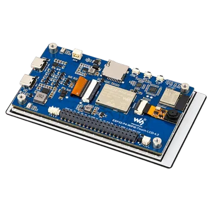
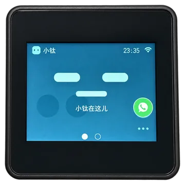
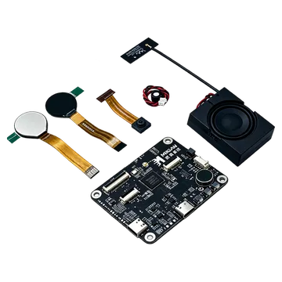

# 固件下载与开发入口

[中文](downloads.md) · [English](downloads.en.md)

当前统一发行：**v1.2.0-beta.1 — 测试版，待实板验收**。下方另列 `v1.0.0` 历史正式归档和 `v1.1.0` 历史预发布归档。
旧板卡 tag 及其失效下载链接已清理。

[发布说明、SHA-256 与已知问题](https://github.com/tangeai/xiaotai/releases/tag/v1.2.0-beta.1) · [发布规范](development/release-policy.md)

在电脑上用 Chrome 或 Edge 打开[小钛网页烧录工具](https://xiaotai.chat/web-flasher/)，按开发板型号选择固件版本。也可以从下表下载与板型、屏幕匹配的完整镜像，再用 **本地 BIN** 打开。

ESP32 镜像以 `_merged.bin` 结尾，BK7258 镜像以 `_all-app.bin` 结尾，两者都从 `0x0` 写入。ESP32 完整镜像会覆盖 NVS 中的 Wi-Fi 和绑定信息。BK7258 烧录前请备份原厂校准数据，避免全片擦除。

统一发行版本与复用固件的内嵌身份不同，请按下表“内嵌版本”核对设备日志。本次整理未重新编译固件。

## 立创·实战派 BK7258

立创·实战派 BK7258 / LCKFB ShiZhanPai BK7258

| 变体 | 内嵌固件版本 | 完整烧录 BIN |
|---|---|---|
| 默认 | `1.0.2+build.99` | [v1.2.0-beta.1_lckfb-bk7258_all-app.bin](https://github.com/tangeai/xiaotai/releases/download/v1.2.0-beta.1/v1.2.0-beta.1_lckfb-bk7258_all-app.bin) |

[烧录步骤与开发板指南](boards/lckfb-bk7258/README.md)

## 立创·实战派 ESP32-S3

立创·实战派 ESP32-S3 / LCKFB ShiZhanPai ESP32-S3

| 变体 | 内嵌固件版本 | 完整烧录 BIN |
|---|---|---|
| 默认 | `1.1.0+build.82` | [v1.2.0-beta.1_lckfb-esp32s3_merged.bin](https://github.com/tangeai/xiaotai/releases/download/v1.2.0-beta.1/v1.2.0-beta.1_lckfb-esp32s3_merged.bin) |

[烧录步骤与开发板指南](boards/lckfb-esp32s3/README.md)

## 微雪 ESP32-P4-WIFI6-Touch-LCD-4.3

微雪 ESP32-P4-WIFI6-Touch-LCD-4.3 / Waveshare ESP32-P4-WIFI6-Touch-LCD-4.3

适用于 **4.3 英寸屏、PCB V1.0**，请核对型号。

| 变体 | 内嵌固件版本 | 完整烧录 BIN |
|---|---|---|
| 默认 | `1.1.0+build.48` | [v1.2.0-beta.1_waveshare-esp32p4-touch-lcd-43c-v10_merged.bin](https://github.com/tangeai/xiaotai/releases/download/v1.2.0-beta.1/v1.2.0-beta.1_waveshare-esp32p4-touch-lcd-43c-v10_merged.bin) |

[烧录步骤与开发板指南](boards/waveshare-esp32p4-touch-lcd-43c-v10/README.md)

## M5Stack CoreS3-Lite

M5Stack CoreS3-Lite / M5Stack CoreS3-Lite

适用于 CoreS3-Lite **K128-Lite / ILI9342C**，只需下载下面这一份完整镜像。

| 变体 | 内嵌固件版本 | 完整烧录 BIN |
|---|---|---|
| ILI9342C | `1.1.0+build.91` | [v1.2.0-beta.1_m5stack-cores3-lite_ili9342c_merged.bin](https://github.com/tangeai/xiaotai/releases/download/v1.2.0-beta.1/v1.2.0-beta.1_m5stack-cores3-lite_ili9342c_merged.bin) |

[烧录步骤与开发板指南](boards/m5stack-cores3-lite/README.md)

## 觅感 AI 玩具开发板 BK7258

觅感 AI 玩具开发板 BK7258 / MGKFB AI Toy Development Board BK7258

适用于 **8 MiB Flash、双屏眼睛**开发板。

| 变体 | 内嵌固件版本 | 完整烧录 BIN |
|---|---|---|
| 默认 | `1.0.3+build.49` | [v1.2.0-beta.1_mgkfb-bk7258_all-app.bin](https://github.com/tangeai/xiaotai/releases/download/v1.2.0-beta.1/v1.2.0-beta.1_mgkfb-bk7258_all-app.bin) |

[烧录步骤与开发板指南](boards/mgkfb-bk7258/README.md)

## 历史固件归档

- [v1.0.0：五板历史完整 BIN](https://github.com/tangeai/xiaotai/releases/tag/v1.0.0)。
- [v1.1.0：五板历史完整 BIN](https://github.com/tangeai/xiaotai/releases/tag/v1.1.0)；归档的立创 S3 镜像存在 AI 已知问题，保留 pre-release。

归档保留实际内嵌版本与哈希，供复现历史使用；当前测试使用上方 v1.2.0-beta.1。

## 二次开发

先阅读[架构与二次开发](../ARCHITECTURE.md)，工具链、SDK、原生工程、编译与调试步骤见各板指南。
按[源码编译说明](../README.md#从源码编译)获取仓库，使用 `tools/build.py --board <board-id>` 构建；
M5 还需选择对应屏幕变体。

复现统一发行时检出版本 tag；旧板卡 tag 已清理，历史源码使用归档发布记录中的提交 SHA。
主分支可能包含尚未发布的修改。

在线功能依赖绑定与信令平台、TiRTC 以及所用的 AI 或微信服务。服务地址和授权配置见
[项目说明](../README.md)。修改固件后按[测试说明](../tests/README.md)验证，提交和发布按
[贡献指南](../CONTRIBUTING.md)执行。
