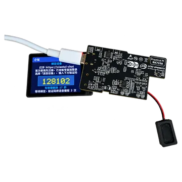
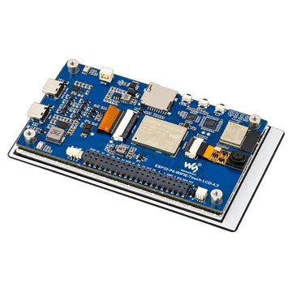
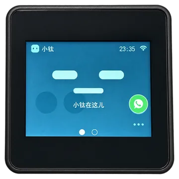
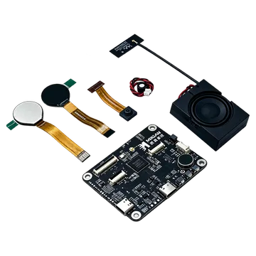

# 固件下载与开发入口

[快速体验](../README.md) · [开发板目录](boards/README.md) · [架构与二次开发](../ARCHITECTURE.md)

选择与你的开发板匹配的正式固件，按烧录指南完成配网和绑定，即可体验该板支持的功能。
准备修改代码时，可以先用发布固件确认硬件和服务连接正常，再按本页末尾的[二次开发](#二次开发)入口搭建环境。

下载前核对实物型号、PCB 版本和屏幕控制器。同一芯片的不同开发板不能混用固件；
M5 需要区分 ILI9342E / ILI9342C 屏幕，觅感 BK7258 使用包含双屏眼睛显示的统一固件。

| 使用场景 | 选择文件 | 烧录方式 |
|---|---|---|
| ESP32 首次体验 | 完整镜像 BIN | 从 `0x0` 写入；会覆盖 Wi-Fi、绑定等 NVS 配置，烧录后重新配网和绑定 |
| ESP32 保留配置升级 | 固件包 ZIP | 解压后按清单分文件烧录，先核对分区与配置兼容性，不执行全片擦除 |
| BK7258 首次体验 | 固件包 ZIP | 解压后选择 `-all-app.bin`，按本板指南通过串口烧录 |

BK 包内的 `-app_pack.rbl` 用于 OTA 升级，不能用于首次串口烧录；觅感 OTA 尚未专项验收。

核验下载文件时，使用对应发布页的 `SHA256SUMS`；包内文件、版本和烧录地址见 `MANIFEST.json`。
各版本的验证范围和已知问题见发布说明，历史版本可在 [GitHub Releases](https://github.com/tangeai/xiaotai/releases) 中查找。

## 立创·实战派 BK7258

使用立创·实战派 BK7258 对应固件，首次烧录的完整镜像包含在 ZIP 中。

| 适用硬件 | 当前正式版 | 完整镜像（BIN） | 固件包（ZIP） | 发布说明 |
|---|---|---|---|---|
| 立创·实战派 BK7258 | v1.0.2 · build.73 | 包含在 ZIP 中 | [下载 ZIP](https://github.com/tangeai/xiaotai/releases/download/bk7258-v1.0.2-build.73/lckfb-bk7258-1.0.2%2Bbuild.73-validation.zip) | [查看说明](https://github.com/tangeai/xiaotai/releases/tag/bk7258-v1.0.2-build.73) |

[烧录指南](boards/lckfb-bk7258/README.md#烧录) · [硬件资料](boards/lckfb-bk7258/README.md#规格) · [编译与调试](boards/lckfb-bk7258/README.md#开发目录)

## 立创·实战派 ESP32-S3

适用于 PCB V1.0.1，下载前请核对板上的版本标识。

| 适用硬件 | 当前正式版 | 完整镜像（BIN） | 固件包（ZIP） | 发布说明 |
|---|---|---|---|---|
| PCB V1.0.1 | v1.1.0 · build.45 | [下载 BIN](https://github.com/tangeai/xiaotai/releases/download/lckfb-esp32s3-v1.1.0-build.45/lckfb-esp32s3-1.1.0%2Bbuild.45-merged.bin) | [下载 ZIP](https://github.com/tangeai/xiaotai/releases/download/lckfb-esp32s3-v1.1.0-build.45/lckfb-esp32s3-1.1.0%2Bbuild.45-validation.zip) | [查看说明](https://github.com/tangeai/xiaotai/releases/tag/lckfb-esp32s3-v1.1.0-build.45) |

本版新增 AI 音频识别，功能和验证范围见[版本说明](boards/lckfb-esp32s3/RELEASE_NOTES_1.1.0.md)。

[烧录指南](boards/lckfb-esp32s3/README.md#烧录) · [硬件资料](boards/lckfb-esp32s3/README.md#规格) · [编译与调试](boards/lckfb-esp32s3/README.md#开发)

## 微雪 ESP32-P4-WIFI6-Touch-LCD-4.3

适用于 4.3 英寸屏、PCB V1.0 的型号，请核对屏幕尺寸和板卡版本。

| 适用硬件 | 当前正式版 | 完整镜像（BIN） | 固件包（ZIP） | 发布说明 |
|---|---|---|---|---|
| PCB V1.0 | v1.1.0 · build.27 | [下载 BIN](https://github.com/tangeai/xiaotai/releases/download/waveshare-esp32p4-touch-lcd-43c-v10-v1.1.0/waveshare-esp32p4-touch-lcd-43c-v10-1.1.0%2Bbuild.27-merged.bin) | [下载 ZIP](https://github.com/tangeai/xiaotai/releases/download/waveshare-esp32p4-touch-lcd-43c-v10-v1.1.0/waveshare-esp32p4-touch-lcd-43c-v10-1.1.0%2Bbuild.27-validation.zip) | [查看说明](https://github.com/tangeai/xiaotai/releases/tag/waveshare-esp32p4-touch-lcd-43c-v10-v1.1.0) |

[烧录指南](boards/waveshare-esp32p4-touch-lcd-43c-v10/README.md#烧录) · [硬件资料](boards/waveshare-esp32p4-touch-lcd-43c-v10/README.md#规格) · [编译与调试](boards/waveshare-esp32p4-touch-lcd-43c-v10/README.md#开发)

## M5Stack CoreS3-Lite

型号为 K128-Lite。请确认屏幕控制器为 ILI9342E 或 ILI9342C，再选择对应固件；仅凭外观无法区分。

| 适用硬件 | 当前正式版 | 完整镜像（BIN） | 固件包（ZIP） | 发布说明 |
|---|---|---|---|---|
| ILI9342E | 暂无可用发布附件 | — | — | [历史验证记录](../boards/m5stack/cores3-lite/VALIDATION.md) |
| ILI9342C | v1.0.1 · build.48 | [下载 BIN](https://github.com/tangeai/xiaotai/releases/download/m5stack-cores3-lite-v1.0.1-build.48-ili9342c/m5stack-cores3-lite-1.0.1%2Bbuild.48-merged.bin) | [下载 ZIP](https://github.com/tangeai/xiaotai/releases/download/m5stack-cores3-lite-v1.0.1-build.48-ili9342c/m5stack-cores3-lite-1.0.1%2Bbuild.48-validation.zip) | [查看说明](https://github.com/tangeai/xiaotai/releases/tag/m5stack-cores3-lite-v1.0.1-build.48-ili9342c) |

ILI9342E 的历史 build.47 发布附件当前不可用，可按本板指南从源码编译并自行验证；不要使用 ILI9342C 固件替代。

[烧录指南](boards/m5stack-cores3-lite/README.md#烧录) · [硬件资料](boards/m5stack-cores3-lite/README.md#规格) · [编译与调试](boards/m5stack-cores3-lite/README.md#开发)

## 觅感 AI 玩具开发板 BK7258

适用于配备双屏眼睛、8 MiB Flash 的觅感开发板，使用统一固件。

| 适用硬件 | 当前正式版 | 完整镜像（BIN） | 固件包（ZIP） | 发布说明 |
|---|---|---|---|---|
| 双屏眼睛 · 8 MiB Flash | v1.0.3 · build.26 | 包含在 ZIP 中 | [下载 ZIP](https://github.com/tangeai/xiaotai/releases/download/mgkfb-bk7258-v1.0.3-build.26/mgkfb-bk7258-1.0.3%2Bbuild.26-validation.zip) | [查看说明](https://github.com/tangeai/xiaotai/releases/tag/mgkfb-bk7258-v1.0.3-build.26) |

[烧录指南](boards/mgkfb-bk7258/README.md#烧录) · [硬件资料](boards/mgkfb-bk7258/README.md#规格) · [编译与调试](boards/mgkfb-bk7258/README.md#开发目录)

## 二次开发

需要修改功能或适配硬件时，先阅读[架构与二次开发](../ARCHITECTURE.md)，了解产品逻辑、
平台适配和板级驱动的边界。工具链、SDK 依赖、原生工程目录以及编译和调试步骤，见上方对应开发板的指南。

从当前源码开始开发，按[源码编译说明](../README.md#从源码编译)获取仓库，使用
`tools/build.py --board <board-id>` 选择目标板构建。M5 还需按实际屏幕选择变体。
需要复现已发布版本时，从对应 Release 的标签检出源码；主分支可能包含尚未发布的修改。

发布固件的在线功能仍依赖绑定与信令平台、TiRTC 以及所用的 AI 或微信服务。
接入自建平台时，需要配置服务地址和授权凭证，具体要求见[项目说明](../README.md)。
修改后的固件应重新完成对应功能的实板验证，测试方法见[测试与硬件验证](../tests/README.md)。

准备提交或发布修改时，参照[参与开发](../CONTRIBUTING.md)；下载页的更新范围见
[下载入口维护](../CONTRIBUTING.md#下载入口维护)。
